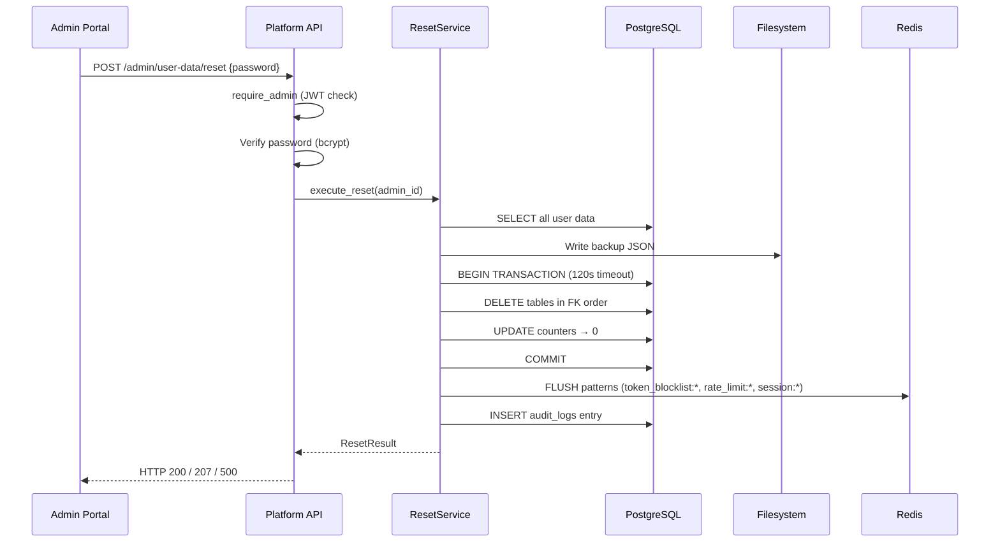
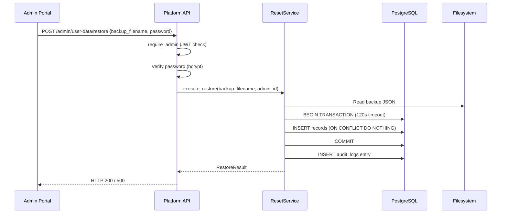

# Design Document: Admin User Data Reset

## Overview

This feature adds a destructive "reset all user data" capability to the admin portal, backed by automatic backup creation before any wipe and a restore-from-backup option. The system spans the Platform API (FastAPI) and the Admin Portal (React SPA).

**Key design decisions:**
1. **Single-transaction atomicity** — All database deletions execute within one transaction (120s timeout) to guarantee all-or-nothing semantics.
2. **Backup-first guarantee** — The backup must succeed before any deletion starts. If backup fails, the reset aborts.
3. **Password re-verification** — The admin must re-enter their password for both reset and restore, with rate limiting (5 attempts / 15 min lockout).
4. **FK-ordered deletion** — Tables are deleted in reverse dependency order to avoid constraint violations without needing to disable FK checks.
5. **Partial-success reporting** — If Redis flush fails after a successful DB commit, return HTTP 207 with details rather than hiding the partial failure.

## Architecture





## Components and Interfaces

### Backend Components

#### 1. ResetService (`platform_api/services/reset_service.py`)

The core orchestrator for backup, reset, and restore operations.

```python
class ResetService:
    """Orchestrates user data backup, reset, and restore operations."""

    def __init__(
        self,
        pool: AsyncPGPool,
        redis: Redis,
        audit_service: AuditService,
        backup_dir: str,
    ) -> None: ...

    async def execute_reset(self, admin_id: str) -> ResetResult:
        """Create backup then wipe all user data in a single transaction.
        
        Returns:
            ResetResult with backup_filename, tables_cleared, record_counts,
            redis_flushed status.
        Raises:
            BackupCreationError: If backup write fails (aborts reset).
            ResetExecutionError: If any DB operation fails (rolls back).
        """
        ...

    async def execute_restore(self, backup_filename: str, admin_id: str) -> RestoreResult:
        """Restore user data from a backup file.
        
        Returns:
            RestoreResult with records_restored count and skipped count.
        Raises:
            FileNotFoundError: If backup file doesn't exist.
            RestoreExecutionError: If any insert fails (rolls back).
        """
        ...

    async def list_backups(self) -> list[BackupMetadata]:
        """List available backups sorted newest-first, max 100."""
        ...

    async def create_backup(self, admin_id: str) -> BackupMetadata:
        """Create a backup of all user data without performing a reset."""
        ...
```

#### 2. ResetRepository (`platform_api/repositories/reset_repo.py`)

Handles raw SQL operations for bulk deletion and restoration.

```python
class ResetRepository:
    """Low-level database operations for user data reset and restore."""

    def __init__(self, pool: AsyncPGPool) -> None: ...

    async def fetch_all_user_data(self, exclude_admin_email: str) -> dict[str, list[dict]]:
        """Fetch all rows from user data tables for backup.
        
        Returns:
            Dict mapping table_name → list of row dicts (JSON-serializable).
        """
        ...

    async def delete_user_data_in_transaction(
        self, conn: Connection, exclude_admin_email: str
    ) -> dict[str, int]:
        """Delete all user data rows in FK dependency order within an existing transaction.
        
        Returns:
            Dict mapping table_name → deleted_row_count.
        """
        ...

    async def reset_counters_in_transaction(self, conn: Connection) -> dict[str, int]:
        """Reset redeem_codes.current_redemptions and invitation_codes.current_uses to 0.
        
        Returns:
            Dict mapping table_name → updated_row_count.
        """
        ...

    async def restore_data_in_transaction(
        self, conn: Connection, data: dict[str, list[dict]]
    ) -> tuple[int, int]:
        """Insert backup data into tables, skipping PK conflicts.
        
        Returns:
            Tuple of (records_inserted, records_skipped).
        """
        ...
```

#### 3. Admin Router Extension (`platform_api/routers/admin.py`)

New endpoints added to the existing admin router:

```python
# New endpoints on the existing admin router

@router.post("/user-data/reset")
async def reset_user_data(
    request: ResetRequest,         # {password: str}
    ctx: AdminDep,
    reset_service: ResetServiceDep,
) -> ResetResponse: ...

@router.get("/user-data/backups")
async def list_backups(
    ctx: AdminDep,
    reset_service: ResetServiceDep,
) -> BackupListResponse: ...

@router.post("/user-data/restore")
async def restore_user_data(
    request: RestoreRequest,       # {backup_filename: str, password: str}
    ctx: AdminDep,
    reset_service: ResetServiceDep,
) -> RestoreResponse: ...
```

#### 4. Password Verification Helper

```python
async def verify_admin_password(
    admin_id: str,
    password: str,
    pool: AsyncPGPool,
    redis: Redis,
) -> None:
    """Verify admin password with rate limiting.
    
    Raises:
        AuthenticationError: Wrong password (401).
        RateLimitExceededError: Too many failed attempts (429).
    """
    ...
```

#### 5. Rate Limiter for Password Attempts

```python
class PasswordAttemptLimiter:
    """Tracks failed password attempts per admin in Redis."""

    REDIS_KEY_PREFIX = "reset_pwd_attempts:"
    MAX_ATTEMPTS = 5
    LOCKOUT_SECONDS = 900  # 15 minutes

    def __init__(self, redis: Redis) -> None: ...

    async def check_and_increment(self, admin_id: str) -> None:
        """Check if admin is locked out; if not, increment failure count.
        
        Raises:
            RateLimitExceededError: If attempts >= MAX_ATTEMPTS within window.
        """
        ...

    async def reset(self, admin_id: str) -> None:
        """Clear failed attempts on successful verification."""
        ...
```

### Frontend Components

#### 6. UserDataManagementSection (`admin_portal/src/pages/settings/user-data-section.tsx`)

New tab section added to the Settings page.

```typescript
interface UserDataManagementSectionProps {}

export function UserDataManagementSection(): JSX.Element {
  // State: password dialog open, operation in progress, selected backup
  // Renders: Reset button (destructive), backup list, restore buttons
}
```

#### 7. PasswordConfirmDialog (`admin_portal/src/components/shared/password-confirm-dialog.tsx`)

Reusable password confirmation dialog (extends existing ConfirmDialog pattern).

```typescript
interface PasswordConfirmDialogProps {
  open: boolean;
  onOpenChange: (open: boolean) => void;
  title: string;
  description: string;
  onConfirm: (password: string) => void;
  isLoading?: boolean;
  error?: string | null;
}

export function PasswordConfirmDialog(props: PasswordConfirmDialogProps): JSX.Element;
```

#### 8. useUserDataReset Hook (`admin_portal/src/hooks/use-user-data-reset.ts`)

```typescript
interface BackupEntry {
  filename: string;
  created_at: string;
  file_size_bytes: number;
  total_records: number;
  tables: string[];
}

interface ResetResult {
  backup_filename: string;
  tables_cleared: string[];
  record_counts: Record<string, number>;
  redis_flushed: boolean;
}

interface RestoreResult {
  records_restored: number;
  records_skipped: number;
}

export function useBackupList(): UseQueryResult<BackupEntry[]>;
export function useResetUserData(): UseMutationResult<ResetResult, Error, { password: string }>;
export function useRestoreUserData(): UseMutationResult<RestoreResult, Error, { backup_filename: string; password: string }>;
```

## Data Models

### Request/Response Schemas (Pydantic)

```python
from pydantic import BaseModel, Field

class ResetRequest(BaseModel):
    password: str = Field(..., min_length=1, max_length=200)

class RestoreRequest(BaseModel):
    backup_filename: str = Field(..., min_length=1, max_length=300, pattern=r'^backup_\d{4}-\d{2}-\d{2}T\d{2}-\d{2}-\d{2}Z\.json$')
    password: str = Field(..., min_length=1, max_length=200)

class ResetResponse(BaseModel):
    status: str  # "success" or "partial"
    backup_filename: str
    tables_cleared: list[str]
    record_counts: dict[str, int]
    total_records_deleted: int
    redis_flushed: bool
    redis_error: str | None = None

class BackupMetadataResponse(BaseModel):
    filename: str
    created_at: str  # ISO 8601
    file_size_bytes: int
    total_records: int
    tables: list[str]
    actor_id: str | None = None

class BackupListResponse(BaseModel):
    backups: list[BackupMetadataResponse]

class RestoreResponse(BaseModel):
    status: str  # "success"
    backup_filename: str
    records_restored: int
    records_skipped: int
```

### Backup File Format (JSON)

```json
{
  "metadata": {
    "created_at": "2026-07-13T10:30:00Z",
    "total_records": 15432,
    "tables": ["users", "refresh_tokens", "..."],
    "actor_id": "uuid-of-admin",
    "version": 1
  },
  "data": {
    "users": [
      {"id": "...", "email": "...", "password_hash": "...", ...}
    ],
    "refresh_tokens": [...],
    "credit_wallets": [...],
    ...
  }
}
```

### Domain Models

```python
from dataclasses import dataclass
from datetime import datetime

@dataclass(frozen=True)
class BackupMetadata:
    filename: str
    created_at: datetime
    file_size_bytes: int
    total_records: int
    tables: list[str]
    actor_id: str | None = None

@dataclass(frozen=True)
class ResetResult:
    backup_filename: str
    tables_cleared: list[str]
    record_counts: dict[str, int]
    total_records_deleted: int
    redis_flushed: bool
    redis_error: str | None = None

@dataclass(frozen=True)
class RestoreResult:
    backup_filename: str
    records_restored: int
    records_skipped: int
```

### FK-Ordered Deletion Sequence

Tables are deleted in this exact order to respect foreign key constraints (leaf tables first):

```python
DELETION_ORDER: list[str] = [
    # Leaf tables (no dependents)
    "batch_channel_assets",
    "profile_video_templates",
    "image_jobs",
    "suno_tasks",
    "songs",
    "batches",
    "youtube_connected_accounts",
    "youtube_connect_sessions",
    "credit_transactions",
    "credit_wallets",
    "notification_queue",
    "user_settings",
    "refresh_tokens",
    "usage_tracking",
    "plan_usage",
    "onboarding_ai_usage",
    "onboarding_drafts",
    "billing_payments",
    "redeem_code_redemptions",
    "invitation_code_redemptions",
    "licenses",
    "client_log_batches",
    "audit_logs",
    "channel_profiles",
    # Conditional deletes (user-owned only)
    # music_descriptions WHERE user_id IS NOT NULL
    # music_structures WHERE user_id IS NOT NULL
    # Parent table last
    "users",  # WHERE email != 'admin@mgfaceless.com'
]
```

### Redis Flush Patterns

```python
REDIS_FLUSH_PATTERNS: list[str] = [
    "token_blocklist:*",
    "rate_limit:*",
    "session:*",
]
```

## Correctness Properties

*A property is a characteristic or behavior that should hold true across all valid executions of a system — essentially, a formal statement about what the system should do. Properties serve as the bridge between human-readable specifications and machine-verifiable correctness guarantees.*

### Property 1: Backup completeness

*For any* set of user data records across all user-data tables, after backup creation, the backup JSON file shall contain every record from every user-data table (excluding the admin account row), with no records missing or duplicated.

**Validates: Requirements 2.2**

### Property 2: Backup metadata and filename correctness

*For any* backup created at any UTC datetime, the backup filename shall match the pattern `backup_YYYY-MM-DDThh-mm-ssZ.json` and the metadata shall contain a valid creation timestamp, accurate total record count matching the sum of all data arrays, the complete list of table names, and the triggering admin's actor ID.

**Validates: Requirements 2.3, 2.4**

### Property 3: Admin account preservation

*For any* database state containing any number of user accounts, after a successful reset operation, the admin account row (email = admin@mgfaceless.com) shall remain in the users table with all its columns unchanged.

**Validates: Requirements 3.2**

### Property 4: System configuration preservation

*For any* database state with system configuration data across all system config tables (plans, plan_offers, credit_packs, etc.), after a successful reset operation, all system config rows shall remain unchanged — same count, same data.

**Validates: Requirements 3.3**

### Property 5: Counter reset to zero

*For any* set of redeem_codes with current_redemptions values in [0, N] and invitation_codes with current_uses values in [0, M], after a successful reset operation, all redeem_codes.current_redemptions and all invitation_codes.current_uses shall equal 0.

**Validates: Requirements 3.4, 3.5**

### Property 6: Audit log per-table accuracy

*For any* reset operation that deletes known record counts per table, the resulting audit_logs entry metadata shall contain a per-table breakdown where each table's count matches the actual number of rows deleted from that table.

**Validates: Requirements 3.10**

### Property 7: Backup listing sorted and bounded

*For any* set of backup files on the filesystem with varying creation timestamps, the backup list endpoint shall return entries sorted in strictly descending order by creation date, containing at most 100 entries, with each entry including filename, creation timestamp, file size, total record count, and table names.

**Validates: Requirements 4.1, 4.2**

### Property 8: Restore inserts non-conflicting records

*For any* backup file containing user records, and any current database state (which may contain some of those records already), a restore operation shall insert all records whose primary keys do not already exist in the database, skip all records whose primary keys conflict, and the final database state shall be the union of pre-existing rows and newly inserted non-conflicting rows.

**Validates: Requirements 5.3**

### Property 9: Authorization enforcement

*For any* HTTP request to the reset, backup-list, or restore endpoints, if the request lacks a valid JWT token the endpoint shall return HTTP 401, and if the request has a valid token but without admin role the endpoint shall return HTTP 403, with 401 checks taking precedence over 403 checks.

**Validates: Requirements 7.1, 7.2, 7.3, 7.4**

## Error Handling

| Scenario | HTTP Status | Response | Recovery |
|----------|-------------|----------|----------|
| Invalid/missing JWT | 401 | `{"detail": "Authentication required."}` | Re-login |
| Non-admin role | 403 | `{"detail": "Admin privileges required."}` | N/A |
| Wrong password | 401 | `{"detail": "Invalid credentials."}` | Retry (up to 5x) |
| Rate limited (5 failures) | 429 | `{"detail": "Too many failed attempts. Try again in 15 minutes."}` | Wait 15 min |
| Backup creation failed | 500 | `{"detail": "Backup creation failed, reset aborted."}` | Check disk space |
| DB deletion/restore failed | 500 | `{"detail": "Operation failed: {table_name} - {error}. Transaction rolled back."}` | Investigate DB |
| Redis flush failed (after DB success) | 207 | `{"status": "partial", "redis_flushed": false, "redis_error": "..."}` | Manual Redis flush |
| Backup file not found | 404 | `{"detail": "Backup not found."}` | Check filesystem |
| Backup file unreadable/corrupt | 500 | `{"detail": "Failed to read backup file: {error}"}` | Check file integrity |
| Network timeout (frontend) | N/A | Toast: "Request timed out. Please try again." | Retry |

### Error Hierarchy

```python
class ResetError(Exception):
    """Base error for reset operations."""
    pass

class BackupCreationError(ResetError):
    """Backup write failed — reset must be aborted."""
    pass

class ResetExecutionError(ResetError):
    """Database deletion failed — transaction rolled back."""
    def __init__(self, table: str, detail: str): ...

class RestoreExecutionError(ResetError):
    """Restore insert failed — transaction rolled back."""
    def __init__(self, table: str, detail: str): ...

class RateLimitExceededError(ResetError):
    """Too many failed password attempts."""
    pass
```

## Testing Strategy

### Property-Based Tests (Hypothesis)

Property-based testing is appropriate for this feature because the core logic involves data transformations (backup/restore), invariant preservation (admin account, system config), and operations that must hold across any valid database state.

**Library:** Hypothesis (Python)  
**Configuration:** Minimum 100 iterations per property test  
**Tag format:** `Feature: admin-user-data-reset, Property {N}: {description}`

Properties to implement as PBT:
- Property 1: Backup completeness (generate random user data → backup → verify all present)
- Property 2: Backup metadata correctness (generate random timestamps → verify format)
- Property 3: Admin account preservation (generate random users including admin → reset → verify admin exists)
- Property 4: System config preservation (generate random config rows → reset → verify unchanged)
- Property 5: Counter reset (generate codes with random counters → reset → verify all 0)
- Property 6: Audit log accuracy (generate known data → reset → verify counts match)
- Property 7: Backup listing (generate random backup files → list → verify sorted, bounded)
- Property 8: Restore idempotence (generate backup + existing state → restore → verify union)
- Property 9: Authorization (generate various auth states → verify correct status codes)

### Unit Tests (pytest)

Example-based tests for specific scenarios:
- Password verification: correct password → proceeds; wrong → 401
- Rate limiting: 5 failures → 429 on 6th attempt
- Backup file not found → 404
- DB failure mid-transaction → rollback + 500
- Redis failure after commit → 207 partial response
- Filename pattern validation for restore requests

### Frontend Tests (Vitest + fast-check)

- Component rendering: UserDataManagementSection displays correctly
- PasswordConfirmDialog: button disabled when empty, enabled when typed
- Reset flow: click → dialog → confirm → loading → success toast
- Error states: API failure → error toast persists
- Backup list: renders sorted entries with correct formatting
- Loading states: buttons disabled during operations

### Integration Tests

- Full reset flow: seed DB → reset → verify all user tables empty, admin preserved, config intact
- Full restore flow: reset → restore from backup → verify data matches original
- Transaction rollback: inject failure → verify no partial state
- Redis flush: verify key patterns cleared after successful reset
