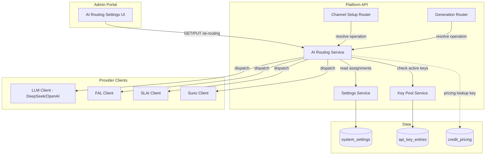
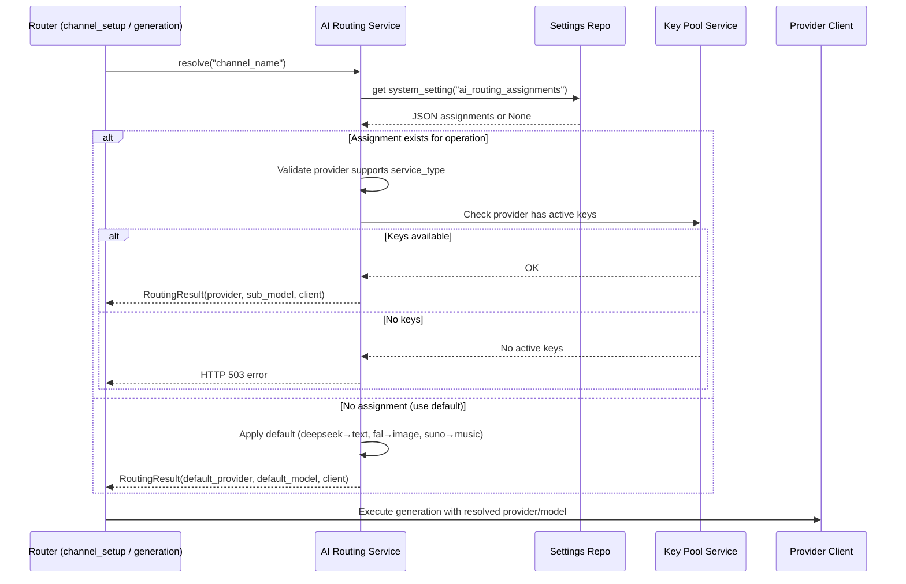

# Design Document: AI Model Routing

## Overview

The AI Model Routing system provides a configurable dispatch layer that sits between the platform API's generation endpoints and the Key Pool / provider clients. Instead of hardcoding which AI provider handles each operation (e.g., "always use DeepSeek for text"), an admin can assign any compatible provider (and optionally a sub-model) per operation via the Settings page. The routing service resolves these assignments at request time, then delegates to the existing key-pool-wrapped clients.

### Key Design Goals

- **Decoupled provider selection**: Operations (channel_name, channel_logo, etc.) are mapped to providers via stored assignments rather than code-level hardcoding
- **Immediate effect**: Admin changes take effect on the next request with no restart required
- **Capability validation**: Only providers that support the operation's service type AND have active keys appear as options
- **Single source of truth**: Desktop app never stores or selects AI providers/API keys locally; it only calls Platform API endpoints and the backend applies Admin Portal routing + Key Pool at request time
- **Credit integration**: Credit pricing lookups use the resolved provider + specific operation name for per-operation granularity
- **Minimal disruption**: Integrates into existing layered architecture (Router → Service → Client) without restructuring

### Technology Choices

- **Storage**: `system_settings` table (existing) — single JSON value keyed as `ai_routing_assignments`
- **Registry**: Python code constants (frozen dicts / StrEnums) — operations and capabilities are fixed at build time
- **Admin UI**: New "AI Routing" section on the existing Settings page (shadcn/ui + React Query)
- **Testing**: Hypothesis for property-based tests on the routing resolution logic

## Architecture

### High-Level Integration



### Request Flow (Routing Resolution)



## Components and Interfaces

### New Files Structure

```
platform_api/
├── services/
│   └── ai_routing_service.py      # Core routing logic + registry constants
├── routers/
│   └── ai_routing.py              # Admin API endpoints (GET/PUT)
└── tests/
    └── test_ai_routing_service.py # Property-based + unit tests
```

```
admin_portal/src/
├── pages/
│   └── settings/
│       └── ai-routing-section.tsx  # AI Routing card within Settings page
├── hooks/
│   └── use-ai-routing.ts          # React Query hooks
└── types/
    └── ai-routing.ts              # TypeScript interfaces
```

### Service Type Registry (Code Constants)

```python
"""AI Routing constants — code-level registry of service types, operations, and capabilities."""

from enum import StrEnum


class ServiceType(StrEnum):
    """Categories of AI work."""
    TEXT_GENERATION = "text_generation"
    IMAGE_GENERATION = "image_generation"
    MUSIC_GENERATION = "music_generation"


class Operation(StrEnum):
    """Specific platform operations, each belonging to one ServiceType."""
    # Text generation
    CHANNEL_NAME = "channel_name"
    CHANNEL_DESCRIPTION = "channel_description"
    CHANNEL_KEYWORDS = "channel_keywords"
    CHANNEL_TAGS = "channel_tags"
    LYRIC = "lyric"
    TITLE = "title"
    ALBUM = "album"
    # Image generation
    CHANNEL_LOGO = "channel_logo"
    CHANNEL_COVER = "channel_cover"
    BACKGROUND_IMAGE = "background_image"
    THUMBNAIL_IMAGE = "thumbnail_image"
    # Music generation
    MUSIC = "music"


# Maps each operation to its service type
OPERATION_SERVICE_TYPE: dict[Operation, ServiceType] = {
    Operation.CHANNEL_NAME: ServiceType.TEXT_GENERATION,
    Operation.CHANNEL_DESCRIPTION: ServiceType.TEXT_GENERATION,
    Operation.CHANNEL_KEYWORDS: ServiceType.TEXT_GENERATION,
    Operation.CHANNEL_TAGS: ServiceType.TEXT_GENERATION,
    Operation.LYRIC: ServiceType.TEXT_GENERATION,
    Operation.TITLE: ServiceType.TEXT_GENERATION,
    Operation.ALBUM: ServiceType.TEXT_GENERATION,
    Operation.CHANNEL_LOGO: ServiceType.IMAGE_GENERATION,
    Operation.CHANNEL_COVER: ServiceType.IMAGE_GENERATION,
    Operation.BACKGROUND_IMAGE: ServiceType.IMAGE_GENERATION,
    Operation.THUMBNAIL_IMAGE: ServiceType.IMAGE_GENERATION,
    Operation.MUSIC: ServiceType.MUSIC_GENERATION,
}

# Which service types each provider supports
PROVIDER_CAPABILITIES: dict[str, set[ServiceType]] = {
    "deepseek": {ServiceType.TEXT_GENERATION},
    "openai": {ServiceType.TEXT_GENERATION, ServiceType.IMAGE_GENERATION},
    "fal": {ServiceType.IMAGE_GENERATION},
    "slai": {ServiceType.TEXT_GENERATION, ServiceType.IMAGE_GENERATION},
    "suno": {ServiceType.MUSIC_GENERATION, ServiceType.TEXT_GENERATION},
}

# Sub-model options per provider per service type
PROVIDER_SUB_MODELS: dict[str, dict[ServiceType, list[str]]] = {
    "openai": {
        ServiceType.TEXT_GENERATION: ["gpt-4o", "gpt-4o-mini", "gpt-4-turbo"],
        ServiceType.IMAGE_GENERATION: ["dall-e-3", "dall-e-2"],
    },
    "fal": {
        ServiceType.IMAGE_GENERATION: ["flux-pro", "flux-dev", "flux-schnell"],
    },
    "deepseek": {
        ServiceType.TEXT_GENERATION: ["deepseek-chat", "deepseek-reasoner"],
    },
    "slai": {},  # Single default, no sub-models
    "suno": {},  # Single default, no sub-models
}

# Default providers per service type (used when no assignment exists)
DEFAULT_PROVIDER: dict[ServiceType, str] = {
    ServiceType.TEXT_GENERATION: "deepseek",
    ServiceType.IMAGE_GENERATION: "fal",
    ServiceType.MUSIC_GENERATION: "suno",
}

DEFAULT_SUB_MODEL: dict[str, str] = {
    "deepseek": "deepseek-chat",
    "fal": "flux-pro",
}
```

### AI Routing Service Interface

```python
from dataclasses import dataclass
from typing import Protocol


@dataclass(frozen=True)
class RoutingResult:
    """Result of resolving an operation to a specific provider."""
    provider: str          # e.g. "deepseek", "openai", "fal"
    sub_model: str | None  # e.g. "gpt-4o-mini", "flux-pro", None
    service_type: str      # e.g. "text_generation"


class AIRoutingServicePort(Protocol):
    """Protocol for AI routing resolution."""

    async def resolve(self, operation: str) -> RoutingResult:
        """Resolve an operation to its assigned provider and sub-model.

        Falls back to default if no assignment exists.
        Raises ExternalServiceError (503) if the resolved provider has no active keys.
        """
        ...

    async def get_all_assignments(self) -> dict[str, dict]:
        """Return all current assignments grouped by service type.

        Returns:
            {
                "text_generation": {
                    "channel_name": {"provider": "deepseek", "sub_model": "deepseek-chat"},
                    ...
                },
                "image_generation": { ... },
                "music_generation": { ... },
            }
        """
        ...

    async def save_assignments(self, assignments: dict[str, dict]) -> None:
        """Persist all assignments atomically to system_settings."""
        ...

    async def get_available_providers(self) -> dict[str, list[dict]]:
        """Return providers per service type filtered by active Key Pool keys.

        Returns:
            {
                "text_generation": [
                    {"provider": "deepseek", "sub_models": ["deepseek-chat", "deepseek-reasoner"]},
                    {"provider": "openai", "sub_models": ["gpt-4o", "gpt-4o-mini", "gpt-4-turbo"]},
                ],
                ...
            }
        """
        ...
```

### AI Routing Service Implementation (Key Logic)

```python
class AIRoutingService:
    """Resolves operations to AI providers based on stored assignments."""

    def __init__(
        self,
        settings_repo: SettingsRepositoryPort,
        key_pool_service: KeyPoolServicePort,
    ) -> None:
        self._settings_repo = settings_repo
        self._key_pool = key_pool_service

    async def resolve(self, operation: str) -> RoutingResult:
        op = Operation(operation)
        service_type = OPERATION_SERVICE_TYPE[op]

        # Load assignments from system_settings
        assignments = await self._load_assignments()
        assignment = assignments.get(operation)

        if assignment:
            provider = assignment["provider"]
            sub_model = assignment.get("sub_model")
        else:
            # Use default
            provider = DEFAULT_PROVIDER[service_type]
            sub_model = DEFAULT_SUB_MODEL.get(provider)

        # Validate provider still supports this service type
        if service_type not in PROVIDER_CAPABILITIES.get(provider, set()):
            provider = DEFAULT_PROVIDER[service_type]
            sub_model = DEFAULT_SUB_MODEL.get(provider)

        # Check Key Pool has active keys
        has_keys = await self._key_pool.has_active_keys(provider)
        if not has_keys:
            raise ExternalServiceError(
                f"No active API keys for provider '{provider}'. "
                f"Configure keys on the Key Pool page.",
                status_code=503,
                details={"provider": provider, "operation": operation},
            )

        return RoutingResult(
            provider=provider,
            sub_model=sub_model,
            service_type=service_type,
        )

    async def _load_assignments(self) -> dict[str, dict]:
        """Load the flat operation→assignment map from system_settings."""
        raw = await self._settings_repo.get_system_setting("ai_routing_assignments")
        if raw is None:
            return {}
        import json
        return json.loads(raw) if isinstance(raw, str) else raw
```

### Admin API Endpoints

```python
# platform_api/routers/ai_routing.py

router = APIRouter(prefix="/admin/ai-routing", tags=["ai-routing"])


@router.get("")
async def get_assignments(
    routing_service: AIRoutingServiceDep,
    _: AdminAuthDep,
) -> dict:
    """Return all operation assignments grouped by service type."""
    return await routing_service.get_all_assignments()


@router.put("")
async def save_assignments(
    request: SaveAssignmentsRequest,
    routing_service: AIRoutingServiceDep,
    _: AdminAuthDep,
) -> dict:
    """Persist all assignments atomically."""
    await routing_service.save_assignments(request.assignments)
    return {"status": "saved"}


@router.get("/providers")
async def get_providers(
    routing_service: AIRoutingServiceDep,
    _: AdminAuthDep,
) -> dict:
    """Return available providers per service type (filtered by active keys)."""
    return await routing_service.get_available_providers()
```

### Integration with Channel Setup Router

The existing `channel_setup.py` endpoints will be modified to inject and call the routing service:

```python
# Before (hardcoded):
result = await gen.generate_chat_text(system_prompt=system, user_prompt=prompt, model="deepseek-chat")
# ...
await credit_svc.execute_with_credits(user_id=ctx.user_id, ai_service="deepseek", operation_type="text_generation", ...)

# After (routed):
routing = await routing_service.resolve("channel_name")
result = await gen.generate_chat_text(system_prompt=system, user_prompt=prompt, model=routing.sub_model or "deepseek-chat")
# ...
await credit_svc.execute_with_credits(user_id=ctx.user_id, ai_service=routing.provider, operation_type="channel_name", ...)
```

Each endpoint maps to a specific `Operation`:
| Endpoint | Operation |
|----------|-----------|
| `generate-names` | `channel_name` |
| `generate-description` | `channel_description` (description field), `channel_keywords` (keywords), `channel_tags` (tags) |
| `generate-logo` | `channel_logo` |
| `generate-covers` | `channel_cover` |

### Integration with Generation Router

```python
# Before (client-supplied provider):
provider = request.provider  # "fal" or "slai"

# After (routed, operation-specific):
operation = "background_image"  # or "thumbnail_image" based on request context
routing = await routing_service.resolve(operation)
# Override request.provider with the admin-assigned one
```

### Credit Pricing Integration

Credit lookups change from generic operation types to specific operation names:

```python
# Before:
await credit_svc.execute_with_credits(
    ai_service="deepseek",
    operation_type="text_generation",  # Generic
    ...
)

# After:
routing = await routing_service.resolve("channel_name")
await credit_svc.execute_with_credits(
    ai_service=routing.provider,          # Resolved provider
    operation_type="channel_name",        # Specific operation
    fallback_operation_type="text_generation",  # Graceful fallback to old generic type
    ...
)
```

The `fallback_operation_type` parameter (already supported by `CreditOperationService`) ensures backward compatibility: if no `(provider, channel_name)` pricing entry exists yet, it falls back to `(provider, text_generation)`.

## Data Models

### Assignment Storage Format (system_settings)

Stored as a single JSON value in the `system_settings` table:

```sql
-- Key: "ai_routing_assignments"
-- value_type: "json"
-- value (JSON):
{
  "channel_name": {"provider": "deepseek", "sub_model": "deepseek-chat"},
  "channel_description": {"provider": "deepseek", "sub_model": "deepseek-chat"},
  "channel_keywords": {"provider": "deepseek", "sub_model": "deepseek-chat"},
  "channel_tags": {"provider": "deepseek", "sub_model": "deepseek-chat"},
  "channel_logo": {"provider": "fal", "sub_model": "flux-pro"},
  "channel_cover": {"provider": "fal", "sub_model": "flux-pro"},
  "lyric": {"provider": "openai", "sub_model": "gpt-4o"},
  "title": {"provider": "deepseek", "sub_model": "deepseek-chat"},
  "album": {"provider": "deepseek", "sub_model": "deepseek-chat"},
  "background_image": {"provider": "fal", "sub_model": "flux-pro"},
  "thumbnail_image": {"provider": "fal", "sub_model": "flux-dev"},
  "music": {"provider": "suno", "sub_model": null}
}
```

This flat structure (operation → assignment) is simple to read and write atomically. The grouping-by-service-type is done in the API response layer for the UI, not in storage.

### Pydantic Schemas

```python
from pydantic import BaseModel, Field


class OperationAssignment(BaseModel):
    """A single operation's provider assignment."""
    provider: str = Field(pattern=r"^(deepseek|openai|fal|slai|suno)$")
    sub_model: str | None = None


class SaveAssignmentsRequest(BaseModel):
    """Request to save all assignments."""
    assignments: dict[str, OperationAssignment]


class ProviderOption(BaseModel):
    """A provider available for a service type."""
    provider: str
    sub_models: list[str]


class AssignmentResponse(BaseModel):
    """Full assignments grouped by service type."""
    text_generation: dict[str, OperationAssignment]
    image_generation: dict[str, OperationAssignment]
    music_generation: dict[str, OperationAssignment]


class ProvidersResponse(BaseModel):
    """Available providers per service type."""
    text_generation: list[ProviderOption]
    image_generation: list[ProviderOption]
    music_generation: list[ProviderOption]
```

### TypeScript Types (Admin Portal)

```typescript
// types/ai-routing.ts

export interface OperationAssignment {
  provider: string;
  sub_model: string | null;
}

export interface ProviderOption {
  provider: string;
  sub_models: string[];
}

export interface AssignmentsResponse {
  text_generation: Record<string, OperationAssignment>;
  image_generation: Record<string, OperationAssignment>;
  music_generation: Record<string, OperationAssignment>;
}

export interface ProvidersResponse {
  text_generation: ProviderOption[];
  image_generation: ProviderOption[];
  music_generation: ProviderOption[];
}
```

### Admin Portal UI Design

The AI Routing section lives within the existing Settings page as a new Card:

```
┌─────────────────────────────────────────────────────────────────┐
│  AI Routing                                                     │
│  Configure which AI model handles each operation.               │
│  Credit costs are configured on the Credits page. →             │
│                                                                 │
│  ┌─ Text Generation ────────────────────────────────────────┐   │
│  │  Channel Name      [DeepSeek ▼] [deepseek-chat ▼]       │   │
│  │  Channel Desc      [DeepSeek ▼] [deepseek-chat ▼]       │   │
│  │  Channel Keywords  [DeepSeek ▼] [deepseek-chat ▼]       │   │
│  │  Channel Tags      [DeepSeek ▼] [deepseek-chat ▼]       │   │
│  │  Lyric             [OpenAI  ▼] [gpt-4o         ▼]       │   │
│  │  Title             [DeepSeek ▼] [deepseek-chat ▼]       │   │
│  │  Album             [DeepSeek ▼] [deepseek-chat ▼]       │   │
│  └──────────────────────────────────────────────────────────┘   │
│                                                                 │
│  ┌─ Image Generation ───────────────────────────────────────┐   │
│  │  Channel Logo      [FAL      ▼] [flux-pro      ▼]       │   │
│  │  Channel Cover     [FAL      ▼] [flux-pro      ▼]       │   │
│  │  Background Image  [FAL      ▼] [flux-dev      ▼]       │   │
│  │  Thumbnail Image   [FAL      ▼] [flux-schnell  ▼]       │   │
│  └──────────────────────────────────────────────────────────┘   │
│                                                                 │
│  ┌─ Music Generation ───────────────────────────────────────┐   │
│  │  Music             [Suno     ▼]                          │   │
│  └──────────────────────────────────────────────────────────┘   │
│                                                                 │
│                                         [ Save All Assignments ]│
└─────────────────────────────────────────────────────────────────┘
```

**UI Behavior:**
- Provider dropdown is filtered by: (a) supports the operation's service type AND (b) has active keys in Key Pool
- Sub-model dropdown appears only when the selected provider has sub-models for that service type
- If provider has no sub-models (e.g., SLAI), the sub-model dropdown is hidden
- "Save All Assignments" sends `PUT /api/v1/admin/ai-routing` with the full map
- On initial load with no saved assignments, dropdowns show defaults (DeepSeek for text, FAL for image, Suno for music)


## Correctness Properties

*A property is a characteristic or behavior that should hold true across all valid executions of a system — essentially, a formal statement about what the system should do. Properties serve as the bridge between human-readable specifications and machine-verifiable correctness guarantees.*

### Property 1: Resolve returns stored assignment

*For any* valid operation and *for any* stored assignment where the assigned provider supports the operation's service type, calling `resolve(operation)` should return a `RoutingResult` with that exact provider and sub_model.

**Validates: Requirements 4.1, 4.2**

### Property 2: Default fallback when no assignment exists

*For any* operation that has no stored assignment, `resolve(operation)` should return the default provider for that operation's service type: "deepseek" for text_generation, "fal" for image_generation, "suno" for music_generation.

**Validates: Requirements 3.3, 4.3**

### Property 3: No active keys produces 503 error

*For any* operation whose resolved provider (whether from assignment or default) has zero active keys in the Key Pool, calling `resolve(operation)` should raise an error with HTTP status 503.

**Validates: Requirements 4.4**

### Property 4: Available providers are filtered by capability and active keys

*For any* service type and *for any* Key Pool state, `get_available_providers()` should return exactly those providers that (a) have the service type in their PROVIDER_CAPABILITIES AND (b) have at least one active key in the Key Pool. No provider missing either condition should appear; no provider satisfying both should be omitted.

**Validates: Requirements 2.3, 2.4**

### Property 5: Assignment persistence round-trip

*For any* valid assignments dict (where each operation maps to a provider that supports its service type), calling `save_assignments(assignments)` then `get_all_assignments()` should produce a response where every operation in the saved dict has the same provider and sub_model as was saved.

**Validates: Requirements 3.4, 6.2**

### Property 6: GET assignments returns all operations

*For any* stored state (including empty / partial assignments), `get_all_assignments()` should return entries for every operation defined in the OPERATION_SERVICE_TYPE registry, using the stored assignment when present and the default when absent.

**Validates: Requirements 6.1**

### Property 7: Pricing key composition matches resolved provider

*For any* operation with a resolved `RoutingResult(provider=P, ...)`, the credit pricing lookup for that generation should use `(P, operation_name)` as the key — ensuring the price charged corresponds to the provider actually used.

**Validates: Requirements 5.3**

## Error Handling

### Error Categories

| Error | HTTP Status | Error Code | Trigger |
|-------|-------------|------------|---------|
| No active keys for provider | 503 | `NO_AVAILABLE_KEYS` | Resolved provider has zero active keys in Key Pool |
| Invalid operation | 422 | `VALIDATION_ERROR` | Operation string not in Operation enum |
| Invalid provider for operation | 422 | `VALIDATION_ERROR` | Assigned provider doesn't support the operation's service type |
| Settings persistence failure | 500 | `INTERNAL_ERROR` | Database error writing to system_settings |
| No pricing configured | — | — | Graceful: charge 0 credits and log warning (not a user-facing error) |

### Error Handling Strategy

```python
class AIRoutingError(PlatformAPIError):
    """Base error for AI routing failures."""
    pass


# Provider has no keys → 503
# Reuses existing NoAvailableKeysError from key_pool_service or raises ExternalServiceError
# with a clear message pointing admin to the Key Pool page.

# Invalid assignment → rejected at save time (validation in SaveAssignmentsRequest)
# The Pydantic model validates provider names and the service validates capability.
```

### Resilience Patterns

1. **Default fallback**: If the stored assignment references a provider that no longer supports the service type (e.g., capabilities changed in a code update), the system silently falls back to the default provider rather than failing.
2. **Missing pricing graceful degradation**: If no `credit_pricing` entry exists for `(provider, operation)`, the existing `CreditOperationService` charges 0 credits and logs a warning. Generation proceeds.
3. **Atomic save**: Assignments are stored as a single JSON value, so partial writes are impossible — either all assignments save or none do.
4. **Cache-friendly**: The system_settings read is a single row lookup. For high-traffic scenarios, a short Redis cache (TTL 5–10s) could be added without changing the interface.

## Testing Strategy

### Property-Based Testing (Hypothesis)

The routing logic is a pure function of (operation, assignments_state, key_pool_state) → result. This makes it ideal for property-based testing.

**Library**: Hypothesis (Python)  
**Configuration**: `@settings(max_examples=100)` minimum per property test  
**Tag format**: `# Feature: ai-model-routing, Property {number}: {property_text}`

Each correctness property maps to a single Hypothesis test:

| Property | Test Strategy | Key Generators |
|----------|---------------|----------------|
| 1: Resolve returns stored assignment | Generate random (operation, valid_assignment) pairs, mock settings_repo and key_pool | `st.sampled_from(Operation)`, `st.sampled_from(valid_providers_for_type)` |
| 2: Default fallback | Generate random operations, mock empty assignments | `st.sampled_from(Operation)` |
| 3: No keys → 503 | Generate random operations, mock key_pool to return no keys | `st.sampled_from(Operation)` |
| 4: Available providers filter | Generate random key_pool states (set of providers with keys) | `st.sets(st.sampled_from(all_providers))` |
| 5: Round-trip persistence | Generate random full assignment dicts | Custom strategy building valid assignment maps |
| 6: GET returns all operations | Generate random partial assignments | `st.dictionaries(st.sampled_from(Operation), assignment_strategy)` |
| 7: Pricing key composition | Generate random (operation, assignment), verify output | Same as Property 1 |

### Unit Tests (pytest)

- Concrete examples of each property (specific operations, specific providers)
- Edge cases: empty assignments dict, all operations assigned, provider with no sub-models
- Validation errors: invalid provider name, provider that doesn't support service type
- Admin endpoint integration tests with mocked service

### Frontend Tests (Vitest + fast-check)

- Component rendering: all operations visible, grouped by service type
- Dropdown filtering: only valid providers shown per operation
- Save button: sends correct PUT payload
- Property test (fast-check): for any valid assignment state, the form correctly round-trips through render → edit → save

### Test File Structure

```
platform_api/tests/
├── test_ai_routing_service.py       # Property-based + unit tests for routing logic
├── test_ai_routing_router.py        # Integration tests for admin endpoints
└── test_ai_routing_integration.py   # End-to-end routing through channel_setup

admin_portal/src/pages/settings/
└── __tests__/
    └── ai-routing-section.test.tsx  # Component + property tests
```
