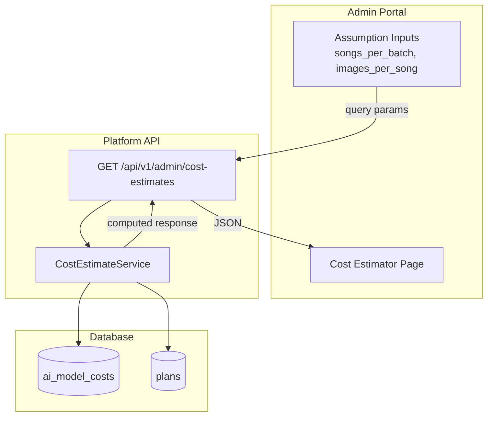
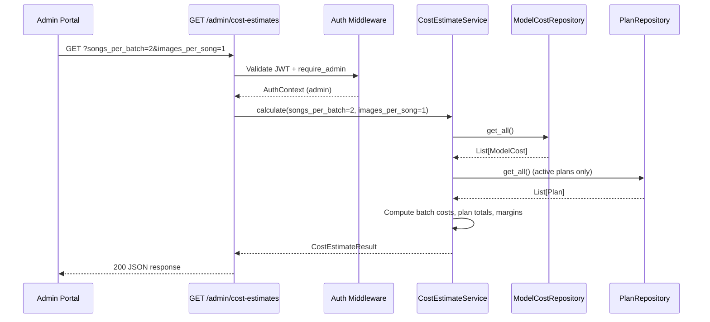

# Design Document: Cost Breakdown Estimator

## Overview

The Cost Breakdown Estimator is a read-only analytics page in the Admin Portal backed by a single dedicated API endpoint. It provides administrators with visibility into AI provider costs per batch generation cycle, plan quota economics, and profit margin analysis — enabling informed pricing decisions without complex client-side computation.

### Key Design Goals

- **Server-Side Calculation**: All cost arithmetic happens in the Platform API. The frontend is a pure display layer with configurable assumptions that trigger re-fetches.
- **Minimal Infrastructure Change**: No new database tables. The feature reads from existing `ai_model_costs` and `plans` tables.
- **Fast Feedback Loop**: Adjusting batch assumptions (songs per batch, images per song) recalculates all derived values via a re-fetch with query parameters, debounced at 300ms.
- **Clear Visual Hierarchy**: Costs grouped by provider, plan analysis in a sortable table, profit margins with color-coded health indicators.

### Technology Choices

- **Backend**: New FastAPI router (`routers/cost_estimates.py`) with a single GET endpoint — follows the existing admin router pattern.
- **Service Layer**: New `CostEstimateService` class encapsulating all calculation logic, depending on `ModelCostRepository` and `PlanRepository`.
- **Frontend**: New React page at `admin_portal/src/pages/cost-estimates/index.tsx` using TanStack Query, shadcn/ui components, and Recharts for the cost distribution visualization.
- **State Management**: TanStack Query with `keepPreviousData: true` for seamless recalculation on assumption changes. No global state — all data is server-derived.

## Architecture

### High-Level Data Flow



### Request Flow



## Components and Interfaces

### New Files

```
platform_api/
├── routers/
│   └── cost_estimates.py          # GET /api/v1/admin/cost-estimates
├── services/
│   └── cost_estimate_service.py   # Business logic for cost calculations

admin_portal/src/
├── pages/
│   └── cost-estimates/
│       └── index.tsx              # Main page component
├── hooks/
│   └── use-cost-estimates.ts      # TanStack Query hook
└── types/
    └── cost-estimates.ts          # TypeScript interfaces
```

### CostEstimateService Interface

```python
from __future__ import annotations

from dataclasses import dataclass, field
from decimal import Decimal


@dataclass
class ProviderCostGroup:
    """AI model costs grouped by provider."""
    ai_service: str
    entries: list[ModelCostEntry]
    subtotal_usd: float


@dataclass
class ModelCostEntry:
    """Single cost record."""
    ai_service: str
    sub_model: str | None
    operation_type: str
    cost_usd: float


@dataclass
class BatchCostBreakdown:
    """Cost breakdown for a single batch cycle."""
    total_batch_cost_usd: float
    text_generation_cost_usd: float
    music_generation_cost_usd: float
    image_generation_cost_usd: float
    songs_per_batch: int
    images_per_song: int


@dataclass
class PlanCostAnalysis:
    """Cost and margin analysis for one plan."""
    plan_name: str
    price_cents: int
    monthly_song_limit: int | None
    monthly_image_limit: int | None
    per_song_cost_usd: float
    per_image_cost_usd: float
    estimated_total_cost_cents: int | None  # None if unlimited
    profit_margin_cents: int | None         # None if unlimited or zero price
    profit_margin_percentage: float | None  # None if not calculable
    is_unlimited: bool
    is_margin_applicable: bool


@dataclass
class CostDistributionEntry:
    """Provider's share of total batch cost."""
    ai_service: str
    cost_usd: float
    percentage: float


@dataclass
class CostEstimateResult:
    """Complete response from the cost estimate endpoint."""
    model_costs_by_provider: list[ProviderCostGroup]
    batch_cost: BatchCostBreakdown
    plan_analyses: list[PlanCostAnalysis]
    cost_distribution: list[CostDistributionEntry]
    average_margin_percentage: float | None
    warnings: list[str]


class CostEstimateService:
    """Calculates cost estimates from ai_model_costs and plans data."""

    def __init__(
        self,
        model_cost_repo: ModelCostRepository,
        plan_repo: PlanRepository,
    ) -> None:
        self._model_cost_repo = model_cost_repo
        self._plan_repo = plan_repo

    async def calculate(
        self,
        songs_per_batch: int = 1,
        images_per_song: int = 1,
    ) -> CostEstimateResult:
        """Compute all cost estimates given batch assumptions.

        1. Fetch all model costs and group by provider
        2. Calculate per-batch cost using assumptions
        3. Fetch active plans and compute per-plan total AI cost
        4. Calculate profit margins
        5. Build cost distribution percentages
        """
        ...

    def _get_operation_cost(
        self,
        costs: list[dict],
        operation_type: str,
    ) -> float:
        """Get the cost_usd for a given operation type.

        Uses the first matching entry for the operation_type.
        Returns 0.0 if not found.
        """
        ...

    def _calculate_batch_cost(
        self,
        costs: list[dict],
        songs_per_batch: int,
        images_per_song: int,
    ) -> BatchCostBreakdown:
        """Calculate total batch cost.

        Formula:
        - text_generation: 1 LLM call per song × songs_per_batch
        - music_generation: 1 Suno call per song × songs_per_batch
        - image_generation: images_per_song × songs_per_batch
        """
        ...

    def _calculate_plan_analysis(
        self,
        plan: Any,
        per_song_cost_usd: float,
        per_image_cost_usd: float,
    ) -> PlanCostAnalysis:
        """Calculate cost analysis for a single plan.

        - per_song_cost = text_generation + music_generation
        - per_image_cost = image_generation
        - total_cost = (song_limit × per_song_cost) + (image_limit × per_image_cost)
        - margin = price_cents - total_cost_cents
        - margin_pct = margin / price_cents × 100
        """
        ...

    def _calculate_distribution(
        self,
        costs: list[dict],
        songs_per_batch: int,
        images_per_song: int,
    ) -> list[CostDistributionEntry]:
        """Calculate percentage contribution of each provider.

        Groups operations by ai_service, sums their contribution to the
        batch cost, then computes percentages that sum to 100%.
        """
        ...
```

### API Endpoint

| Endpoint | Method | Auth | Description |
|----------|--------|------|-------------|
| `/api/v1/admin/cost-estimates` | GET | Admin | Returns pre-calculated cost estimation data |

**Query Parameters:**

| Parameter | Type | Default | Range | Description |
|-----------|------|---------|-------|-------------|
| `songs_per_batch` | int | 1 | 1–100 | Assumed songs per batch cycle |
| `images_per_song` | int | 1 | 1–100 | Assumed images generated per song |

**Response Structure (200 OK):**

```json
{
  "model_costs_by_provider": [
    {
      "ai_service": "suno",
      "entries": [
        { "ai_service": "suno", "sub_model": "V5_5", "operation_type": "music", "cost_usd": 0.05 }
      ],
      "subtotal_usd": 0.05
    }
  ],
  "batch_cost": {
    "total_batch_cost_usd": 0.0553,
    "text_generation_cost_usd": 0.0003,
    "music_generation_cost_usd": 0.05,
    "image_generation_cost_usd": 0.005,
    "songs_per_batch": 1,
    "images_per_song": 1
  },
  "plan_analyses": [
    {
      "plan_name": "monthly",
      "price_cents": 999,
      "monthly_song_limit": 420,
      "monthly_image_limit": 120,
      "per_song_cost_usd": 0.0503,
      "per_image_cost_usd": 0.005,
      "estimated_total_cost_cents": 2173,
      "profit_margin_cents": -1174,
      "profit_margin_percentage": -117.52,
      "is_unlimited": false,
      "is_margin_applicable": true
    }
  ],
  "cost_distribution": [
    { "ai_service": "suno", "cost_usd": 0.05, "percentage": 90.4 },
    { "ai_service": "fal", "cost_usd": 0.005, "percentage": 9.0 },
    { "ai_service": "deepseek", "cost_usd": 0.0003, "percentage": 0.5 }
  ],
  "average_margin_percentage": -117.52,
  "warnings": []
}
```

**Error Responses:**

| Status | Condition |
|--------|-----------|
| 401 | Missing or invalid authentication token |
| 403 | Authenticated user is not an admin |
| 422 | `songs_per_batch` or `images_per_song` outside 1–100 range |

### Frontend Component Structure

```
CostEstimatesPage
├── BatchAssumptionsCard (inputs: songs_per_batch, images_per_song)
├── ModelCostsSummaryCard (grouped table by ai_service with subtotals)
├── BatchCostBreakdownCard (per-operation cost breakdown)
├── CostDistributionCard (horizontal bar chart / stacked bar)
├── PlanCostAnalysisCard (table: plan name, price, quotas, total cost, margin)
└── ProfitMarginSummaryCard (average margin, negative margin warnings)
```

### React Hook

```typescript
// hooks/use-cost-estimates.ts
import { useQuery } from '@tanstack/react-query';
import { api } from '@/lib/api';
import type { CostEstimateResponse } from '@/types/cost-estimates';

export function useCostEstimates(songsPerBatch: number, imagesPerSong: number) {
  return useQuery<CostEstimateResponse>({
    queryKey: ['cost-estimates', songsPerBatch, imagesPerSong],
    queryFn: () =>
      api.get('/api/v1/admin/cost-estimates', {
        params: { songs_per_batch: songsPerBatch, images_per_song: imagesPerSong },
      }).then(res => res.data),
    keepPreviousData: true,
    staleTime: 30_000,
  });
}
```

## Data Models

### Existing Tables Used (No Migrations Needed)

**`ai_model_costs`** — source for all per-operation USD costs:

```sql
-- Already exists (migration 026 + 027)
CREATE TABLE ai_model_costs (
    id UUID PRIMARY KEY DEFAULT gen_random_uuid(),
    ai_service VARCHAR(100) NOT NULL,
    sub_model VARCHAR(200),
    operation_type VARCHAR(100) NOT NULL,
    cost_usd NUMERIC(14, 8) NOT NULL CHECK (cost_usd >= 0),
    notes TEXT,
    source VARCHAR(50),
    created_at TIMESTAMPTZ NOT NULL DEFAULT NOW(),
    updated_at TIMESTAMPTZ NOT NULL DEFAULT NOW(),
    CONSTRAINT uq_ai_model_costs_service_model_op
        UNIQUE (ai_service, sub_model, operation_type)
);
```

**`plans`** — source for plan pricing and quotas:

```sql
-- Already exists
CREATE TABLE plans (
    id UUID PRIMARY KEY DEFAULT gen_random_uuid(),
    name VARCHAR(50) NOT NULL UNIQUE,
    price_cents INTEGER NOT NULL,
    billing_cycle_days INTEGER,
    profile_allowance INTEGER NOT NULL,
    monthly_song_limit INTEGER,   -- NULL = unlimited
    monthly_image_limit INTEGER,  -- NULL = unlimited
    daily_song_limit_per_channel INTEGER NOT NULL DEFAULT 7,
    daily_image_limit_per_channel INTEGER NOT NULL DEFAULT 7,
    is_active BOOLEAN NOT NULL DEFAULT true,
    effective_from TIMESTAMPTZ NOT NULL DEFAULT NOW(),
    created_at TIMESTAMPTZ NOT NULL DEFAULT NOW(),
    updated_at TIMESTAMPTZ NOT NULL DEFAULT NOW()
);
```

### Operation Type Mapping

The cost calculation maps requirements terminology to existing `operation_type` values in `ai_model_costs`:

| Requirement Term | `operation_type` in DB | Provider |
|-----------------|----------------------|----------|
| text_generation (LLM draft) | `lyric` or `title` | deepseek |
| music_generation (Suno) | `music` | suno |
| image_generation (cover image) | `background_image` | fal / slai |

The service uses the **first matching entry** per operation category. For batch cost calculation:
- **Per-song cost** = cost of `lyric` (text gen) + cost of `music` (music gen)
- **Per-image cost** = cost of `background_image` (image gen)
- **Batch total** = (per_song_cost × songs_per_batch) + (per_image_cost × images_per_song × songs_per_batch)

### Pydantic Response Schema

```python
from pydantic import BaseModel, Field


class ModelCostEntrySchema(BaseModel):
    ai_service: str
    sub_model: str | None = None
    operation_type: str
    cost_usd: float


class ProviderCostGroupSchema(BaseModel):
    ai_service: str
    entries: list[ModelCostEntrySchema]
    subtotal_usd: float


class BatchCostBreakdownSchema(BaseModel):
    total_batch_cost_usd: float
    text_generation_cost_usd: float
    music_generation_cost_usd: float
    image_generation_cost_usd: float
    songs_per_batch: int
    images_per_song: int


class PlanCostAnalysisSchema(BaseModel):
    plan_name: str
    price_cents: int
    monthly_song_limit: int | None = None
    monthly_image_limit: int | None = None
    per_song_cost_usd: float
    per_image_cost_usd: float
    estimated_total_cost_cents: int | None = None
    profit_margin_cents: int | None = None
    profit_margin_percentage: float | None = None
    is_unlimited: bool
    is_margin_applicable: bool


class CostDistributionEntrySchema(BaseModel):
    ai_service: str
    cost_usd: float
    percentage: float


class CostEstimateResponseSchema(BaseModel):
    model_costs_by_provider: list[ProviderCostGroupSchema]
    batch_cost: BatchCostBreakdownSchema
    plan_analyses: list[PlanCostAnalysisSchema]
    cost_distribution: list[CostDistributionEntrySchema]
    average_margin_percentage: float | None = None
    warnings: list[str] = Field(default_factory=list)
```


## Correctness Properties

*A property is a characteristic or behavior that should hold true across all valid executions of a system — essentially, a formal statement about what the system should do. Properties serve as the bridge between human-readable specifications and machine-verifiable correctness guarantees.*

### Property 1: Model costs ordering invariant

*For any* set of model cost records returned by the endpoint, the entries within each provider group and across groups SHALL be sorted lexicographically by (ai_service, sub_model, operation_type).

**Validates: Requirements 1.1**

### Property 2: Provider grouping subtotal correctness

*For any* set of model cost records grouped by ai_service, the subtotal_usd for each group SHALL equal the arithmetic sum of cost_usd values for all entries within that group, and every entry SHALL appear in exactly one group.

**Validates: Requirements 1.3**

### Property 3: Batch cost formula

*For any* valid songs_per_batch (1–100) and images_per_song (1–100) and any non-negative per-operation costs (text_gen, music_gen, image_gen), the total batch cost SHALL equal `(text_gen + music_gen) × songs_per_batch + image_gen × images_per_song × songs_per_batch`, and the individual breakdowns SHALL sum to the total.

**Validates: Requirements 2.1, 3.2**

### Property 4: Missing operation types produce zero cost and warning

*For any* subset of the required operation types (text_generation, music_generation, image_generation) that is absent from the ai_model_costs data, the endpoint SHALL return 0.0 for that operation's cost contribution AND include a warning string identifying the missing operation type.

**Validates: Requirements 2.5, 3.6**

### Property 5: Only active plans included in response

*For any* set of plans with mixed is_active values, the plan_analyses array SHALL contain only plans where is_active is true, and SHALL contain all such active plans.

**Validates: Requirements 3.1**

### Property 6: Plan total cost formula

*For any* active plan with numeric (non-null) monthly_song_limit S and monthly_image_limit I, and given per_song_cost and per_image_cost, the estimated_total_cost_cents SHALL equal `round((S × per_song_cost + I × per_image_cost) × 100)`.

**Validates: Requirements 3.3**

### Property 7: Unlimited and zero-price plans excluded from margin calculation

*For any* plan where monthly_song_limit is null OR price_cents is zero, the response SHALL set is_margin_applicable to false, profit_margin_cents to null, and profit_margin_percentage to null. Additionally, is_unlimited SHALL be true when monthly_song_limit is null.

**Validates: Requirements 3.5, 4.5**

### Property 8: Profit margin percentage calculation

*For any* plan where is_margin_applicable is true, profit_margin_cents SHALL equal price_cents minus estimated_total_cost_cents, and profit_margin_percentage SHALL equal `round((profit_margin_cents / price_cents) × 100, 2)`.

**Validates: Requirements 4.1, 4.2**

### Property 9: Average margin is arithmetic mean of calculable margins

*For any* non-empty set of plans where is_margin_applicable is true, the average_margin_percentage SHALL equal the arithmetic mean of their individual profit_margin_percentage values, rounded to 2 decimal places. If no plans have a calculable margin, average_margin_percentage SHALL be null.

**Validates: Requirements 4.4**

### Property 10: Input validation rejects out-of-range parameters

*For any* songs_per_batch or images_per_song value that is not a positive integer in the range [1, 100], the endpoint SHALL return a 422 validation error response.

**Validates: Requirements 5.5**

### Property 11: Cost distribution percentages sum to 100%

*For any* non-zero total batch cost with at least one provider, the sum of all percentage values in cost_distribution SHALL equal 100.0 (within floating-point tolerance of ±0.1 due to rounding to 1 decimal place).

**Validates: Requirements 7.1**

### Property 12: Cost distribution sorted by cost descending

*For any* cost_distribution array with more than one entry, each entry's cost_usd SHALL be greater than or equal to the next entry's cost_usd (sorted descending).

**Validates: Requirements 7.2**

## Error Handling

### Error Categories

| Scenario | HTTP Status | Error Code | Response Body |
|----------|-------------|------------|---------------|
| Missing/invalid auth token | 401 | `UNAUTHORIZED` | `{"detail": "Invalid or missing token"}` |
| Non-admin user | 403 | `FORBIDDEN` | `{"detail": "Admin access required"}` |
| Invalid query params | 422 | `VALIDATION_ERROR` | `{"detail": "songs_per_batch must be between 1 and 100"}` |
| Empty ai_model_costs table | 200 | — | Normal response with zero values + `warnings: ["No model costs configured..."]` |
| Database connection failure | 500 | `INTERNAL_ERROR` | `{"detail": "Internal server error"}` |

### Error Handling Strategy

The endpoint follows a graceful degradation approach:

1. **Missing cost data is not an error** — the endpoint returns zero values for missing operations and includes a `warnings` array explaining what's missing. This allows the frontend to always render.
2. **Invalid input is rejected immediately** — FastAPI's `Query(ge=1, le=100)` handles parameter validation before the service layer is invoked.
3. **Authentication failures** use the existing `require_admin` dependency which raises 401/403 before any business logic executes.
4. **Database errors** propagate as 500 responses via FastAPI's default exception handler. The service does not catch database exceptions — they bubble up naturally.

### Warnings Array

The warnings field is populated with human-readable messages when data is incomplete:

```python
warnings = []
if not model_costs:
    warnings.append(
        "No AI model costs configured. Add cost entries in the Credits > Model Costs section."
    )
if text_gen_cost == 0.0:
    warnings.append("Missing cost for text_generation (lyric). Showing $0.00.")
if music_gen_cost == 0.0:
    warnings.append("Missing cost for music_generation (music). Showing $0.00.")
if image_gen_cost == 0.0:
    warnings.append("Missing cost for image_generation (background_image). Showing $0.00.")
```

## Testing Strategy

### Property-Based Testing

This feature is well-suited for property-based testing because the core logic consists of **pure arithmetic functions** (cost formulas, margin calculations, percentage distributions) that should hold universally across all valid inputs.

**Library**: 
- Python (backend): Hypothesis (`@settings(max_examples=100)`)
- TypeScript (frontend formatting): fast-check (`fc.assert(fc.property(...), { numRuns: 100 })`)

**Tag format**: `Feature: cost-breakdown-estimator, Property {number}: {property_text}`

Each correctness property maps to a single property-based test with minimum 100 iterations.

### Unit Tests (Example-Based)

| Test | Validates |
|------|-----------|
| Empty model costs → returns zeros + warning | Req 1.4, 5.4 |
| Admin auth required (401/403 scenarios) | Req 5.2 |
| Default query params (1, 1) produce correct initial response | Req 6.5 |
| Negative margin plan gets `is_margin_applicable: true` with negative values | Req 4.3 |
| Frontend renders empty state when batch cost is zero | Req 7.4 |
| Frontend input resets to defaults on mount | Req 6.3 |
| Debounce fires after 300ms idle | Req 6.2 |
| Tooltip shows on hover with correct format | Req 7.3 |

### Integration Tests

| Test | Validates |
|------|-----------|
| Full endpoint call with seeded DB data returns expected shape | Req 5.1, 5.3 |
| Endpoint reads from ai_model_costs (not hardcoded) | Req 2.4 |
| Response within 3s for typical data volume | Req 1.1 (performance) |

### Test File Locations

```
platform_api/tests/
├── test_cost_estimate_service.py       # Property tests + unit tests for service
└── test_cost_estimates_router.py       # Integration tests for endpoint

admin_portal/src/pages/cost-estimates/
└── __tests__/
    └── cost-estimates.test.tsx         # Component rendering tests
```
