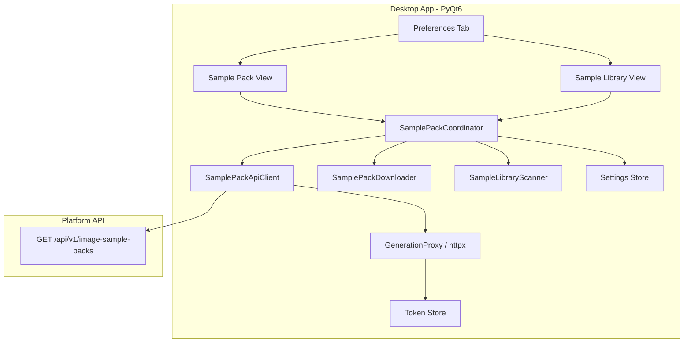
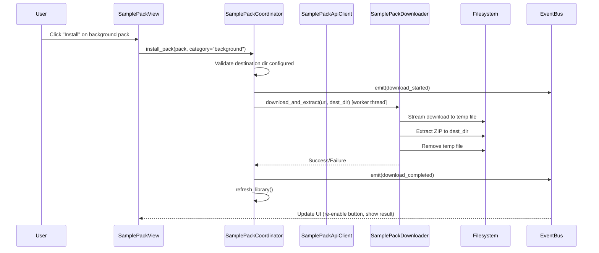
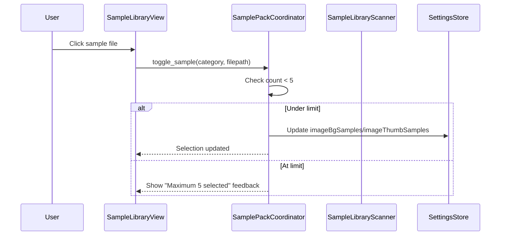

# Design Document: Sample Pack Manager

## Overview

This design describes the Sample Pack Downloads and Sample Library Manager feature for the PyQt6 Desktop App. The feature allows users to browse available sample packs from the Platform API, download and extract them into local directories, scan those directories for image files, and curate up to 5 background and 5 thumbnail samples for image generation.

### Key Design Goals

- **Feature Isolation**: Implement as a standalone coordinator under `features/sample_pack/` following the established coordinator pattern
- **Protocol-Based DI**: All external dependencies (HTTP, filesystem, settings, UI) injected via Protocol interfaces
- **Reuse Existing Infrastructure**: Leverage `GenerationProxy`'s httpx client pattern for API calls, existing `list_images_in_folder()` for directory scanning, and existing settings persistence
- **Non-Blocking UI**: All network and filesystem operations run on worker threads, communicating results via the event bus

### Technology Choices

- **HTTP Client**: `httpx` (sync) — consistent with `GenerationProxy` and `AuthClient` patterns. Called from worker threads.
- **Archive Extraction**: `zipfile` (stdlib) — sample packs are ZIP archives. Falls back to `shutil.unpack_archive` for broader format support.
- **Image Preview**: `QPixmap` loaded from file path, scaled to 16:7 aspect ratio in the preview widget
- **Settings Persistence**: Existing `_update_music_settings()` pattern for `imageBgSamples`, `imageThumbSamples`, `imageBgRandom`, `imageThumbRandom`

## Architecture

### High-Level Component Architecture



### Download & Install Flow



### Sample Curation Flow



### Module Layout

```
python_app/
├── features/
│   └── sample_pack/
│       ├── __init__.py
│       ├── coordinator.py          # SamplePackCoordinator — orchestration logic
│       ├── api_client.py           # SamplePackApiClient — HTTP calls to Platform API
│       ├── downloader.py           # SamplePackDownloader — download + extract logic
│       └── scanner.py              # SampleLibraryScanner — directory scanning
├── services/
│   └── image_generation.py         # EXISTING — list_images_in_folder() reused
└── app/
    └── sample_pack_ui_handlers.py  # UI wiring (connects coordinator to view widgets)
```

## Components and Interfaces

### 1. SamplePackApiClient (`features/sample_pack/api_client.py`)

Fetches the sample pack list from the Platform API. Reuses the same httpx + token pattern as `GenerationProxy`.

```python
from __future__ import annotations

from dataclasses import dataclass
from typing import Protocol


@dataclass(frozen=True)
class SamplePackInfo:
    """A single sample pack from the Platform API."""
    id: str
    category: str       # "background" | "thumbnail"
    name: str
    source_type: str    # "url"
    source_value: str   # Download URL
    version_label: str | None = None
    notes: str | None = None


class SamplePackApiClientPort(Protocol):
    """Protocol for fetching sample packs from the Platform API."""

    def list_packs(self) -> list[SamplePackInfo]:
        """Fetch all active sample packs.

        Returns list of SamplePackInfo sorted by category then name.

        Raises:
            NetworkError: On connection failure or timeout.
            AuthenticationError: On 401 after token refresh fails.
        """
        ...


class SamplePackApiClient:
    """HTTP client for the /image-sample-packs endpoint.

    Args:
        base_url: Platform API base URL (e.g. "http://localhost:8000/api/v1").
        token_store: Token persistence for reading the current access token.
        auth_client: Auth client for token refresh on 401.
        timeout: Request timeout in seconds. Defaults to 15s.
    """

    def __init__(
        self,
        base_url: str,
        token_store: TokenStorePort,
        auth_client: AuthClientPort,
        timeout: float = 15.0,
    ) -> None: ...

    def list_packs(self) -> list[SamplePackInfo]:
        """GET /image-sample-packs → parse response into SamplePackInfo list.

        On 401: attempt one token refresh, retry.
        On network error: raise NetworkError with descriptive message.
        """
        ...
```

### 2. SamplePackDownloader (`features/sample_pack/downloader.py`)

Downloads a ZIP archive from a URL and extracts it into a target directory. Runs on a worker thread.

```python
from __future__ import annotations

from dataclasses import dataclass
from pathlib import Path
from typing import Callable, Protocol


@dataclass(frozen=True)
class DownloadResult:
    """Result of a download + extraction operation."""
    success: bool
    files_extracted: int
    error_message: str | None = None


class SamplePackDownloaderPort(Protocol):
    """Protocol for downloading and extracting sample packs."""

    def download_and_extract(
        self,
        url: str,
        destination_dir: str,
        *,
        on_progress: Callable[[int, int | None], None] | None = None,
        should_cancel: Callable[[], bool] | None = None,
    ) -> DownloadResult:
        """Download archive from URL and extract into destination_dir.

        Args:
            url: Download URL for the ZIP archive.
            destination_dir: Local directory to extract files into.
            on_progress: Optional callback (bytes_downloaded, total_bytes_or_none).
            should_cancel: Optional cancellation check function.

        Returns:
            DownloadResult with success status and file count.

        Raises:
            NetworkError: On download failure.
            ExtractionError: On corrupt/invalid archive.
        """
        ...


class SamplePackDownloader:
    """Downloads and extracts sample pack archives.

    Implementation:
    1. Stream-download URL to a temp file using httpx (chunked, 8KB chunks)
    2. Validate the file is a valid ZIP archive
    3. Extract all image files (*.png, *.jpg, *.jpeg, *.webp) to destination
    4. Skip non-image files silently
    5. Remove the temp file on completion (success or failure)

    Google Drive share links are normalized to direct download URLs
    (uc?export=download&id=...) before streaming.
    """

    def __init__(self, timeout: float = 120.0) -> None: ...

    def download_and_extract(
        self,
        url: str,
        destination_dir: str,
        *,
        on_progress: Callable[[int, int | None], None] | None = None,
        should_cancel: Callable[[], bool] | None = None,
    ) -> DownloadResult: ...

    @staticmethod
    def _normalize_google_drive_url(url: str) -> str:
        """Convert Google Drive share links to direct download URLs."""
        ...
```

### 3. SampleLibraryScanner (`features/sample_pack/scanner.py`)

Wraps the existing `list_images_in_folder()` utility with a coordinator-friendly interface and alphabetical sorting.

```python
from __future__ import annotations

from dataclasses import dataclass
from pathlib import Path
from typing import Protocol


@dataclass(frozen=True)
class SampleFileInfo:
    """A single sample image file found in the library."""
    file_path: str      # Full absolute path
    file_name: str      # Filename only (e.g. "sunset_01.png")


class SampleLibraryScannerPort(Protocol):
    """Protocol for scanning sample directories."""

    def scan(self, directory: str) -> list[SampleFileInfo]:
        """Scan directory for image files (png, jpg, jpeg, webp).

        Returns list of SampleFileInfo sorted alphabetically by filename.
        Returns empty list if directory is empty, missing, or not configured.
        """
        ...


class SampleLibraryScanner:
    """Scans a directory for image sample files.

    Delegates to the existing list_images_in_folder() utility but
    re-sorts by filename (alphabetical) and returns typed dataclass results.
    """

    def scan(self, directory: str) -> list[SampleFileInfo]:
        """Scan directory for supported image files.

        Supported extensions: .png, .jpg, .jpeg, .webp
        Returns empty list for invalid/missing directories.
        """
        ...
```

### 4. SamplePackCoordinator (`features/sample_pack/coordinator.py`)

The central orchestrator. Owns the business logic for listing packs, installing them, scanning libraries, and managing curation state. No Qt imports.

```python
from __future__ import annotations

import threading
from typing import Any, Callable, Protocol

from ..ports import EventBusPort, LoggerPort, SettingsAccessor


class SamplePackCoordinator:
    """Orchestrates sample pack downloads and sample library curation.

    Dependencies (constructor-injected):
        api_client: SamplePackApiClientPort — fetches pack list from Platform API
        downloader: SamplePackDownloaderPort — downloads and extracts packs
        scanner: SampleLibraryScannerPort — scans local directories
        settings_accessor: Callable[[], dict] — reads current settings
        settings_updater: Callable[[dict], None] — persists settings changes
        bus: EventBusPort — emits events for UI updates
        logger: LoggerPort — structured logging
    """

    MAX_SELECTIONS_PER_CATEGORY: int = 5

    def __init__(
        self,
        *,
        api_client: SamplePackApiClientPort,
        downloader: SamplePackDownloaderPort,
        scanner: SampleLibraryScannerPort,
        settings_accessor: Callable[[], dict],
        settings_updater: Callable[[dict], None],
        bus: EventBusPort,
        logger: LoggerPort | None = None,
    ) -> None: ...

    # -- Pack List Operations --

    def fetch_packs(self) -> None:
        """Fetch available packs from API on a worker thread.

        Emits: sample_pack_event {type: "packs_loaded", background: [...], thumbnail: [...]}
        On error emits: sample_pack_event {type: "packs_load_failed", message: str}
        """
        ...

    def get_cached_packs(self) -> dict[str, list[SamplePackInfo]]:
        """Return the last-fetched packs grouped by category.

        Returns: {"background": [...], "thumbnail": [...]}
        """
        ...

    # -- Download & Install --

    def install_pack(self, pack_id: str, category: str) -> None:
        """Download and extract a pack into the appropriate sample directory.

        Runs on a worker thread. Validates destination dir is configured.

        Emits:
            sample_pack_event {type: "install_started", pack_id, category}
            sample_pack_event {type: "install_progress", bytes_downloaded, total_bytes}
            sample_pack_event {type: "install_completed", pack_id, files_extracted}
            sample_pack_event {type: "install_failed", pack_id, message}

        After successful install, automatically calls refresh_library().
        """
        ...

    @property
    def is_installing(self) -> bool:
        """True if a download/extraction is currently in progress."""
        ...

    # -- Library Scanning --

    def refresh_library(self) -> None:
        """Scan both sample directories and emit updated file lists.

        Emits: sample_pack_event {type: "library_refreshed",
               background_files: [...], thumbnail_files: [...]}
        """
        ...

    def get_background_files(self) -> list[SampleFileInfo]:
        """Return cached background sample file list."""
        ...

    def get_thumbnail_files(self) -> list[SampleFileInfo]:
        """Return cached thumbnail sample file list."""
        ...

    # -- Curation --

    def toggle_sample(self, category: str, file_path: str) -> bool:
        """Toggle selection state for a sample file.

        If already selected: deselect it.
        If not selected and count < MAX_SELECTIONS_PER_CATEGORY: select it.
        If at max: return False (no change).

        Persists updated selection to settings immediately.
        Returns True if toggle was applied, False if at limit.
        """
        ...

    def get_selected_samples(self, category: str) -> list[str]:
        """Return the list of currently selected sample paths for a category.

        category: "background" | "thumbnail"
        """
        ...

    def get_selection_count(self, category: str) -> int:
        """Return current selection count for a category."""
        ...

    def set_random_mode(self, category: str, enabled: bool) -> None:
        """Toggle random mode for a category.

        Persists imageBgRandom or imageThumbRandom to settings.
        """
        ...

    def get_random_mode(self, category: str) -> bool:
        """Return current random mode for a category."""
        ...
```

### 5. UI Handlers (`app/sample_pack_ui_handlers.py`)

Connects the coordinator to PyQt6 widgets in the Preferences tab. Follows the pattern established by `image_ui_handlers.py`.

```python
class SamplePackUIHandlers:
    """Mixin or handler class for Sample Pack UI interactions.

    Connects Qt signals from widgets in the Preferences tab to
    SamplePackCoordinator methods. Listens to bus events to update
    widget state (progress, enable/disable, lists).

    Key responsibilities:
    - Wire "Reload Packs" button → coordinator.fetch_packs()
    - Wire "Install" buttons → coordinator.install_pack()
    - Wire "Refresh Samples" button → coordinator.refresh_library()
    - Wire sample list clicks → coordinator.toggle_sample()
    - Wire random toggle buttons → coordinator.set_random_mode()
    - Wire hover events → load preview image
    - Wire "Open Link" → webbrowser.open(url)
    - Wire "Open File" → os.startfile(path) or QDesktopServices
    - Listen to bus events → update widget state
    """
    ...
```

### 6. Sample Preview Widget

The preview area displays a selected/hovered image at 16:7 aspect ratio with the full file path below.

```python
class SamplePreviewWidget:
    """Displays a sample image preview.

    Methods:
        show_preview(file_path: str) → Load image, scale to 16:7, display
        clear_preview() → Show placeholder text
        get_current_path() → str | None

    The widget is a QLabel with fixed aspect ratio (16:7) inside a
    bordered container. Below it, a QLabel shows the full file path.
    An "Open File" button opens the file in the system file explorer.
    """
    ...
```

## Data Models

### Platform API Response Model

```python
# Response from GET /api/v1/image-sample-packs
@dataclass(frozen=True)
class ImageSamplePackListResponse:
    items: list[ImageSamplePackItem]

@dataclass(frozen=True)
class ImageSamplePackItem:
    id: str
    category: str           # "background" | "thumbnail"
    name: str
    source_type: str        # "url"
    source_value: str       # Download URL
    version_label: str | None
    notes: str | None
```

### Internal Domain Models

```python
@dataclass(frozen=True)
class SamplePackInfo:
    """Domain model for a sample pack."""
    id: str
    category: str       # "background" | "thumbnail"
    name: str
    source_type: str
    source_value: str
    version_label: str | None = None
    notes: str | None = None

@dataclass(frozen=True)
class SampleFileInfo:
    """Domain model for a scanned sample file."""
    file_path: str      # Absolute path
    file_name: str      # Filename only

@dataclass(frozen=True)
class DownloadResult:
    """Result of a download + extraction operation."""
    success: bool
    files_extracted: int
    error_message: str | None = None
```

### Settings Keys (existing)

| Key | Type | Description |
|-----|------|-------------|
| `imageBackgroundSamplesDir` | `str` | Directory path for background samples |
| `imageThumbnailSamplesDir` | `str` | Directory path for thumbnail samples |
| `imageBgSamples` | `list[str]` | Selected background sample file paths (max 5) |
| `imageThumbSamples` | `list[str]` | Selected thumbnail sample file paths (max 5) |
| `imageBgRandom` | `bool` | Whether random mode is enabled for backgrounds |
| `imageThumbRandom` | `bool` | Whether random mode is enabled for thumbnails |

### Event Bus Messages

```python
# All events emitted on channel "sample_pack_event"
# type: "packs_loaded" — pack list fetched successfully
{"type": "packs_loaded", "background": [...], "thumbnail": [...]}

# type: "packs_load_failed" — API call failed
{"type": "packs_load_failed", "message": "Unable to load sample pack list."}

# type: "install_started" — download/extract began
{"type": "install_started", "pack_id": "...", "category": "background"}

# type: "install_progress" — download progress update
{"type": "install_progress", "bytes_downloaded": 1024000, "total_bytes": 5000000}

# type: "install_completed" — extraction finished
{"type": "install_completed", "pack_id": "...", "files_extracted": 12}

# type: "install_failed" — download or extraction error
{"type": "install_failed", "pack_id": "...", "message": "Connection timed out"}

# type: "library_refreshed" — directory scan complete
{"type": "library_refreshed", "background_files": [...], "thumbnail_files": [...]}
```


## Correctness Properties

*A property is a characteristic or behavior that should hold true across all valid executions of a system — essentially, a formal statement about what the system should do. Properties serve as the bridge between human-readable specifications and machine-verifiable correctness guarantees.*

### Property 1: Pack list categorization preserves data and groups correctly

*For any* list of `SamplePackInfo` items with arbitrary `category`, `name`, `notes`, and `source_value` fields, categorizing the list into "background" and "thumbnail" groups should: (a) place every item into exactly one group matching its category, (b) preserve all fields (name, notes, source_value) unchanged for every item, and (c) the sum of items across both groups should equal the original list length.

**Validates: Requirements 1.2, 1.3**

### Property 2: ZIP extraction round-trip

*For any* valid ZIP archive containing image files (with extensions .png, .jpg, .jpeg, .webp), extracting the archive into a destination directory should result in every image file from the archive existing in the destination directory with the same filename and byte content. Non-image files in the archive should be skipped.

**Validates: Requirements 2.2, 2.3**

### Property 3: Scanner returns only supported images, sorted alphabetically

*For any* directory containing a mix of files with various extensions, the scanner should return only files with extensions in {.png, .jpg, .jpeg, .webp}, and the returned list should be sorted in case-insensitive alphabetical order by filename.

**Validates: Requirements 3.1, 3.2**

### Property 4: Toggle is self-inverse

*For any* valid sample file path and any initial selection state (where the selection count is below the maximum), toggling the sample twice should restore the original selection state exactly.

**Validates: Requirements 4.1**

### Property 5: Selection count invariant

*For any* sequence of toggle operations on sample files within a single category, the number of selected items should never exceed 5. When a toggle is attempted at the maximum count for an unselected item, the toggle should be rejected and the selection state should remain unchanged.

**Validates: Requirements 4.2, 4.3**

### Property 6: Selection persistence round-trip

*For any* set of selected sample paths (up to 5 per category), persisting the selection to settings and then reading it back should produce the identical list of paths in the same order.

**Validates: Requirements 4.4**

## Error Handling

### Error Categories and User-Facing Behavior

| Scenario | Error Source | User-Facing Behavior |
|----------|-------------|---------------------|
| API unreachable | `NetworkError` | "Unable to load sample pack list." + Retry button enabled |
| API 401 after refresh | `AuthenticationError` | Redirect to login (handled by auth layer) |
| API 5xx | `GenerationError` | "Unable to load sample pack list." + Retry button enabled |
| Download timeout | `NetworkError` | "Download failed: connection timed out" in status |
| Download 404 | HTTP 404 | "Download failed: file not found at URL" |
| Invalid ZIP | `ExtractionError` | "Install failed: archive is corrupt or not a valid ZIP" |
| Destination dir missing | Pre-validation | Install button disabled; tooltip explains |
| Destination dir read-only | `PermissionError` | "Install failed: cannot write to destination directory" |
| Disk full during extraction | `OSError` | "Install failed: insufficient disk space" |

### Error Propagation Strategy

1. **API errors** are caught in `SamplePackApiClient` and re-raised as typed exceptions (`NetworkError`, `AuthenticationError`)
2. **Download/extraction errors** are caught in `SamplePackDownloader` and returned as `DownloadResult(success=False, error_message=...)`
3. **The coordinator** translates errors into event bus messages that the UI handlers display
4. **No silent failures** — all errors surface to the user via the event bus → UI status label

### Pre-Validation

Before starting any download:
- Destination directory must be a non-empty string
- Destination directory must exist on disk (or be creatable)
- No other download/extraction must be in progress (`is_installing` check)

If pre-validation fails, the coordinator rejects the operation immediately with a descriptive message (no network call is made).

## Testing Strategy

### Property-Based Tests (Hypothesis)

Property-based testing is appropriate for this feature because it involves:
- Pure data transformation functions (categorization, scanning, sorting)
- Invariant enforcement (selection count limit)
- Round-trip operations (ZIP extraction, settings persistence)

**Library**: `hypothesis` (Python) — already used in the project
**Minimum iterations**: 100 per property test
**Tag format**: `Feature: sample-pack-manager, Property N: <description>`

Each correctness property maps to a single Hypothesis test:

| Property | Test Function | Generator Strategy |
|----------|--------------|-------------------|
| 1 | `test_categorization_preserves_data` | `st.lists(st.builds(SamplePackInfo, ...))` |
| 2 | `test_zip_extraction_round_trip` | `st.lists(st.tuples(st.from_regex(r'[a-z]+\.(png\|jpg)', fullmatch=True), st.binary(min_size=100)))` |
| 3 | `test_scanner_filters_and_sorts` | `st.lists(st.from_regex(r'[a-z0-9_]+\.[a-z]{2,4}', fullmatch=True))` |
| 4 | `test_toggle_is_self_inverse` | `st.lists(st.text(min_size=1), max_size=10), st.integers(0, 9)` |
| 5 | `test_selection_count_invariant` | `st.lists(st.tuples(st.sampled_from(files), st.booleans()), min_size=1, max_size=20)` |
| 6 | `test_selection_persistence_round_trip` | `st.lists(st.text(min_size=1), min_size=0, max_size=5)` |

### Unit Tests (pytest)

Example-based tests for specific scenarios:

- **API failure handling**: Network timeout → error event emitted with correct message
- **Install button disable**: Empty destination dir → `install_pack()` returns immediately
- **Download progress**: Progress callback invoked during download
- **Google Drive URL normalization**: Various Drive share link formats → correct direct URLs
- **Open Link**: `webbrowser.open()` called with correct `source_value`
- **Open File**: `os.startfile()` called with correct file path
- **Preview pinning**: Click pins preview, hover doesn't unpin
- **Empty directory scan**: Returns empty list
- **Non-existent directory scan**: Returns empty list without error

### Integration Tests

- **End-to-end install flow**: Mock HTTP server → download → extract → scan → verify files appear in library list
- **Coordinator + settings round-trip**: Toggle selections → verify settings file updated → reload settings → verify selections match

### Test File Location

```
python_app/tests/
├── features/
│   └── sample_pack/
│       ├── test_coordinator.py          # Unit + property tests for coordinator
│       ├── test_api_client.py           # Unit tests for API client
│       ├── test_downloader.py           # Property + unit tests for downloader
│       ├── test_scanner.py              # Property tests for scanner
│       └── test_integration.py          # End-to-end flow tests
```
