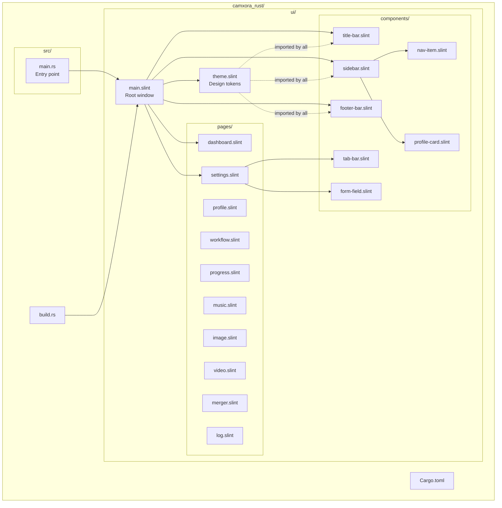
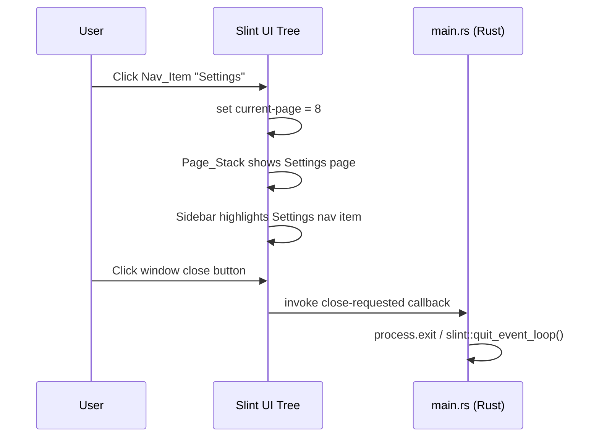

# Design Document: Slint Desktop UI

## Overview

This design defines the architecture for rebuilding the CAMXORA desktop application UI using the [Slint](https://slint.dev/) declarative UI framework in Rust. The application lives in `camxora_rust/` and replicates the existing PyQt6 dark-themed desktop app pixel-for-pixel, including the custom frameless title bar, sidebar navigation, page stack, footer status bar, and Settings page with tabbed sub-pages.

### Design Decisions

- **Slint declarative markup over imperative UI code**: Slint `.slint` files provide a declarative, compile-time-checked description of the UI tree. This eliminates runtime layout bugs and enables the Slint compiler to catch missing properties/tokens at build time.
- **Single binary crate (no workspace)**: The UI is a single application with one binary target. A Cargo workspace adds complexity without benefit at this stage — there are no shared library crates yet.
- **`no-frame: true` for custom title bar**: Slint's `Window` element supports `no-frame` to remove native decorations. Combined with `resize-border-width` for resize affordance, this allows a fully custom title bar while retaining system resize behavior.
- **Global structs for design tokens**: Slint `export global` definitions provide compile-time-checked, centralized token access across all `.slint` files. Any reference to a missing token fails compilation.
- **Page stack via conditional visibility**: Rather than a dynamic component loader, all pages exist in the tree with `visible: current-page == N`. This gives instant page switching (no allocation) and keeps the design statically analyzable.
- **`slint-build` in `build.rs`**: The standard Slint build pipeline compiles `.slint` → Rust at build time, providing type-safe bindings to callbacks, properties, and globals from Rust code.

### Key Research Findings

- **Slint `Window.no-frame`**: Setting `no-frame: true` removes all native window decorations. `resize-border-width` (winit backend) allows users to resize even without a native frame. ([Slint Window docs](https://docs.slint.dev/latest/docs/slint/reference/window/window/))
- **Slint Globals**: `export global` defines singleton property bags accessible from all component files via import and from Rust via generated accessor methods. Globals must be exported from the root file to be visible to Rust. ([Slint Globals docs](https://docs.slint.dev/latest/docs/slint/guide/language/coding/globals/))
- **Slint `TouchArea`**: Provides pointer event handling for custom drag regions. Used to implement title bar dragging.
- **`Window.maximized` / `Window.minimized`**: In-out boolean properties that can be toggled from Slint callbacks to control window state.
- **Current Slint version**: `slint 1.12.x` is the latest stable release on crates.io. `slint-build` version must match.

## Architecture



### Data Flow



## Components and Interfaces

### Root Window (`ui/main.slint`)

```slint
import { DesignTokens } from "theme.slint";
import { TitleBar } from "components/title-bar.slint";
import { Sidebar } from "components/sidebar.slint";
import { FooterBar } from "components/footer-bar.slint";
// ... page imports

export component AppWindow inherits Window {
    no-frame: true;
    resize-border-width: 8px;
    title: "CAMXORA Desktop Studio";
    preferred-width: 1440px;
    preferred-height: 900px;
    min-width: 1024px;
    min-height: 640px;
    background: DesignTokens.surface-base;
    default-font-family: "Open Sans";

    in-out property <int> current-page: 0;
    in-out property <string> footer-left: "";
    in-out property <string> footer-center: "";
    in-out property <string> footer-right: "";

    callback close-requested();
    callback minimize-requested();
    callback maximize-toggle-requested();

    VerticalLayout {
        TitleBar {
            on-close => { root.close-requested(); }
            on-minimize => { root.minimize-requested(); }
            on-maximize-toggle => { root.maximize-toggle-requested(); }
        }

        HorizontalLayout {
            Sidebar {
                current-page <=> root.current-page;
            }
            // Page Stack (conditional visibility)
            Rectangle {
                // Each page visible only when current-page matches
            }
        }

        FooterBar {
            left-text: root.footer-left;
            center-text: root.footer-center;
            right-text: root.footer-right;
        }
    }
}
```

### Design Tokens Global (`ui/theme.slint`)

```slint
export global DesignTokens {
    // Colors
    out property <color> surface-base: #060b20;
    out property <color> surface-raised: #0A1530;
    out property <color> surface-overlay: #101a38;
    out property <color> surface-elevated: #14203e;
    out property <color> text-primary: #eef4ff;
    out property <color> text-secondary: #d9e5fb;
    out property <color> text-muted: #7b8fb5;
    out property <color> accent: #1ABCFE;
    out property <color> secondary-accent: #7466F1;
    out property <color> success: #0ACF83;
    out property <color> warning: #F24E1E;
    out property <color> danger: #FF7262;
    out property <color> border: #263653;
    out property <color> gradient-start: #7466F1;
    out property <color> gradient-end: #A259FF;
    out property <color> badge-gold: #F2C94C;
    out property <color> badge-text: #1a1a2e;
    out property <color> logout-red: #ef4444;

    // Typography
    out property <string> font-family: "Open Sans";
    out property <length> size-title: 18px;
    out property <length> size-subtitle: 14px;
    out property <length> size-body: 14px;
    out property <length> size-caption: 11px;
    out property <int> weight-regular: 400;
    out property <int> weight-medium: 500;
    out property <int> weight-bold: 700;

    // Spacing
    out property <length> padding-sm: 4px;
    out property <length> padding-md: 8px;
    out property <length> padding-lg: 16px;
    out property <length> gap-sm: 4px;
    out property <length> gap-md: 8px;
    out property <length> gap-lg: 16px;
    out property <length> margin-sm: 4px;
    out property <length> margin-md: 12px;
    out property <length> margin-lg: 24px;

    // Shape
    out property <length> radius-sm: 4px;
    out property <length> radius-md: 8px;
    out property <length> radius-lg: 12px;
    out property <length> border-width-thin: 1px;
    out property <length> border-width-medium: 2px;
}
```

### Title Bar Component (`ui/components/title-bar.slint`)

```slint
import { DesignTokens } from "../theme.slint";

export component TitleBar inherits Rectangle {
    height: 38px;
    background: DesignTokens.surface-base;

    callback on-close();
    callback on-minimize();
    callback on-maximize-toggle();

    HorizontalLayout {
        padding-left: DesignTokens.padding-lg;
        alignment: space-between;

        // Brand section
        HorizontalLayout {
            spacing: DesignTokens.gap-md;
            alignment: center;
            Text { text: "CAMXORA"; font-size: 14px; font-weight: 700; color: DesignTokens.text-primary; }
            Text { text: "DESKTOP STUDIO"; font-size: 11px; font-weight: 400; color: DesignTokens.text-muted; }
        }

        // Window controls
        HorizontalLayout {
            spacing: 2px;
            alignment: end;
            // Minimize, Maximize, Close buttons (30x30 hit areas)
        }
    }

    // Drag area (TouchArea covering non-button regions)
    TouchArea {
        // pointer-event handling for window move
        moved => { /* emit drag delta */ }
        double-clicked => { root.on-maximize-toggle(); }
    }
}
```

### Sidebar Component (`ui/components/sidebar.slint`)

```slint
import { DesignTokens } from "../theme.slint";
import { NavItem } from "nav-item.slint";
import { ProfileCard } from "profile-card.slint";

export component Sidebar inherits Rectangle {
    width: 260px;
    background: DesignTokens.surface-raised;

    in-out property <int> current-page;

    // User profile data (bound from Rust)
    in property <string> username: "User";
    in property <string> initials: "U";
    in property <string> plan-name: "Pro";
    in property <string> credits-text: "";

    VerticalLayout {
        ProfileCard {
            username: root.username;
            initials: root.initials;
            plan-name: root.plan-name;
            credits-text: root.credits-text;
        }

        // 1px separator
        Rectangle { height: 1px; background: rgba(255, 255, 255, 0.06); }

        // Nav items (10 entries)
        VerticalLayout {
            spacing: DesignTokens.gap-sm;
            padding: DesignTokens.padding-md;
            // NavItem for each page...
        }

        // Spacer
        Rectangle { vertical-stretch: 1; }

        // Logout separator + button
        Rectangle { height: 1px; background: rgba(255, 255, 255, 0.06); }
        // Logout NavItem with red tint
    }
}
```

### Nav Item Component (`ui/components/nav-item.slint`)

```slint
import { DesignTokens } from "../theme.slint";

export component NavItem inherits Rectangle {
    height: 44px;
    border-radius: DesignTokens.radius-md;

    in property <string> label;
    in property <image> icon;
    in property <bool> active: false;
    in property <bool> is-danger: false;

    callback clicked();

    // Background: gradient when active, transparent when inactive
    background: active ? @linear-gradient(90deg, DesignTokens.gradient-start, DesignTokens.gradient-end) : transparent;

    HorizontalLayout {
        padding-left: DesignTokens.padding-lg;
        spacing: DesignTokens.gap-lg;
        alignment: start;

        Image { source: root.icon; width: 20px; height: 20px; colorize: active ? white : (is-danger ? DesignTokens.logout-red : DesignTokens.text-muted); }
        Text { text: root.label; font-size: DesignTokens.size-body; color: active ? white : (is-danger ? DesignTokens.logout-red : DesignTokens.text-muted); vertical-alignment: center; }
    }

    TouchArea { clicked => { root.clicked(); } }
}
```

### Footer Bar Component (`ui/components/footer-bar.slint`)

```slint
import { DesignTokens } from "../theme.slint";

export component FooterBar inherits Rectangle {
    height: 28px;
    background: DesignTokens.surface-base;

    in property <string> left-text;
    in property <string> center-text;
    in property <string> right-text;

    // 1px top border
    Rectangle { height: 1px; background: DesignTokens.border; y: 0; }

    HorizontalLayout {
        padding-left: DesignTokens.padding-lg;
        padding-right: DesignTokens.padding-lg;

        Text { text: root.left-text; font-size: DesignTokens.size-caption; color: DesignTokens.text-muted; horizontal-alignment: left; overflow: elide; }
        Text { text: root.center-text; font-size: DesignTokens.size-caption; color: DesignTokens.text-muted; horizontal-alignment: center; overflow: elide; horizontal-stretch: 1; }
        Text { text: root.right-text; font-size: DesignTokens.size-caption; color: DesignTokens.text-muted; horizontal-alignment: right; overflow: elide; }
    }
}
```

### Settings Page with Tab Bar (`ui/pages/settings.slint`)

```slint
import { DesignTokens } from "../theme.slint";
import { TabBar } from "../components/tab-bar.slint";

export component Settings inherits Rectangle {
    in-out property <int> active-tab: 0;

    VerticalLayout {
        TabBar {
            active-tab <=> root.active-tab;
            tabs: ["Profiles", "YouTube", "Publication", "Preferences", "Descriptions", "Structures", "Pools", "Suno"];
        }

        // Tab content area - show one sub-page at a time
        Rectangle {
            // Profiles sub-page (active-tab == 0)
            // ... other sub-pages
        }
    }
}
```

### Tab Bar Component (`ui/components/tab-bar.slint`)

```slint
import { DesignTokens } from "../theme.slint";

export component TabBar inherits Rectangle {
    height: 44px;
    background: transparent;

    in property <[string]> tabs;
    in-out property <int> active-tab: 0;

    // 1px bottom border
    Rectangle { height: 1px; background: DesignTokens.border; y: root.height - 1px; }

    HorizontalLayout {
        spacing: DesignTokens.gap-lg;
        padding-left: DesignTokens.padding-lg;

        // For each tab: text + 2px bottom accent indicator when active
    }
}
```

### Profiles Sub-Page (Split Panel)

```slint
import { DesignTokens } from "../theme.slint";
import { FormField } from "../components/form-field.slint";

component ProfilesPage inherits Rectangle {
    HorizontalLayout {
        // Profile_Panel (left, 320px)
        Rectangle {
            width: 320px;
            background: DesignTokens.surface-raised;
            // Header, search input, scrollable profile list
        }

        // Detail_Panel (right, fills remaining)
        Rectangle {
            horizontal-stretch: 1;
            // Form fields or "No profile selected" placeholder
        }
    }
}
```

### Rust Entry Point (`src/main.rs`)

```rust
fn main() -> Result<(), slint::PlatformError> {
    let ui = AppWindow::new()?;

    // Bind close callback
    ui.on_close_requested({
        let ui_handle = ui.as_weak();
        move || {
            slint::quit_event_loop().ok();
        }
    });

    // Bind minimize callback
    ui.on_minimize_requested({
        let ui_handle = ui.as_weak();
        move || {
            if let Some(ui) = ui_handle.upgrade() {
                ui.window().set_minimized(true);
            }
        }
    });

    // Bind maximize toggle callback
    ui.on_maximize_toggle_requested({
        let ui_handle = ui.as_weak();
        move || {
            if let Some(ui) = ui_handle.upgrade() {
                let maximized = ui.window().is_maximized();
                ui.window().set_maximized(!maximized);
            }
        }
    });

    ui.run()
}
```

### Build Script (`build.rs`)

```rust
fn main() {
    slint_build::compile("ui/main.slint").expect("Slint compilation failed");
}
```

## Data Models

### Navigation Model

| Property | Type | Description |
|----------|------|-------------|
| `current-page` | `int` | Index 0–9 mapping to the 10 navigation pages |
| Page indices | — | 0=Dashboard, 1=Profile, 2=Workflow, 3=Progress, 4=Music, 5=Image, 6=Video, 7=Merger, 8=Settings, 9=Log |

### User Profile Model (bound from Rust)

| Property | Type | Description |
|----------|------|-------------|
| `username` | `string` | Display name (truncated at 20 chars in UI) |
| `initials` | `string` | 1–2 character initials for avatar circle |
| `plan-name` | `string` | Subscription plan label (e.g., "Pro") |
| `credits-text` | `string` | Formatted credits + expiry string |

### Settings Profile Model

| Field | Type | Constraints |
|-------|------|-------------|
| `name` | `string` | max 100 characters |
| `folder-name` | `string` | max 100 characters |
| `run-prefix` | `string` | max 50 characters |
| `channel-logo` | `image` | file path to image |
| `channel-cover` | `image` | file path to image |
| `video-template` | `string` | selected template ID |
| `reel-template` | `string` | selected template ID |
| `output-resolution` | `string` | dropdown selection |
| `image-mode` | `string` | dropdown selection |

### Footer Model

| Property | Type | Description |
|----------|------|-------------|
| `footer-left` | `string` | Left-aligned status text |
| `footer-center` | `string` | Center-aligned status text |
| `footer-right` | `string` | Right-aligned status text |


## Correctness Properties

*A property is a characteristic or behavior that should hold true across all valid executions of a system — essentially, a formal statement about what the system should do. Properties serve as the bridge between human-readable specifications and machine-verifiable correctness guarantees.*

### Property 1: Title Bar Drag Delta Preserves Window Position

*For any* initial window position (x, y) and any drag delta (dx, dy) applied within the title bar drag area, the resulting window position SHALL equal (x + dx, y + dy).

**Validates: Requirements 2.7**

### Property 2: Title Bar Hit Area Exclusivity

*For any* pointer position within the title bar bounds that is NOT within any of the three button hit areas (30×30px each, right-aligned), initiating a drag SHALL NOT invoke any button callback (close, minimize, maximize).

**Validates: Requirements 2.10**

### Property 3: Username Truncation at Boundary

*For any* username string, if its character count exceeds 20, the displayed text SHALL be truncated with an ellipsis; if its character count is 20 or fewer, the displayed text SHALL show the full username without modification.

**Validates: Requirements 3.3**

### Property 4: Navigation State Exclusivity

*For any* valid page index (0–9), after a navigation click selecting that index, the `current-page` property SHALL equal that index, exactly one Nav_Item SHALL be in active state, and exactly one page in the Page_Stack SHALL be visible.

**Validates: Requirements 3.10, 4.2**

### Property 5: Invalid Navigation Index Rejection

*For any* integer value outside the range 0–9, setting `current-page` to that value SHALL leave the currently visible page unchanged and the previously active Nav_Item still active.

**Validates: Requirements 4.6**

### Property 6: Footer Text Binding Round-Trip

*For any* valid string value assigned to a footer zone property (left, center, or right), the displayed text content of that zone SHALL exactly equal the assigned string.

**Validates: Requirements 5.4**

### Property 7: No Inline Hex Literals in Component Files

*For any* `.slint` file within `ui/components/` or `ui/pages/`, the file content SHALL contain zero occurrences of raw hex color codes (pattern `#[0-9a-fA-F]{3,8}`) or numeric pixel literals (other than 0 or 1) outside of the token definition file (`ui/theme.slint`).

**Validates: Requirements 6.6**

### Property 8: Tab Switching Exclusivity

*For any* valid tab index (0–7), after clicking that tab in the Settings_Tab_Bar, the `active-tab` property SHALL equal that index, exactly one tab SHALL display the active indicator, and the corresponding sub-page SHALL be visible.

**Validates: Requirements 7.4**

### Property 9: Profile List Display Limit

*For any* number of profile items N (where N ≥ 0), the Profile_Panel SHALL display at most min(N, 20) items in its scrollable list.

**Validates: Requirements 8.4**

### Property 10: Layout Geometry Invariants Under Resize

*For any* window size (W, H) where W ≥ 1024 and H ≥ 640:
- The Sidebar width SHALL equal exactly 260px
- The Page_Stack width SHALL equal W − 260px
- The Title_Bar SHALL span the full window width W and remain anchored to y=0
- The Footer_Bar SHALL span the full window width W and remain anchored to the bottom edge

**Validates: Requirements 4.1, 9.3, 9.4, 9.5, 9.6**

### Property 11: File Size Constraint

*For any* `.slint` file within `ui/components/` or `ui/pages/`, the file line count SHALL not exceed 200 lines.

**Validates: Requirements 10.6**

## Error Handling

### Window Management Errors

| Scenario | Behavior |
|----------|----------|
| Window cannot be created (missing GPU/display) | `main()` returns `Err(slint::PlatformError)` with descriptive message; process exits with code 1 |
| Slint event loop panic | Rust panic handler logs error; process aborts gracefully |
| Font "Open Sans" not available on system | Slint falls back to system default sans-serif font |

### Navigation Errors

| Scenario | Behavior |
|----------|----------|
| `current-page` set to value outside 0–9 | Page_Stack remains on current page (no change) |
| `active-tab` set to value outside 0–7 | Tab bar remains on current tab (no change) |
| Nav callback invoked with invalid index from Rust | Slint property binding ignores out-of-range; Rust side logs warning |

### Profile Management Errors

| Scenario | Behavior |
|----------|----------|
| Profile list data exceeds 20 items | UI displays first 20; remaining items accessible via scroll |
| Profile name exceeds 100 characters | Input field enforces max-length at the component level |
| No profiles available | Profile_Panel shows empty list; Detail_Panel shows "No profile selected" |
| Delete confirmation cancelled | No deletion occurs; UI returns to normal state |

### Build-Time Errors

| Scenario | Behavior |
|----------|----------|
| Missing token reference in .slint file | `slint-build` fails compilation with "unknown property" error naming the token |
| Import path not found | `slint-build` fails with file-not-found error |
| Syntax error in .slint file | `slint-build` fails with line/column error location |
| `build.rs` cannot find `ui/main.slint` | Build script panics with clear "file not found" message |

### Runtime Data Binding Errors

| Scenario | Behavior |
|----------|----------|
| Rust sets property to empty string | UI displays empty zone/label (no crash) |
| Rust sets username longer than 20 chars | Slint `overflow: elide` truncates with ellipsis in the UI |
| Window resize below minimum (1024×640) | Slint enforces `min-width`/`min-height`; window manager prevents further shrinking |

## Testing Strategy

### Unit Tests (Rust `#[cfg(test)]`)

**Test location:** `camxora_rust/src/tests/`

Unit tests verify Rust-side logic:
- Navigation index validation (clamp/reject out-of-range)
- Footer text formatting utilities
- Profile data model serialization
- Window geometry calculations

**Framework:** Built-in Rust `#[test]` with `assert_eq!` / `assert!`

### Property-Based Tests (proptest)

**Library:** [proptest](https://crates.io/crates/proptest) — the standard Rust PBT library

**Test location:** `camxora_rust/src/tests/properties.rs`

**Configuration:** Minimum 100 iterations per property (proptest default is 256, which exceeds this).

Each correctness property maps to a single `proptest!` test:

```rust
// Feature: slint-desktop-ui, Property 4: Navigation State Exclusivity
proptest! {
    #[test]
    fn prop_navigation_exclusivity(page_idx in 0..10i32) {
        // Set current-page to page_idx
        // Assert exactly one page visible
        // Assert current-page == page_idx
    }
}
```

**Tag format:** `// Feature: slint-desktop-ui, Property {N}: {title}`

**Properties requiring pure logic testing (no Slint runtime):**
- Property 3 (username truncation) — test the truncation function
- Property 5 (invalid index rejection) — test the clamping/guard logic
- Property 6 (footer text round-trip) — test string binding
- Property 7 (no hex literals) — file scanning test
- Property 9 (profile list limit) — test the `min(N, 20)` logic
- Property 11 (file size constraint) — file scanning test

**Properties requiring integration with Slint (test via `slint-testing` or visual snapshot):**
- Property 1, 2 (title bar drag) — integration test with simulated pointer events
- Property 4, 8 (navigation/tab exclusivity) — instantiate component, toggle state
- Property 10 (layout geometry) — instantiate window at various sizes

### Integration Tests

**Test location:** `camxora_rust/tests/`

Integration tests verify:
- `cargo build` succeeds with zero warnings
- Application binary starts and creates a window
- All `.slint` files compile without errors
- Token system completeness (no missing references)

### Static Analysis Tests

**Test location:** `camxora_rust/src/tests/static_checks.rs`

- Scan `ui/components/` and `ui/pages/` for raw hex color literals (Property 7)
- Scan for files exceeding 200 lines (Property 11)
- Verify directory structure matches requirement 10

### Test Balance

| Category | Count | Purpose |
|----------|-------|---------|
| Property tests (proptest) | 11 properties × 100+ iterations | Universal correctness across all inputs |
| Unit tests | ~15 tests | Specific examples, edge cases, error conditions |
| Integration tests | ~5 tests | Build verification, window creation, token completeness |
| Static analysis | ~3 tests | File structure and code quality constraints |
