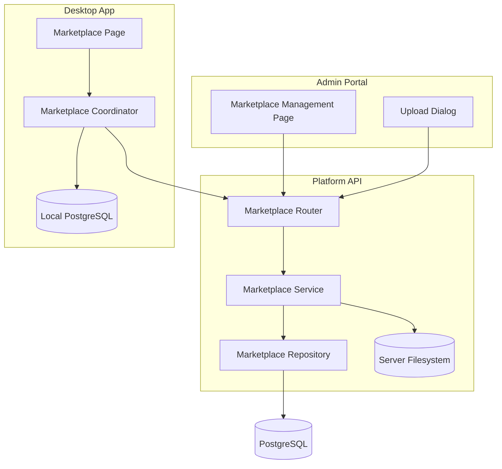
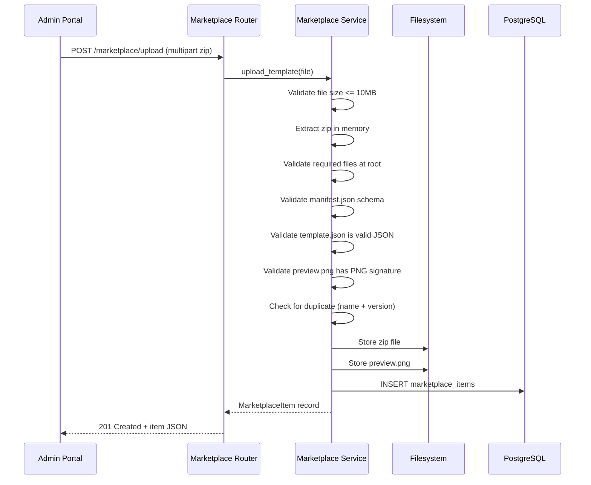
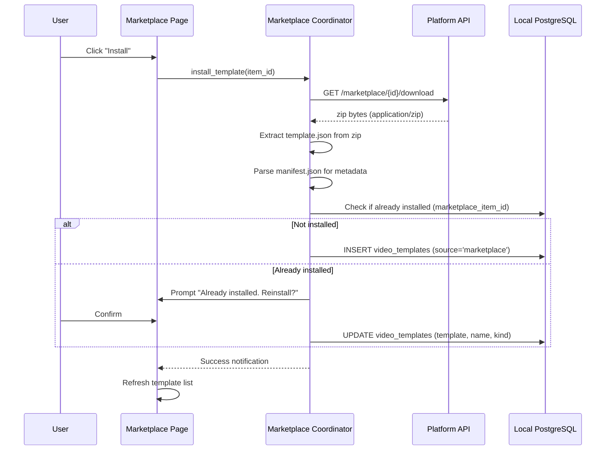

# Design Document: Template Marketplace

## Overview

The Template Marketplace feature introduces a centralized system for distributing curated video templates from admins to desktop app users. Admins upload zip bundles (containing template JSON, preview image, and manifest metadata) through the Admin Portal. The Platform API stores these bundles, serves a browsable catalog, and handles downloads. Desktop app users browse the marketplace, install templates locally, and are protected from accidental modification of marketplace originals via a read-only policy with "Save As" for creating editable copies.

### Key Design Goals

- **Admin Workflow**: Single-step zip upload with automatic validation, metadata extraction, and catalog publishing
- **User Discovery**: Paginated, filterable marketplace catalog with preview thumbnails for quick browsing
- **Safe Installation**: Downloaded templates are marked read-only in the local database; users must "Save As" to modify
- **Consistent Patterns**: Follows existing Platform API layered architecture (router → service → repository), desktop app coordinator pattern, and Admin Portal shadcn/ui + TanStack Query patterns
- **File-Based Storage**: Template zips and preview images stored on the server filesystem (no object storage dependency)

### Technology Choices

- **Platform API**: New `marketplace` router, service, and repository following existing patterns
- **Storage**: Server filesystem under a configurable `MARKETPLACE_STORAGE_PATH` directory
- **Desktop App**: New `features/marketplace/coordinator.py` with `httpx` downloads via the existing Generation Proxy HTTP client pattern
- **Admin Portal**: New `/marketplace` page with upload dialog, status toggles, and delete actions using TanStack Query + shadcn/ui

## Architecture

### High-Level Architecture



### Upload and Validation Flow



### Desktop App Installation Flow



### Module Dependency Graph

```
platform_api/
├── routers/
│   └── marketplace.py              # NEW — /marketplace/* endpoints
├── services/
│   └── marketplace_service.py      # NEW — Upload validation, file mgmt
├── repositories/
│   └── marketplace_repo.py         # NEW — marketplace_items CRUD
├── models/
│   └── marketplace_schemas.py      # NEW — Pydantic models
└── migrations/
    └── versions/
        └── xxx_add_marketplace_items.py  # NEW — DB migration

python_app/
├── features/
│   └── marketplace/
│       ├── __init__.py             # NEW
│       └── coordinator.py          # NEW — Browse, install, reinstall
├── views/
│   ├── marketplace_view.py         # NEW — Grid UI with cards
│   └── marketplace_page_controller.py # NEW — View controller
└── database/
    └── marketplace_queries.py      # NEW — Local DB queries

admin_portal/
├── src/pages/
│   └── marketplace/
│       └── index.tsx               # NEW — Management page
├── src/components/
│   └── marketplace/
│       ├── upload-dialog.tsx        # NEW — Upload modal
│       └── marketplace-table.tsx    # NEW — Items table
├── src/hooks/
│   └── use-marketplace.ts          # NEW — TanStack Query hooks
└── src/types/
    └── marketplace.ts              # NEW — TypeScript types
```

## Components and Interfaces

### Platform API — Marketplace Router

```python
router = APIRouter(prefix="/marketplace", tags=["marketplace"])

# Admin endpoints (require admin role)
POST   /marketplace/upload          # Upload new template bundle
GET    /marketplace/admin/items     # List all items (admin view, paginated)
PATCH  /marketplace/items/{id}      # Update metadata
POST   /marketplace/items/{id}/enable   # Enable item
POST   /marketplace/items/{id}/disable  # Disable item
DELETE /marketplace/items/{id}      # Delete item + files

# Public endpoints (require authenticated user)
GET    /marketplace/catalog         # Browse enabled items (paginated, filterable)
GET    /marketplace/items/{id}/preview  # Serve preview PNG
GET    /marketplace/items/{id}/download # Download zip bundle
```

### Platform API — Marketplace Service Interface

```python
from typing import Protocol
from uuid import UUID

class MarketplaceServicePort(Protocol):
    async def upload_template(self, file_content: bytes, filename: str) -> MarketplaceItem: ...
    async def list_items(self, *, page: int, page_size: int) -> PaginatedResult[MarketplaceItem]: ...
    async def get_catalog(self, *, page: int, page_size: int, kind: str | None, search: str | None) -> PaginatedResult[MarketplaceItem]: ...
    async def update_item(self, item_id: UUID, update: MarketplaceItemUpdate) -> MarketplaceItem: ...
    async def enable_item(self, item_id: UUID) -> MarketplaceItem: ...
    async def disable_item(self, item_id: UUID) -> MarketplaceItem: ...
    async def delete_item(self, item_id: UUID) -> None: ...
    async def get_preview_path(self, item_id: UUID) -> str: ...
    async def get_download_path(self, item_id: UUID) -> str: ...
```

### Platform API — Marketplace Repository Interface

```python
class MarketplaceRepositoryPort(Protocol):
    async def create(self, item: MarketplaceItem) -> MarketplaceItem: ...
    async def get_by_id(self, item_id: UUID) -> MarketplaceItem | None: ...
    async def find_by_name_version(self, name: str, version: str) -> MarketplaceItem | None: ...
    async def list_all(self, *, offset: int, limit: int) -> tuple[list[MarketplaceItem], int]: ...
    async def list_enabled(self, *, offset: int, limit: int, kind: str | None, search: str | None) -> tuple[list[MarketplaceItem], int]: ...
    async def update(self, item_id: UUID, fields: dict) -> MarketplaceItem | None: ...
    async def delete(self, item_id: UUID) -> bool: ...
```

### Desktop App — Marketplace Coordinator

```python
class MarketplaceCoordinator:
    """Orchestrates marketplace browsing and template installation.

    Dependencies (constructor-injected):
        http_client: httpx.Client (shared instance with auth headers)
        db_config: database connection config
        user_id: str
        on_install_complete: Callable[[str], None]  # template uid
        on_error: Callable[[str], None]
        logger: LoggerPort | None
    """

    def fetch_catalog(self, *, page: int, kind: str | None, search: str | None) -> CatalogResponse: ...
    def install_template(self, item_id: str) -> str: ...
    def reinstall_template(self, item_id: str) -> str: ...
    def is_installed(self, marketplace_item_id: str) -> bool: ...
```

### Admin Portal — Key Components

**MarketplacePage** (`pages/marketplace/index.tsx`):
- Paginated table with TanStack Query (`useMarketplaceItems`)
- Upload button → UploadDialog
- Status toggle per row
- Delete with confirmation dialog

**UploadDialog** (`components/marketplace/upload-dialog.tsx`):
- File input (`.zip`, max 10MB client-side check)
- Upload progress indicator
- Error display from API validation
- Success → close dialog, invalidate query

**useMarketplace hook** (`hooks/use-marketplace.ts`):
- `useMarketplaceItems(page)` — admin list query
- `useUploadTemplate()` — mutation
- `useToggleStatus(id)` — mutation
- `useDeleteItem(id)` — mutation

## Data Models

### Database Schema — Platform API (PostgreSQL)

```sql
CREATE TABLE marketplace_items (
    id UUID PRIMARY KEY DEFAULT gen_random_uuid(),
    name VARCHAR(200) NOT NULL,
    description VARCHAR(2000) NOT NULL,
    version VARCHAR(50) NOT NULL,
    author VARCHAR(200) NOT NULL,
    kind VARCHAR(20) NOT NULL CHECK (kind IN ('video', 'reel')),
    tags TEXT[] NOT NULL DEFAULT '{}',
    status VARCHAR(20) NOT NULL DEFAULT 'enabled' CHECK (status IN ('enabled', 'disabled')),
    zip_path VARCHAR(500) NOT NULL,
    preview_path VARCHAR(500) NOT NULL,
    created_at TIMESTAMPTZ NOT NULL DEFAULT NOW(),
    updated_at TIMESTAMPTZ NOT NULL DEFAULT NOW(),
    UNIQUE(name, version)
);

CREATE INDEX idx_marketplace_items_status ON marketplace_items(status);
CREATE INDEX idx_marketplace_items_kind ON marketplace_items(kind);
CREATE INDEX idx_marketplace_items_created ON marketplace_items(created_at DESC);
```

### Database Schema — Desktop App (Local PostgreSQL)

The existing `video_templates` table is extended with a new column:

```sql
ALTER TABLE video_templates
ADD COLUMN marketplace_item_id TEXT DEFAULT NULL;

CREATE INDEX idx_video_templates_marketplace_item
ON video_templates(marketplace_item_id)
WHERE marketplace_item_id IS NOT NULL;
```

Existing columns used:
- `uid` — generated UUID for local record
- `name` — template name from manifest
- `source` — set to `'marketplace'` for installed templates
- `template` — JSONB from template.json
- `kind` — `'video'` or `'reel'` from manifest
- `created_at`, `updated_at` — timestamps

### Pydantic Schemas — Platform API

```python
from pydantic import BaseModel, Field
from datetime import datetime
from uuid import UUID

class ManifestSchema(BaseModel):
    name: str = Field(min_length=1, max_length=200)
    description: str = Field(min_length=1, max_length=2000)
    version: str = Field(min_length=1, max_length=50)
    author: str = Field(min_length=1, max_length=200)
    kind: Literal["video", "reel"]
    tags: list[str] = Field(default_factory=list, max_length=20)

class MarketplaceItemResponse(BaseModel):
    id: UUID
    name: str
    description: str
    version: str
    author: str
    kind: str
    tags: list[str]
    status: str
    preview_url: str
    created_at: datetime

class MarketplaceItemListResponse(BaseModel):
    items: list[MarketplaceItemResponse]
    total: int
    page: int
    page_size: int

class MarketplaceItemUpdateRequest(BaseModel):
    name: str | None = Field(None, min_length=1, max_length=200)
    description: str | None = Field(None, min_length=1, max_length=2000)
    tags: list[str] | None = Field(None, max_length=20)

class CatalogQueryParams(BaseModel):
    page: int = Field(default=1, ge=1)
    page_size: int = Field(default=25, ge=1, le=100)
    kind: Literal["video", "reel"] | None = None
    search: str | None = Field(None, min_length=1, max_length=100)
```

### TypeScript Types — Admin Portal

```typescript
interface MarketplaceItem {
  id: string;
  name: string;
  description: string;
  version: string;
  author: string;
  kind: 'video' | 'reel';
  tags: string[];
  status: 'enabled' | 'disabled';
  preview_url: string;
  created_at: string;
}

interface MarketplaceListResponse {
  items: MarketplaceItem[];
  total: number;
  page: number;
  page_size: number;
}

interface MarketplaceItemUpdate {
  name?: string;
  description?: string;
  tags?: string[];
}
```

### Filesystem Storage Layout

```
{MARKETPLACE_STORAGE_PATH}/
├── zips/
│   ├── {item_id}.zip
│   └── ...
└── previews/
    ├── {item_id}.png
    └── ...
```

- `MARKETPLACE_STORAGE_PATH` defaults to `./marketplace_storage` relative to the Platform API working directory
- Configured via `Settings.marketplace_storage_path` in `platform_api/config.py`

### Manifest.json Schema (inside zip)

```json
{
  "name": "Neon Pulse",
  "description": "High-energy visualizer template with neon gradients",
  "version": "1.0.0",
  "author": "Admin",
  "kind": "video",
  "tags": ["neon", "edm", "energetic"]
}
```

### Upload Validation Rules

1. File size ≤ 10 MB (checked before extraction)
2. Valid zip archive (parseable by `zipfile` module)
3. Root-level files only: `template.json`, `preview.png`, `manifest.json`
4. `manifest.json`: Valid JSON with all required fields non-empty, `kind` ∈ {"video", "reel"}, `tags` ≤ 20 items each ≤ 50 chars
5. `template.json`: Parseable as JSON (conforms to video template schema)
6. `preview.png`: First 8 bytes match PNG signature (`\x89PNG\r\n\x1a\n`)
7. No duplicate (name, version) pair in existing records


## Correctness Properties

*A property is a characteristic or behavior that should hold true across all valid executions of a system — essentially, a formal statement about what the system should do. Properties serve as the bridge between human-readable specifications and machine-verifiable correctness guarantees.*

### Property 1: Upload round-trip preserves manifest metadata

*For any* valid Template_Bundle zip containing a manifest with arbitrary name (1-200 chars), description (1-2000 chars), version (1-50 chars), author (1-200 chars), kind ∈ {"video", "reel"}, and tags (0-20 items, each 1-50 chars), uploading the bundle SHALL produce a MarketplaceItem record whose name, description, version, author, kind, and tags exactly match the manifest values, with status set to "enabled".

**Validates: Requirements 1.1, 1.6**

### Property 2: Zip structure validation identifies missing files

*For any* zip archive whose root-level file set is a proper subset of {template.json, preview.png, manifest.json} (i.e., at least one required file is missing), the upload SHALL be rejected with a validation error, and the error SHALL list exactly the files that are absent from the archive root.

**Validates: Requirements 1.2, 1.3**

### Property 3: Manifest field validation identifies invalid fields

*For any* manifest.json where one or more required fields (name, description, version, author, kind) are either missing or empty strings, the upload SHALL be rejected with a validation error that identifies each invalid field by name.

**Validates: Requirements 1.4**

### Property 4: Duplicate name+version detection

*For any* two Template_Bundles whose manifests share the same (name, version) pair, uploading the second bundle after the first has been successfully stored SHALL be rejected with a duplicate-item error that includes the conflicting name and version.

**Validates: Requirements 1.8**

### Property 5: Enable/disable controls catalog visibility

*For any* Marketplace_Item, disabling it SHALL cause the public catalog endpoint to exclude it from results, and subsequently enabling it SHALL cause the public catalog endpoint to include it in results. At no point SHALL a disabled item appear in the public catalog.

**Validates: Requirements 2.2, 2.3, 3.1**

### Property 6: Metadata update persistence

*For any* existing Marketplace_Item and any valid metadata update (name 1-200 chars, description 1-2000 chars, tags ≤ 20 items each ≤ 50 chars), applying the update and then fetching the item SHALL return the updated field values exactly as submitted.

**Validates: Requirements 2.5**

### Property 7: Invalid metadata update rejection

*For any* metadata update request containing at least one field that violates constraints (name empty or >200 chars, description empty or >2000 chars, any tag >50 chars, or >20 tags), the update SHALL be rejected with a validation error that identifies the invalid fields without modifying the existing record.

**Validates: Requirements 2.7**

### Property 8: Kind filter returns only matching items

*For any* set of enabled Marketplace_Items with mixed kinds and any kind filter value ∈ {"video", "reel"}, the catalog response SHALL contain only items whose kind matches the filter, and SHALL contain all enabled items of that kind.

**Validates: Requirements 3.2**

### Property 9: Search matches name, description, or tags

*For any* enabled Marketplace_Item and any case-insensitive substring of its name, description, or any of its tags, searching with that substring SHALL include the item in the catalog results.

**Validates: Requirements 3.3**

### Property 10: Catalog ordering is newest-first

*For any* set of enabled Marketplace_Items, the catalog response without explicit ordering SHALL return items in descending created_at order (newest first). For any two adjacent items in the response, the first item's created_at SHALL be ≥ the second item's created_at.

**Validates: Requirements 3.5**

### Property 11: Download round-trip preserves zip content

*For any* Template_Bundle zip that was successfully uploaded, downloading it via the download endpoint SHALL return bytes identical to the original uploaded zip file.

**Validates: Requirements 4.1**

### Property 12: Description truncation at 120 characters

*For any* template description string, the displayed card text SHALL be: the full description if length ≤ 120 characters, or the first 120 characters followed by "…" if length > 120 characters.

**Validates: Requirements 5.5**

### Property 13: Installation creates correct local record

*For any* valid marketplace template download, the installed local record SHALL have: a non-empty generated uid, the template name matching the manifest name, source equal to "marketplace", the template JSON matching template.json contents, kind matching the manifest kind, the current user's user_id, the marketplace item id as reference, and valid timestamps.

**Validates: Requirements 6.1, 6.5**

### Property 14: Reinstall preserves identity while updating content

*For any* installed marketplace template, reinstalling it SHALL: preserve the original uid and created_at timestamp, update the template JSON to the newly downloaded content, update the name and kind to the current manifest values, and update the updated_at timestamp.

**Validates: Requirements 6.6**

### Property 15: Read-only enforcement by source

*For any* template record, the "Save" action SHALL be disabled if and only if source equals "marketplace". Templates with source "user" or "builtin" SHALL have "Save" enabled.

**Validates: Requirements 7.1**

### Property 16: "Save As" creates independent user copy

*For any* installed marketplace template and any valid non-empty non-whitespace name (1-100 chars), "Save As" SHALL create a new record with: a different uid from the original, source equal to "user", the user-provided name, and the current template JSON. The original marketplace template record SHALL remain unchanged in all fields.

**Validates: Requirements 7.2**

### Property 17: Whitespace-only names rejected in "Save As"

*For any* string composed entirely of whitespace characters (spaces, tabs, newlines) or the empty string, submitting it as the name in the "Save As" dialog SHALL be rejected with a validation error, and no new template record SHALL be created.

**Validates: Requirements 7.3**

## Error Handling

### Platform API Error Responses

All errors follow the existing structured error envelope pattern:

```json
{
  "error": {
    "code": "ERROR_CODE",
    "message": "Human-readable description",
    "details": { ... }
  }
}
```

| Scenario | HTTP Status | Error Code | Details |
|----------|-------------|------------|---------|
| Zip exceeds 10 MB | 413 | `FILE_SIZE_EXCEEDED` | `{"max_bytes": 10485760, "actual_bytes": <size>}` |
| Missing zip files | 422 | `INVALID_BUNDLE` | `{"missing_files": ["template.json", ...]}` |
| Invalid manifest fields | 422 | `INVALID_MANIFEST` | `{"invalid_fields": {"name": "required", ...}}` |
| Invalid kind value | 422 | `INVALID_KIND` | `{"valid_values": ["video", "reel"]}` |
| Invalid template.json | 422 | `INVALID_TEMPLATE_JSON` | `{"reason": "not valid JSON"}` |
| Invalid PNG | 422 | `INVALID_PREVIEW_IMAGE` | `{"reason": "not a valid PNG file"}` |
| Duplicate name+version | 409 | `DUPLICATE_ITEM` | `{"name": "...", "version": "..."}` |
| Item not found | 404 | `ITEM_NOT_FOUND` | `{"item_id": "..."}` |
| Item disabled (download) | 403 | `ITEM_NOT_AVAILABLE` | `{"reason": "item is disabled"}` |
| Unauthenticated | 401 | `UNAUTHORIZED` | — |
| Invalid metadata update | 422 | `INVALID_METADATA` | `{"invalid_fields": {"name": "max 200 chars", ...}}` |
| File missing on disk | 500 | `FILE_UNAVAILABLE` | `{"item_id": "..."}` |
| Invalid kind filter | 422 | `INVALID_FILTER` | `{"field": "kind", "valid_values": ["video", "reel"]}` |

### Desktop App Error Handling

| Scenario | User-Facing Behavior |
|----------|---------------------|
| Network unreachable | Error message + "Retry" button on marketplace page |
| API returns 401 | Redirect to login view (existing pattern) |
| Download timeout (30s) | "Download timed out" message + "Try Again" button |
| Corrupt zip / invalid JSON | "Template file is corrupted" message + retry |
| Insufficient disk space | "Not enough disk space" message |
| Database write failure | "Failed to save template" + modifications retained |
| Duplicate install detected | Prompt "Already installed. Reinstall?" |

### File Cleanup on Failure

- **Upload failure after partial file write**: Service catches exceptions during `marketplace_items` INSERT and removes any written zip/preview files from disk
- **Delete failure after DB removal**: Logged as orphaned files; admin can clean up manually. Success returned to caller per Requirement 2.4
- **Installation failure after partial download**: Desktop app removes any partially written temp files before surfacing the error

### Admin Portal Error Handling

- API validation errors → displayed inline below the upload dialog or as toast messages
- Network errors during toggle/delete → revert optimistic UI update, show error toast
- Upload progress indicator with abort capability for large files

## Testing Strategy

### Dual Testing Approach

This feature uses both unit tests and property-based tests for comprehensive coverage:

- **Property-based tests** (Hypothesis for Python, fast-check for TypeScript): Verify universal correctness properties across randomly generated inputs. Minimum 100 iterations per property.
- **Unit tests** (pytest, Vitest): Verify specific examples, edge cases, integration points, and error conditions.

### Property-Based Testing Configuration

**Python (Platform API + Desktop App)**:
- Library: `hypothesis`
- Minimum iterations: 100 (via `@settings(max_examples=100)`)
- Tag format: `# Feature: template-marketplace, Property {N}: {title}`

**TypeScript (Admin Portal)**:
- Library: `fast-check`
- Minimum iterations: 100 (via `fc.assert(prop, { numRuns: 100 })`)
- Tag format: `// Feature: template-marketplace, Property {N}: {title}`

### Test Organization

```
platform_api/tests/
└── test_marketplace/
    ├── test_upload_validation.py       # Properties 1-4, edge cases
    ├── test_catalog.py                 # Properties 5, 8-10
    ├── test_metadata_management.py     # Properties 6-7
    ├── test_download.py                # Property 11
    └── conftest.py                     # Fixtures, generators

python_app/tests/
└── test_marketplace/
    ├── test_installation.py            # Properties 13-14
    ├── test_template_protection.py     # Properties 15-17
    ├── test_description_truncation.py  # Property 12
    └── conftest.py                     # Fixtures, generators

admin_portal/tests/
└── marketplace/
    ├── marketplace-page.test.tsx       # Example-based component tests
    └── upload-dialog.test.tsx          # Upload flow tests
```

### Key Hypothesis Strategies (Python)

```python
from hypothesis import strategies as st

# Valid manifest
valid_name = st.text(min_size=1, max_size=200, alphabet=st.characters(whitelist_categories=('L', 'N', 'P', 'Z')))
valid_description = st.text(min_size=1, max_size=2000)
valid_version = st.from_regex(r'[0-9]+\.[0-9]+\.[0-9]+', fullmatch=True)
valid_author = st.text(min_size=1, max_size=200, alphabet=st.characters(whitelist_categories=('L', 'N', 'P', 'Z')))
valid_kind = st.sampled_from(["video", "reel"])
valid_tag = st.text(min_size=1, max_size=50, alphabet=st.characters(whitelist_categories=('L', 'N')))
valid_tags = st.lists(valid_tag, max_size=20)

# Invalid metadata for rejection tests
invalid_name = st.one_of(st.just(""), st.text(min_size=201, max_size=300))
whitespace_only = st.text(alphabet=st.sampled_from([' ', '\t', '\n', '\r']), min_size=0, max_size=50)
```

### Integration Tests

Integration tests cover the full upload → catalog → download → install pipeline using a test database and temporary filesystem directory:

1. Upload a valid bundle via API → verify catalog listing → download → verify content matches
2. Upload, disable, verify catalog exclusion, enable, verify inclusion
3. Upload duplicate → verify rejection with correct error
4. Full desktop install flow with mocked HTTP responses

### Mocking Strategy

- **Platform API tests**: Use in-memory asyncpg connection pool + temp directory for filesystem
- **Desktop App tests**: Mock `httpx.Client` responses, use test PostgreSQL database
- **Admin Portal tests**: MSW (Mock Service Worker) for API responses
