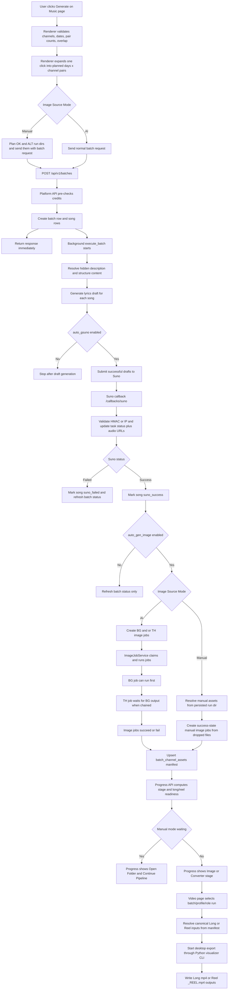
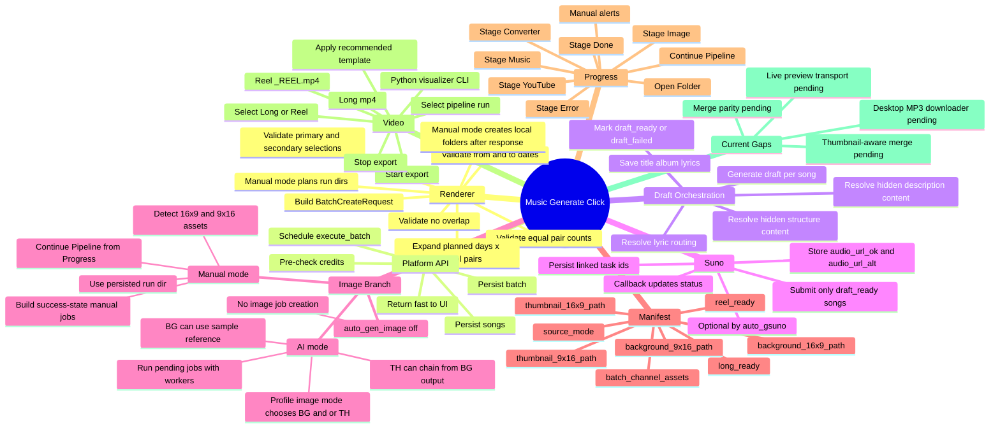

# Music Generate Flow

## Purpose
- Document the real application flow that starts when the user clicks `Generate` on the Music page.
- Capture current logic, branching rules, state transitions, and ownership across Electron renderer, Electron main, Platform API, and downstream runtime services.
- Keep this file as a restart-safe reference for future implementation work.

## Verification Scope
- `verified`: flow traced against the current codebase on `2026-06-29`
- `partially verified`: behavior is present in architecture/docs but still missing a completed runtime slice
- `pending`: planned but not yet implemented

## High-Level Flowchart

## Mind Map

## Step-By-Step Execution

### 1. Music page click
- The `Generate` button triggers `createBatchMutation` in [MusicWorkspacePage.tsx](file:///d:/Development/Projects/Electron/MusicGenerator/camxora/src/renderer/src/features/music/MusicWorkspacePage.tsx#L1142-L1226).
- The renderer validates:
  - at least one Primary and one Secondary channel
  - equal Primary and Secondary counts
  - no overlap between the two lists
  - valid `from_date` and `to_date`

### 2. One click becomes many batch runs
- The renderer expands one user action into:
  - `planned days x selected channel pairs`
- For each day and pair it creates a [BatchCreateRequest](file:///d:/Development/Projects/Electron/MusicGenerator/camxora/src/renderer/src/shared/api/platformEndpoints.ts#L250-L265).

### 3. Manual mode pre-plans run directories
- If `imageSourceMode` is `manual`, the renderer plans deterministic `ok_run_dir` and `alt_run_dir` before calling the API in [MusicWorkspacePage.tsx](file:///d:/Development/Projects/Electron/MusicGenerator/camxora/src/renderer/src/features/music/MusicWorkspacePage.tsx#L1175-L1212).
- After the API returns, Electron creates those folders locally so the user can place files early.

### 4. Batch API persists and returns quickly
- `POST /api/v1/batches` is handled in [batch.py](file:///d:/Development/Projects/Electron/MusicGenerator/platform_api/routers/batch.py#L54-L105).
- The route:
  - calls `batch_service.create_batch(...)`
  - schedules background execution with `BackgroundTasks`
  - returns the new batch response immediately

### 5. Credit gate happens before starting
- `create_batch()` in [batch_service.py](file:///d:/Development/Projects/Electron/MusicGenerator/platform_api/services/batch_service.py#L186-L317) validates input and computes batch cost.
- Current cost rules:
  - draft cost always applies
  - Suno cost applies only when `auto_gsuno = true`
  - image cost applies only when `auto_gen_image = true` and image mode is not Manual

### 6. Batch and song rows are created
- The batch stores:
  - profile ids
  - `auto_gen_image`
  - `auto_gsuno`
  - planned dates
  - optional `ok_run_dir` and `alt_run_dir`
- Songs are created as `pending`.

### 7. Background batch execution starts
- `execute_batch()` in [batch_service.py](file:///d:/Development/Projects/Electron/MusicGenerator/platform_api/services/batch_service.py#L319-L380) loads the batch and calls `orchestrate_drafts(...)`.

### 8. Draft generation resolves hidden Admin prompt content
- `orchestrate_drafts()` in [batch_service.py](file:///d:/Development/Projects/Electron/MusicGenerator/platform_api/services/batch_service.py#L424-L515) runs one draft per song.
- Before draft generation, `_resolve_song_prompt_content()` in [batch_service.py](file:///d:/Development/Projects/Electron/MusicGenerator/platform_api/services/batch_service.py#L891-L916) resolves:
  - `description_id` -> real hidden description content
  - `structure_id` -> real hidden structure content
- This keeps the UI selector simple while using real admin-managed prompt content at runtime.

### 9. Draft result handling
- On success:
  - `title`, `album`, and `lyrics` are saved
  - song status becomes `draft_ready`
- On failure:
  - song status becomes `draft_failed`

### 10. `auto_gsuno` branch
- If `auto_gsuno = false`, execution stops after drafts and batch status is refreshed.
- If `auto_gsuno = true`, successful drafts are submitted to Suno through `_submit_song_to_suno()` in [batch_service.py](file:///d:/Development/Projects/Electron/MusicGenerator/platform_api/services/batch_service.py#L942-L963).

### 11. Suno submission
- Each successful song:
  - resolves style from hidden description content
  - submits title + lyrics + style to Suno
  - links the created Suno task to the song and batch
  - marks the song `suno_pending`

### 12. Suno callback
- Public callback endpoint: [callbacks.py](file:///d:/Development/Projects/Electron/MusicGenerator/platform_api/routers/callbacks.py#L295-L469)
- It performs:
  - HMAC or IP validation
  - payload parsing
  - task lookup
  - status mapping
  - `audio_url_ok` and `audio_url_alt` extraction
  - task status persistence
  - batch-service lifecycle handoff
  - user notification push and queue fallback

### 13. Suno success and failure handling
- `handle_suno_task_update()` in [batch_service.py](file:///d:/Development/Projects/Electron/MusicGenerator/platform_api/services/batch_service.py#L776-L790):
  - `SUCCESS` -> mark song `suno_success`, then continue into image logic
  - `FAILED` or `CANCELLED` -> mark song `suno_failed`, refresh batch status

### 14. `auto_gen_image` branch
- If `auto_gen_image = false`, image job creation is skipped.
- If `auto_gen_image = true`, `create_image_jobs_for_song()` in [batch_service.py](file:///d:/Development/Projects/Electron/MusicGenerator/platform_api/services/batch_service.py#L549-L623) creates image work for OK and ALT profiles.

### 15. Profile image mode branch
- `_create_jobs_for_profile()` in [batch_service.py](file:///d:/Development/Projects/Electron/MusicGenerator/platform_api/services/batch_service.py#L1031-L1252) reads `profile.image_config.mode`:
  - `bg_thumb`
  - `bg_only`
  - `thumb_only`
- This controls whether the profile gets Background jobs, Thumbnail jobs, or both.

### 16. AI image mode
- In AI mode:
  - Background jobs use `background_prompt` plus the current UI background prompt
  - Thumbnail jobs use `thumbnail_prompt` plus the current UI thumbnail prompt
  - Background jobs can use a sample-library reference image
  - Thumbnail jobs can use a style reference and can depend on background output via `source_job_id`

### 17. Manual image mode
- In Manual mode, `_build_manual_jobs_for_profile()` in [batch_service.py](file:///d:/Development/Projects/Electron/MusicGenerator/platform_api/services/batch_service.py#L1206-L1252) reads the persisted run dir and checks for required files.
- If the required assets exist, it builds already-successful jobs with:
  - `provider = manual`
  - `status = success`
  - `output_image_path` pointing to user-supplied files

### 18. Image runner for AI mode
- `run_pending_jobs()` in [image_job_service.py](file:///d:/Development/Projects/Electron/MusicGenerator/platform_api/services/image_job_service.py#L160-L202) claims pending jobs and processes them with worker limits.
- `_run_one_job()` in [image_job_service.py](file:///d:/Development/Projects/Electron/MusicGenerator/platform_api/services/image_job_service.py#L204-L299) handles:
  - credit enforcement for non-prepaid image jobs
  - prompt validation
  - base-image resolution
  - generation provider call
  - output file writing
  - success or failure persistence

### 19. Real BG -> TH chaining
- `_resolve_base_image_bytes()` and `_wait_for_source_job_output()` in [image_job_service.py](file:///d:/Development/Projects/Electron/MusicGenerator/platform_api/services/image_job_service.py#L306-L353) implement real dependency waiting.
- Thumbnail jobs:
  - wait for source background output if `source_job_id` exists
  - go back to `pending` with a dependency message when background is not ready yet

### 20. Canonical manifest update
- `_sync_batch_channel_asset_manifests()` in [batch_service.py](file:///d:/Development/Projects/Electron/MusicGenerator/platform_api/services/batch_service.py#L1180-L1205) persists `batch_channel_assets`.
- The canonical fields are:
  - `run_dir`
  - `source_mode`
  - `background_16x9_path`
  - `background_9x16_path`
  - `thumbnail_16x9_path`
  - `thumbnail_9x16_path`

### 21. Progress API determines operational stage
- Progress stage logic is in [progress.py](file:///d:/Development/Projects/Electron/MusicGenerator/platform_api/routers/progress.py#L87-L179).
- Current stage meanings:
  - `Music`: waiting on draft and or saved song output
  - `Image`: waiting on image generation or manual image satisfaction
  - `Converter`: image stage is ready, but converter and merge are still not fully exposed by API
  - `YouTube`: upload in progress
  - `Done`: upload complete
  - `Error`: failure detected

### 22. Long and reel readiness
- Progress merges persisted `batch_channel_assets` with live run-dir scanning in [progress.py](file:///d:/Development/Projects/Electron/MusicGenerator/platform_api/routers/progress.py#L358-L423).
- It computes:
  - `long_ready`
  - `reel_ready`

### 23. Manual-mode Progress actions
- Renderer logic is in [ProgressPage.tsx](file:///d:/Development/Projects/Electron/MusicGenerator/camxora/src/renderer/src/features/shell/ProgressPage.tsx#L193-L290).
- In manual mode, Progress can:
  - inspect the local folder
  - show missing files
  - open the folder
  - call `Continue Pipeline`
- `Continue Pipeline` triggers manual sync through [apiSyncManualImageJobs](file:///d:/Development/Projects/Electron/MusicGenerator/camxora/src/renderer/src/shared/api/platformEndpoints.ts#L832-L832), which routes to `sync_manual_assets_for_batch()` in [batch_service.py](file:///d:/Development/Projects/Electron/MusicGenerator/platform_api/services/batch_service.py#L648-L729).

### 24. Video route consumes canonical branch inputs
- Branch mapping is handled by [videoPipelineInputs.ts](file:///d:/Development/Projects/Electron/MusicGenerator/camxora/src/renderer/src/shared/lib/videoPipelineInputs.ts#L20-L40).
- Current mapping:
  - `Long` -> `background_16x9_path` + `thumbnail_16x9_path` + `profile.video_template_id`
  - `Reel` -> `background_9x16_path` + `thumbnail_9x16_path` + `profile.reel_template_id`

### 25. Desktop export handoff
- Video route UI is in [VideoWorkspacePage.tsx](file:///d:/Development/Projects/Electron/MusicGenerator/camxora/src/renderer/src/features/video/VideoWorkspacePage.tsx#L965-L1073).
- Electron main export coordinator is in [index.ts](file:///d:/Development/Projects/Electron/MusicGenerator/camxora/src/main/index.ts#L661-L786).
- Current export behavior:
  - validate run dir
  - validate branch background
  - list MP3 files
  - validate active template
  - run `python_app.visualizer.main`
  - write Long outputs as standard mp4
  - write Reel outputs as `_REEL.mp4`
  - support stop/cancel

## Stage Ownership Table
| Stage | Owner | Real Today | Notes |
|------|-------|------------|-------|
| Generate click and fanout | Electron renderer | yes | One click expands into days x channel pairs |
| Credit pre-check | Platform API | yes | Happens before batch persistence |
| Batch and song persistence | Platform API | yes | `POST /batches` |
| Draft generation | Platform API | yes | Uses hidden Admin prompt content |
| Suno submission | Platform API | yes | Only when `auto_gsuno` is enabled |
| Suno callback handling | Platform API | yes | Stores audio URLs and routes status back into batch logic |
| MP3 download to run dirs | Electron desktop | partially | architecture chosen, full runtime downloader still pending |
| AI image generation | Platform API | yes | BG and TH jobs run server-side |
| Manual image bypass | Platform API plus Electron local files | yes | Continue Pipeline sync is real |
| Canonical asset manifest | Platform API | yes | `batch_channel_assets` is the downstream source of truth |
| Progress operational view | Platform API plus Electron renderer | yes | Includes manual alerts and long/reel readiness |
| Canonical video input selection | Electron renderer | yes | Video route consumes manifest data |
| Desktop export | Electron main plus Python visualizer CLI | yes | Long and Reel export exist |
| Merge parity | Desktop future slice | no | still pending |
| Live preview transport parity | Desktop future slice | no | still pending |

## State Transition Summary
| Entity | States Used Today | Notes |
|------|--------------------|-------|
| Batch | `pending`, `processing`, `completed`, `partial`, `failed` | Derived from draft and Suno counters in [batch_service.py](file:///d:/Development/Projects/Electron/MusicGenerator/platform_api/services/batch_service.py#L972-L1013) |
| Song | `pending`, `draft_ready`, `draft_failed`, `suno_pending`, `suno_success`, `suno_failed` | Image stage is tracked via image jobs, not a separate song state machine |
| ImageJob | `pending`, `running`, `success`, `failed` | Thumbnail can re-enter `pending` while waiting on background output |
| Progress stage | `Music`, `Image`, `Converter`, `YouTube`, `Done`, `Error` | Converter and merge remain partly informational today |

## Important Logic Rules
- `auto_gsuno = false` stops the automatic pipeline after draft generation.
- `auto_gen_image = false` stops image creation after Suno success.
- Manual image mode does not bill image credits.
- `batch_channel_assets` is the canonical downstream handoff, not `image_jobs.output_image_path`.
- `Long` and `Reel` readiness are separate and must not be collapsed into one generic image-ready state.

## Known Gaps
- `partially verified`: desktop MP3 downloader and retry flow is still pending, even though callback audio URLs are already persisted.
- `verified gap`: converter and merge are not yet fully exposed as real API-backed runtime stages.
- `verified gap`: current desktop export uses canonical branch background plus run-dir MP3s; thumbnail-aware merge and final composition still remain later slices.
- `verified gap`: live preview transport, play/pause/seek, and attach/detach parity are still not implemented.

## Recommended Usage
- Use this file as the operational source of truth when continuing:
  - music downloader work
  - converter and merge parity
  - workflow and progress stage refinement
  - desktop export hardening
