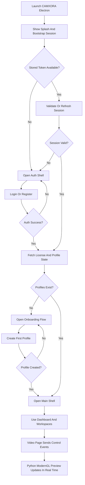

## 1. Product Overview
CAMXORA Electron is a new desktop UI shell built with Electron, React, TypeScript, Tailwind CSS, shadcn/ui, and Lucide icons, while Python remains the backend and rendering engine for business workflows and the native `ModernGL` video preview.

- Primary goal: replace the PyQt-rendered application UI with a modern Electron desktop experience without rewriting the proven Python service logic.
- Target outcome: parity-first migration from the current Python desktop app flow in `python_app/app/bootstrap.py`, `python_app/views/login_view.py`, `python_app/views/onboarding_view.py`, and `python_app/app/main_window.py`.
- Business value: faster UI iteration, consistent design system, easier frontend hiring, cleaner API-first architecture, and long-term reuse of the same backend across desktop surfaces.

## 2. Product Goals

### 2.1 Core Goals
1. Deliver a production-ready Electron desktop app under `d:\Development\Projects\Electron\MusicGenerator\camxora\`.
2. Rebuild the current desktop journey in React: splash/startup, login, register, onboarding, main app shell, and all primary workspaces.
3. Keep all business logic, generation flows, authentication rules, license checks, and platform data in Python/API layers.
4. Preserve the native Python `ModernGL` preview for the Video workspace while moving all surrounding controls and layout into Electron.
5. Follow the existing platform direction where AI routing, provider selection, plans, credits, and policy remain admin-controlled through backend APIs.

### 2.2 Non-Goals
1. Do not rewrite the Python generation engine into Node.js.
2. Do not duplicate AI/provider configuration logic in the Electron app.
3. Do not attempt to literally mount the current PyQt `QOpenGLWidget` inside the React DOM.
4. Do not migrate every legacy page in a single big-bang release; ship incrementally by route and feature slice.

## 3. Current Baseline
The current application flow already provides the functional blueprint for the Electron rewrite.

- Startup entry: `python_app/__main__.py` -> `python_app/app/bootstrap.py`
- Splash: `python_app/app/splash_screen.py`
- Auth shell: `python_app/views/login_view.py`
- Auth orchestration: `python_app/views/login_page_controller.py`
- Onboarding flow: `python_app/views/onboarding_controller.py` and `python_app/views/onboarding_view.py`
- Main window shell: `python_app/app/main_window.py` and `python_app/app/init_orchestrator.py`
- Primary pages: `home`, `profile`, `workflow`, `progress`, `music`, `image`, `video`, `merger`, `settings`, `log`

The Electron app must mirror these runtime decisions:

1. App launch may auto-restore a valid session.
2. If the token is invalid and refresh fails, the user must be returned to auth immediately.
3. If the user has no profiles after authentication, onboarding must open before the main shell.
4. If the user has profiles, the main shell opens directly to the default home/dashboard route.

## 4. Target Users

### 4.1 Primary User
| Role | Registration Method | Core Permissions |
|------|---------------------|------------------|
| Standard creator user | Email registration and login | Use generation workflows, manage profiles, view usage, render media, export content |

### 4.2 Secondary User Types
| Role | Context | Notes |
|------|---------|-------|
| Trial user | New account without paid license | Must see trial plan state, real credits, and gated profile allowance |
| Paid user | Licensed subscriber | Must see plan data, wallet data, usage, and unlocked limits |

## 5. Core Features

### 5.1 Feature Modules
1. **Startup and Session Bootstrap**: splash screen, token restore, refresh, profile check, route decision
2. **Authentication**: login, register, validation, loading, errors, session persistence, immediate logout on `401`
3. **Onboarding**: first-profile creation wizard, media generation helpers, final profile save
4. **Desktop App Shell**: window chrome, sidebar navigation, top status area, route outlet, toast layer, modal layer
5. **Dashboard / Home**: KPI cards, weekly usage, recent activity, real backend stats, zero-state rules using `0`
6. **Profile Workspace**: account details, plan details, credits, profile usage, signed-in state
7. **Workflow Workspace**: workflow actions and status orchestration
8. **Progress Workspace**: job list, filters, status badges, polling/streaming updates, row actions
9. **Music Workspace**: generation forms, profile settings tabs, publication settings, backend-driven model behavior
10. **Image Workspace**: prompt workflow, samples/assets, generation history, result gallery
11. **Video Workspace**: Electron control page + native Python preview companion + export operations
12. **Merger Workspace**: deferred/placeholder route unless actively required in later milestones
13. **Settings Workspace**: user-facing desktop settings only; no local AI/provider configuration
14. **Log Workspace**: runtime logs, operation trace, diagnostics view

### 5.2 Page Details
| Page Name | Module Name | Feature Description |
|-----------|-------------|---------------------|
| Splash | Bootstrap status | Shows app loading stages, validates stored session, transitions without flashing incorrect UI |
| Auth | Login panel | Email/password login, loading state, form validation, auth errors, immediate session redirect on success |
| Auth | Register panel | Name/email/password registration, server error handling, duplicate email flow, post-register onboarding entry |
| Auth | Session restore | Silent validation/refresh using stored tokens before showing login |
| Onboarding | Welcome and stepper | Introduces required first profile setup and tracks multi-step progress |
| Onboarding | Profile identity | Channel name, genre, persona basics, validation |
| Onboarding | Assets and generation | Logo, cover, description, keywords, tags, generated helper actions |
| Onboarding | Final review | Summary, profile creation, success transition into main shell |
| App Shell | Sidebar navigation | Primary routes, active state, account/plan context, logout |
| Home | Dashboard metrics | Stats cards, charts, recent activity, zero-filled backend data |
| Profile | Account summary | User info, plan data, credits, usage summary |
| Workflow | Task center | Workflow states, start/stop actions, queue visibility |
| Progress | Job tracking | Status table, filter bar, polling/stream updates, error surfacing |
| Music | Profiles tab | Two-pane layout, plan-gated profile creation, list/detail editing |
| Music | Publication tab | YouTube/social metadata controls and save flow |
| Music | Settings tab | Video path, workers, image settings, backend-driven generation defaults |
| Image | Generator | Prompt inputs, reference/samples, results, retry/regenerate actions |
| Video | Control page | Template controls, timing, overlays, export setup, preview open/close actions |
| Video | Native preview companion | Frameless or attached preview window rendered in Python `ModernGL` and updated in real time from React controls |
| Settings | App preferences | Desktop preferences, API base URL, general app behavior, no provider management UI |
| Log | Runtime diagnostics | Structured logs, filtering, copy/export actions |

## 6. Core Process

### 6.1 Main User Flows
1. **Cold Start**
   - User launches CAMXORA Electron.
   - App shows splash screen and performs session bootstrap.
   - If the token is valid and profiles exist, open main shell.
   - If the token is valid but no profiles exist, open onboarding.
   - If validation fails, open auth.

2. **Authentication**
   - User logs in or registers.
   - Backend returns tokens and profile existence status.
   - App validates plan/license state.
   - User is routed to onboarding or the main shell.

3. **Onboarding**
   - User completes first-profile setup.
   - App uses backend endpoints for genre data and content generation helpers.
   - Final profile save succeeds.
   - User enters the main shell with the newly created profile available.

4. **Daily Usage**
   - User opens dashboard and workspaces.
   - User triggers music/image/video flows.
   - App continuously reflects backend state, job progress, credits, and errors.

5. **Video Preview**
   - User opens the Video page in Electron.
   - React controls modify template and preview settings.
   - App sends state changes to Python in real time.
   - Python native preview window updates immediately and remains visually attached to the app workflow.

### 6.2 Flow Diagram

## 7. User Interface Design

### 7.1 Design Style
- Overall style: premium dark desktop studio, dense but clean, card-based, precise optical spacing
- Primary colors: deep navy surfaces with controlled purple gradient accents
- Accent gradient: use CAMXORA brand direction consistent with current desktop purple action emphasis
- Buttons: shadcn variants with custom desktop sizing, strong active states, icon-first action buttons
- Typography: modern readable UI font stack for Electron, with strong heading/body hierarchy and compact desktop rhythm
- Icon style: Lucide icons throughout, semantically mapped per action and field
- Layout style: desktop-first shell with sidebar + top context band + route content area

### 7.2 Page Design Overview
| Page Name | Module Name | UI Elements |
|-----------|-------------|-------------|
| Splash | Loading surface | Branded logo, progress indicator, status lines, smooth transition |
| Auth | Split screen | Brand panel, form card, tabs for login/register, error banner, loading CTA |
| Onboarding | Wizard shell | Stepper, content card, preview areas, generation helper buttons, sticky footer actions |
| Main Shell | Navigation frame | Sidebar, account summary, route header, status badges, toaster, dialogs |
| Dashboard | KPI layout | Stat cards, chart area, recent activity table, empty/loading states |
| Music | Workspace layout | Tabs, two-pane profile editor, settings cards, action bars |
| Image | Generator layout | Input controls, sample gallery, result gallery, progress banners |
| Video | Hybrid layout | React control panels, preview launcher card, native preview companion, export section |
| Progress | Monitoring table | Filter bar, job table, badge system, retry/open actions |
| Settings | Preference panels | Form cards, toggle rows, endpoint settings, reset/logout actions |

### 7.3 Responsiveness
- Desktop-first only for the initial roadmap
- Optimize for `1280x800`, `1440x900`, `1536x864`, `1920x1080`, and higher
- Support window resizing down to a practical minimum desktop width
- No mobile layout requirement

## 8. Product Rules And Acceptance Criteria

### 8.1 Platform Rules
1. Electron owns the UI only.
2. Python/backend remains the source of truth for business logic.
3. AI routing and provider policy remain backend-admin controlled.
4. On `401 Unauthorized`, the app must clear session and redirect to auth immediately.
5. Use real backend data; avoid fake local feature simulation.

### 8.2 Acceptance Criteria
1. A new Electron app workspace exists under `camxora`.
2. Startup/login/register/onboarding/main-shell routing is fully documented before coding begins.
3. Every current primary PyQt page has an Electron route target, migration priority, and backend dependency note.
4. The Video page plan explicitly preserves Python native preview rendering.
5. Implementation order begins with startup/auth/onboarding before workspace-heavy routes.

## 9. Release Phasing
1. **Phase 1**: app foundation, splash, login, register, session bootstrap
2. **Phase 2**: onboarding flow
3. **Phase 3**: main shell, dashboard, profile page, settings, logs
4. **Phase 4**: progress, workflow, music workspace
5. **Phase 5**: image workspace
6. **Phase 6**: video workspace with native preview coordination
7. **Phase 7**: hardening, packaging, telemetry, QA, migration rollout
