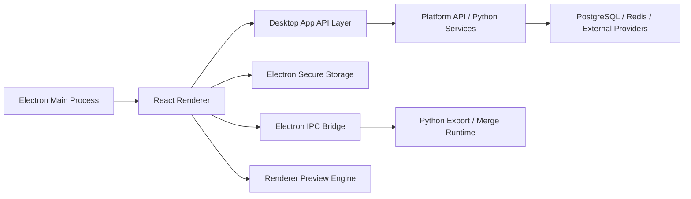
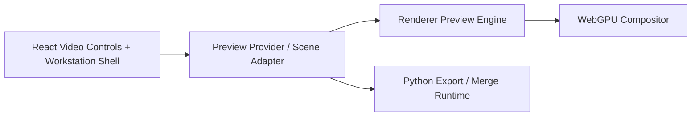
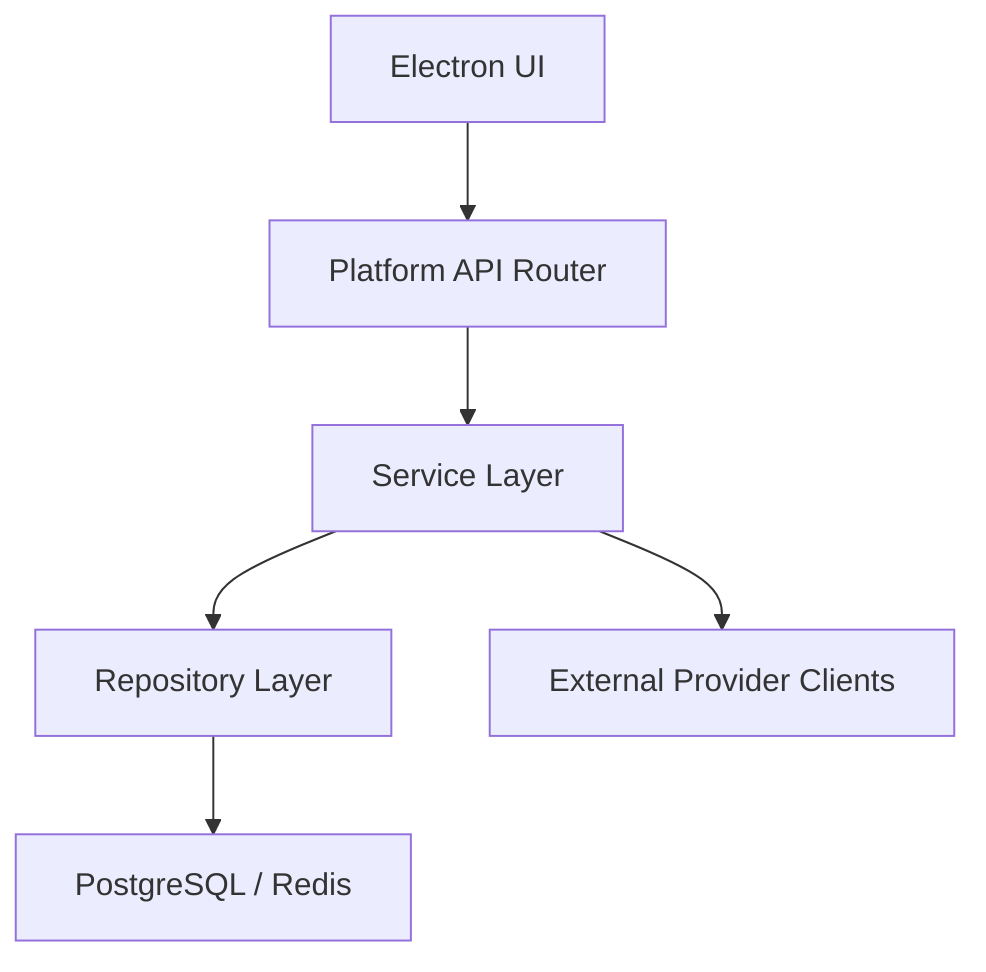

## 1. Architecture Design
CAMXORA Electron is a desktop UI rewrite, not a backend rewrite. The Python platform remains the operational core while Electron becomes the presentation layer.



### 1.1 Source-System Baseline
The new Electron app must preserve the runtime semantics currently implemented in:

- Startup/session bootstrap: `python_app/app/bootstrap.py`
- Login/register orchestration: `python_app/views/login_page_controller.py`
- Onboarding workflow: `python_app/views/onboarding_controller.py`
- Main shell/page wiring: `python_app/app/main_window.py` and `python_app/app/init_orchestrator.py`
- API clients: `python_app/services/*.py`
- Native video preview baseline: `python_app/views/components/_core.py` and `python_app/visualizer/gpu_render.py`
- Electron Video workspace and template state: `camxora/src/renderer/src/features/video/VideoWorkspacePage.tsx` and `camxora/src/renderer/src/features/settings/settingsTemplateDraft.ts`

### 1.2 Architectural Rules
1. The React renderer never owns core business logic.
2. Platform API remains the source of truth for auth, profiles, license state, stats, credits, routing policy, and generation operations.
3. Electron main process owns secure storage, window lifecycle, and native desktop integrations.
4. Python remains the temporary export/render backend, but the future live preview path is renderer-owned.
5. No local duplicate provider/model configuration is allowed in Electron.

## 2. Technology Description

### 2.1 Stack
- Desktop shell: Electron
- Frontend: React 18 + TypeScript
- Router: `HashRouter` or `MemoryRouter` for packaged desktop routing
- Data fetching: TanStack Query
- Form handling: React Hook Form + Zod
- Styling: Tailwind CSS + shadcn/ui
- Icons: Lucide React
- Build tool: Vite
- Packaging: Electron Builder or Electron Forge
- Testing:
  - unit/component: Vitest + Testing Library
  - desktop E2E later: Playwright or Spectron alternative strategy

### 2.2 Recommended App Structure
```text
camxora/
  docs/
    prd.md
    design.md
    technical.md
    tasks.md
  src/
    main/
      index.ts
      windows/
      ipc/
      storage/
      menu/
    preload/
      index.ts
      api.ts
    renderer/
      src/
        app/
          providers/
          routes/
          layout/
        features/
          startup/
          auth/
          onboarding/
          dashboard/
          profile/
          workflow/
          progress/
          music/
          image/
          video/
          settings/
          logs/
        shared/
          api/
          ui/
          hooks/
          lib/
          types/
          assets/
  package.json
  tsconfig.json
  tailwind.config.ts
  postcss.config.js
  vite.config.ts
  electron-builder.yml
```

## 3. Route Definitions
| Route | Purpose |
|-------|---------|
| `/startup` | Session bootstrap and splash experience |
| `/auth/login` | Login flow |
| `/auth/register` | Register flow |
| `/onboarding/welcome` | First-run introduction |
| `/onboarding/profile` | Identity/profile setup |
| `/onboarding/assets` | Logo/cover generation helpers |
| `/onboarding/overview` | Final overview + description/keywords/tags generation |
| `/onboarding/review` | Final confirmation and create |
| `/app/home` | Dashboard/home |
| `/app/profile` | Account and plan overview |
| `/app/workflow` | Workflow operations |
| `/app/progress` | Job monitoring |
| `/app/music` | Music workspace |
| `/app/image` | Image workspace |
| `/app/video` | Video workspace and preview controls |
| `/app/merger` | Reserved route for later parity work |
| `/app/settings` | Python primary settings workspace plus honest contract-limited subsections |
| `/app/log` | Runtime logs and diagnostics |

### 3.1 Current Shell Parity Notes
- The authenticated shell now follows the Python desktop route map and sidebar order:
  - `home`, `profile`, `workflow`, `progress`, `music`, `image`, `video`, `merger`, `settings`, `log`
- The shell frame includes:
  - shared frameless header with window controls
  - left sidebar with account summary
  - route-level header/content outlet
  - bottom status footer
- Sidebar summary is populated from live backend data using `apiGetMe()` and `apiListProfiles()`.
- Dashboard data is now populated from:
  - `GET /api/v1/stats/dashboard`
  - `GET /api/v1/licenses/validate`
- Progress/workflow data is now populated from:
  - `GET /api/v1/progress`
- The new progress endpoint returns a read-only aggregate row model combining:
  - batch metadata
  - downloaded music counts per role
  - image job readiness per profile/role
  - YouTube upload summary per batch
- Current API parity limitation:
  - the Electron dashboard can show license expiration from the license endpoint
  - the sidebar still does not surface expiry yet because that shell summary query is intentionally lightweight
  - converter/merge filesystem state and row actions are still desktop-only and are not yet exposed by API/IPC

## 3.X Pipeline Notes (Music → Suno → Images → Video)

### 3.X.1 Profile Image Mode (`image_config.mode`)
- Stored per profile as `channel_profiles.image_config.mode` (JSONB).
- Values used by backend job creation:
  - `bg_thumb` (default)
  - `bg_only`
  - `thumb_only`
- Electron currently reads this value but must expose an editor control in Settings → Profiles to keep parity with Python.

### 3.X.2 Suno Callback Reachability
- Suno can only call the callback if `callbackUrl` is reachable from the public internet.
- Local dev `http://localhost:8000/...` will not work unless tunneled (ngrok/cloudflared) or deployed.
- Callback handler persists status + `audio_url_ok/audio_url_alt` and triggers downstream automation (image jobs) when `batch.auto_gen_image=true`.
- Recommended production callback URL:
  - `https://api.camxora.com/api/v1/callbacks/suno`
- Reasoning:
  - keep callback traffic isolated on the API subdomain
  - avoid coupling callbacks to the marketing/site origin
  - allow stricter infra/security rules for API traffic than the main website
- Local development recommendation:
  - keep the callback contract the same, but point `callback_base_url` to a temporary tunnel only when live callback testing is required
  - otherwise continue using signed callback simulation scripts during development

### 3.X.3 OK/ALT Audio Download Worker (Parity Gap)
- Platform API should remain a status/orchestration layer here:
  - persist `audio_url_ok/audio_url_alt`
  - expose those direct links to the desktop app
  - do not act as the MP3 file downloader
- Desktop app responsibility:
  - determine deterministic output folders per `(batch_id, role, profile)`
  - download OK/ALT songs directly from the provider URL
  - retry/backoff safely on transient failures
  - update downstream progress state so Music/Progress/Workflow reflect real saved-audio counts
- This keeps file I/O local to the desktop workflow and avoids turning Platform API into a media relay.

### 3.X.4 User-Provided Images (Bypass AI Image Generation)
- Add a user-selectable “Image Source Mode” (AI vs User-Provided).
- When user-provided mode is enabled:
  - batch output folders must be allocated immediately after batch creation, not only after later pipeline steps
  - image-job execution must short-circuit in Manual mode and must never enqueue AI image renders for that batch/profile path
  - BG/TH readiness should be computed from filesystem existence + validity (readable image, dimension detection)
  - once required assets are present, a backend sync action should materialize satisfied image state for the batch so Progress can advance to the next real stage without local-only guessing
- Current desktop directory convention for the manual-image foundation:
  - match the same paired run dirs the AI pipeline uses for OK/ALT channel output
  - base directory comes from `sunoOutputDir` with fallback to `downloadsDir`
  - folder shape is `{baseDir}\\{profile.folder_name}\\{publishDate}` and, when that same label already exists, `{publishDate}_{NN}`
  - the desktop app plans those run dirs locally before `POST /batches`, passes them in the create request, and the API persists them as `batch.ok_run_dir` / `batch.alt_run_dir`
  - Progress must inspect the persisted `run_dir` from the batch/progress contract rather than recomputing from batch metadata later
  - Example:
    - `D:\Music\MyChannel\2026-06-29`
    - `D:\Music\MyChannel\2026-06-29_02`
  - Expected filenames inside that directory:
    - `background-16x9.(png|jpg|jpeg|webp)`
    - `background-9x16.(png|jpg|jpeg|webp)`
    - `thumbnail-16x9.(png|jpg|jpeg|webp)`
    - `thumbnail-9x16.(png|jpg|jpeg|webp)`
- Aspect ratio routing:
  - 16:9 assets → long video branch
  - 9:16 assets → reel branch
- Add a persisted `batch_channel_assets` manifest keyed by `(batch_id, profile_id, role)` so downstream stages do not have to guess from `image_jobs.output_image_path`.
  - Fields should include:
    - `run_dir`
    - `source_mode`
    - `background_16x9_path`
    - `background_9x16_path`
    - `thumbnail_16x9_path`
    - `thumbnail_9x16_path`
    - `updated_at`
  - Progress/workflow contracts should derive:
    - `long_ready` from the `16:9` branch inputs
    - `reel_ready` from the `9:16` branch inputs
  - `image_jobs.output_image_path` remains a compatibility/preview field only; it is not the canonical source for converter/reel inputs anymore.
- Video conversion + merge parity remains desktop-only today; Progress and Workflow now consume local run-directory converter/merger truth in the Electron renderer via desktop IPC, while backend API exposure is still a separate phase.
- Before full converter parity exists, the Electron Video route should consume the same canonical branch-input resolver:
  - select a `(batch_id, profile_id, role)` run from Progress data
  - derive branch inputs from `batch_channel_assets`
  - map `Long` → `background_16x9_path` + `thumbnail_16x9_path` + `profile.video_template_id`
  - map `Reel` → `background_9x16_path` + `thumbnail_9x16_path` + `profile.reel_template_id`
- Progress and Workflow should now model downstream states explicitly as:
  - `Music`
  - `Image`
  - `Converter`
  - `Merger`
  - `YouTube`
  - `Done`
  - `Error`
- State meaning:
  - `Converter` = per-track long/reel export readiness or active export runtime
  - `Merger` = final long merge or reel merge readiness/runtime after exports exist
- `Auto Merge` and `Auto Reel` should remain disabled on the Music page until the desktop merge coordinators are real end-to-end.
- Next parity step is a global Electron desktop coordinator mounted in the app shell:
  - poll active progress rows plus settings
  - reuse the persisted `run_dir` and `batch_channel_assets` inputs
  - resolve the profile template per branch before export starts
  - start long export first
  - only start reel export after the long outputs exist for that same `(batch_id, profile_id, role)` lane
  - gate conversion on real downloaded MP3 readiness, not only upstream music success
  - respect active export and merge runtime state so a second branch is never started while the desktop worker is still busy
  - rely on the existing Electron main export runtime for merge behavior instead of inventing a second execution path
- Toggle enablement rule:
  - `Auto-Video`, `Auto Merge`, and `Auto Reel` can be enabled only after the shell-level coordinator is live
  - `Auto-Upload` must remain disabled until a real long-merged-output upload runtime exists

### 3.X.5 Workflow vs Progress Recommendation
- `Workflow` should remain a summarized, high-level stage view:
  - best for “where is this run in the pipeline?”
  - not ideal for asset troubleshooting or file-driven resume actions
- `Progress` should become the detailed operational surface:
  - show direct/manual asset requirements per run
  - show current readiness of OK/ALT song files and BG/TH manual images
  - now show MP3 download state plus desktop-inspected converter and merger state from the persisted `run_dir`
  - later graduate those desktop-only runtime signals into a reusable backend/API contract if cross-device visibility becomes necessary
  - surface actionable alerts and “Continue Pipeline” / resume actions
  - the resume action should call a dedicated backend sync contract that validates the persisted run dir and updates batch image state for all applicable songs/profiles in that batch
- This split keeps Workflow visually clean while letting Progress own operational recovery.
- UX differentiation for Electron:
  - `Workflow` should render one selected run in a richer visual timeline and keep only lightweight selection/filter controls
  - `Workflow` should not duplicate the shell page title with another large intro card inside the route body; use one compact control rail instead
  - when no rows match, `Workflow` should show one empty-state board instead of separate empty run and timeline panels
  - `Workflow` should promote the selected row into a hero surface so stage, status, role, and summary metrics are clear before the user scans the detailed stage cards
  - `Progress` should keep the multi-row table, operational filters, download visibility, and all recovery controls
  - `Progress` should collapse repeated top-level summary sections into one command surface plus the table so it reads as an operator console instead of stacked dashboards
  - both pages must derive from the same canonical row model so visual state and action state never diverge
  - both pages should reuse the same shared renderer primitives for selects, date picking, and inline toggles so Windows browser-default controls never leak back into the workspace UI

## 4. Runtime State Model

### 4.1 State Layers
1. **Server State**
   - profiles
   - stats
   - plan/license
   - jobs/progress
   - generation results
   - user account data
   - handled via TanStack Query

2. **Client UI State**
   - modal open/close
   - active tabs
   - local form state
   - preview panel status
   - wizard step state

3. **Secure Session State**
   - access token
   - refresh token
   - selected environment/base URL
   - stored via Electron secure storage, not browser `sessionStorage`

4. **Onboarding Draft State**
   - selected genre
   - generated / chosen names
   - generated / uploaded logos and covers
   - shared overview description, keywords, and tags
   - stored via Electron secure storage and hydrated during bootstrap for the same signed-in account

### 4.2 Providers
- `QueryClientProvider`
- `AuthProvider`
- `ThemeProvider` if later required
- `DialogProvider` and `ToastProvider`
- `PreviewProvider` for Video page coordination

## 5. API Definitions

### 5.1 API Strategy
Use a single client abstraction in the renderer:

```ts
interface DesktopApiClient {
  get<T>(path: string, config?: RequestConfig): Promise<T>;
  post<T>(path: string, body?: unknown, config?: RequestConfig): Promise<T>;
  put<T>(path: string, body?: unknown, config?: RequestConfig): Promise<T>;
  patch<T>(path: string, body?: unknown, config?: RequestConfig): Promise<T>;
  delete<T>(path: string, config?: RequestConfig): Promise<T>;
}
```

The renderer should not care whether transport is direct HTTP or routed through Electron preload helpers.

### 5.X Image Workspace (Python Parity)
**Current State**
- Electron Image workspace ([ImageWorkspacePage.tsx](file:///d:/Development/Projects/Electron/MusicGenerator/camxora/src/renderer/src/features/image/ImageWorkspacePage.tsx)) is now queue-first:
  - top-left controls for date range, one prompt, reload, generate, and clear
  - top-right stacked background/thumbnail previews
  - queue table below the top section grouped per `(batch_id, profile_id, channel_role)` with BG/TH status cells
- Sample-library curation moved into `Preferences` in [SettingsWorkspacePage.tsx](file:///d:/Development/Projects/Electron/MusicGenerator/camxora/src/renderer/src/features/settings/SettingsWorkspacePage.tsx):
  - background and thumbnail sample directories remain there
  - selected sample subsets and random toggles persist through `/settings`
  - hover preview + click-to-pin selection now live beside those directory settings
- The shared backend `image_jobs` table is the single source of truth for queue items.
- The current backend gap is important:
  - `BatchService` can derive distinct `background_prompt` and `thumbnail_prompt` from `image_config`
  - but `ImageJob` still stores only one `prompt`
  - and `ImageJobService` currently submits image requests with `base_image=None`, so reference-image chaining is not yet real

**Planned Redesign**
- The Image page becomes a true top-level workstation:
  - left card contains date filters, queue list/table (primary), then `Background Prompt` and `Thumbnail Prompt` below the queue
  - right rail contains stacked `Background Preview` and `Thumbnail Preview`
- Sample delivery becomes admin-managed and on-demand:
  - Admin Portal stores multiple named pack entries for background and thumbnail sample zips
  - Electron downloads, extracts, and refreshes local libraries from those admin-managed sources
- Image execution becomes two-stage and reference-aware:
  - background jobs use background sample-library references plus the background prompt
  - thumbnail jobs use generated background output as the main base image plus thumbnail style references and thumbnail prompt

**Platform API Endpoints**
- `GET /api/v1/image-jobs`
  - query: `batch_id`, `status` (repeatable), `limit`
- `POST /api/v1/image-jobs/enqueue`
  - body: `{ batch_ids: string[] }`
- `POST /api/v1/image-jobs/run`
  - body: `{ batch_id?: string, limit?: number }`
  - schedules server-side execution as a background task
- `POST /api/v1/image-jobs/retry`
  - body: `{ job_ids?: string[], batch_id?: string }`
- `POST /api/v1/image-jobs/clear`
  - body: `{ batch_id?: string, statuses?: string[] }`
- Planned admin endpoint usage:
  - existing admin system settings endpoints under `/api/v1/admin/system-settings/*` can bootstrap sample-pack metadata
  - but multiple named entries per category will likely outgrow ad-hoc key/value storage, so a typed admin CRUD route is the safer target shape
  - recommended future route family:
    - `GET /api/v1/admin/image-sample-packs`
    - `POST /api/v1/admin/image-sample-packs`
    - `PATCH /api/v1/admin/image-sample-packs/{pack_id}`
    - `DELETE /api/v1/admin/image-sample-packs/{pack_id}`
    - `GET /api/v1/image-sample-packs` for the user app to fetch visible download options

**Planned Settings Keys**
- User-facing local/runtime settings:
  - `imageBackgroundPrompt`
  - `imageThumbnailPrompt`
  - `imageBackgroundSamplesDir`
  - `imageThumbnailSamplesDir`
  - `imageBgSamples`
  - `imageThumbSamples`
  - `imageBgRandom`
  - `imageThumbRandom`
- Planned admin sample-pack entity fields:
  - `id`
  - `category` (`background` | `thumbnail`)
  - `name`
  - `source_type` (`google_drive` | `direct_url`)
  - `source_value` (file id or normalized URL)
  - `is_active`
  - `sort_order`
  - optional:
    - `version_label`
    - `notes`

**Planned Schema / Domain Changes**
- Extend `ImageJob` persistence beyond a single freeform prompt so the runner can execute deterministically.
- Proposed fields:
  - `user_prompt` or separate stored prompt fields resolved per job
  - `reference_image_path` or `reference_asset_id`
  - `style_reference_path` for thumbnail-style guidance
  - `source_job_id` for thumbnail jobs that chain from generated background outputs
- Keep backward compatibility by making new fields nullable during migration.

**Execution Flow**
- Enqueue:
  - resolves hidden matching batches + songs for the selected date range
  - derives BG/TH jobs per profile using `image_config` rules plus current UI prompt state
  - dedupes by `(song_id, profile_id, kind, channel_role)` to avoid duplicates
- Planned enqueue enrichment:
  - background jobs resolve one chosen background sample reference from the local library
  - thumbnail jobs record a future dependency on the paired background output
  - thumbnail jobs can also retain a style-reference asset from the thumbnail library
- Run:
  - jobs are primarily executed via callback-driven automation; manual runs remain a recovery tool rather than a user-facing primary action
  - the service claims a limited set of pending jobs, sets `RUNNING`
  - background jobs call generation with a real base/reference image from the sample library
  - thumbnail jobs wait until their paired background output exists, then call generation with that generated image as the base image
  - thumbnail jobs also apply prompt/style guidance from the thumbnail stage
  - persists `output_image_path` and marks `SUCCESS` or stores `error` and marks `FAILED`

**Electron Download / Extract Flow**
- Admin Portal owns the named pack catalog and source URLs/IDs.
- User app flow:
  - fetch admin-managed pack metadata
  - show separate named download lists for `Background` and `Thumbnail`
  - let the user pick a pack by display name
  - download the selected zip to temp storage
  - extract into the configured local sample-library directory
  - refresh sample-library state automatically
- Electron-side requirements:
  - download helper with progress/error reporting
  - zip extraction helper in main/preload
  - safe overwrite strategy for existing library contents
  - cleanup of temporary zip files after extraction

**Google Drive Handling**
- Do not rely blindly on pasted browser share URLs in the desktop app.
- Safer approach:
  - accept Google Drive file IDs or validated download URLs in Admin Portal
  - normalize them centrally before the Electron app consumes them
  - keep the future option to swap Google Drive for another host without changing the user flow

**Callback Automation (Python Parity)**
- When Suno callbacks mark a task as `SUCCESS` and the owning batch has `auto_gen_image = true`:
  - `BatchService` creates missing image jobs for the completed song
  - the callback handler schedules `ImageJobService.run_pending_jobs(user_id, batch_id=...)` so images begin generating automatically without manual `Run pending`
  - the job runner claims work with DB locking (`FOR UPDATE SKIP LOCKED`) to avoid duplicate processing when multiple callbacks arrive close together
- Planned chaining constraint:
  - callback-driven automation must still respect background-first sequencing before thumbnail generation inside the same song/profile lane

**Risks / Known Limitations**
- Batch-level credit deduction is done up-front, while direct image generation enforces credits per operation.
- For parity and correctness, the image job runner must not double-charge already prepaid batch image operations.
- Future improvement: add a “usage increment without charging” path so prepaid batches still count toward plan usage limits.
- Additional redesign risks:
  - a schema migration is required for richer image-job metadata
  - Google Drive download behavior may need normalization/proxy logic for stable desktop downloads
  - thumbnail chaining introduces sequencing dependencies that cannot be faked in the UI

### 5.2 Auth API Contracts
```ts
type LoginRequest = {
  email: string;
  password: string;
};

type LoginResponse = {
  access_token: string;
  refresh_token: string;
  token_type: string;
};

type RegisterRequest = {
  email: string;
  password: string;
  full_name: string;
};
```

### 5.3 Onboarding Resume Contracts
- `GET /api/v1/users/me` must expose whether the authenticated email is already confirmed.
- `POST /api/v1/auth/send-verification` should report `is_verified = true` when the email is already confirmed, so the client can skip redundant confirm-code UX safely.
- Bootstrap route decisions must distinguish:
  - unauthenticated -> `/auth/login`
  - authenticated + zero profiles + email not confirmed -> `/onboarding/welcome`
  - authenticated + zero profiles + email confirmed -> `/onboarding/wizard/genre`
  - authenticated + existing profiles -> `/app/home`
- Logout during onboarding or inside the app shell should call `POST /api/v1/auth/logout` before local secure-storage cleanup when possible.

### 5.4 Dev Service Scripts
- `start-services.ps1` must manage:
  - Platform API
  - Admin Portal
  - Electron app
  - MailHog
- MailHog handling must be ownership-aware:
  - reuse an existing MailHog instance when already running
  - stop MailHog only when the service script started it
  - do not blindly kill ports `1025` and `8025`
- `stop-services.ps1` must stop only owned processes recorded by the service metadata file

### 5.5 Current Onboarding UI Notes
- Onboarding now uses the shared `DesktopHeader` so the logo and window controls remain consistent with auth and app-shell routes.
- The verification entry step uses six dedicated digit inputs instead of a single plain text field.
- Onboarding logout is surfaced from the shared layout, not embedded repeatedly inside each step card.
- The logos step must keep using the shared backend generation endpoint already used by Python:
  - `POST /api/v1/channel-setup/generate-logo`
- Python-parity manual logo upload belongs to the Electron desktop boundary:
  - use the existing file-picker IPC surface
  - read the selected local image through Electron main/preload
  - validate and convert it to base64
  - store it in onboarding state for final `/profiles` creation
  - do not add a new backend upload endpoint for this flow
- The final onboarding step should be presented as `Overview` while preserving the Python summary/editor semantics:
  - show both channels in a summary card
  - use `POST /api/v1/channel-setup/generate-description-text`
  - use `POST /api/v1/channel-setup/generate-keywords`
  - use `POST /api/v1/channel-setup/generate-tags`
  - keep description, keywords, and tags shared across both profiles during creation
- Profile creation persistence for onboarding is already backend-backed through `POST /api/v1/channel-setup/create-profile`:
  - `logo_base64` -> `logo_path`
  - `cover_images` -> `image_config.cover_paths`
  - `description`, `keywords`, `tags` -> `youtube_config`

### 5.3 Bootstrap Contract
```ts
type SessionBootstrapResult = {
  authenticated: boolean;
  needsOnboarding: boolean;
  redirectTo: "/auth/login" | "/onboarding/welcome" | "/app/home";
  user?: {
    id: string;
    email: string;
  };
  license?: {
    planName: string;
    credits: number;
    profileAllowance: number;
  };
};
```

### 5.4 Profile/Data Contracts
The Electron app should continue following the current adapter strategy used by Python clients: backend snake_case can be transformed into frontend-friendly structures at the renderer API layer rather than leaking raw response shapes across UI components.

### 5.5 Unauthorized Policy
Any `401` from protected routes must:
1. clear stored session
2. emit an auth-expired event
3. redirect to `/auth/login`
4. surface a user-facing session-expired message if appropriate

## 6. Electron Main / Preload Architecture

### 6.1 Main Process Responsibilities
- Create and manage the main application window
- Persist secure tokens and settings
- Coordinate application lifecycle and single-instance behavior
- Expose safe APIs to the renderer via preload
- Later coordinate the embedded preview host bridge and any native-surface lifecycle needed for the Python renderer

### 6.2 Preload Responsibilities
- Expose whitelisted APIs only
- Provide typed bridge methods for:
  - secure token read/write/clear
  - app info/version
  - environment settings
  - preview control commands
  - preview host / embedding lifecycle commands
  - optional OS integrations such as file pickers and shell open

### 6.3 Renderer Responsibilities
- Render all UI
- Manage routes, forms, and server state
- Never directly use unrestricted Node APIs

## 7. Video Preview Architecture

### 7.1 Recommended Model
Use an Electron renderer-owned preview engine mounted directly into the Video workspace center pane. Keep Python export, merge, and downstream automation temporarily, but stop investing in Python live preview as the long-term path.



### 7.2 Technology Direction
- Recommended renderer stack:
  - custom renderer boundary owned inside `features/video`
  - `WebGPU` as the only live preview compositor backend
  - build spectrum from a linear bar foundation first, then express 180/360 behavior through layer geometry (`curved` + `mirrored`) instead of maintaining a second Canvas implementation
  - move background, logo, smoke, vignette, and text presentation into the same WebGPU output surface rather than leaving them as DOM overlays
- Current implementation slice:
  - the preview slot now mounts one WebGPU canvas as the visible compositor surface
  - the renderer now resolves a split compositor payload:
    - background texture upload
    - native GPU smoke/vignette atmosphere pass
    - overlay texture upload for logo/timed text
    - particle instances
    - spectrum instances
  - the compositor now includes a native post-FX bloom chain (bright pass + blur + composite) so glow/emission behavior can evolve toward the Python/OpenGL look without reopening a CPU renderer path
  - bloom parameters are now scene-driven (threshold/knee/intensity/strength/blur scale) and computed in the preview adapter from spectrum layer glow/blur plus reactive energy before being passed into the compositor
  - when the preview has no usable background scene input, the compositor now falls back to a native engine-owned gradient scene so the renderer remains visibly testable instead of collapsing into a black surface
  - background, smoke, vignette, logo, timed text, particles, and spectrum now land on the same renderer-owned output surface; remaining follow-up GPU work is bloom tuning plus deeper native overlay migration for logo/text fidelity
  - engine-first sequencing is now locked as:
    - native GPU particles
    - native atmosphere/fullscreen effect passes
    - post-FX hardening
- Rationale:
  - the Video workstation is primarily a 2D layered compositor, not a 3D scene
  - the strongest remaining parity wall is not React or Electron, but the current split between GPU spectrum rendering and non-GPU presentation layers
  - a direct WebGPU backend gives the project the long-term shader/post-FX headroom Boss wants without requiring a second backend to be built in parallel right now
  - keeping a split between GPU spectrum and DOM/CSS overlays increases drift risk, so the approved direction is one WebGPU compositor for the visible preview output

### 7.3 Preview Responsibilities
**React / Electron**
- own all user-visible Video workspace UI
- own the preview surface lifecycle and slot mounting
- own capability detection and honest WebGPU-required status reporting
- own preview playback/scrub state
- own audio analysis for reactive preview features
- own scene updates from the existing template draft and workspace state
- own composition of background, spectrum, logo, text, smoke, vignette, and later particles inside one GPU surface

**Python**
- remain the temporary source of final export/render execution
- continue powering the existing CLI export, merge, and downstream automation paths
- stop acting as the future live preview target

### 7.4 Scene Graph Contract
The renderer preview engine should consume the existing template/workspace state and map it into a stable scene graph rather than inventing a second settings model.

```ts
type VideoPreviewSceneState = {
  resolution: { width: number; height: number; branch: 'long' | 'reel' };
  playback: { currentTimeSec: number; durationSec: number; isPlaying: boolean };
  assets: {
    backgroundPath?: string;
    thumbnailPath?: string;
    logoPath?: string;
    audioPath?: string;
  };
  template: Record<string, unknown>;
  overlays: TemplateTextOverlayDraft[];
};
```

Recommended scene layers:
- background layer
- smoke/vignette atmosphere layer
- spectrum layer
- logo layer
- particles layer
- text overlay layer
- post-effects/compositing layer
- optional debug/perf overlay in development only

### 7.5 Preview Provider Responsibilities
Add a renderer-side preview provider/service that:
- accepts the current `VideoWorkspacePage` state and `settingsTemplateDraft` output
- normalizes it into `VideoPreviewSceneState`
- owns asset loading and disposal
- owns renderer startup/shutdown, resize, DPR, and visibility handling
- exposes preview status to the UI:
  - `initializing`
  - `ready`
  - `error`

### 7.5.1 Target Core Engine Modules (Tracked)
The current preview engine exists today, but it is not fully modularized. To prevent architecture drift, the renderer preview engine should be incrementally reorganized into the following target modules. These are tracked as responsibilities first (not necessarily file names), and implemented one-by-one without reintroducing a second preview backend.

| Module | Responsibility | Current Location | Status | Notes |
|--------|----------------|------------------|--------|-------|
| PreviewProvider | lifecycle, startup/shutdown, resize/DPR, status surface, frame loop | `features/video/preview/PreviewProvider.tsx` + `features/video/preview/RendererVideoPreviewSurface.tsx` + `features/video/RendererVideoPreview.tsx` | partial | Provider/service shell is extracted and the wrapper is clean; asset composition, surface lifecycle, transport/audio coordination, scene assembly, and frame-bridge shaping are split out, leaving provider as a thin runtime composition layer |
| CapabilitySelector | detect WebGPU capability + safe local-asset bridge availability | `features/video/useRendererVideoPreview.ts` | partial | WebGPU-only direction; do not add WebGL2 selection unless Boss changes direction |
| SceneStateAdapter | map `template + templateDraft + workspace` into renderable scene payload | `features/video/preview/previewScene.ts` + `features/video/preview/spectrumAdapter.ts` + `features/video/preview/particleAdapter.ts` + `features/video/preview/previewUtils.ts` + `features/settings/settingsTemplateDraft.ts` | partial | `VideoPreviewScene` now owns the higher-level immutable scene payload, and the old adapter compatibility surface is removed; continue moving remaining normalization + GPU-node payload shaping out of the component |
| AssetManager | background/logo/audio source resolution, decode status, lifetime management | `features/video/preview/usePreviewAssetService.ts` + `features/video/useRendererVideoPreview.ts` + `features/video/preview/usePreviewAssetManager.ts` + `features/video/webgpu/webgpuSpectrumRenderer.ts` | partial | Provider-facing source resolution and decode state are now composed behind a dedicated asset service hook; GPU texture lifetime is still inside the renderer class today |
| SurfaceLifecycle | preview container sizing, canvas refs, WebGPU renderer startup/shutdown | `features/video/preview/usePreviewSurfaceLifecycle.ts` + `features/video/webgpu/webgpuSpectrumRenderer.ts` | partial | Provider-facing surface lifecycle is extracted; future work can move more renderer-device concerns behind this boundary |
| TransportCoordinator | preview playback reporting, audio session bootstrap/teardown, volume changes, playback commands | `features/video/preview/usePreviewTransportCoordinator.ts` + `features/video/preview/audioFeatureBus.ts` + `features/video/preview/transportClock.ts` | partial | Provider-facing transport coordination is extracted; future work can move more playback policy and error routing behind this boundary |
| SceneState | preview scale, text/spectrum derivation, DOM presentation state, immutable scene assembly | `features/video/preview/usePreviewSceneState.ts` + `features/video/preview/previewScene.ts` + `features/video/core/scene/sceneGraphComposer.ts` + `features/video/core/scene/attachmentService.ts` | partial | Provider-facing scene assembly is extracted; future work can move more preview-specific selectors into dedicated derivation helpers if needed |
| FrameBridge | provider-to-runtime option shaping into RAF/render orchestration | `features/video/preview/usePreviewProviderState.ts` + `features/video/preview/usePreviewRuntime.ts` + `features/video/preview/previewFrameContract.ts` | partial | The old bridge/coordinator files are removed; remaining work is to narrow the provider-to-runtime option surface and freeze the final public runtime seam |
| DomPresentation | background/logo DOM presentation policy | `features/video/preview/previewDomPresentation.ts` + `features/video/core/scene/sceneGraphComposer.ts` | partial | DOM presentation policy is now isolated from canvas compositing, so background/logo DOM behavior can evolve without editing the fallback canvas path |
| CanvasCompositor | fallback backdrop/overlay canvas compositing | `features/video/preview/previewCanvasCompositor.ts` + `features/video/core/scene/sceneGraphComposer.ts` | partial | Canvas compositing is now isolated from direct DOM presentation updates, so fallback backdrop/logo/text rendering can evolve without widening the DOM-layer seam |
| DomFrameRenderer | DOM-side composition shell over presentation and canvas seams | `features/video/preview/previewDomFrameRenderer.ts` | partial | The DOM frame renderer now composes the DOM presentation and canvas compositor helpers instead of owning both policies inline |
| ReactiveFrameState | analysed-frame resolution, reactive-energy derivation, motion-state updates | `features/video/preview/previewReactiveFrameState.ts` + `features/video/preview/audioSpectrumAnalysis.ts` + `features/video/core/scene/sceneGraphComposer.ts` | partial | Audio/reactive-state analysis is extracted from the RAF coordinator; future work can still move more domain-specific motion policies behind narrower helpers if they grow |
| SpectrumGpuRuntime | spectrum instance assembly and attachment-aware radius policy | `features/video/domains/spectrum/spectrumGpuRuntime.ts` + `features/video/domains/spectrum/spectrumGpuContract.ts` + `features/video/preview/spectrumAdapter.ts` | partial | Spectrum instance building is now isolated behind a spectrum-domain runtime entrypoint and the preview-local wrapper has been removed |
| ParticleGpuRuntime | particle simulation and anchor-radius policy | `features/video/domains/particles/particleGpuRuntime.ts` + `features/video/domains/particles/particleGpuContract.ts` + `features/video/preview/particleAdapter.ts` | partial | Particle simulation is now isolated behind a particles-domain runtime entrypoint and the preview-local wrapper has been removed |
| PreviewScene | immutable preview scene payload across viewport, transport, domain nodes, and GPU policy | `features/video/preview/previewScene.ts` + `features/video/preview/usePreviewSceneState.ts` | partial | Scene assembly now owns immutable GPU policy (`gpuNode`) for atmosphere eligibility, spectrum-instance submission, and fallback-scene submission, so downstream runtime helpers stop reconstructing those decisions inline |
| AtmosphereGpuMath | low-level WebGPU atmosphere shaping math | `features/video/domains/atmosphere/atmosphereGpuMath.ts` + `features/video/preview/previewUtils.ts` | partial | The lowest-level atmosphere math now lives under the atmosphere domain instead of the older mixed preview adapter |
| AtmosphereGpuRuntime | atmosphere-domain GPU shaping policy | `features/video/domains/atmosphere/atmosphereGpuRuntime.ts` + `features/video/domains/atmosphere/atmosphereGpuMath.ts` | partial | Atmosphere shaping now enters preview orchestration through an atmosphere-domain runtime entrypoint and domain-owned math helper |
| GpuBloomTuning | bloom-stat derivation and post-FX tuning math | `features/video/preview/previewGpuBloomTuning.ts` + `features/video/preview/previewUtils.ts` | partial | Low-level bloom/stat aggregation and post-FX tuning are now isolated from the compatibility adapter surface and from atmosphere-domain logic |
| GpuPostFx | shared preview bloom/post-FX composition | `features/video/preview/previewGpuPostFx.ts` + `features/video/preview/previewGpuBloomTuning.ts` | partial | Shared post-FX composition is now isolated from atmosphere-domain policy so preview bloom tuning can evolve without touching atmosphere ownership |
| GpuEffects | atmosphere and post-FX shaping composition | `features/video/domains/atmosphere/atmosphereGpuRuntime.ts` + `features/video/preview/previewGpuPostFx.ts` + `features/video/preview/previewGpuDomainPreparation.ts` | partial | The old combined preview wrappers are removed, so effect shaping now enters the GPU path directly through the narrowed atmosphere and post-FX seams |
| GpuExecutionPlan | final GPU execution-plan assembly before submission | `features/video/preview/previewGpuExecutionPlan.ts` | partial | Submission-plan shaping is now isolated from the GPU composition shell, so instance pass-through, fallback-scene submission, and final surface dimensions route through one dedicated helper |
| GpuDomainPreparation | GPU-side spectrum, particle, and effect preparation | `features/video/preview/previewGpuDomainPreparation.ts` | partial | Domain preparation is now grouped behind one helper so spectrum/particle/effect prep can evolve without changing the shared submission path |
| GpuRuntimeResult | GPU timing/result packaging after submission | `features/video/preview/previewGpuRuntimeResult.ts` | partial | GPU return-contract shaping is now isolated from the GPU composition shell, so timing aggregation and result packaging no longer widen the compositor adapter |
| GpuSubmission | final WebGPU submission contract | `features/video/preview/previewGpuSubmission.ts` + `features/video/webgpu/webgpuSpectrumRenderer.ts` | partial | Final renderer submission is now isolated from effect shaping, so render-call contract changes no longer require edits in the broader GPU prep path |
| GpuSubmissionOrchestrator | shared GPU submission flow over plan assembly, submission, and result packaging | `features/video/preview/previewGpuSubmissionOrchestrator.ts` | partial | Shared submission flow is now isolated from domain prep so final renderer submission changes do not force edits through spectrum/particle preparation |
| GpuRuntimeCoordinator | frozen public GPU orchestration seam over domain preparation, shared submission, and the scene-owned GPU execution contract | `features/video/preview/previewGpuRuntimeCoordinator.ts` | complete | The dedicated GPU runtime coordinator is now the direct caller-facing GPU seam, so prep and submission evolution no longer requires keeping a compatibility wrapper alive |
| FrameTelemetry | frame-timing accumulation and debug report emission | `features/video/preview/previewFrameTelemetry.ts` | partial | Frame performance telemetry is extracted from the RAF coordinator; future work can route debug delivery through a dedicated diagnostics service if the reporting path grows |
| VideoDiagnostics | shared debug event transport for preview and workspace instrumentation | `features/video/videoDiagnostics.ts` | partial | Debug transport is centralized instead of duplicated inline; future work can still move session/run policy behind a richer diagnostics service if needed |
| FrameState | frame layout/DPR resolution, anchor geometry, delta timing, playback-report cadence | `features/video/preview/previewFrameState.ts` | partial | Frame-state math is extracted from the RAF coordinator; future work can still move the remaining loop lifecycle into a dedicated scheduler/helper if needed |
| PlaybackReporter | playback-report cadence application and transport snapshot reporting | `features/video/preview/previewPlaybackReporter.ts` + `features/video/preview/previewFrameState.ts` + `features/video/preview/transportClock.ts` | partial | Playback-report policy is now isolated from the frame runner, so transport snapshot cadence can evolve without widening the main frame orchestration seam |
| FrameReporter | frame-level telemetry timing application and report payload shaping | `features/video/preview/previewFrameReporter.ts` + `features/video/preview/previewFrameTelemetry.ts` | partial | Telemetry/report payload ownership is now isolated from the frame runner, so report schema changes no longer require edits inside the shared frame orchestration seam |
| AnimationLoop | requestAnimationFrame scheduling and previous-timestamp handoff | `features/video/preview/previewAnimationLoop.ts` | partial | RAF scheduling is extracted from the coordinator; future work can still evolve this into a reusable scheduler hook if more runtime loops appear |
| FrameRunner | per-frame runtime orchestration across reactive-state derivation, DOM composition, and GPU submission | `features/video/preview/previewFrameRunner.ts` | partial | The main per-frame body is extracted from the coordinator; playback cadence and telemetry/report payload shaping now route through dedicated helpers, while future work can still narrow GPU post-FX/submission ownership if needed |
| RuntimeDiagnostics | preview frame telemetry wiring and debug event emission setup | `features/video/preview/previewRuntimeDiagnostics.ts` + `features/video/preview/previewFrameTelemetry.ts` + `features/video/videoDiagnostics.ts` | partial | Preview diagnostics setup is extracted from the runtime hook; future work can merge this with a broader preview runtime shell if more runtime services need shared bootstrapping |
| PreviewRuntime | preview runtime effect boundary over diagnostics setup, RAF scheduling, and frame execution | `features/video/preview/usePreviewRuntime.ts` | partial | The provider now consumes one runtime hook directly; future work can inline this into `PreviewProvider` if a separate runtime boundary stops paying for itself |
| PreviewProviderState | provider-side orchestration across asset, surface, transport, scene, and runtime composition | `features/video/preview/usePreviewProviderState.ts` | partial | `PreviewProvider.tsx` now delegates its orchestration to a dedicated hook; future work can keep collapsing prop-surface types if the provider contract still feels too wide |
| PreviewProviderContract | provider-facing preview render/options contract types | `features/video/preview/previewProviderContract.ts` | partial | Provider render-state and provider option ownership are now isolated from runtime-only dependencies, so `PreviewProvider.tsx`, `RendererVideoPreviewSurface.tsx`, and `usePreviewProviderState.ts` no longer depend on the per-frame contract surface |
| PreviewFrameContract | runtime/frame execution contract types | `features/video/preview/previewFrameContract.ts` | partial | Runtime-hook and frame-runner dependencies now share a focused frame contract, and `PreviewFrameExecutionOptions` continues to narrow the frame runner surface away from the full runtime hook options |
| RenderSurface | WebGPU device/context, canvas lifecycle, resize, render passes | `features/video/webgpu/webgpuSpectrumRenderer.ts` | implemented | Single compositor backend |
| AudioEngine | `AudioContext`, analyser/FFT, smoothing, reactive envelope metrics | `features/video/preview/audioFeatureBus.ts` + `features/video/preview/audioSpectrumAnalysis.ts` | partial | Audio runtime ownership is extracted, while more policy-specific playback/error routing can still move behind the transport boundary later |
| TransportClock | play/pause/seek commands and time sync between UI and renderer | `features/video/preview/transportClock.ts` + `features/video/preview/usePreviewTransportCoordinator.ts` | partial | Command types and playback snapshots are extracted; future work can still tighten higher-level transport policy |
| BackgroundNode | fit/contain, brightness, motion hooks | `features/video/RendererVideoPreview.tsx` (CPU raster → texture upload + temporary DOM shell fallback) | partial | Still CPU-rasterized; future target is native GPU sampling, but the fallback path must mirror motion/reactivity semantics instead of flattening them |
| LogoNode | opacity, spin, masking, alpha-bounds attachment basis | `features/video/RendererVideoPreview.tsx` (CPU raster → texture upload + temporary DOM shell fallback) | partial | Attachment logic exists; rendering still CPU-rasterized, and the fallback path must preserve pulse/spin/placement fidelity with the compositor path |
| SpectrumNode | preset-family render modes, instanced geometry, attachment semantics | `features/video/RendererVideoPreview.tsx` + `features/video/webgpu/webgpuSpectrumRenderer.ts` | implemented | Geometry is CPU-built; draw is GPU-instanced |
| ParticleNode | emitters/spawn modes/reactivity + render variants | `features/video/preview/particleAdapter.ts` + `features/video/webgpu/webgpuSpectrumRenderer.ts` | partial | Simulation is CPU; rendering is GPU |
| TextNode | timed overlays, animation, transforms, ordering | `features/video/RendererVideoPreview.tsx` (CPU raster → texture upload) | partial | Timing exists; native GPU text is future work |
| AtmosphereNode | smoke/vignette/ambient overlays | `features/video/webgpu/webgpuSpectrumRenderer.ts` | implemented | Native GPU pass is live |
| PostFXComposer | bright pass, blur, bloom, composite (and later grading/noise) | `features/video/webgpu/webgpuSpectrumRenderer.ts` | implemented | Bloom chain exists; now scene-driven |

Support modules (tracked, but not required for “core engine works”):
- PreviewDiagnostics: partial today (status badges); add FPS/texture/debug overlay later.
- ParityBridge: not yet extracted; required while Python export remains final truth.
- CanvasFallbackBackend: not planned under WebGPU-only preview direction.

### 7.6 Audio Analysis Model
- Move live preview audio-reactivity into the renderer using Web Audio.
- Initial direction:
  - decode local audio input for the selected lane
  - feed FFT/time-domain data into the preview ticker
  - derive smoothed metrics for bass/beat/reactivity fields already present in the template/settings contract
- Keep the analyzer interface abstract so later export migration can reuse the same feature extraction semantics.

### 7.7 Layer Implementation Notes
**Background**
- render as a full-viewport textured quad in the WebGPU compositor
- support fit/cover modes, scale, offset, brightness, and future motion/displacement hooks

**Logo**
- render as a textured sprite in the WebGPU compositor with opacity/scale/rotation controls
- support masking/circle crop and reactivity hooks

**Spectrum**
- render from analyzed FFT bins into the selected style geometry
- support both long and reel aspect ratios from the same contract
- consolidate the settings surface so spectrum recipe + layer editing share one UI:
  - remove the standalone `Layer` tab
  - keep one `Spectrum` tab that includes preset selection, audio reactivity, positioning, plus the layer inspector/editor
- spectrum authoring state should split into two layers:
  - persisted template state from `video-workspace`
  - local spectrum session state (style + spectrum draft fields + layers) that drives the live preview immediately
- same-template query refreshes must not overwrite the active local spectrum session
- local spectrum session should survive route remounts within the same app session through renderer session storage keyed by `templateId`
- explicit `Save Spectrum` should write the local spectrum session back into the template payload; ordinary slider drags should not patch the backend/template
- consolidate preset application into one renderer-facing `Spectrum Preset` recipe model:
  - simple presets emit a single-layer recipe
  - stacked presets emit a multi-layer recipe
  - preset application updates both `template.style` and the full `template.layers` payload together
- do not let normal spectrum patch writes silently re-apply a style patch onto layer `0`; layer edits must survive later audio/position updates
- renderer must honor more of the existing layer schema so presets and manual layer edits become meaningfully different:
  - `curved`
  - `mirrored`
  - `fillCircle`
  - `gravity`
  - `blend_mode`
  - `blur`
- style families should map to different renderer draw modes rather than only width/thickness tweaks:
  - `straight-bars` -> square-capped bar renderer
  - `flying-glow` -> arc-native wing renderer with shoulder-weighted flare, center dip, and brighter tips than bases
  - `halo-stack` -> upward luminous flight renderer with brighter tips than bases
  - `dot-matrix` -> segmented dot renderer
  - `wave-ribbon` -> continuous stroke/wave renderer
  - `liquid-mass` -> filled reactive mass renderer
- glow/blur values must preserve their authored ranges; avoid over-clamping that makes preset recipes collapse into the same look
- keep backward compatibility by normalizing legacy saved preset keys into the smaller curated preset family set during template load and preset application
- add one non-duplicated transient helper parameter in `audioSettings`:
  - `kickDrop` (or equivalent normalized field) should modulate a fast bass-hit envelope with quick decay
  - the renderer analysis path should use it after sensitivity/dynamics/smoothing so it behaves as a helper accent rather than a duplicate global gain control
  - the effect should be most visually useful for curved/mirrored 180/360 looks where kick bursts read like a wing flare or shock ring
- `Flying Glow` implementation direction:
  - preset defaults should start with `curved: true` and `mirrored: true`
  - geometry should use a dedicated wing envelope instead of the current center-heavy bar bias
  - the envelope should emphasize the upper shoulder regions and avoid over-inflating the center so the silhouette reads as ears/wings rather than a round blob
  - the audio helper path should also modulate a collapse envelope so the wing can drop back down quickly between kicks instead of staying fully opened
  - `Bass Drop Assist` should influence wing-family motion even when the active style is `flying-glow`, not only `straight-bars`
  - kick onset should act as the main amplitude gate for wing height, with non-kick spectral content reduced to a subtle texture layer so other instruments do not hold the wing open
  - wing-family bar density and width bias should be high enough that adjacent bars nearly merge visually, producing a smooth continuous wing body with minimal negative space
  - the curved mirrored base radius around the logo should remain visually even at rest; wing-specific shoulder lift should apply mainly to dynamic extension, not to the resting circle itself
  - low-level non-kick motion should create subtle circular breathing, while kick and bass-drop transients drive the larger shoulder-wing flare and the fast collapse back toward the resting radius
  - implementation should therefore separate `Flying Glow` into:
    - a low-amplitude full-circle waveform bed driven by general music energy
    - a kick/drop-dominant shoulder flare term that expands the wing silhouette and then decays quickly back to the circular bed
- `Orbital Bars` implementation direction:
  - use curved + mirrored full-circle geometry around the logo
  - preserve a rounded capsule-bar look instead of the denser wing body
  - keep motion distributed around the whole ring from general music energy rather than prioritizing kick-wing flare logic
  - use a separate curated preset identity so Boss can choose this circular equalizer look without mutating `Flying Glow`
- Shared analyser implementation direction:
  - the stronger per-bin baseline removal and local-peak accent logic must not remain exclusive to `straight-bars`
  - all spectrum families should benefit from adaptive per-bin contrast shaping, with style-specific intensity rather than one broad averaging path
  - preserve smooth motion where appropriate, but reduce the amount of broad floor lifting and over-smoothing that makes most bands react at nearly the same height
- Equalizer architecture revamp direction:
  - split the current renderer-side equalizer into three layers:
    - perceptual/log band mapping and temporal smoothing
    - standardized feature extraction (`energy`, `transient`, `level`, `kick`, `drop`)
    - style-level render adaptation (`Straight Bars`, `Flying Glow`, `Orbital Bars`, etc.)
  - the spectrum UI/draft contract should now align to the engine with:
    - `inputGain`
    - `bandContrast`
    - `transientFocus`
    - `kickImpact`
    - `motionSmoothing`
  - keep backward fallback from older templates that still store legacy spectrum audio fields (`sensitivity`, `heightBoost`, `kickDrop`, `smoothing`)
  - remove style-specific behaviour from the low-level analyser as much as practical; styles should consume the same feature frame rather than owning separate hidden audio models
  - place the new equalizer pipeline in a dedicated preview/audio-analysis module instead of leaving all analysis logic embedded in `RendererVideoPreview.tsx`
  - after feature extraction and style adaptation, the renderer still needs a post-shaping height-range expansion step so typical music can drive visible bar travel instead of staying trapped in a low-amplitude band
  - spectrum geometry scaling should preserve enough headroom that layer `thickness` remains a meaningful physical height control after the engine revamp
  - next spectrum-reactivity hardening step:
    - keep per-band sustain/energy as the main visual bed
    - add a per-band fast-vs-slow onset delta helper so local instrument hits rise above the sustain bed without turning the whole spectrum into one shared beat pulse
    - keep global kick/drop helpers as style-specific accents instead of making every family follow one scalar beat envelope
  - current audio-engine visibility hardening step:
    - avoid flattening the visible result so aggressively that `Input Gain`, `Band Contrast`, and `Transient Focus` only change internal averages while looking nearly static in the preview
    - make `Kick Impact` modify actual rendered spectrum shape across all curated families rather than only changing a shared reactive summary value
    - treat `Flying Glow` as a dedicated ring/wing family with a visibly breathing circular bed during ordinary playback and a stronger shoulder flare on kick/drop moments, instead of letting its current rest-ring floor suppress most of the motion
    - keep `Flying Glow` reactive energy more transient-weighted than bed-weighted so the wing opens strongly on kicks but still collapses fast afterward instead of staying inflated from average music energy alone
    - keep a dedicated fast `Flying Glow` motion-drive signal for wing flare geometry instead of driving the flare only from the slower shared spectrum reactive-energy summary
    - final tuning goal for `Flying Glow`: keep the idle circular bed smaller and quieter than the active flare so the preset never reads like a permanently-open wing when the beat relaxes
    - gate the shoulder-wing expansion itself by the fast motion-drive signal so low-drive playback falls back toward a rounder ring instead of preserving a wing silhouette from slower base bar values
    - keep the wing-open threshold above the ordinary bed so moderate playback stays ring-first while stronger beat events unlock the largest shoulder flare and then collapse quickly
    - for `Flying Glow`, compute the circular ring bed from a more uniform general-music value and reserve shoulder asymmetry for the beat-gated wing flare path, so the wing silhouette cannot remain open just because the ring bed is still active
    - add a preview-runtime temporal wing envelope for `Flying Glow` so beat motion is edge-triggered over time:
      - detect kick/drop-driven trigger events
      - estimate recent beat interval from trigger spacing
      - open the wing on trigger strength
      - force the envelope to decay back toward zero before the next hit based on the recent interval, so faster beats naturally produce faster close/reopen cycles
    - expose a dedicated `Flying Glow Wing Release` control in `audioSettings` and the Spectrum UI:
      - higher values lengthen the release portion of the temporal wing envelope
      - the release stays tempo-aware, so faster beat spacing still closes/reopens faster than slower beat spacing
      - the control should affect only `Flying Glow` wing collapse, not the shared ring bed or other spectrum families
    - widen the effective `Flying Glow Wing Release` release-time range so the slider creates an obvious visual difference in the live preview instead of only a subtle timing change
    - let `Flying Glow` wing triggers include a controlled amount of low-end/bass sustain/onset support in addition to kick/drop, so the wing can catch bass phrasing more musically without going back to a permanently held-open state
    - keep that bass-support path from making the wing collapse too abruptly:
      - smooth beat-interval updates instead of letting every short retrigger reset the interval instantly
      - in release mode, decay the temporal wing envelope toward a musically supported floor derived from the current raw drive instead of always decaying toward zero
    - separate `Flying Glow` trigger-drive from support-drive:
      - `styleTriggerDrive` should represent the sharper kick/drop reopen pulse
      - `styleMotionDrive` can keep the musically supported tail/body motion
      - the preview runtime must use trigger-drive for reopen decisions and support-drive only for release-floor sustain, so bass support cannot reopen the wing by itself
    - add a minimum-close retrigger gate for `Flying Glow`:
      - when the wing pulse is still above a visible-open threshold, rapid repeated trigger pulses should not reopen it again immediately
      - retriggering should be allowed only after the pulse falls far enough, or after a much longer timeout safety path
      - this protects fast `beb beb beb` patterns from visually reading as one permanently open wing
    - smooth the `Flying Glow` geometry source before instance generation:
      - use a broader neighbor blend for bar-length shaping
      - keep some local detail for texture
      - bias the visible silhouette toward a continuous solid wing instead of square-toothed per-bar spikes
- Spectrum layer color authoring must expose explicit color styling controls:
  - `Solid Color` and `Gradient` should be labeled as color styles directly in the UI
  - a solid-color layer should keep using `color.mode = solid` plus `solidColor` without requiring gradient settings

**Particles**
- map existing particle settings onto renderer-side emitters/containers
- preserve blend-mode and density semantics where visually practical
- first engine slice should simulate particles in `RendererVideoPreview.tsx` and submit them as native GPU instances to the WebGPU compositor instead of reopening any CPU/Canvas draw path

**Text**
- reuse the existing unlimited overlay contract and CapCut-style editor flow
- render text directly from the ordered overlays list with per-layer transforms and timing inside the WebGPU compositor
- keep `sizePx` as the persisted contract key

**Smoke / Vignette**
- render as compositor-owned fullscreen effect passes instead of DOM gradients
- keep current draft semantics for opacity, blur, strength, and color while moving the visible output onto the GPU surface

### 7.8 Effects Strategy
- Start with built-in/custom filter support in the renderer preview engine for:
  - glow/bloom approximation
  - rgb split/chromatic offset
  - noise/grain
  - shake/transform distortion
- Every effect must be tagged as one of:
  - `matched`
  - `approximate`
  - `preview-only`
so preview/export differences stay honest while Python export still exists.

### 7.9 Migration Boundary
- Freeze the current Python native preview path:
  - no new feature work
  - no further Win32 embed hardening unless required for rollback safety
- Keep the following existing pieces alive temporarily:
  - Python CLI export runtime
  - merge coordinators
  - downstream upload automation
- The renderer preview project must not block current export/merge automation progress.

### 7.10 Preview Capability / Fallback Rules
- Capability detection must happen inside the renderer preview provider.
- Behavior:
  - require the WebGPU renderer for the live preview compositor
  - expose clear unavailable/error state when WebGPU is unavailable or initialization fails
  - do not silently fall back to Canvas2D for spectrum rendering
  - do not keep visible DOM overlay rendering as a second preview presentation path
  - expose the active mode in development diagnostics
- Temporary implementation note:
  - while reliable local desktop asset rendering still depends on a shell-layer fallback for some background/logo cases, that fallback must reuse the same transform/reactivity/smoothing math as the compositor-fed path so Boss does not see different behavior depending on which presentation layer happens to be active
- This rule is intentional because Boss explicitly prefers one renderer truth path over mixed GPU/Canvas preview behavior.

### 7.11 Preview/Export Parity Strategy
- Short term:
  - renderer preview becomes the operator-facing live preview
  - Python CLI remains the export source
- Mid term:
  - create a parity matrix per feature (background, spectrum, logo, particles, text, effects)
  - surface preview/export mismatch honestly in the Video workspace when relevant
- Long term:
  - define how the renderer preview engine can also become the export source or share a render-spec with export

### 7.11.1 Video Parity Matrix
- `Keep Electron`
  - renderer-owned live preview in the center pane
  - optimistic local editing with buffered persistence
  - unlimited text-layer workflow
  - explicit spectrum/logo attachment workflow
- `Port Python`
  - output-critical spectrum analysis semantics
  - native preset/render recipe identity
  - native glow/composite behavior
  - honest export-tab functional controls that still exist in Python
  - any preview rule that changes final output expectations

### 7.11.2 Highest-Impact Parity Gaps
- `Spectrum analysis mismatch`
  - Implemented first-pass parity in Electron:
    - fixed 64-bin log-frequency mapping
    - Python-style frequency boost curve
    - 5-tap smoothing across the mapped bins
    - mirrored derivation at layer-render time
    - bass/kick-reactive energy envelope for downstream preview response
  - Remaining work is visual QA/tuning against the Python native reference rather than the old averaged-band architecture.
- `Spectrum glow/composite mismatch`
  - Implemented first-pass parity in Electron:
    - spectrum layers now render through Python-inspired multi-pass glow/body passes instead of only a single shadow-biased pass
    - glow passes now force additive-style composition before the main body pass, closer to the native renderer's blend behavior
    - `screen`, `add`, and `lighten` style layers now resolve to a more intentionally luminous additive path in the preview renderer
  - Remaining work is visual QA/tuning because Canvas2D still cannot fully match the native ModernGL backend's final glow density.
- `Preset identity mismatch`
  - Implemented first-pass parity in Electron:
    - renderer now preserves native style keys internally instead of collapsing all older styles into only curated family names
    - native Python looks such as `thin-lines`, `symmetrical-bars`, `pixel-bars`, `floating-blocks`, `mountain`, `liquid`, and `neon-pulse` now resolve to distinct renderer behavior
    - compact Electron preset UX remains intact while backend/native templates regain more honest preview identity
  - Remaining work is visual QA/tuning plus any deeper recipe alignment needed for strict output parity.
- `Export control mismatch`
  - Thumbnail generation, speed/workers wiring, merge-stop behavior, and some manual media workflows still need honest page-level parity.

### 7.11.3 Recommended Fix Order
1. Validate and tune the new Python-like spectrum analysis semantics in Electron against the native reference.
2. Validate and tune the restored native preset-identity mapping against the Python reference.
3. Validate and tune the new multi-pass glow/composite renderer path against the Python reference.
4. Validate and tune the new playback-timed text visibility/animation path in Electron preview against Python export timing behavior.
5. Validate and tune the new Python export logo-attachment path against Electron preview, especially zero-gap behavior on transparent logo assets.
6. Validate and tune the new Python export curated-preset/gradient path against Electron preview for exact style identity.
7. Finish export-tab functional parity without regressing approved Electron UX.

### 7.11.3A Spectrum Engine Audit (2026-07-03)
- Full Video-route audit across `VideoWorkspacePage`, `RendererVideoPreview`, `spectrumAdapter`, `webgpuSpectrumRenderer`, desktop IPC wiring, and pipeline-input resolution confirms the current premium-look blocker is primarily renderer-side, not backend-side.
- Verified root causes:
  - Curated renderer families still collapse into a small bar-only GPU primitive set, so multiple presets read as the same engine with different widths/heights.
  - Layer semantics such as `fillCircle`, `gradientDirection`, and `blend_mode` are exposed in the UI/state contract but are only partially or not meaningfully honored in the current WebGPU draw path.
  - Spectrum gradients are effectively sample-stepped rather than smoothly interpolated, which reduces polish and makes halos/ribbons feel synthetic.
  - The current compositor still relies on CPU-rasterized logo/text/background textures uploaded every frame; that is acceptable as a transition boundary, but it is not the primary reason the spectrum itself looks non-premium.
- Verified non-root causes:
  - `useVideoWorkspaceQuery()` and Electron IPC workspace loading are simple state transport and do not materially flatten the spectrum look.
  - Canonical long/reel pipeline input resolution is downstream/export related and is not the main cause of the live preview spectrum weakness.

### 7.11.3B Premium Spectrum Rebuild Direction
- First rebuild slice:
  - keep the current preview contract and workstation controls
  - upgrade the renderer so distinct families map to distinct GPU shape semantics
  - add honest blend-path separation for normal vs luminous layers
  - smooth gradient interpolation so premium palettes look continuous instead of banded
- Target renderer family mapping:
  - `straight-bars` -> premium bar/capsule body with cleaner tip energy
  - `flying-glow` / `halo-stack` -> wing/halo geometry with stronger tip lift and halo falloff
  - `dot-matrix` -> segmented dot/cell geometry
  - `wave-ribbon` -> connected ribbon-like banding
  - `liquid-mass` -> heavier filled mass look
- Guardrail:
  - do not add more UI controls first
  - improve engine truth first, then tune presets against the stronger renderer
- Next premium follow-up:
  - keep all curated presets on a disciplined line-bar geometry baseline by default
  - sharpen audio-bin contrast so adjacent bins no longer collapse into near-equal heights
  - reduce over-soft rendering so body detail stays crisp before glow/compositing
  - implement a distinct `screen` blend path instead of folding every non-`normal` layer into additive output
  - deepen per-family GPU behavior so `Wave Ribbon`, `Liquid Mass`, and `Halo Stack` no longer share only one generic luminous-body recipe
  - tune scene-driven bloom thresholds against renderer family/glow truth so bloom enhances premium light hierarchy instead of flattening it
  - give `Straight Bars` its own flagship shader/pass behavior so the default bar preset reads as polished light columns rather than a generic capsule renderer

### 7.11.3C Video Workstation Shell Revamp Direction
- The next route-level revamp should focus on workstation structure, not new backend contracts:
  - keep `useVideoWorkspaceQuery()`, progress-row resolution, buffered template patching, and current export mutations
  - reorganize the route into a preview-first three-rail shell that makes preview context visible before deep control editing
- Planned shell ownership:
  - left rail = template/session context plus the existing visual-system tabs
  - center = renderer stage, transport, quick asset/run context, and text-layer manager
  - right rail = contextual inspector for text/edit/export operations
- Existing technical seams should be reused rather than replaced:
  - `renderActiveTab()` continues to own the left-rail control groups
  - `renderTextTab()` remains the layer-manager surface under preview
  - `renderTextSidePanel()` and `renderExportQueuePanel()` remain the right-rail contextual tools
- Guardrails:
  - do not change desktop IPC or settings patch contracts just for layout
  - do not duplicate pipeline resolution logic outside `resolveVideoPipelineInputs()`
  - keep preview playback commands renderer-owned and avoid introducing a second playback state source
- UX goal:
  - the route should expose run/branch/readiness/background/logo/track truth in one glance so premium rendering work is not hidden behind a form-heavy shell
- Route follow-up:
  - remove the redundant spectrum-preset apply flow and move to one honest preset selector
  - let the center preview fall back to `resolveVideoPipelineInputs(...).backgroundPath` when no manual preview background is selected, so selected pipeline branch assets can actually drive the visible preview
  - keep curated preset recipes single-layer by default so the Spectrum tab layer panel remains the explicit authoring surface for stacked looks
  - keep a reliable shell-layer path for preview background/logo visibility in the live Electron route even when GPU texture upload behavior is inconsistent on local desktop assets

### 7.11.4 Current Verified Preview/Export Gaps
- `Text timing mismatch`
  - Implemented first-pass parity in Electron preview: timed text now honors `startSec`, `durationSec`, and animation families including fade, slide, pop, typewriter, glow pulse, and shake inside the compositor-fed preview surface.
  - Remaining gap is renderer fidelity rather than missing timing semantics, because Electron now composites text into the GPU preview surface but still needs shader/native-text quality tuning against Python export.
- `Logo attachment mismatch`
  - Implemented first-pass parity in Python export: the GPU renderer now consumes `previewBindings.spectrumAttachToLogo` and `previewBindings.spectrumLogoGap`, measures visible logo alpha radius, and normalizes the nearest attached spectrum layer before applying additional layer offsets.
  - Remaining gap is visual QA/tuning rather than missing semantics, because Electron preview and Python export still use different rendering backends and may not match perfectly on every transparent logo asset.
- `Preset/export recipe mismatch`
  - Implemented first-pass parity in Python export: curated Electron style families now resolve to explicit Python render branches and multi-stop gradient ramps instead of collapsing to only legacy/two-color handling.
  - Remaining gap is visual QA/tuning rather than missing recipe semantics, because the Python renderer still approximates Electron’s Canvas/Web rendering families through its own GPU branch set.
- `Preview background truth mismatch`
  - Verified route-level gap: the Video page can have a selected pipeline run with a resolved branch background while the center preview still uses only the manual workspace background path, which leaves the compositor on the fallback scene and makes the preview look black/default even though the route shows loaded background context.
  - Required follow-up is route-level source resolution, not a backend change: the preview should use the resolved branch background whenever a manual preview background is absent.

### 7.12 Text Overlay Architecture (Unlimited + Presets)
**Goal**
- Support an unlimited number of text overlays (CapCut-style text layers) while rendering them directly in the new preview engine.

**Current renderer-facing contract**
- Electron already supports:
  - ordered overlay lists
  - add / duplicate / delete / reorder
  - preset style insertion
  - `sizePx` persistence with `fontSize` compatibility fallback

**Renderer plan**
- Use the existing ordered overlay list as the scene input
- Keep selected-layer edits auto-applied through the buffered template patch path
- Separate text content/style controls from animation/timing controls in the right rail, but render both through one overlay timeline model inside the preview engine

## 8. Feature Mapping From Python App
| Current Python Area | Electron Target | Notes |
|---------------------|-----------------|-------|
| `bootstrap.py` | `features/startup` + main process bootstrap helpers | Recreate session restore decision tree |
| `login_view.py` + `login_page_controller.py` | `features/auth` | React UI, API-backed auth controller hooks |
| `onboarding_view.py` + `onboarding_controller.py` | `features/onboarding` | Same wizard order, React forms, backend helpers |
| `main_window.py` + `core_view.py` | `app/layout` | Sidebar shell and route outlet |
| `dashboard_view.py` + stats client | `features/dashboard` | Real data, zero-fill behavior |
| `profile_view.py` + account client | `features/profile` | Account/plan/credits summary |
| `progress_view.py` | `features/progress` | React table + polling/stream logic |
| `music_view.py` composer/history areas | `features/music` | Main music generation workspace after auth foundation |
| `image_view.py` | `features/image` | Generation and asset flows |
| `video_view.py` + `settings_view.py` + `_core.py` | `features/video` + renderer preview engine + Python export bridge | Video workspace owns the template editor, renderer preview, and temporary Python export wiring |
| `music_view.py::_build_music_settings_tab()` | `features/settings` | Primary settings workspace with profiles/publication/system tabs |
| `log_view.py` | `features/logs` | Runtime diagnostics surface |

## 9. Server Architecture Diagram
The Electron UI reuses the existing backend layering rather than replacing it.



## 10. Data Model Notes

### 10.1 Data Ownership
- Users, tokens, profiles, plans, credits, stats, jobs, and generation results belong to backend systems
- Electron persists secure session data, onboarding draft recovery state, and local desktop preferences

### 10.2 Local Desktop Data
Potential local persisted settings:
- API base URL
- onboarding wizard draft for the current signed-in account
- window bounds
- sidebar collapse state
- preview dock preference
- recent local file paths if allowed

## 10.3 Music Workspace Parity Direction
- Verified Python ownership:
  - primary `Music` page comes from `python_app/views/music_view.py::_build_music_workspace_page()`
  - primary `Settings` page comes from `python_app/views/music_view.py::_build_music_settings_tab()`
- Electron must keep the same top-level ownership split:
  - `/app/music` = dense composer/history workspace
  - `/app/settings` = profiles/publication/preferences/descriptions/structures/pools/suno settings workspace
- The Electron music route should now target strict Python UI parity for the workspace itself, not the old simplified composer/history slice.

## 10.4 Music Workspace Implementation Shape
- `features/music/MusicWorkspacePage.tsx` should mirror the Python workspace structure:
  - session strip
  - four-card composer row
  - automation strip
  - song editor/detail card
  - history table
- UI parity exception confirmed by Boss:
  - `Song description` and `Song structure` should stay as dropdown-only selectors in Electron
  - do not bring back Python-style freeform text editors for those two fields
  - parity work should clone the underlying generation rules while preserving the newer dropdown UX
- `features/music/useMusicWorkspaceQuery.ts` should load all parity-critical inputs together:
  - `me`
  - `profiles`
  - `settings`
  - prompt description names
  - prompt structure names
  - music history
  - resolved user-safe operation costs
- Existing real contracts already support the core workflow:
  - `POST /generation/draft`
  - `POST /generation/polish-lyrics`
  - `POST /batches`
  - `GET /batches/{batch_id}`
  - `GET /music/history`
  - `PATCH /settings`
- Additional user-safe read contract added for Music UX:
  - `GET /credits/operation-costs`
  - resolves current AI routing for `lyric`, `music`, and `background_image`
  - returns admin-configured credit costs without exposing the admin pricing manager
- Verified parity gap notes from current code inspection:
  - current Electron already follows the desired newer UX for description/structure source selection through dropdown state; parity work must preserve this instead of restoring Python text-entry widgets
  - batch generation still uses the existing single-pair `/batches` contract under the hood, but the Electron UI now fans out one generate action into `planned days × ordered channel pairs` to match the Python date-range batching model
  - history now restores description/structure names, lyrics, and OK/ALT output folder paths from persisted song/task records
  - direct `draft`, `suno`, and `image` routes now use router-level enforcement plus `skip_pricing=True` service calls to avoid duplicate charging while batch/internal service flows can still use service-level pricing
  - direct draft requests now send prompt ids and let the backend resolve hidden Admin prompt content
  - `BatchService.orchestrate_drafts()` now resolves stored song `description_id` / `structure_id` through `PromptService` before forwarding draft requests to the generation service, keeping batch flows aligned with the hidden-prompt rule
  - batch creation now persists `auto_gen_image` so the same run-level flag governs both cost precheck and post-Suno image-job creation
  - batch creation now persists `auto_gsuno` so the same run-level flag governs whether Suno credit is part of the batch estimate and later orchestration intent
  - the Electron `Generate` CTA now computes the current total batch estimate as `planned days × channel pairs × songs per batch`, using routed draft costs, adding Suno only when `Auto-GSuno` is enabled, and adding image-generation credits when enabled, matching the batch fanout behavior
  - the Music automation card now shows selection-aware plan totals for draft, Suno, image, and combined batch credits
  - `Draft` and `Polish` button labels now display the routed lyric credit cost directly
  - `Revisions` remains a non-AI informational action, so it is labeled as `0 credits` and does not participate in the AI cost totals
  - next execution slice uses the existing `POST /batches` contract but adds backend `BackgroundTasks` scheduling so the route still returns quickly while batch orchestration continues server-side
  - `BatchService` needs a real `execute_batch()` path that:
    - loads the created batch/songs
    - orchestrates drafts from the stored prompt IDs
    - stops at draft completion when `auto_gsuno` is false
    - submits Suno only for successful drafts when `auto_gsuno` is true
    - reads the user’s current `sunoDefaultVersion` from merged settings for model selection
  - `BatchRepository` should expose the generic Suno task lookup/create/update helpers required by both `GenerationService` and the callbacks router so batch execution, dedupe, and callback completion all share one persistence layer
  - the callbacks router should delegate successful and failed Suno status transitions back into `BatchService` so song state and auto-image follow-up stay aligned with the persisted batch flags
- Settings-backed parity fields that can be persisted from the music workspace include:
  - `creativity`
  - `defaultSongCount`
  - `uniqueOpening`
  - `strictLevel`
  - `uniquenessHistoryWindow`
  - `lyricsPolishStrength`
  - `autoGenImage`
  - `autoGSuno`
  - `autoVideoAfterSuno`
  - `autoMergeAfterVideo`
  - `autoReelAfterVideo`
  - `autoUploadYouTube`

## 10.5 Music History Contract
- The history route should keep using existing generation tables and remain authenticated/user-scoped.
- Current renderer parity target:
  - Python-style table headers and tighter row rendering
  - batch grouping context
  - richer Suno/image/youtube status surfaces
  - song selection feeding the local editor where backend data is available
- Current backend limitations that still require honest UI boundaries:
  - no folder-open IPC contract in Electron
  - no safe Suno retry contract exposed in the renderer
  - current history response does not yet return the full Python row payload for perfect row backfill/actions

## 10.5.1 Verified Music Generation Flow
- Verified Python click flow when `Generate` is pressed:
  1. validate selected OK/ALT channel counts, date range, song count, and Auto-Suno prerequisites
  2. expand the run dates into a date list
  3. iterate each date × OK/ALT pair × requested song count
  4. claim title/album/opening rows from the content pools with a reservation token
  5. compute avoid lists from recent history
  6. resolve description/structure using Python match/shuffle/all/cycle rules
  7. call `POST /generation/draft` with:
     - description
     - structure
     - avoid lists
     - optional forced opening
     - pooled title/album inserted as inspiration text rather than reused verbatim
  8. persist the generated draft/song record
  9. finalize pool reservations on success or release them on failure/cancel
  10. later submit/poll Suno and downstream automation based on settings

## 10.5.2 Endpoint Reuse Audit
- Existing contracts that should be reused without inventing alternatives:
  - `POST /generation/draft`
  - `POST /generation/polish-lyrics`
  - `POST /generation/suno`
  - `GET /generation/suno/{task_id}`
  - `GET /settings`
  - `PATCH /settings`
  - `GET /music/history`
  - `POST /content-pools/{kind}/claim`
  - `POST /content-pools/{kind}/release`
  - `POST /content-pools/{kind}/finalize`
- Likely backend gaps for true parity that are not currently satisfied by Python-exposed HTTP contracts:
  - a multi-pair batch orchestration contract or equivalent server-side workflow capable of handling multiple OK/ALT selections per run from Electron
  - a music history payload expansion that returns description, structure, and lyrics fields for editor hydration
  - optional draft/batch metadata persistence for pooled source title/album/opening so Electron can trace which pool rows were polished into final output

## 10.5 Music History Contract
- The history route should not invent a new storage model; it should compose the existing generation tables.
- Recommended backend shape:
  - router: `platform_api/routers/music_history.py`
  - read path: direct SQL aggregation using `get_db_pool()` for now, following the same lightweight pattern used by `progress.py`
  - scope: authenticated user only via `get_current_user`
- Recommended response model:
  - list-level response with recent batches ordered by `created_at DESC`
  - each batch entry includes:
    - batch id
    - status
    - created/updated timestamps
    - OK/ALT profile ids and names
    - song count
    - planned `from_date` / `to_date`
    - nested song summaries for titles, album, draft status, Suno status, download flags, and image counts
- Renderer integration:
  - add typed adapters in `shared/api/platformEndpoints.ts`
  - load history in the music workspace query stack or a dedicated music-history hook
  - keep the UI read-only and status-oriented

## 10.6 Image Workspace Slice
- The first safe `features/image` implementation should stay inside currently exposed backend contracts:
  - `POST /generation/image`
  - existing `GET /profiles`
  - existing `GET /progress`
- Renderer scope for this slice:
  - prompt editor
  - profile selection
  - resolution and style-strength controls
  - optional base-image upload converted to base64 client-side
  - session-local results gallery for successfully returned images
  - read-only backend progress context using the shared progress aggregate feed
- Current implementation details:
  - `features/image/ImageWorkspacePage.tsx` owns form state, upload handling, mutation flow, and session gallery
  - `features/image/useImageWorkspaceQuery.ts` loads `me`, `profiles`, and recent `progress` rows together
  - `shared/api/platformEndpoints.ts` now includes a typed `apiGenerateImage()` adapter for `/generation/image`
  - the same route now persists reusable profile-scoped image defaults through `apiUpdateUserProfile()` and `image_config`
- Persisted Image defaults currently cover the backend fields already consumed by `BatchService`:
  - `mode`
  - `background_prompt`
  - `thumbnail_prompt`
  - `resolution`
  - `style_strength`
- UX behavior:
  - the workspace can load a saved background or thumbnail prompt into the one-off generator
  - session results remain local to the current renderer session
  - recent backend image activity still comes from the shared `/progress` aggregate feed
- Guardrails for honesty:
  - no fake server-side image history table
  - no fake retry/variation actions until backend contracts exist
  - no local filesystem save/open actions presented as working features

## 10.7 Video Workspace Bootstrap
- The Video route owns the Python multimedia/template editor surface because the source app mounts `settings_view.py` inside `video_view.py`.
- The safe Electron implementation uses a desktop bridge instead of backend HTTP endpoints because the real parity target is the Python-native preview/export stack.
- Current bridge contract:
  - preload/main IPC exposes `video:get-workspace-state`
  - local mutation commands expose:
    - `video:set-template`
    - `video:set-output-resolution`
    - `video:patch-template`
    - `video:start-pipeline-export`
    - `video:stop-export`
  - renderer consumes it through `useVideoWorkspaceQuery()`
  - `/app/video` renders both the workspace snapshot and the Python-parity settings editor
- Current desktop data sources:
  - `python_app/video_templates_local.json`
  - `python_app/models/music_model.py` `DEFAULT_SETTINGS`
- Current payload coverage includes:
  - current template
  - template list
  - output resolution
  - preview aspect ratio
  - background/logo paths
  - selected MP3 + directory placeholders
  - playback/export status placeholders
  - bridge source metadata and next-phase notes
- Current local mutation coverage:
  - select active template
  - change output resolution
  - patch the active template JSON for:
    - Spectrum
    - Background
    - Logo
    - Particles
    - Text
  - persist those choices into Electron-side desktop preferences and local Python template sources
  - start or stop a real desktop export from canonical pipeline inputs resolved from Progress / `batch_channel_assets`
- Current desktop export coordinator behavior:
  - Electron main launches `python -m python_app.visualizer.main` directly instead of waiting for the full Qt preview bridge
  - the request comes from a selected `(batch_id, profile_id, role)` run plus `Long` or `Reel` branch choice in the Video route
  - `Long` uses the selected run dir MP3 set plus `background_16x9_path`
  - `Reel` uses the same run dir MP3 set plus `background_9x16_path` and writes `_REEL.mp4` outputs while preserving any existing standard MP4
  - worker concurrency comes from `videoExportWorkers`
  - route polling stays active while export is running and keeps the final completed count plus `lastOutputPath` visible after completion, stop, or failure
- Planned automatic desktop export coordinator behavior:
  - mount globally in the Electron shell alongside the download coordinator
  - inspect active progress rows plus local runtime inspection results
  - for each eligible row:
    - trigger long export when music is downloaded and long assets are ready but long MP4 outputs do not yet exist
    - trigger reel export only when `autoReelAfterVideo` is enabled and long MP4 outputs already exist
    - let the existing main-process branch-aware merge logic decide whether merge runs for that branch based on settings
  - maintain a local cooldown/claim map so the same row/branch is not retriggered repeatedly while state is still propagating
- Upload parity constraint:
  - Python enqueues YouTube upload from the long merged output only
  - reel merged output is intentionally ignored by upload automation
  - Electron now has the matching API enqueue contract shape for merged uploads:
    - `profile_id`
    - `batch_id`
    - `role`
    - `merged_mp4_path`
  - the upload queue data model is now lane-aware (`batch_id + profile_id + role`) so Progress/Workflow can avoid falsely showing both lanes as uploaded when only one merged output was queued
  - `platform_api` now also owns a real background upload runner:
    - `POST /api/v1/youtube/uploads/run`
    - claims `pending` lane jobs atomically
    - marks them `running`
    - uploads the long merged MP4 through the Google API
    - applies the long `thumbnail_16x9` asset when available
    - applies playlist/category/visibility metadata from the profile YouTube config
    - stores `youtube_video_id`, `youtube_url`, warnings, and final status back on the same queue row
  - the Electron shell coordinator now also owns the first safe auto-upload hook:
    - scans runtime `mergedLongPaths` from the same local run-directory inspector used by Progress/Workflow
    - only targets long merged outputs
    - skips lanes that already have YouTube `pending` / `running` / `blocked` / `success` state
    - intentionally does not auto-retry `failed` or `blocked` rows yet
    - enqueues one lane at a time and then kicks `POST /api/v1/youtube/uploads/run`
    - keeps a per-lane cooldown map so repeated polling does not spam the upload queue
  - Progress now treats queued, running, blocked, and failed YouTube states honestly instead of collapsing everything non-success into one bucket
  - `Auto-Upload` must still remain disabled until the Electron shell automatically enqueues and runs those long-merge jobs end to end and that path is verified in signed-in desktop QA
- Guardrails for honesty:
  - no fake live preview stream
  - no fake playback transport actions
  - merge and live preview transport are still pending even though desktop export now exists
  - route explains clearly which commands are real today versus still phase 2

## 11. Video Effect Domain Isolation And Marketplace Architecture

### 11.1 Verified Current-State Findings
The current codebase already contains useful modular pieces, but the final runtime boundary is still too centralized.

- `features/video/VideoWorkspacePage.tsx`
  - owns editor UI plus mixed preview-template assembly
  - background, logo, and particles all patch through the same buffered template path
- `features/video/RendererVideoPreview.tsx`
  - is still the main orchestration hub for:
    - asset loading inputs
    - audio analysis consumption
    - background motion
    - logo motion
    - spectrum instance building
    - particles
    - post-FX
    - final draw submission
- `features/settings/settingsTemplateDraft.ts`
  - still exposes one large `TemplateSettingsDraft` covering spectrum, background, logo, particles, text, and atmosphere
- `features/video/useRendererVideoPreview.ts`
  - already provides a useful asset-source boundary, but only for file-source resolution
- `features/video/preview/spectrumAdapter.ts`
  - is already a good domain adapter candidate for spectrum geometry
- `features/video/preview/particleAdapter.ts`
  - is already a good domain adapter candidate for particle simulation
- `src/main/index.ts`
  - already contains a safe zip download/extract path used for image sample packs; this is a strong installation-model starting point for future effect packs

Current coupling risks verified from the code:
- shared mutable draft coupling through `TemplateSettingsDraft`
- shared frame-loop coupling through `RendererVideoPreview.tsx`
- shared reactive-energy fan-out from one analyzer result into background, logo, spectrum, particles, and post-FX
- explicit logo-to-spectrum layout coupling through `spectrumAttachToLogo` and `spectrumLogoGap`
- partial dual-path rendering for background/logo, which increases parity drift risk

### 11.2 Architecture Goal
Keep one compositor and one scene, but stop letting effect domains talk to each other directly.

The target rule is:
- one workspace
- one preview engine
- one persisted template payload
- many isolated effect domains

Every domain should own:
- schema
- defaults
- editor state
- patch builder
- runtime adapter
- renderer node contract
- pack manifest metadata

No domain should import another domain's editor/runtime internals. Cross-domain collaboration must happen only through shared contracts in the video core.

### 11.3 Target Module Layout
```text
camxora/src/renderer/src/features/video/
  core/
    contracts/
      videoTemplateContracts.ts
      videoSceneContracts.ts
      effectPackContracts.ts
    scene/
      sceneGraphComposer.ts
      attachmentService.ts
      layoutResolver.ts
    runtime/
      PreviewProvider.tsx
      previewEngineRuntime.ts
      transportClock.ts
      frameScheduler.ts
    audio/
      audioFeatureBus.ts
      audioFeatureStore.ts
      sharedSpectrumAnalysis.ts
    assets/
      assetManager.ts
      textureRegistry.ts
      previewAssetResolver.ts
    registry/
      effectRegistry.ts
      installedPackRegistry.ts
      compatibilityResolver.ts
    packs/
      effectPackInstaller.ts
      effectPackValidator.ts
      effectPackRollback.ts
  domains/
    spectrum/
      contracts/
        spectrumSettings.ts
        spectrumSceneNode.ts
        spectrumPackManifest.ts
      editors/
        SpectrumInspector.tsx
        useSpectrumEditorState.ts
      runtime/
        spectrumPatchBuilder.ts
        spectrumSceneAdapter.ts
        spectrumStyleRegistry.ts
      styles/
        straightBars/
        flyingGlow/
        orbitalBars/
        dotMatrix/
        waveRibbon/
        liquidMass/
        haloStack/
    background/
      contracts/
        backgroundSettings.ts
        backgroundSceneNode.ts
        backgroundPackManifest.ts
      editors/
        BackgroundInspector.tsx
        useBackgroundEditorState.ts
      runtime/
        backgroundPatchBuilder.ts
        backgroundSceneAdapter.ts
        backgroundMotionRegistry.ts
    logo/
      contracts/
        logoSettings.ts
        logoSceneNode.ts
        logoPackManifest.ts
      editors/
        LogoInspector.tsx
        useLogoEditorState.ts
      runtime/
        logoPatchBuilder.ts
        logoSceneAdapter.ts
        logoBehaviorRegistry.ts
    particles/
      contracts/
        particleSettings.ts
        particleSceneNode.ts
        particlePackManifest.ts
      editors/
        ParticlesInspector.tsx
        useParticlesEditorState.ts
      runtime/
        particlesPatchBuilder.ts
        particleSceneAdapter.ts
        particleEffectRegistry.ts
      effects/
        embers/
        dust/
        sparkTrails/
        orbiters/
    text/
      contracts/
      editors/
      runtime/
    atmosphere/
      contracts/
      editors/
      runtime/
  workspace/
    VideoWorkspacePage.tsx
    useVideoWorkspaceQuery.ts
    useVideoWorkspaceActions.ts
    VideoWorkspaceShell.tsx
```

### 11.4 Dependency Direction Rules
Required direction:

`workspace UI -> domain editor state -> domain patch/state adapter -> core scene composer -> render runtime`

Allowed imports:
- domain -> `video/core/contracts`
- domain -> shared utilities
- workspace -> domain editors
- core scene composer -> domain scene adapters

Disallowed imports:
- spectrum domain importing background editor/runtime internals
- particles domain importing logo editor/runtime internals
- renderer node code mutating workspace form state directly
- marketplace installer writing template payloads without passing through validation/registry services

### 11.5 Shared Contracts
The system should keep a single saved template JSON for compatibility, but internally normalize it into domain slices:

- `SpectrumSettingsState`
- `BackgroundSettingsState`
- `LogoSettingsState`
- `ParticlesSettingsState`
- `TextSettingsState`
- `AtmosphereSettingsState`

The current `TemplateSettingsDraft` should be replaced incrementally by:
- `buildSpectrumSettingsState()`
- `buildBackgroundSettingsState()`
- `buildLogoSettingsState()`
- `buildParticlesSettingsState()`
- `buildTextSettingsState()`
- `buildAtmosphereSettingsState()`

Patch building should also be domain-owned:
- `buildSpectrumTemplatePatch()`
- `buildBackgroundTemplatePatch()`
- `buildLogoTemplatePatch()`
- `buildParticlesTemplatePatch()`
- `buildTextTemplatePatch()`
- `buildAtmosphereTemplatePatch()`

The current patch builders already exist for most domains; the architectural change is to move them beside their domain, stop routing all editor behavior through one mega-draft type, and let the workspace aggregate domain dirty state instead of domain field values.

### 11.6 Scene Composition Model
Do not let render code read raw workspace state directly.

Introduce a composed scene payload:
- `VideoPreviewScene`
  - `viewport`
  - `transport`
  - `audioFeatures`
  - `backgroundNode`
  - `logoNode`
  - `spectrumNodes[]`
  - `particleNodes[]`
  - `textNodes[]`
  - `atmosphereNode`
  - `postFxNode`

Important rule:
- each domain adapter emits an immutable scene node
- `sceneGraphComposer` is the only place allowed to assemble those nodes into one frame payload
- `attachmentService` is the only place allowed to resolve intentional cross-domain geometry, such as spectrum attaching to the visible logo radius

This prevents hidden coupling from being reintroduced during future feature work.

### 11.7 Audio Isolation Model
Audio should be shared as features, not as direct domain math.

Target services:
- `audioFeatureBus`
  - owns current per-frame audio features
  - publishes immutable snapshots
- `audioFeatureStore`
  - caches previous-frame and smoothed values
- `sharedSpectrumAnalysis`
  - remains the main analyzer foundation for perceptual bins and onset/transient/kick/drop extraction

Domain consumption rule:
- Background consumes only the fields it declares
- Logo consumes only the fields it declares
- Spectrum consumes per-band features plus style-specific helpers
- Particles consumes only trigger/reactivity channels it declares

No domain should reach into another domain's motion state.

### 11.8 Marketplace / Pack System
Marketplace support should not install arbitrary code into the renderer. First delivery should use declarative packs.

Supported pack classes:
- `spectrum-style-pack`
- `particle-effect-pack`
- `background-motion-pack`
- `logo-behavior-pack`

Each installed pack should contain:
- `manifest.json`
- optional assets:
  - textures
  - thumbnails
  - demo clips
  - gradients/palettes
- one or more declarative effect definitions

Pack manifest shape:
```json
{
  "id": "vendor.flying-wings-deluxe",
  "type": "spectrum-style-pack",
  "version": "1.0.0",
  "engineVersion": "^1.0.0",
  "displayName": "Flying Wings Deluxe",
  "vendor": "CAMXORA Labs",
  "entrypoints": [
    {
      "key": "flying-wings-deluxe",
      "domain": "spectrum",
      "definition": "styles/flying-wings-deluxe.json"
    }
  ],
  "assets": {
    "thumbnail": "assets/cover.png"
  },
  "capabilities": [
    "audio.perBandEnergy",
    "audio.onset",
    "layout.attachToLogo"
  ]
}
```

First-phase pack rule:
- packs contribute definitions and assets
- packs do not execute arbitrary renderer JavaScript/WGSL downloaded from the marketplace

This keeps installation safer and prevents untrusted code from owning the preview runtime.

### 11.9 Registry Design
Use registries so the workspace never hardcodes marketplace items into UI/editor logic.

Required registries:
- `spectrumStyleRegistry`
- `particleEffectRegistry`
- `backgroundMotionRegistry`
- `logoBehaviorRegistry`
- `installedPackRegistry`

Registry responsibilities:
- merge built-in effects with installed-pack effects
- validate compatibility
- expose display metadata to the UI
- expose normalized runtime definitions to domain scene adapters
- keep disabled/incompatible packs out of active runtime selection

The existing `pythonVideoSettings.ts` curated preset system should be treated as the first built-in `spectrumStyleRegistry` seed rather than left as a permanently hardcoded special case.

### 11.10 Installation Flow
Recommended desktop installation flow:

1. download zip
2. extract to a temp directory
3. validate `manifest.json`
4. validate schema version and engine compatibility
5. validate referenced asset paths stay inside the extracted pack root
6. copy the pack into an app-owned install directory
7. register the pack in `installedPackRegistry`
8. surface success/failure to the workspace

Existing implementation leverage:
- `src/main/index.ts` already contains `files:download-and-extract-zip`
- this can be generalized into an effect-pack installer instead of inventing a second installation path

### 11.11 Failure Safety And Rollback
Marketplace readiness requires fail-closed behavior.

Rules:
- incompatible packs do not activate
- invalid manifests do not install
- missing assets disable only the affected pack entry, not the whole workspace
- removing a pack must not corrupt saved templates
- a saved template referencing a missing pack should:
  - keep the raw saved reference
  - show a warning in UI
  - fall back to a safe built-in replacement for rendering only

### 11.12 Testing Strategy
Required tests before any marketplace release:
- domain patch-isolation tests
  - spectrum save does not rewrite background/logo/particles unexpectedly
- scene-composer tests
  - attachment behavior changes only through `attachmentService`
- registry tests
  - built-in and installed definitions merge deterministically
- manifest validation tests
  - bad schema/version/path traversal packs fail closed
- migration tests
  - legacy templates still normalize into the new domain contracts

### 11.13 Migration Plan
Phase 1
- keep current behavior
- extract domain settings states from `TemplateSettingsDraft`
- keep existing JSON payload and IPC contract stable

Phase 2
- move patch builders and editor state into domain folders
- introduce `sceneGraphComposer`
- reduce `RendererVideoPreview.tsx` into provider/runtime wiring only

Phase 3
- introduce registries for built-in spectrum and particle effects
- move current hardcoded style definitions into registry-backed built-ins

Phase 4
- add pack installer/validator/registry persistence
- expose installed packs in the UI

Phase 5
- add compatibility warnings, disable/remove flows, and migration tooling for saved templates

### 11.14 Immediate Refactor Priorities
Highest-value next steps in the current codebase:
- extract domain settings contracts out of `settingsTemplateDraft.ts`
- extract `sceneGraphComposer` out of `RendererVideoPreview.tsx`
- isolate attachment math into `attachmentService`
- convert `pythonVideoSettings.ts` into a real spectrum style registry
- add an app-owned installed-pack directory plus manifest validator in Electron main

### 11.15 Current Implementation Status
Completed isolation slices in the current Electron Video workspace:
- Phase 1:
  - domain settings modules for `spectrum`, `background`, `logo`, `particles`, `text`, and `atmosphere`
  - `sceneGraphComposer.ts`
  - `attachmentService.ts`
  - `spectrumStyleRegistry.ts`
- Phase 2:
  - workspace services for buffered patching, spectrum session persistence, text preset definitions, and explicit logo/spectrum bindings
- Phase 3:
  - dedicated inspector files for `Spectrum`, `Background`, `Logo`, and `Particles`
- Phase 4:
  - dedicated `SpectrumLayerEditor.tsx`
- Phase 5:
  - domain write-controller hooks for spectrum, background, logo, and particles
- Phase 6:
  - `useTextEditor.ts` for text-layer behavior
  - `TextPanels.tsx` for text-layer UI
  - `ExportQueuePanel.tsx` for the export right rail
- Phase 7:
  - `templateDraftDomains.ts` for explicit workspace draft slices and per-domain dirty-state comparison
  - inspector contracts now depend on `SpectrumDraftSlice`, `BackgroundDraftSlice`, `LogoDraftSlice`, and `ParticlesDraftSlice` instead of the full aggregate draft
  - background, particles, and spectrum editor hooks now accept domain-scoped patch inputs
- Phase 8:
  - `useVideoWorkspaceDraft.ts` now owns compatibility-draft hydration, spectrum session restore, local spectrum layer state, and per-domain draft derivation for the workspace shell
- Phase 9:
  - `useVideoWorkspaceShell.ts` now owns page-local shell state for tab selection, preview playback state, preview command issuance, template/background staging, and pipeline/layer/text selection lifecycle
- Phase 10:
  - `useVideoWorkspaceCommands.ts` now owns template/output mutations, buffered template patch writes, export commands, preview-audio selection, and background-selection bridge flows
- Phase 11:
  - `useLogoSpectrumBindings.ts` now owns the intentional logo↔spectrum editor seam
  - `VideoWorkspaceStage.tsx` now owns the center preview/export/text stage shell
  - `workspaceShellPrimitives.tsx` now owns shared shell presentation primitives
- Phase 12:
  - `VideoWorkspaceLeftRail.tsx` now owns the left template/context shell plus visual-domain tab container
  - `VideoWorkspaceRightRail.tsx` now owns the right inspector shell and text/export panel routing
- Phase 13:
  - `VideoWorkspaceShell.tsx` now owns the remaining workspace-column composition, label shaping, and panel routing
  - `VideoWorkspacePage.tsx` now delegates the full three-column workstation shell to a single workspace container
- Phase 14:
  - `useVideoWorkspaceViewModel.ts` now owns the page-to-shell presentation contract assembly
  - `VideoWorkspacePage.tsx` now passes a single workspace shell view-model into `VideoWorkspaceShell.tsx` instead of assembling the shell prop surface inline
- Phase 15:
  - `useVideoWorkspaceCoordinator.ts` now owns the page-level query wiring, derived pipeline/layer selection setup, and workspace hook orchestration
  - `VideoWorkspacePage.tsx` now acts as a thin entry container that gates errors and renders the shell
- Phase 16:
  - `audioFeatureBus.ts` now owns preview audio source resolution, audio runtime setup/teardown, playback command application, and gain updates
  - `transportClock.ts` now owns preview playback command types plus playback-state snapshot helpers
  - `RendererVideoPreview.tsx` now consumes those runtime services instead of embedding the full audio transport path inline
- Phase 17:
  - `usePreviewAssetManager.ts` now owns background/logo image decode load-state lifecycles plus logo visible-radius analysis
  - `RendererVideoPreview.tsx` now consumes extracted asset manager state instead of owning those image lifecycle effects inline
- Phase 18:
  - `usePreviewFrameCoordinator.ts` now owns the preview RAF loop, per-frame audio analysis, reactive motion updates, GPU instance/particle assembly, 2D overlay/backdrop canvas coordination, and WebGPU render submission
  - `RendererVideoPreview.tsx` now delegates frame production instead of embedding the full render-loop orchestration inline
- Phase 19:
  - `previewScene.ts` now assembles an immutable `VideoPreviewScene` payload for viewport, transport, capability, and domain-node state
  - `usePreviewFrameCoordinator.ts` now consumes that scene payload instead of a wider spread of raw template/workspace inputs
  - `RendererVideoPreview.tsx` now performs provider-style scene wiring and routes preview shell rendering through `scene.*`
- Phase 20:
  - `PreviewProvider.tsx` now owns preview mount/lifecycle/status wiring, scene assembly, asset-manager integration, transport wiring, and frame-coordinator hookup
  - `RendererVideoPreviewSurface.tsx` now owns the preview shell presentation for DOM background/logo layers plus preview status badges
  - `RendererVideoPreview.tsx` now enters through the provider path and acts as the thin adapter that preserves the existing helper exports and render contract
- Phase 21:
  - `RendererVideoPreview.tsx` no longer carries the unreachable inline runtime body that predated the provider extraction
  - stale inline-runtime imports and helper types are removed, leaving the wrapper focused on helper exports plus provider composition only
- Phase 22:
  - `usePreviewAssetService.ts` now composes `useRendererVideoPreview.ts` with `usePreviewAssetManager.ts` so capability/source resolution plus decode-state ownership are exposed to the provider as one service dependency
  - `PreviewProvider.tsx` no longer directly coordinates those two lower-level hooks inline
- Phase 23:
  - `usePreviewSurfaceLifecycle.ts` now owns preview container sizing, canvas refs, and WebGPU renderer startup/shutdown
  - `PreviewProvider.tsx` no longer embeds resize observer setup or inline WebGPU bootstrapping logic
- Phase 24:
  - `usePreviewTransportCoordinator.ts` now owns playback reporting, preview audio session bootstrap/teardown, preview-volume updates, and playback command application
  - `PreviewProvider.tsx` no longer embeds inline transport/audio effects or playback-report deduping logic
- Phase 25:
  - `usePreviewSceneState.ts` now owns provider-facing scene assembly, including scale computation, text overlay derivation, spectrum attachment/bar-count derivation, and DOM presentation state
  - `usePreviewFrameBridge.ts` now owns provider-facing frame-coordinator input shaping
  - `PreviewProvider.tsx` no longer embeds the scene assembly stack or the large inline `usePreviewFrameCoordinator(...)` call
- Phase 26:
  - `previewDomFrameRenderer.ts` now owns DOM background/logo presentation plus 2D backdrop/overlay canvas rendering
  - `usePreviewFrameCoordinator.ts` no longer embeds the DOM/canvas presentation block inline, and is more focused on audio/reactive/GPU frame orchestration
- Phase 27:
  - `previewReactiveFrameState.ts` now owns analysed-frame resolution, reactive-energy derivation, synthetic-spectrum fallback, and motion-state updates
  - `usePreviewFrameCoordinator.ts` no longer embeds the audio/reactive-state analysis block inline, and is more focused on frame timing plus GPU/particle/spectrum submission work
- Phase 28:
  - `previewGpuFrameRenderer.ts` now owns spectrum instance assembly, particle simulation, post-FX shaping, and WebGPU submission
  - `usePreviewFrameCoordinator.ts` no longer embeds the GPU render path inline, and is more focused on RAF ownership, playback-report cadence, frame layout timing, and delegation to the reactive/DOM/GPU helpers
- Phase 29:
  - `previewFrameTelemetry.ts` now owns frame-timing accumulation and debug-report emission
  - `usePreviewFrameCoordinator.ts` no longer embeds timing accumulator state or inline report-reset logic, and is more focused on RAF lifecycle plus delegation to the reactive/DOM/GPU/telemetry helpers
- Phase 30:
  - `videoDiagnostics.ts` now owns the shared debug transport used by the preview runtime and the workspace coordinator
  - `usePreviewFrameCoordinator.ts` and `useVideoWorkspaceCoordinator.ts` no longer duplicate raw `fetch('http://127.0.0.1:7777/event')` instrumentation code inline
- Phase 31:
  - `previewFrameState.ts` now owns frame layout/DPR resolution, anchor-to-center geometry, delta timing, and playback-report cadence decisions
  - `usePreviewFrameCoordinator.ts` no longer embeds those frame-state calculations inline, and is more focused on RAF ownership plus delegation to the extracted runtime helpers
- Phase 32:
  - `previewAnimationLoop.ts` now owns requestAnimationFrame scheduling and previous-timestamp handoff
  - `usePreviewFrameCoordinator.ts` no longer chains `requestAnimationFrame` directly, and is more focused on effect-level orchestration over the extracted helpers
- Phase 33:
  - `previewFrameRunner.ts` now owns per-frame orchestration across playback report cadence, reactive-state derivation, DOM/canvas composition, GPU submission, and telemetry reporting
  - `usePreviewFrameCoordinator.ts` no longer embeds the per-frame runtime body inline, and is now a thin effect wrapper over diagnostics setup, RAF scheduling, and frame-runner delegation
- Phase 34:
  - `previewRuntimeDiagnostics.ts` now owns preview frame telemetry wiring and debug event emission setup
  - `usePreviewFrameCoordinator.ts` no longer creates the preview debug sender or telemetry wiring inline, and is now reduced to the runtime effect boundary over diagnostics, RAF scheduling, and frame execution
- Phase 35:
  - `usePreviewRuntime.ts` now owns the preview runtime effect boundary directly from `PreviewProvider.tsx`
  - removed `usePreviewFrameBridge.ts` and `usePreviewFrameCoordinator.ts`, since they were only passing provider-shaped runtime options through another thin hook layer
  - `PreviewProvider.tsx` now composes the runtime directly instead of routing through redundant bridge/coordinator indirection
- Phase 36:
  - `usePreviewProviderState.ts` now owns provider-side orchestration across asset resolution, surface lifecycle, transport coordination, scene assembly, and runtime wiring
  - `PreviewProvider.tsx` no longer owns that orchestration inline and is now a thin render shell over the extracted provider-state hook
- Phase 37:
  - `previewRuntimeContract.ts` centralized the preview provider/runtime/frame contract types
  - `usePreviewProviderState.ts`, `usePreviewRuntime.ts`, `previewFrameRunner.ts`, `PreviewProvider.tsx`, and `RendererVideoPreviewSurface.tsx` stopped repeating those wide option and render-state type declarations independently
  - `previewFrameRunner.ts` now depends on the narrower `PreviewFrameExecutionOptions` contract instead of inheriting the full runtime-hook option surface, keeping frame execution dependencies more honest
- Phase 38:
  - `previewProviderContract.ts` now owns the provider-facing preview render/options contract used by `PreviewProvider.tsx`, `RendererVideoPreviewSurface.tsx`, and `usePreviewProviderState.ts`
  - `previewFrameContract.ts` now owns the runtime/frame execution contract used by `usePreviewRuntime.ts` and `previewFrameRunner.ts`
  - the aggregate `previewRuntimeContract.ts` file is removed, so provider and runtime layers no longer share one broad contract module
- Phase 39:
  - `previewSpectrumGpuRuntime.ts` now owns spectrum instance assembly and attachment-aware radius policy
  - `previewParticleGpuRuntime.ts` now owns particle simulation and anchor-radius policy
  - `previewGpuFrameRenderer.ts` now focuses on post-FX shaping and final WebGPU submission instead of mixing spectrum, particles, and submission policy in one file
- Phase 40:
  - `previewDomPresentation.ts` now owns background/logo DOM presentation policy
  - `previewCanvasCompositor.ts` now owns fallback backdrop/overlay canvas compositing
  - `previewDomFrameRenderer.ts` now composes those DOM-side helpers instead of mixing DOM presentation and canvas policy inline
- Phase 41:
  - `previewPlaybackReporter.ts` now owns playback-report cadence application and transport snapshot reporting
  - `previewFrameRunner.ts` no longer applies playback cadence and audio-element snapshot reporting inline
  - playback-report policy now composes `previewFrameState.ts` and `transportClock.ts` through one dedicated helper instead of one shared frame seam
- Phase 42:
  - `previewFrameReporter.ts` now owns frame-level telemetry timing application and report payload shaping
  - `previewFrameRunner.ts` no longer shapes the telemetry report payload or applies GPU timing telemetry inline
  - frame telemetry schema ownership now routes through one dedicated helper instead of one shared frame seam
- Phase 43:
  - `previewGpuEffects.ts` now owns atmosphere/post-FX shaping
  - `previewGpuSubmission.ts` now owns final WebGPU submission
  - `previewGpuFrameRenderer.ts` now composes GPU helpers instead of mixing post-FX policy with the render-call contract inline
- Phase 44:
  - `previewScene.ts` now owns immutable GPU policy (`gpuNode`) for fallback-scene and atmosphere eligibility
  - `previewFrameRunner.ts` and `previewGpuFrameRenderer.ts` now consume scene-owned GPU policy instead of rebuilding those decisions inline
  - the remaining GPU composition seam is narrower because fallback-scene and atmosphere ownership now live at the scene contract boundary
- Phase 45:
  - `previewScene.ts` now owns spectrum-instance submission and fallback-scene submission policy inside `gpuNode`
  - `previewFrameRunner.ts` no longer reads `viewport.useWebGpuSpectrum` or recomputes fallback submission conditions for the GPU path
  - `previewGpuFrameRenderer.ts` now consumes scene-owned submission policy instead of deciding spectrum pass-through and fallback submission inline

- Phase 46:
  - `previewScene.ts` now exports a reusable `VideoPreviewGpuNode` contract so downstream GPU helpers consume one scene-owned execution node instead of duplicating the shape ad hoc
  - `previewFrameRunner.ts` now passes `scene.gpuNode` through as one GPU execution dependency instead of spreading multiple policy booleans into the GPU render path
  - `previewGpuFrameRenderer.ts` now consumes the scene-owned GPU execution contract directly, narrowing the remaining GPU composition seam to one immutable scene dependency plus per-frame GPU inputs

- Phase 47:
  - `previewGpuExecutionPlan.ts` now owns final GPU execution-plan assembly before renderer submission
  - `previewGpuFrameRenderer.ts` no longer shapes fallback-scene, instance pass-through, and final surface dimensions inline before calling the submission helper
  - `previewGpuSubmission.ts` now consumes the shared execution-plan contract plus renderer dependency instead of owning a parallel submission payload shape

- Phase 48:
  - `previewGpuRuntimeResult.ts` now owns GPU timing/result packaging after submission
  - `previewGpuFrameRenderer.ts` no longer shapes the GPU return contract inline after render submission
  - the remaining GPU composition seam is narrower because both submission-plan assembly and runtime-result packaging now live behind dedicated helpers

- Phase 49:
  - `previewGpuRuntimeCoordinator.ts` now owns the composed GPU runtime orchestration over spectrum prep, particle simulation, effect shaping, execution-plan assembly, submission, and runtime-result packaging
  - `previewGpuFrameRenderer.ts` is now reduced to a thin compatibility wrapper that forwards the public GPU render call into the dedicated coordinator
  - the remaining GPU runtime surface is now explicitly split between a stable public entrypoint and an internal coordinator seam

- Phase 50:
  - `previewGpuDomainPreparation.ts` now owns GPU domain preparation across spectrum instance assembly, particle simulation, and effect shaping while consuming scene-owned GPU policy
  - `previewGpuSubmissionOrchestrator.ts` now owns execution-plan assembly, final renderer submission, and runtime-result packaging
  - `previewGpuRuntimeCoordinator.ts` now composes those two seams instead of mixing domain preparation with shared submission flow inline

- Phase 51:
  - `features/video/domains/spectrum/spectrumGpuContract.ts` now owns spectrum GPU preparation request/result contracts
  - `features/video/domains/particles/particleGpuContract.ts` now owns particle GPU preparation request/result contracts
  - `previewGpuDomainPreparation.ts` and `previewGpuRuntimeCoordinator.ts` now compose explicit `spectrum` and `particles` request packages instead of preview-local flat prep arguments

- Phase 52:
  - `features/video/domains/spectrum/spectrumGpuRuntime.ts` now owns the actual spectrum GPU prep adapter implementation
  - `features/video/domains/particles/particleGpuRuntime.ts` now owns the actual particle GPU prep adapter implementation
  - `previewSpectrumGpuRuntime.ts` and `previewParticleGpuRuntime.ts` are now thin compatibility wrappers while `previewGpuDomainPreparation.ts` depends on the domain runtime entrypoints directly

- Phase 53:
  - `features/video/domains/atmosphere/atmosphereGpuRuntime.ts` now owns atmosphere-domain GPU shaping entrypoint logic
  - `previewGpuPostFx.ts` now owns shared preview bloom/post-FX composition
  - `previewGpuDomainPreparation.ts` now composes atmosphere and post-FX shaping directly, while `previewGpuEffects.ts` remains only as a thin compatibility wrapper

- Phase 54:
  - `features/video/domains/atmosphere/atmosphereGpuMath.ts` now owns the low-level WebGPU atmosphere shaping math
  - `previewGpuBloomTuning.ts` now owns bloom-stat derivation and post-FX tuning math
  - `sceneStateAdapter.ts` is now only a compatibility export surface over the narrower low-level helpers

- Phase 55:
  - removed `previewSpectrumGpuRuntime.ts`, `previewParticleGpuRuntime.ts`, `previewGpuEffects.ts`, and `sceneStateAdapter.ts` after verification that no production imports still depended on those compatibility wrappers
  - the focused preview GPU path now depends directly on the domain runtime entrypoints plus `previewGpuPostFx.ts` and `previewGpuBloomTuning.ts`
  - wrapper-only tests were removed so the regression suite now covers the surviving domain/runtime seams instead of deleted passthrough files

Current `VideoWorkspacePage.tsx` responsibility is now primarily:
- workspace error gating
- shell render handoff through the extracted coordinator

The next high-value reduction target is to keep moving toward domain-owned runtime boundaries under `M7.A5`, specifically by finishing the remaining domain-isolation closures now that the GPU runtime public seam is frozen at `previewGpuRuntimeCoordinator.ts`.

Latest `M7.A2.2` status:
- completed for preview GPU/runtime contracts by introducing `features/video/core/contracts/previewDraftContracts.ts`
- preview GPU/runtime helpers now consume narrowed spectrum/particles/atmosphere/layout/logo/background draft slices instead of importing `TemplateSettingsDraft`
- remaining aggregate draft usage inside preview is now concentrated in provider and scene-assembly files, which stays under `M7.A2.3` / `M7.A2.4`

Latest `M7.A2.3` to `M7.A2.5` status:
- completed by introducing `features/video/core/contracts/videoTemplateDraft.ts` as the shared non-workspace video draft/builder source
- `attachmentService.ts`, `logoSpectrumBindings.ts`, `previewScene.ts`, `usePreviewSceneState.ts`, `previewProviderContract.ts`, and `RendererVideoPreview.tsx` no longer import `settingsTemplateDraft.ts`
- `settingsTemplateDraft.ts` is now a workspace compatibility shim over the shared draft contract plus workspace patch builders
- `videoDraftBoundary.test.ts` now enforces that non-workspace video source files do not import `settingsTemplateDraft.ts`

Latest `M7.A3.3` to `M7.A3.5` status:
- completed by moving preview runtime composition onto immutable scene-owned runtime inputs in `previewScene.ts`
- `previewFrameRunner.ts` now consumes `scene.runtimeNode` instead of rebuilding position/reactive/presentation/GPU draft slices from `scene.draft`
- `sceneBoundary.test.ts` now enforces:
  - preview consumers outside `previewScene.ts` do not read `scene.draft` directly
  - domain source files do not import sibling domain internals outside approved shared contracts

Latest `M7.A4.4` to `M7.A4.5` status:
- completed by removing `previewGpuFrameRenderer.ts` and wiring `previewFrameRunner.ts` directly to `previewGpuRuntimeCoordinator.ts`
- `previewRuntimeBoundary.test.ts` now enforces that preview source files do not import the deleted GPU compatibility adapter
- the remaining runtime shells such as `previewDomFrameRenderer.ts` and `previewGpuSubmissionOrchestrator.ts` remain intentional composition seams, not compatibility wrappers

Latest `M7.A5.1` status:
- completed by moving the remaining live Spectrum ownership seams into spectrum-domain files:
  - `features/video/domains/spectrum/spectrumLayerModel.ts`
  - `features/video/domains/spectrum/spectrumRendererAdapter.ts`
  - `features/video/domains/spectrum/spectrumPreviewRuntime.ts`
- `useSpectrumEditor.ts` now imports spectrum preset/template helpers from spectrum-domain modules instead of `settingsTemplateDraft.ts` or `pythonVideoSettings.ts`
- `usePreviewSceneState.ts`, `previewScene.ts`, `previewGpuRuntimeCoordinator.ts`, `previewGpuPostFx.ts`, `previewFrameReporter.ts`, `attachmentService.ts`, `audioSpectrumAnalysis.ts`, and `previewReactiveFrameState.ts` now depend on spectrum-owned contracts instead of the preview-local spectrum adapter
- `RendererVideoPreview.tsx` now delegates live Spectrum runtime helpers (`buildLayerSpectrumValues`, `buildSyntheticSpectrumValues`, `resolveSpectrumBarCount`, `smoothPreviewReactiveValue`, `updateFlyingGlowWingEnvelope`) to the spectrum domain, leaving only legacy compatibility exports in place
- `preview/spectrumAdapter.ts` is reduced to a compatibility re-export surface with no remaining production callers
- `spectrumDomainBoundary.test.ts` now enforces:
  - production video sources do not import the legacy preview spectrum adapter path
  - the Spectrum workspace editor no longer reaches through settings-owned spectrum helpers

Latest `M7.A5.2` to `M7.A5.5` status:
- completed by finishing the remaining live domain-ownership cuts for Background, Logo, and Particles:
  - `features/video/domains/background/backgroundPreviewRuntime.ts`
  - `features/video/domains/logo/logoPreviewRuntime.ts`
  - `features/video/domains/particles/particleSimulation.ts`
- `useBackgroundEditor.ts`, `useLogoEditor.ts`, and `useParticlesEditor.ts` now depend on `VideoTemplateDraft` plus domain-owned template-patch builders instead of the workspace compatibility shim
- `BackgroundInspector.tsx`, `LogoInspector.tsx`, and `ParticlesInspector.tsx` now read their option lists from domain-owned settings modules instead of `pythonVideoSettings.ts`
- preview/runtime callers now depend on domain-owned Background/Logo/Particles seams:
  - `previewDomPresentation.ts`
  - `previewCanvasCompositor.ts`
  - `previewDomFrameRenderer.ts`
  - `previewReactiveFrameState.ts`
  - `previewFrameContract.ts`
  - `previewProviderContract.ts`
  - `previewGpuRuntimeCoordinator.ts`
  - `usePreviewProviderState.ts`
  - `RendererVideoPreview.tsx`
- `sceneGraphComposer.ts` and `preview/particleAdapter.ts` are now compatibility re-export shells with no remaining production callers
- `videoDomainIsolationBoundary.test.ts` now enforces:
  - production video sources stay off `sceneGraphComposer.ts`, `preview/particleAdapter.ts`, and `preview/spectrumAdapter.ts` outside explicit compatibility files
  - background/logo/particle editors and inspectors no longer reach through settings-owned helper modules
- with `spectrumDomainBoundary.test.ts` and `videoDomainIsolationBoundary.test.ts` both green, `M7.A5` is now complete

Latest `M7.A6` to `M7.A8` narrowing direction:
- `M7.A6` is now narrowed around the real install/runtime anchors already present in the codebase:
  - desktop-side zip install flow exposed through `shared/api/desktop.ts`
  - current sample-pack workspace UX in `features/settings/SettingsWorkspacePage.tsx`
  - domain-owned runtime/settings seams under `features/video/domains/*`
- the intended `M7.A6` contract is:
  - one shared effect-pack manifest
  - one desktop install/storage model
  - one renderer-facing registry/catalog seam
  - domain-owned pack payload schemas and runtime application adapters
- `M7.A7` is now narrowed around safety, not feature invention:
  - compatibility handshake between app version, manifest schema version, and domain contract version
  - preinstall validation
  - staged activation and rollback
  - disabled/missing-pack recovery for saved templates
  - explicit status/recovery surfaces
- `M7.A8` is now narrowed around the exact regression gates needed before marketplace rollout:
  - manifest/schema tests
  - install/registry integration tests
  - fail-closed recovery tests
  - domain-boundary audits for pack-aware runtime/editor code
  - per-domain patch-isolation tests for pack preview/apply flows

Implemented `M7.A6` to `M7.A8` result:
- shared manifest, runtime, and version contracts now live under `src/shared/effectPacks/*`
- Electron-side install, staging, activation, rollback, and catalog loading now live in `src/main/effectPackRegistry.ts` and the main/preload bridges
- renderer-side pack catalog, management, and selection flows now run through `useEffectPackCatalogQuery.ts`, `useEffectPackManager.ts`, and the four workspace inspectors
- template state now persists per-domain pack references through `VideoTemplateDraft`, `effectPackDraftState.ts`, and the shared runtime patch helpers
- the safety model now fails closed on unsupported domain contracts and restores the prior installed version when activation fails
- verification now includes manifest/runtime helper tests, registry rollback tests, workspace boundary audits, per-domain patch-isolation tests, `npm run check`, and a full Vitest sweep against the live tree

Latest `M7.A9` hardening direction:
- scope is intentionally limited to `/app/video`
- the remaining enterprise-grade hotspots are no longer domain isolation itself, but workspace orchestration, save-assembly ownership, and operator observability/recovery
- the intended `M7.A9` contract is:
  - final Video template save assembly moves out of `features/settings/settingsTemplateDraft.ts`
  - `useVideoWorkspaceCoordinator.ts` becomes a thinner composition seam over smaller workspace services
  - the Video page exposes a first-class diagnostics surface built from existing workspace dirty state, preview telemetry, pipeline inputs, and export/runtime state
  - recovery controls remain explicit and local to the Video page:
    - preview remount
    - workspace refresh
    - local-draft reset
    - diagnostics export/copy

Planned `M7.A9` module direction:
- add a Video-owned workspace save helper module under `features/video/workspace/*` so `/app/video` no longer depends on `settingsTemplateDraft.ts` for final save-payload assembly
- add a dedicated workspace diagnostics/recovery hook under `features/video/workspace/*` so diagnostics shaping and recovery commands do not stay inline inside `useVideoWorkspaceCoordinator.ts`
- keep `settingsTemplateDraft.ts` as the aggregate draft-compatibility shim for workspace hydration only
- keep preview diagnostics transport (`videoDiagnostics.ts`, `previewRuntimeDiagnostics.ts`, `previewFrameTelemetry.ts`) reusable, but surface its operator-facing summary through the Video page shell instead of only through debug-server events

Implemented `M7.A9` result:
- final Video template-save assembly now lives in `src/renderer/src/features/video/workspace/videoWorkspaceTemplateSave.ts`
- `useVideoWorkspaceCoordinator.ts` now composes:
  - `useVideoWorkspaceTemplatePersistence.ts`
  - `useVideoWorkspaceDiagnostics.ts`
- `settingsTemplateDraft.ts` remains the aggregate draft-compatibility shim, but no longer owns the primary `/app/video` save-payload assembly path
- `VideoWorkspaceDiagnosticsPanel.tsx` now surfaces operator-facing Video health directly in the left rail using:
  - per-domain dirty state
  - preview/save/export/pipeline status badges
  - current background/logo/track/run-dir context
  - explicit recovery commands for preview remount, workspace refresh, local-draft reset, and diagnostics copy
- `VideoWorkspaceStage.tsx` now accepts a preview-runtime nonce so the diagnostics recovery path can force a clean preview remount without leaving `/app/video`

Latest `M7.A10` hardening direction:
- keep scope limited to `/app/video`
- add a shared preview lifecycle contract so capability, WebGPU surface state, fallback-scene state, and recovery state are represented explicitly instead of being inferred loosely from scene copy or playback readiness
- the intended `M7.A10` contract is:
  - the preview provider render state exposes lifecycle truth alongside `scene`
  - the WebGPU surface lifecycle reports unsupported, initializing, running, recovering, device-lost, and error states
  - device loss and explicit remount should move through the same recovery-aware contract
  - Video workspace diagnostics consume that provider lifecycle state instead of guessing preview health from playback alone

Planned `M7.A10` module direction:
- extend `previewProviderContract.ts` with a reusable lifecycle type owned by the preview feature
- extend `usePreviewSurfaceLifecycle.ts` and the WebGPU renderer integration to emit lifecycle transitions and device-lost state
- pass lifecycle state through `usePreviewProviderState.ts` and `RendererVideoPreviewSurface.tsx`
- surface the same lifecycle state in `VideoWorkspaceStage.tsx` and `useVideoWorkspaceDiagnostics.ts` so `/app/video` exposes one consistent operator truth

Latest `M7.A11` hardening direction:
- keep scope limited to `/app/video`
- reuse the existing preview lifecycle state instead of inventing a second fallback-status system
- derive one operator-facing guidance model from lifecycle state plus current asset/run-path context
- render that guidance in both `VideoWorkspaceStage.tsx` and `VideoWorkspaceDiagnosticsPanel.tsx`, with the stage using a more visible callout and the diagnostics rail using a denser support summary
- keep preview-runtime ownership inside the existing lifecycle/provider path; this slice is about presentation and operator trust, not a new renderer mode

Implemented `M7.A11` result:
- `useVideoWorkspaceDiagnostics.ts` now owns the shared preview-guidance derivation so the stage and diagnostics card consume the same operator truth
- `VideoWorkspaceStage.tsx` now renders a visible guidance callout for unsupported, recovering, device-lost, error, and fallback-active states without introducing a new preview renderer path
- `VideoWorkspaceDiagnosticsPanel.tsx` now renders lifecycle guidance summaries when attention is required and falls back to the simpler status paragraph only when the preview is healthy
- `previewLifecycleState.ts` now uses more operator-facing copy for unsupported, fallback-active, device-lost, and error states

Latest `M7.A12` hardening direction:
- keep scope limited to `/app/video`
- refine layout hierarchy without changing workspace/runtime behavior
- move the heavy diagnostics surface behind a compact disclosure in the left rail so the active editor remains primary
- improve the right-rail no-selection state through `TextInspectorPanel` instead of inventing a new inspector path
- rebalance `VideoWorkspaceShell.tsx` column widths so the center stage gets more space on large screens

Implemented `M7.A12` result:
- `VideoWorkspaceLeftRail.tsx` now renders diagnostics through a native disclosure section placed below the active editor content, reducing fixed-column noise without removing recovery access
- `TextPanels.tsx` now owns the richer no-selection inspector card, keeping the right rail intentional without widening the shell contract
- `VideoWorkspaceRightRail.tsx` now tones the selected-layer badge correctly when no text layer is selected
- `VideoWorkspaceShell.tsx` now narrows both side rails on large screens so the center preview has more breathing room

Latest `M7.A13` hardening direction:
- keep scope limited to `/app/video`
- remove duplicated status surfaces before adding any more polish
- treat the stage as the primary owner of preview/export-readiness context, and keep the right rail focused on editing rather than status repetition
- trim diagnostics and preview overlay copy so healthy mode stays quiet while degraded mode stays explicit

Implemented `M7.A13` result:
- `VideoWorkspaceRightRail.tsx` now keeps only selection context in the header and leaves status ownership to the stage/diagnostics surfaces
- `VideoWorkspaceLeftRail.tsx` removes the disabled Delete action and trims template/diagnostics copy
- `VideoWorkspaceStage.tsx` now removes repeated status chips and some duplicate summary fields so the stage header stays lighter
- `VideoWorkspaceDiagnosticsPanel.tsx` now shows fewer summary fields and only highlights export/pipeline status when attention is actually required
- `RendererVideoPreviewSurface.tsx` now suppresses healthy-mode overlay chatter and concentrates overlay warnings on real preview problems

Latest `M7.A14` hardening direction:
- keep scope limited to `/app/video`
- concentrate the next cleanup on the reusable inspector field components and the most obvious label-heavy controls
- reduce visual label chrome while preserving accessible names and existing editor behavior

Implemented `M7.A14` result:
- `inspectorFields.tsx` now renders compact stacked labels for select/color controls and reduces redundant slider value chrome when the label already carries the current value
- `TextPanels.tsx` now applies the same compact label treatment to numeric text-inspector controls
- `BackgroundInspector.tsx`, `SpectrumInspector.tsx`, `LogoInspector.tsx`, and `ParticlesInspector.tsx` now use shorter, more contextual control labels

Latest `M7.A15` hardening direction:
- keep scope limited to `/app/video`
- remove the remaining context-card duplication from the left and center rails
- clean up the Spectrum audio card by removing field-level instruction copy
- add a Video-only `CompactTabs` distribution mode so the tabs justify across the rail width without changing unrelated pages

Implemented `M7.A15` result:
- `VideoWorkspaceLeftRail.tsx` no longer renders the separate pipeline-summary card
- `VideoWorkspaceStage.tsx` now treats the asset/run block as a plain action-and-asset section instead of a named context card
- `SpectrumInspector.tsx` now uses a simpler `Audio` section with the helper descriptions removed
- `compact-tabs.tsx` now supports `justify`, and only the Video page tab surfaces opt into that mode

Latest `M7.A16` hardening direction:
- keep scope limited to `/app/video`
- document clearly that the removed template-level `Delete` control had no real destructive wiring
- fix Spectrum-tab overflow by making the layer editor cards and dense control rows shrink/stack within the left rail instead of relying on horizontal squeeze
- Implemented `M7.A16` result:
  - `VideoWorkspaceLeftRail.tsx` remains limited to real template actions; no template-delete command is exposed because no delete-template mutation exists there
  - `inspectorFields.tsx` and `SpectrumLayerEditor.tsx` now add shrink-safe `min-w-0` / full-width guards so nested cards and color rows fit the rail
  - Spectrum layer action and geometry rows now stack at narrow widths instead of forcing horizontal overflow
- Implemented `M7.A17` result:
  - main-process video IPC now exposes a real `video:delete-template` path backed by template-file mutation in `src/main/index.ts`
  - preload and renderer desktop contracts now expose `deleteTemplate(templateId)` alongside `setTemplate()` and `patchTemplate()`
  - `useVideoWorkspaceCommands.ts` owns confirmation, mutation, cache refresh, and selection fallback after template removal
  - `VideoWorkspaceLeftRail.tsx` again shows `Delete`, but only as a confirmed action wired to the real bridge mutation
- Implemented `M7.A18` result:
  - documented the Video renderer capability audit and improvement program in `docs/video-preview-gpu-reactivity-parity-plan.md`
  - recorded the current present / partial / missing matrix for FFT, beat detection, smoothing, interpolation, peak-hold, log weighting, GPU rendering, bloom, motion blur, particles, gradient handling, frame-rate control, and audio sync
  - documented that the Python reference currently has stronger offline audio analysis and that preview/export are not yet guaranteed 100% identical because preview uses the Electron WebGPU stack while export still launches `python_app.visualizer.main`
  - defined the next implementation sequence as:
    - `M7.A19`: analyzed audio feature timeline + GPU-fed reactivity pipeline
    - `M7.A20`: GPU simulation/post-fx migration + adaptive performance tiers
    - `M7.A21`: preview/export renderer convergence
- Implemented initial `M7.A19` slice:
  - `audioReactiveTimeline.ts` now defines a deterministic analyzed-audio timeline contract plus interpolation sampler for preview/runtime use
  - `audioFeatureBus.ts` now bootstraps decoded-track analysis alongside the live playback session and stores the analyzed timeline on the preview audio runtime
  - `previewReactiveFrameState.ts` now prefers sampled analyzed `reactiveEnergy`, `kick`, and `drop` values when a timeline is available, while the live FFT/spectrum path remains as the current bar-render fallback
  - `audioSpectrumAnalysis.ts` now tracks peak-hold state in the live envelope and exposes peak-hold values on analyzed spectrum frames for later runtime/GPU ownership work
  - focused preview tests now cover deterministic timeline building, interpolation, and sampled reactivity integration without widening the operator UI
- Implemented second `M7.A19` slice:
  - `audioReactiveTimeline.ts` now carries full analyzed per-band spectrum features instead of only coarse energy summaries
  - `audioSpectrumAnalysis.ts` now exports reusable `AudioSpectrumFeatures` and `buildAudioSpectrumFrameFromFeatures(...)` so analyzed playback and live fallback can build one shared `AudioSpectrumFrame` contract
  - `previewReactiveFrameState.ts` now prefers constructing full analyzed spectrum frames from sampled timeline data before falling back to live `AnalyserNode` bytes
  - focused preview tests now cover deterministic analyzed-spectrum playback rather than only coarse sampled energy routing
- Implemented third `M7.A19` slice:
  - added `previewGpuAudioSignal.ts` plus `previewGpuAudioSignalContract.ts` so preview builds one reusable per-frame audio signal payload carrying analyzed bands, peak-hold, and resampled spectrum values
  - `previewReactiveFrameState.ts` now returns that shared signal once per frame, so downstream GPU work does not have to rebuild the same sampled spectrum data repeatedly
  - `spectrumGpuRuntime.ts` now reuses the prebuilt mirrored/non-mirrored signal arrays before any fallback spectrum rebuilding path runs
  - `previewGpuRuntimeCoordinator.ts`, `previewGpuDomainPreparation.ts`, `previewGpuExecutionPlan.ts`, and `previewGpuSubmission.ts` now pass the shared audio signal through the GPU orchestration seam as an explicit render contract
  - `webgpuSpectrumRenderer.ts` now uploads analyzed energy/transient/onset/peak-hold band data every frame and uses audio-fed bloom modulation in the compositor, which establishes the first concrete GPU-consumption path for the new signal contract without widening the operator UI
  - focused tests now cover shared GPU-signal packaging, spectrum-runtime reuse of the shared signal, and GPU submission-plan propagation of the new audio contract
- Implemented fourth `M7.A19` slice:
  - expanded `audioReactiveTimeline.test.ts` from one pulse fixture into a named deterministic fixture set covering kick-heavy pulses, sustained bass beds, vocal-mid phrases, and high-treble percussion
  - added fixture helpers that synthesize repeatable signal shapes directly in the test so analysis regressions can be detected without external media dependencies
  - tightened the expectations around what each fixture proves:
    - kick-heavy material must show stronger kick/beat activity than the sustained bed
    - sustained bass must preserve a stable energy bed with fewer beat events than the kick-heavy fixture
    - vocal-mid material must bias analyzed energy into the mid-band range
    - treble percussion must activate transient/onset paths deterministically
  - this closes the named synthetic fixture requirement for `M7.A19.9` while leaving Python-reference fixture reconciliation and preview/export parity comparison for later phases
- Implemented fifth `M7.A19` slice:
  - audited the Python ModernGL path in `python_app/visualizer/audio.py`, `_spectrum_fast.py`, and `gpu_render.py` to isolate the parity-relevant domain-drive math from the renderer-specific drawing code
  - added `audioReactivePythonParity.ts` so the TypeScript preview runtime now has explicit helpers for the Python-style squared-kick envelope and raw background/logo/particle drives:
    - background = `max(bass, kick^2 * 0.6)`
    - logo = `max(bass, kick^2 * 0.8)`
    - particles = `max(bass, kick^2)`
  - `previewReactiveFrameState.ts` now derives background/logo drive inputs from sampled `bass` plus kick power before the existing domain-local smoothing/presentation layers run, which aligns the domain-trigger stage more closely with the Python renderer instead of driving everything from generic reactive energy
  - `particleSimulation.ts` now uses the same Python-style kick-power/raw-drive helpers for trigger and spawn shaping, which brings particle behavior closer to the ModernGL reference without widening the preview contract
  - added `audioReactivePythonParity.test.ts` and tightened preview-reactive-state assertions so the new parity helpers are regression-tested directly
  - this does not finish Python parity by itself; it closes the domain-drive formula gap while broader sequence-level reconciliation remains open
- Implemented sixth `M7.A19` slice:
  - added `previewReactiveFrameState.sequence.test.ts` to replay a deterministic analyzed-audio timeline across repeated frames and assert that background/logo envelopes rise on beat frames, decay between beats, and preserve the expected logo-vs-background ordering when the Python-style raw-drive weights differ
  - added `particleSimulation.test.ts` to prove the sequence-level particle behavior now follows the intended split:
    - bass support can keep particle reactive energy alive
    - kick-triggered spawning still depends on the squared-kick trigger path
  - these tests move the Python-reference work from one-frame scalar formula checks to short sequence-trace validation, which is the right boundary before deeper cross-renderer fixture comparison
  - broader parity closure is still open because we have not yet run side-by-side preview/export or Python-vs-TypeScript trace comparison over the same captured fixtures
- Implemented seventh `M7.A19` slice:
  - extended `audioReactivePythonParity.ts` from raw-drive helpers into a small Python-reference trace model:
    - Python `_smooth_env` behavior is now represented explicitly via `resolvePythonParitySmoothedEnv(...)`
    - `buildPythonParityTrace(...)` can build deterministic reference traces for background/logo/particle envelopes from shared `bass` / `kick` input frames
  - `previewReactiveFrameState.ts` now uses the Python smoothing rule for the stored background/logo energy envelopes before the existing local pulse derivation continues
  - `particleSimulation.ts` now uses that same Python smoothing rule for particle reactive and trigger envelopes, which reduces timing drift between the Python renderer and the TypeScript preview runtime
  - updated sequence tests now compare TypeScript runtime traces directly against the Python-reference trace model instead of only asserting generic rise/decay patterns
  - this is the first direct cross-model comparison step inside `M7.A19`; full preview/export or rendered-frame parity still belongs to later closure work
- Implemented eighth `M7.A19` slice:
  - added invisible accessibility labeling to `SliderField` so range controls now expose stable `aria-label` values derived from their operator-facing labels without adding UI clutter
  - upgraded `VideoWorkspacePage.test.tsx` so the mocked `RendererVideoPreview` surfaces key `templateDraft` values in the test DOM and can be used as a direct verification point for preview responsiveness
  - added page-level responsiveness coverage proving that local edits in:
    - Spectrum
    - Background
    - Logo
    - Particles
    update the preview-facing `templateDraft` immediately, without save-gating and without waiting for a query refresh
  - this closes `M7.A19.11` and provides the final evidence needed to mark `M7.A19` complete while leaving deeper GPU simulation and rendered-frame parity to `M7.A20` / `M7.A21`
- Implemented first `M7.A20` slice:
  - added `previewQualityPolicy.ts` as the owned capability/policy seam for the preview runtime:
    - captures adapter/device constraints such as storage-buffer size, max buffer size, texture dimension limits, compute workgroup limits, fallback-adapter status, and preferred canvas format
    - resolves those limits into explicit `compatibility`, `balanced`, or `performance` preview tiers instead of leaving frame-budget thresholds scattered across runtime helpers
    - centralizes the main first-order clamps for preview DPR, spectrum-bar density, and particle-count ceilings
  - `WebGpuSpectrumRenderer.initialize(...)` now returns the profiled capability payload and resolved quality policy instead of hiding that information inside device creation
  - `usePreviewSurfaceLifecycle.ts` now stores that capability profile and quality policy as preview-owned runtime state and passes them into scene construction without adding new operator UI
  - `usePreviewSceneState.ts`, `previewScene.ts`, `previewFrameState.ts`, `previewFrameRunner.ts`, `particleGpuRuntime.ts`, and `previewFrameReporter.ts` now consume that shared policy so:
    - scene state carries one quality contract
    - DPR no longer depends on an inline hard-coded pixel budget
    - spectrum bar density is capped through the policy seam
    - particle submission is capped through the same policy seam
    - telemetry samples are tagged with the active quality tier for later adaptive fallback work
  - this closes `M7.A20.1` and establishes the single policy seam that later `M7.A20.3`, `M7.A20.4`, `M7.A20.7`, and `M7.A20.9` should build on
- Implemented second `M7.A20` slice:
  - upgraded `previewGpuPostFx.ts` from a thin bloom helper into the owned post-fx contract for preview:
    - defines an explicit `PreviewGpuPostFxPlan` with separate bloom, composite, motion-blur, and color-grade sections
    - keeps motion blur and color grading explicitly represented but disabled until the later dedicated implementation slices land
    - maps the owned plan into current `WebGpuPostFxSettings` submission data through one adapter function instead of spreading post-fx defaults across the renderer path
  - `previewGpuDomainPreparation.ts` now owns post-fx planning explicitly and carries both:
    - the preview-owned post-fx plan
    - the current renderer submission payload derived from that plan
  - `previewDraftContracts.ts` now passes the post-fx seam enough runtime context to make bloom/composite planning explicit without adding new operator UI fields
  - this closes `M7.A20.3` by making post-fx a real preview/runtime boundary ahead of `M7.A20.6` motion-blur implementation and `M7.A20.7` telemetry-driven fallback
- Implemented third `M7.A20` slice:
  - replaced the old CPU-integrated particle update path with GPU-evaluated motion:
    - `particleSimulation.ts` now owns bounded spawn descriptors plus particle reactive/trigger envelopes rather than integrating position/velocity for every live particle every frame
    - each particle descriptor now carries immutable spawn data such as spawn position, base direction, speed, spawn time, lifetime, extents, opacity, style, softness, and noise seed
    - `particleGpuRuntime.ts` now produces one shared per-frame particle simulation payload containing current time, center, reactive/trigger envelopes, drift/swirl strengths, opacity, and the mixed particle color
  - `previewGpuDomainPreparation.ts`, `previewGpuExecutionPlan.ts`, `previewGpuSubmission.ts`, `previewGpuSubmissionOrchestrator.ts`, and `previewGpuRuntimeResult.ts` now carry that particle simulation payload as an explicit runtime contract alongside the particle descriptors
  - `webgpuSpectrumRenderer.ts` now evaluates particle travel, drift, swirl, fade, and expiry in the particle vertex shader from spawn descriptors plus the shared particle simulation payload instead of consuming CPU-updated current positions/colors every frame
  - this closes `M7.A20.4` by shifting the frame-critical particle motion path out of CPU integration and into WebGPU evaluation, while leaving later adaptive-quality and motion-blur work to build on the same runtime seam
- Implemented fourth `M7.A20` slice:
  - upgraded the owned post-fx contract so motion blur is no longer a staged placeholder:
    - `previewGpuPostFx.ts` now resolves temporal-history motion-blur settings for quality tiers that allow it and maps those settings into renderer submission data
    - performance-tier post-fx plans now carry explicit motion-blur strength, shutter angle, and sample-count metadata
  - `webgpuSpectrumRenderer.ts` now implements a real temporal/history-based blur path:
    - keeps ping-pong history textures for resolved post-fx output
    - samples prior history during the composite pass
    - renders the new resolved result into the alternate history target before presenting it to the canvas
  - this closes `M7.A20.6` by placing a real history-based temporal pass under the owned post-fx runtime instead of substituting a fake spatial blur
- Implemented fifth `M7.A20` slice:
  - added `previewAdaptiveQuality.ts` as the owned adaptive fallback controller for preview:
    - keeps one explicit adaptive quality state machine (`level`, slow-report streak, healthy-report streak)
    - derives reduced and minimal fallback policies from the already-owned base capability policy instead of inventing a second threshold map
    - scales DPR, max render pixels, spectrum density, particle ceilings, bloom quality, and motion-blur quality from one shared seam
  - `usePreviewSurfaceLifecycle.ts` now separates:
    - base quality policy resolved from adapter/device capability
    - telemetry-driven adaptive state
    - effective runtime quality policy derived from both
  - `usePreviewRuntime.ts`, `usePreviewProviderState.ts`, `previewRuntimeDiagnostics.ts`, `previewFrameTelemetry.ts`, `previewFrameReporter.ts`, and `previewFrameRunner.ts` now pass telemetry reports back into that surface-lifecycle seam so adaptive fallback is no longer passive logging
  - focused preview/runtime tests now cover both:
    - the adaptive state machine itself
    - the live hook/runtime wiring that degrades effective policy after repeated overloaded samples
  - this closes `M7.A20.7` by turning frame telemetry into an active preview-quality governor without adding operator-facing controls or scattering fallback heuristics across runtime helpers
- Implemented sixth `M7.A20` slice:
  - added `previewPerformanceScenes.ts` as the owned internal stress-scene classifier for the preview runtime:
    - `baseline`
    - `max-layers`
    - `heavy-bloom`
    - `high-particles`
    - `text-overlay-pressure`
  - the classifier derives those named scenarios from the real preview scene inputs already owned by the runtime:
    - effective spectrum bar density
    - active layer count
    - luminous glow/blur pressure
    - effective particle budget after quality policy capping
    - active text-overlay count
  - `previewScene.ts` now carries a `performance` node beside capability, quality, runtime, and domain nodes so performance verification can consume scene-owned stress metadata instead of rebuilding it in tests
  - `previewFrameRunner.ts`, `previewFrameReporter.ts`, and `previewFrameTelemetry.ts` now tag frame samples with the active named stress scene, which prepares `M7.A20.9` and `M7.A20.11` to measure frame-budget behavior against repeatable heavy-scene classes instead of anonymous reports
  - focused tests now cover:
    - direct classification of each named stress-scene category
    - scene-payload inclusion of the performance node
    - telemetry/reporter propagation of the named scene id
  - this closes `M7.A20.8` without adding any new editor or diagnostics UI; the performance-scene layer is internal runtime metadata only
- Implemented seventh `M7.A20` slice:
  - added `previewPerformanceVerification.ts` as the owned frame-target verification seam for preview:
    - evaluates telemetry reports against the tier-owned target frame rate
    - treats compatibility/balanced tiers as `60 FPS` targets
    - treats performance tier as a `120 FPS` target where hardware allows
    - classifies each report as `meeting-target`, `near-target`, or `missing-target`
  - the verifier combines:
    - the base capability-derived target frame rate
    - the active adaptive fallback level
    - the named stress-scene classification from `previewPerformanceScenes.ts`
    - actual frame, render, and particle timing from `previewFrameTelemetry.ts`
  - `usePreviewSurfaceLifecycle.ts` now stores the latest performance-verification result beside:
    - the base quality policy
    - the adaptive fallback state
    - the effective quality policy
  - `previewProviderContract.ts` and `usePreviewProviderState.ts` now carry that internal verification result through the preview runtime state so later diagnostics or performance-test seams can consume it without recomputing frame-budget judgment
  - focused tests now cover:
    - healthy `60 FPS` compatibility verification
    - near-target `120 FPS` performance verification with adaptive fallback active
    - honest failure classification for high-particle pressure that still misses the target
    - hook/provider propagation of the latest verification result
  - this closes `M7.A20.9` by making frame-budget verification an explicit runtime contract instead of a manual interpretation of raw telemetry samples
- Implemented eighth `M7.A20` slice:
  - extended `VideoWorkspacePage.test.tsx` so the immediate-preview regression now covers:
    - spectrum draft changes
    - background draft changes
    - logo draft changes
    - particle draft changes
    - text-overlay creation and live text editing
  - that page-level regression still asserts the same contract that matters to the user:
    - local draft edits propagate into preview immediately
    - `patchTemplate(...)` is not required for preview updates
    - runtime-heavy GPU/adaptive/performance work remains invisible to normal editing flow except for improved responsiveness
  - added `RendererVideoPreviewSurface.test.tsx` to prove the newer `performanceVerification` metadata stays internal runtime state in healthy mode:
    - no `meeting-target` / `near-target` / `missing-target` copy is shown on the compositor surface
    - no stress-scene or target-FPS summary is injected into the overlay stack during normal operation
  - this closes `M7.A20.10` by locking both sides of the UX contract:
    - immediate preview edits still work
    - the GPU/performance seams did not add new inspector clutter or diagnostics-heavy overlay chrome
- Implemented ninth `M7.A20` slice:
  - expanded focused GPU/performance lock coverage so the key runtime seams have explicit edge-case tests instead of only happy-path assertions
  - `particleGpuRuntime.test.ts` now verifies that:
    - particle counts are capped through the shared quality policy before simulation delegation
    - the GPU particle simulation payload preserves reactive/trigger envelopes after that cap is applied
  - `previewGpuPostFx.test.ts` now verifies the reduced temporal-history path:
    - motion blur can remain enabled outside the top tier
    - non-`straight-bars` styles keep additive composite blending
    - reduced motion-blur sample counts still map correctly into renderer settings
  - `previewAdaptiveQuality.test.ts` now verifies repeated overload escalation all the way into the minimal fallback level, including the point where bloom and motion blur are disabled
  - `previewPerformanceScenes.test.ts` now verifies stress-scene classification respects the effective quality-policy particle cap rather than the raw draft request
  - `previewPerformanceVerification.test.ts` now verifies frame-target judgment continues to use the base policy target (`60` or `120`) even when live telemetry reports reflect a reduced tier under adaptive fallback
  - this closes `M7.A20.11` by hardening the exact places most likely to drift back toward CPU-heavy or misleading performance behavior as later work continues
- Implemented tenth `M7.A20` slice:
  - closed the remaining spectrum-side runtime gaps around CPU resampling reuse and gradient ownership:
    - `previewReactiveFrameState.ts` now prefers the already-built `PreviewGpuAudioSignalFrame` mirrored render values before falling back to `buildLayerSpectrumValues(...)`, so the preview runtime stops repeating equivalent spectrum resampling work when the shared per-frame signal is already available
    - `spectrumRendererAdapter.ts` now builds a per-layer `WebGpuSpectrumGradientAtlas` and emits per-instance `gradientU` / `gradientV` coordinates instead of relying on CPU-prepared per-instance gradient RGB as the primary color path
    - `spectrumGpuRuntime.ts`, `previewGpuDomainPreparation.ts`, `previewGpuExecutionPlan.ts`, `previewGpuSubmission.ts`, and `previewGpuSubmissionOrchestrator.ts` now carry the gradient atlas through the owned runtime contracts into renderer submission
    - `webgpuSpectrumRenderer.ts` now owns a dedicated gradient sampler/texture/bind-group path and samples the uploaded atlas in the spectrum fragment shader, so layer coloring is resolved in shader/runtime ownership rather than being baked on the CPU
  - updated focused contract/runtime tests so the widened spectrum preparation result and gradient-atlas submission path are locked explicitly
  - this closes `M7.A20.2`, `M7.A20.5`, and `M7.A20.12`, which means `M7.A20` is now complete and the next honest architectural phase is `M7.A21` preview/export convergence

### 10.7.1 Narrowed Closure Criteria For `M7.A2` To `M7.A5`

`M7.A2` is complete only when:
- preview GPU/runtime modules no longer import the aggregate `TemplateSettingsDraft`
- scene composition and binding helpers no longer import the aggregate `TemplateSettingsDraft`
- `settingsTemplateDraft.ts` is limited to workspace hydration/save compatibility or removed entirely
- for the narrowed Video-only hardening slice, “save compatibility” should now mean aggregate draft builders and domain patch helpers only; the final `/app/video` save-payload assembly should live under `features/video/workspace/*`

`M7.A3` is complete only when:
- cross-domain composition routes only through `sceneGraphComposer.ts`, `attachmentService.ts`, or explicit binding helpers such as `logoSpectrumBindings.ts`
- preview/runtime helpers consume immutable scene payloads instead of rebuilding cross-domain links ad hoc
- import audits or tests prove direct cross-domain reads are gone outside approved seams

`M7.A4` is complete only when:
- `PreviewProvider.tsx` remains a thin composition shell over provider/runtime hooks
- the final public GPU runtime seam is explicitly frozen
- remaining runtime compatibility adapters are either removed or intentionally documented as permanent

`M7.A5` is complete only when:
- Spectrum, Background, Logo, and Particles each own their editor/runtime/schema boundaries
- cross-domain behavior uses only approved contracts or binding seams
- boundary tests or import-audit checks prove domain internals are no longer imported across domains

`M7.A6` is complete only when:
- effect-pack installation reuses one shared desktop install/storage model instead of ad hoc domain-specific file flows
- the renderer consumes installed/available packs through one registry/catalog seam
- each visual domain owns its pack payload schema and runtime application contract
- selecting or previewing a pack does not widen cross-domain coupling or rewrite unrelated template fields

`M7.A7` is complete only when:
- incompatible or malformed packs fail closed before activation
- install/update activation is transactional and rollback-safe
- missing, disabled, or quarantined packs can be surfaced honestly in workspace/settings flows
- saved templates continue loading safely even when referenced packs are unavailable

`M7.A8` is complete only when:
- automated tests cover shared manifest parsing and domain payload validation
- registry/install/update/remove flows are exercised by focused integration tests
- recovery behavior for missing, disabled, incompatible, and rolled-back packs is locked by tests
- pack-aware runtime/editor code still passes domain-boundary and per-domain patch-isolation checks

Current status:
- `M7.A6` is complete.
- `M7.A7` is complete.
- `M7.A8` is complete.

## 10.8 Settings Workspace
- The real `/app/settings` route must follow Python primary route ownership from `music_view.py::_build_music_settings_tab()`:
  - YouTube
  - Profiles
  - Publication
  - Settings
  - Descriptions
  - Structures
  - Pools
  - Suno
  - Database
- Current renderer strategy:
  - `features/settings/useSettingsWorkspaceQuery.ts` loads:
    - `GET /users/me`
    - `GET /profiles`
    - `GET /settings`
    - `GET /prompts/descriptions/public`
  - `features/settings/SettingsWorkspacePage.tsx` now starts directly with a compact one-row tab rail instead of route-summary cards
  - supported editable tabs now save through a shared page footer instead of per-tab refresh/save controls
  - active tab content mirrors the Python grouping more closely:
    - `YouTube` -> profile-aware backend-mediated channel connection flow without exposing OAuth credentials in the user app
    - `Profiles` -> list/detail profile editor with icon-labeled rows, bottom-aligned add action, and an inline `"new"` draft state that creates a profile directly from Settings
    - `Publication` -> profile switcher dropdown + Python-style scheduled hour/minute dropdowns where the batch date determines the date portion + label-based YouTube category dropdown
    - `Settings` -> compact Python-parity `Video Path`, `Workers`, `Image`, and `Rendering`
    - `Descriptions` / `Structures` -> table + editor shell
    - `Pools` -> read-only stats + tabbed shared-backend list with `used_count`
    - `Suno` -> compact shared `/settings` form for version/retry/timeout/merge defaults
    - `Database` -> connection + phrase-pool maintenance shell
  - real editable tabs reuse existing backend-safe contracts first:
    - `Profiles` -> `/profiles`
    - `Publication` -> profile `youtube_config`
    - `Settings` -> `/settings`
    - `Suno` -> safe `/settings` keys only
  - `Pools` architecture direction:
    - keep API-key pool management in Admin Portal only
    - migrate Python-local content pools (`title_pool`, `album_pool`, `opening_pairs`) into a new Platform API content-pool service before enabling real Electron pool management
    - Electron `Pools` should remain read-only, usage-aware, or intentionally disabled until the shared service exists
    - Admin Portal should own content-pool CRUD/import/generate/clear operations
    - Admin Portal implementation shape:
      - `/api/v1/admin/content-pools/stats`
      - `/api/v1/admin/content-pools/{kind}`
      - admin-only generate/import/update/delete/clear mutations
      - tabbed manager page reusing the same query/mutation patterns as the existing key-pool admin tools
      - add persisted preset-pack support so generation is not limited to hardcoded in-memory vocab lists
      - generation request contract should accept an optional preset-pack identifier; omitted means the default built-in mixer
      - preset-pack storage should live in new shared Postgres tables managed by Alembic, keyed by pool kind and storing structured JSON word-bank config
      - preset-pack CRUD should stay admin-only and be exposed from the same content-pools route family
    - runtime consumers should read from the shared backend source instead of local Python-only tables
  - `Preferences` parity rules for `/settings`:
    - persist the Python-owned keys already verified in `python_app/views/music_view.py`, `python_app/features/music/settings.py`, and related handlers
    - keep path values normalized before save
    - mirror Python worker ranges and chunk-size constraints
    - write both `outputResolution` and `imageResolution` together when output resolution changes
    - prefer compact `FormRow`-style composition over large nested cards so the tab density matches the current `YouTube` tab baseline
    - enable desktop `Browse` / `Open` path actions only where the Electron bridge safely supports them
  - content-pool uniqueness requirements if Admin Portal generation is added:
    - current Python pool logic is not sufficient for million-scale uniqueness
    - exact normalized uniqueness requires central unique indexes plus reservation/claim semantics
    - `avoid_openings` prompt text alone is not enough; backend validators must post-check openings, titles, and albums
    - preset mixing is feasible as a candidate generator, but not as the uniqueness guarantee by itself
    - practical design:
      - admin manages preset packs/themes
      - backend expands presets into candidates asynchronously
      - candidates are normalized, validated, and inserted through unique constraints
      - runtime consumes reserved rows or prevalidated pool entries
      - first delivery scope already provides preset-pack authoring plus deterministic bank-driven generation
      - next hardening step should add reservation metadata on `title_pool`, `album_pool`, and `opening_pairs`
      - runtime claim flow should:
        - atomically reserve a least-used eligible row
        - keep the reservation through draft generation
        - finalize usage only after a successful draft
        - release the reservation on failure/cancel
      - admin visibility should report reservation health directly from the shared pool tables:
        - active reserved count
        - stale reserved count based on the reservation TTL
        - row-level reservation state, owner, and timestamp
      - shared Platform API should expose authenticated claim endpoints so reservation lifecycle is not Python-runtime-only:
        - `POST /api/v1/content-pools/{kind}/claim`
        - `POST /api/v1/content-pools/{kind}/release`
        - `POST /api/v1/content-pools/{kind}/finalize`
      - shared claim contract should:
        - allocate least-used eligible rows with the same stale-reservation rules
        - accept caller-provided reservation tokens for multi-kind orchestration
        - bind reservation ownership to the authenticated user context plus a caller label
        - reject finalize/release for rows that are not owned by the provided reservation token
      - preset-pack editor should expose a built-in massive bank helper:
        - admin backend returns deterministic preset-bank suggestions for the active pool kind
        - default target count should be 10,000 entries per visible field
        - visible fields means:
          - titles: adjectives, nouns, verbs, places, feelings
          - albums: adjectives, nouns
          - openings: adjectives, nouns, verbs, places, whos, moods, times
        - this flow should not depend on a single DeepSeek response because the requested output volume is too large for one practical LLM call
        - preset config sanitization and save paths must allow 10,000-entry banks instead of the smaller earlier limits
        - the Admin Portal should also expose a combined client-side action that:
          - requests the 10,000-entry banks
          - merges them into the current preset-pack form
          - creates or updates the preset pack immediately afterward
          - optionally opens the pool generation dialog with the saved preset pack already selected
        - when the form name is blank, the combined action should synthesize a stable default massive-pack name so save validation does not block the shortcut
      - Python and Platform API normalization should be aligned so dedupe and reservation matching follow the same text rules
      - generator hardening after the first preset-pack release should also:
        - expand the title, album, and opening candidate builders beyond a small modulo-based pattern loop
        - randomize template selection and fragment pairing on each generate request so the same preset pack explores more of its vocabulary space across runs
        - keep an in-request normalized seen-set before insert so the backend does not resend the same candidate repeatedly within one generate action
        - continue relying on the database unique indexes as the final cross-request duplicate gate
      - admin generate responses should return richer saturation metrics instead of only `inserted`:
        - `requested`
        - `attempted`
        - `inserted`
        - `duplicates_skipped`
      - Admin Portal generate toasts/dialog copy should surface those metrics so duplicate pressure is visible without inspecting the database manually
      - the generate dialog should also retain the latest metrics in local UI state until the active kind or preset source changes, giving admins a stable comparison panel while they tune repeated runs
  - `Suno` parity warning:
    - Electron currently edits Platform API `/settings`
    - Python currently persists equivalent Suno keys in separate local `app_settings`
    - full parity is impossible until one source of truth or an explicit sync adapter is chosen
    - safe next step is to expand the Electron Suno UI only for shared/user-safe keys while documenting the persistence split honestly
  - current YouTube security boundary:
    - Google OAuth app CRUD is admin-only and belongs in the Admin Portal `Settings` page under a dedicated `YouTube OAuth` tab
    - `client_id` and `client_secret` must never be displayed in the Electron renderer
    - the desktop app should only surface connect/disconnect, validated channel identity, and connection state
    - backend routes own encrypted OAuth app storage, browser callback handling, multi-channel selection, and connected-account validation
  - renderer UI primitives:
    - dropdowns inside `SettingsWorkspacePage.tsx` should use the shared renderer shadcn `Select` primitive instead of native `<select>` elements
    - this keeps dropdown popovers theme-consistent and avoids browser-default menu styling in the desktop shell
  - Admin Portal profile detail sync:
    - `GET /api/v1/users/{user_id}/details` should expose the saved `channel_profiles` fields already written by Electron and onboarding, including:
      - `run_prefix`
      - `video_template_id`
      - `reel_template_id`
      - `output_resolution`
      - publication-oriented `youtube_config` fields such as `visibility`, `publish_at`, `made_for_kids`, `ai_use`, `category`, `playlist`, `title_template`, and `description_template`
    - the Admin Portal user detail page should render those values as a read-only verification surface over the shared backend data, not maintain a second profile system
  - contract-limited tabs remain honest and read-only until safe APIs exist:
    - `Descriptions`
    - `Structures`
    - `Pools`
    - `Database`
- Current profile creation behavior:
  - `Add New Profile` in Settings no longer routes into the onboarding wizard
  - selecting the add action switches the detail pane into a dedicated inline create state backed by the existing `/profiles` create contract
  - the draft must be saved before `Publication` or `YouTube` can treat it like a real persisted profile
- Guardrails for honesty:
  - no provider/API key management UI
  - no fake YouTube OAuth CRUD or OAuth-app selector in the user app
  - no fake admin database actions
  - no fake prompt CRUD when the backend requires admin access

## 11. Security Architecture
1. Use preload bridge, not unrestricted Node access in renderer
2. Store tokens via secure desktop storage strategy
3. Sanitize and validate any IPC input
4. Avoid exposing secrets in renderer logs
5. Respect backend authorization as the source of truth

## 12. Testing Strategy

### 12.1 Unit
- form schemas
- auth/session utilities
- route guards
- API adapters
- renderer preview provider adapters and capability selectors

### 12.2 Component
- login form
- register form
- onboarding steps
- dashboard cards
- music profile editor
- video preview canvas host and status surfaces

### 12.3 Integration
- session bootstrap routing
- login -> onboarding
- login -> main shell
- `401` forced logout behavior
- profile limit gating
- dashboard data mapping

### 12.4 Desktop/E2E
- app launch
- session restore
- auth flows
- onboarding completion
- route navigation
- video preview open/close/attach

## 13. Risk Assessment
1. **Auth duplication risk**: mitigated by central auth client and route guard pattern
2. **Backend contract drift**: mitigated by typed adapters and feature API modules
3. **Video preview window complexity**: mitigated by attached-window strategy instead of DOM embedding
4. **Overly large page files**: mitigated by strict feature module boundaries
5. **Migration regressions**: mitigated by parity-first route delivery and staged rollout

## 14. Delivery Strategy

### 14.1 Phase Order
1. Foundation and tooling
2. Startup/auth/session bootstrap
3. Onboarding
4. Main shell
5. Dashboard/profile/settings/logs
6. Progress/workflow/music
7. Image
8. Video + native preview integration
9. Packaging, QA, rollout hardening

### 14.2 Definition Of Done
- route implemented
- real backend integration connected
- loading/error/empty states included
- auth behavior verified
- docs updated
- no fake placeholder logic for shipped routes
