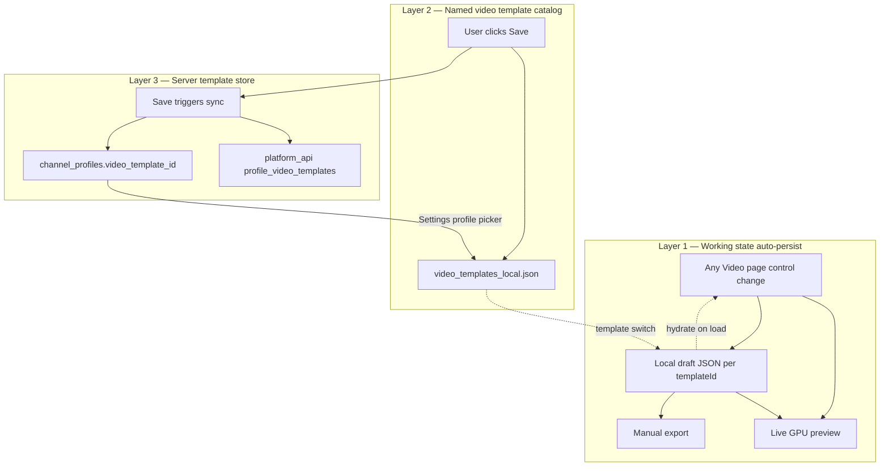

# Video Page — Consolidated Implementation Plan

> **Document ID:** CAMXORA-PAGE-09-IMPL  
> **Version:** 1.0.0  
> **Status:** Approved for implementation  
> **Supersedes / consolidates:** Planning threads from Video workspace sessions (2026-07-08)  
> **Related docs:** [09_VIDEO_REQUIREMENTS.md](09_VIDEO_REQUIREMENTS.md) · [09_VIDEO_ELECTRON_PYTHON_APP_INTEGRATION.md](09_VIDEO_ELECTRON_PYTHON_APP_INTEGRATION.md) · [09_VIDEO_DOMAIN_SCHEMA_APPENDIX.md](09_VIDEO_DOMAIN_SCHEMA_APPENDIX.md) · [04_PROFILE_REQUIREMENTS.md](04_PROFILE_REQUIREMENTS.md)  
> **Targets:** `camxora_python/` · `platform_api/` · `admin_portal/` · `camxora/` (Electron parity where noted)  
> **Last updated:** 2026-07-08

---

# 1. Purpose

This document is the **single implementation contract** for the next Video workspace work. It combines:

1. **Spectrum building logic** aligned with `python_app` (visual behavior)
2. **Camxora architecture** (draft model, normalizer, GPU bridge — marketplace-safe)
3. **Product model for presets vs packs** (unified preset list, no pack-as-attachment confusion)
4. **Three persistence layers** (local draft, local catalog, server sync)
5. **Platform API + Admin Portal** sync so admins can see and manage user video templates per profile

Use this doc for sprint planning and sign-off. Schema field details remain in the appendix docs; this doc defines **what to build and in what order**.

---

# 2. Locked product decisions

These decisions are **final** for this implementation cycle.

| ID | Decision |
|----|----------|
| PD-1 | **Visual/render behavior** comes from `python_app` (`spectrum_model.py`, `_core.py` presets, `gpu_render.py`). Camxora owns UI, draft, save, and sync boundaries. |
| PD-2 | **Effect packs are preset sources**, not a separate save target. Installing a pack adds entries to the **preset style dropdown**; applying a pack sets controls like any built-in preset. Pack ZIP files are never modified by user edits. |
| PD-3 | **Three persistence layers** (see §3). Local draft auto-persists on control change; explicit Save writes the named template catalog; Save also syncs template body to server. |
| PD-4 | **Profile links one long + one reel template** via existing `video_template_id` / `reel_template_id` on `channel_profiles`. User may own many templates; profile points at one of each kind. |
| PD-5 | **Server stores full template JSON** per user/profile so admin can answer: does this profile have a saved template? what is it called? when was it updated? |
| PD-6 | **Optional provenance metadata** (`source`, `origin_pack_id`) may be stored on server templates for analytics — not required for v1. No live “pack attachment” on saved templates. |
| PD-7 | **Pipeline export** uses the **saved** template (local catalog + profile ref). **Manual export** uses **live local draft** (working state). |

---

# 3. Persistence model (three layers)



## 3.1 Layer 1 — Local draft JSON (automatic)

**Purpose:** Session recovery, “where I left off,” manual export source.

| Property | Value |
|----------|-------|
| **Electron key** | `camxora.video.workspace-draft.{templateId}` (localStorage) |
| **Python path** | `{LOCALAPPDATA}/Camxora/video-drafts/{templateId}.json` |
| **Trigger** | Debounced write on **any** control change that affects preview |
| **Snapshot shape** | `{ templateName, draft, layers }` — see [09_VIDEO_REQUIREMENTS.md §6.2](09_VIDEO_REQUIREMENTS.md) |
| **Hydration** | On template load/switch: read draft snapshot if present; else build from saved catalog entry |
| **Reset** | “Reset local draft” restores from **saved catalog** entry (not server) |

**Gap today (Python):** Draft store path exists; auto-persist on every control change is **not fully wired**. Electron has this via `useVideoWorkspaceDraft.ts`.

**Implementation requirement:** Port Electron draft lifecycle to `camxora_python/features/video/services/video_draft_store.py` (or equivalent) and call from `video_view.py` on every draft/layers patch.

## 3.2 Layer 2 — Local template catalog (explicit Save)

**Purpose:** Named templates the user owns; profile picker options; pipeline export source.

| Property | Value |
|----------|-------|
| **Path** | `{python_app}/video_templates_local.json` (shared Electron + Python) |
| **Record shape** | `{ id, name, source, updated_at, template: { ...nested JSON } }` |
| **Trigger** | User clicks **Save** in Video left rail (requires non-empty name) |
| **Builder** | `build_video_workspace_template_save_patch()` → `VideoLocalStore.patch_template()` |

Saved nested `template` includes: `style`, `layers[]`, domain settings, `textOverlays`, etc. See [09_VIDEO_DOMAIN_SCHEMA_APPENDIX.md](09_VIDEO_DOMAIN_SCHEMA_APPENDIX.md).

**Note:** Saved template stores **control values at save time** (`style` + `layers` + scalars). It does **not** write back to installed pack ZIPs.

## 3.3 Layer 3 — Server template store (sync on Save)

**Purpose:** Cross-device backup, admin visibility, platform-managed user data.

| Property | Value |
|----------|-------|
| **Trigger** | After successful local Save (Layer 2), upsert to `platform_api` |
| **Profile link** | Update `channel_profiles.video_template_id` or `reel_template_id` when user assigns template to profile (Settings) |
| **Admin visibility** | Enriched fields on user details + optional template viewer |

**Gap today:** Server only stores opaque `video_template_id` string on profile — **no template JSON**. Admin shows raw UUID with no guarantee content exists.

---

# 4. Spectrum — `python_app` alignment

## 4.1 Architecture split

| Layer | Source | Camxora module |
|-------|--------|----------------|
| Preset recipes | `python_app/views/components/_core.py` | `features/video/lib/spectrum_style_registry.py` |
| Normalize / defaults | `python_app/models/spectrum_model.py` | `visualizer/template_runtime.py` (consolidate to shared or single import) |
| Apply single preset | `_apply_style_preset_to_template()` | `build_spectrum_preset_template()` |
| Apply stacked preset | `python_app/app/video_methods.py` | `build_stacked_spectrum_preset_template()` |
| GPU render | `python_app/visualizer/gpu_render.py` | `camxora_python/visualizer/preview_widget.py` |
| Draft / save / sync | Camxora/Electron | `video_template_draft.py`, `template_normalizer.py`, `video_template_save.py` |

**Do not port:** `python_app` monolithic `VideoPageController` or direct in-place template mutation without draft/layers split.

## 4.2 Preset registry (canonical keys)

Built-in presets (already ported to `spectrum_style_registry.py`):

| Key | Label |
|-----|-------|
| `classic-vertical` | Classic Vertical Bars |
| `thin-lines` | Thin Frequency Lines |
| `dot-matrix` | Dot Matrix Bars |
| `symmetrical-bars` | Symmetrical Bars |
| `soft-waveform` | Continuous Waveform |
| `mountain` | Filled Mountain |
| `liquid` | Liquid Plasma |
| `pixel-bars` | Pixel Bars |
| `neon-pulse` | Neon Pulse Bars |
| `floating-blocks` | Floating Blocks |

Stacked presets:

| Key | Label |
|-----|-------|
| `triple-neon-halo` | Triple Neon Halo |
| `bass-vortex-stack` | Bass Vortex Stack |
| `soft-aura-stack` | Soft Aura Stack |

Legacy aliases on load (`straight-bars` → `classic-vertical`, `flying-glow` → `neon-pulse`, etc.) via `normalize_spectrum_preset_key()`.

## 4.3 Apply semantics (must match `python_app`)

| Behavior | `python_app` | Camxora requirement |
|----------|--------------|---------------------|
| Single preset target | Selected layer index | Pass `_selected_spectrum_layer_index` to `build_spectrum_preset_template(..., layer_index=)` |
| Unknown preset key | Fallback to `classic-vertical` patch | Same — do not return `None` |
| Stacked preset | Replace full `layers[]`, set `style`, then `normalize_template()` | Call shared normalize after stacked apply |
| Layer stack structure | No `enabled` / `solidBand` in normalize | Camxora UI may expose `solidBand`; normalize clamps before GPU |
| Duplicate code | Single source in `_core.py` | Remove duplicate `_apply_style_preset_to_template` from `preview_widget.py`; import registry |

## 4.4 Data flow (Camxora)

```
SpectrumInspector preset apply
  → build_spectrum_preset_template(base, key, layer_index)
  → update _template_draft.style + _spectrum_layers
  → TemplateNormalizer.to_renderer_dict()
  → preview_widget.set_template()
  → video_draft_store.write (Layer 1)
```

Manual layer edits use `_patch_selected_spectrum_layer` (already respects selected index).

---

# 5. Presets and marketplace packs (unified model)

## 5.1 User mental model

1. User installs pack ZIP → local registry (`{userData}/effect-packs/`)
2. Pack appears in **preset style dropdown** (alongside built-in presets)
3. Selecting a preset (built-in or from pack) updates all relevant controls + `layers[]`
4. User tweaks controls → changes go to **local draft** (Layer 1)
5. User clicks Save → **local catalog** (Layer 2) + **server sync** (Layer 3)
6. Pack definition on disk is **read-only**

## 5.2 UI consolidation (target state)

| Current (partial) | Target |
|-------------------|--------|
| Separate “Style preset” dropdown + “Effect pack” selector | **Single preset dropdown**: Built-in + Installed packs |
| `effectPacks.spectrum` ref on saved template | **Remove from save path** for v1 unified model; optional provenance field on server only |
| Pack apply via `effect_pack_draft_state.py` | Pack apply = preset apply (same code path into draft + layers) |

**Transition:** Existing `effect_pack_*` modules remain for install/registry/catalog; apply path merges into preset list. Deprecate separate pack selector in spectrum inspector once unified dropdown ships.

## 5.3 Marketplace constraints (unchanged)

| ID | Constraint |
|----|------------|
| MP-1 | Domain isolation — background/logo/particles patches never overwrite spectrum keys |
| MP-3 | Manifest validation before install |
| MP-4 | Video UI talks to `EffectPackService`, not filesystem |
| MP-5 | `RemoteMarketplaceCatalogProvider` hook for future portal downloads |
| MP-8 | `appVersionRange` + `domainContractVersion` compatibility gates |

Packs ship complete `layers` + `style` in manifest `templatePatch` — they do not depend on `STYLE_PRESET_PATCHES` at runtime.

---

# 6. Particles (open bug)

**Issue:** Preview particles not visible after prior render-order fix attempts.

**Requirements:**

| ID | Requirement |
|----|-------------|
| PT-1 | Render order matches export: spectrum → **particles** → logo |
| PT-2 | Lazy init `_ensure_particle_system()` on resize/first frame |
| PT-3 | Default `particlesSettings.enabled = true` unless template disables |
| PT-4 | Support spawn areas: `screenCenter`, `screenRandom`, reactive modes |
| PT-5 | `set_template()` on every preview update from stage panel |

**Verify:** Particles visible over spectrum with default template + audio playing; export frame matches preview.

---

# 7. Platform API — server template storage

## 7.1 New database table

**Table:** `profile_video_templates`

| Column | Type | Notes |
|--------|------|-------|
| `id` | UUID PK | Same ID as local catalog + `video_template_id` |
| `user_id` | UUID FK | Owner |
| `profile_id` | UUID FK nullable | Profile this template is linked to |
| `kind` | enum | `long` \| `reel` |
| `name` | VARCHAR | Display name |
| `template_json` | JSONB | Full nested template from save patch |
| `updated_at` | TIMESTAMPTZ | Last sync |
| `created_at` | TIMESTAMPTZ | First sync |
| `source` | VARCHAR nullable | `user` \| `admin` \| `marketplace` |

**Indexes:** `(user_id)`, `(profile_id)`, `(user_id, kind)`.

**Migration:** New Alembic revision in `platform_api/migrations/versions/`.

## 7.2 User endpoints (authenticated)

Base path: `/api/v1/profiles/{profile_id}/video-templates`

| Method | Path | Body | Response |
|--------|------|------|----------|
| `PUT` | `/{template_id}` | `{ name, kind, template_json }` | Upsert; set profile ref if kind matches |
| `GET` | `/` | — | List templates for profile (metadata + ids) |
| `GET` | `/{template_id}` | — | Full template JSON |
| `DELETE` | `/{template_id}` | — | Remove server copy |

**Auth:** `get_current_user` — user must own profile. Cross-user → 404.

**On PUT:** Also update `channel_profiles.video_template_id` or `reel_template_id` when `kind` is `long` or `reel` respectively (configurable via request flag `set_as_profile_default: bool`, default `true` on Save from Video page).

## 7.3 Admin endpoints

| Method | Path | Purpose |
|--------|------|---------|
| `GET` | `/api/v1/admin/users/{user_id}/video-templates` | List all templates for user |
| `GET` | `/api/v1/admin/users/{user_id}/video-templates/{template_id}` | Full JSON for support |

Alternatively enrich existing `GET /api/v1/users/{user_id}/details` (preferred for list view).

## 7.4 Enriched admin profile summary

Extend `ChannelProfileAdminSummary` in `platform_api/routers/users.py`:

| Field | Type | Description |
|-------|------|-------------|
| `video_template_id` | string \| null | Existing |
| `video_template_name` | string \| null | **New** |
| `video_template_updated_at` | string \| null | **New** |
| `video_template_available` | bool | **New** — body exists on server |
| `reel_template_id` | string \| null | Existing |
| `reel_template_name` | string \| null | **New** |
| `reel_template_updated_at` | string \| null | **New** |
| `reel_template_available` | bool | **New** |

Join `profile_video_templates` on profile ref IDs when building user details response.

---

# 8. Admin Portal — user profile details

**File:** `admin_portal/src/pages/users/user-detail.tsx`

## 8.1 Replace raw UUID display

| Current | Target |
|---------|--------|
| `Video Template: a1b2c3d4-...` | **Video Template:** Bass Drive Neon — saved Jul 8, 2026 — or **Not saved** |
| Same for Reel | Same pattern |

Use enriched fields from `GET /users/{id}/details`.

## 8.2 Optional v1.1 — template detail panel

- “View template” button opens drawer/modal
- Shows: name, kind, updated_at, style key, layer count, spectrum enabled, domain summary
- Full JSON in collapsible `<pre>` for support (fetch admin GET endpoint on demand)

## 8.3 Types

Update `admin_portal/src/types/models.ts` `channel_profiles` entry with new summary fields.

---

# 9. Desktop client — sync flow

## 9.1 Save sequence (Video workspace)

```
User clicks Save
  1. build_video_workspace_template_save_patch(draft, layers, name)
  2. VideoLocalStore.patch_template()          → Layer 2 local catalog
  3. VideoTemplateSyncWorker.upsert(profile_id, template_id, body)  → Layer 3
  4. On success: emit_shell_status("Saved and synced")
  5. On sync failure: local save succeeds; status warns "Saved locally; sync failed"
```

## 9.2 New client modules

| Module | Location | Role |
|--------|----------|------|
| `video_template_client.py` | `camxora_python/shared/api/` or `features/video/services/` | PUT/GET/DELETE platform API |
| `VideoTemplateSyncWorker` | `camxora_python/features/video/workers/` | Async sync after save |
| `video_draft_store.py` | `camxora_python/features/video/services/` | Layer 1 auto-persist |
| Electron equivalent | `camxora/src/shared/api/` + workspace persistence hook | Parity |

## 9.3 Profile settings integration

- Template dropdown populated from **local catalog** (IPC / `VideoLocalStore.read_templates()`)
- On profile save: `PUT /profiles/{id}` with `video_template_id` / `reel_template_id`
- Optional: on login, pull server templates missing locally (Phase D)

## 9.4 Conflict policy (v1)

**Last-write-wins** by `updated_at`. No merge UI in v1.

---

# 10. Implementation phases

## Phase A — Spectrum parity (camxora_python)

**Goal:** Match `python_app` preset apply behavior within Camxora draft architecture.

- [x] Wire `layer_index=_selected_spectrum_layer_index` in `_apply_spectrum_preset`
- [x] Add `classic-vertical` fallback for unknown preset keys
- [x] Call `normalize_template()` after stacked preset apply
- [x] Consolidate normalize/apply — single module; remove `preview_widget` duplicate
- [x] Update tests: `test_spectrum_inspector.py`, selected-layer preset apply
- [ ] Update `09_VIDEO_REQUIREMENTS.md` §7.3 preset table to canonical keys

**Acceptance:** Selecting preset on layer 2 patches layer 2 only; stacked presets normalize; 166+ tests pass.

## Phase B — Local draft auto-persist (camxora_python + Electron verify)

**Goal:** Layer 1 — every control change persists; app reload restores working state.

- [x] Implement `video_draft_store.py` read/write/debounce
- [x] Hook all draft patch paths in `video_view.py`
- [x] Hydrate on template switch; skip re-hydrate same template_id
- [ ] Manual export reads live draft (verify)
- [x] Reset local draft restores catalog snapshot

**Acceptance:** Change slider → kill app → reopen → same preview state.

## Phase C — Unified preset dropdown (camxora_python)

**Goal:** Installed spectrum packs appear in preset list; single apply path.

- [x] Build preset options = `SPECTRUM_PRESET_OPTIONS` + installed pack entries from `EffectPackService`
- [x] Pack apply uses same draft/layers path via `apply_spectrum_pack_as_preset`
- [x] Hide spectrum pack apply combo; install UI remains on pack card
- [x] Pack apply does not write `effectPacks.spectrum` ref

**Acceptance:** Install pack ZIP → new preset in dropdown → apply updates preview; Save persists values not pack ref.

## Phase D — Platform API (backend)

**Goal:** Server stores template bodies; admin summary enriched.

- [x] Migration `profile_video_templates`
- [x] User CRUD endpoints scoped by profile ownership
- [x] Enrich `GET /users/{id}/details` channel profile summary
- [ ] Admin GET template JSON endpoint (optional v1.1)
- [x] Tests in `platform_api/tests/`

**Acceptance:** PUT template via API → GET details shows name + available + updated_at.

## Phase E — Admin Portal UI

**Goal:** Admin sees meaningful template status per profile.

- [x] Update `models.ts` types
- [x] Update `user-detail.tsx` Video/Reel template rows
- [ ] Optional template detail drawer

**Acceptance:** Admin user page shows “Bass Drive Neon (saved …)” or “Not saved”.

## Phase F — Client server sync (camxora_python + Electron)

**Goal:** Save in Video workspace syncs to platform_api.

- [x] `video_template_client.py` + sync worker (`platform_api.upsert_profile_video_template`)
- [x] Call sync after successful local Save
- [x] Graceful degradation if offline / no profile link
- [ ] Electron parity hook in template persistence

**Acceptance:** Save template → server has JSON → admin details updated.

## Phase G — Particles fix

**Goal:** Particles visible in preview matching export.

- [x] Remove invalid `prog_points.use()` (ModernGL binds via VAO render)
- [x] Restore misplaced `__init__` fields from `_render_particle_points`
- [x] Render order: spectrum → particles → logo (already in paintGL)
- [ ] Visual verify with audio playing in live app

**Can run in parallel with Phase A.**

---

# 11. Definition of done (overall)

| # | Criterion |
|---|-----------|
| D-1 | Spectrum presets behave like `python_app` (selected layer, fallback, stacked normalize) |
| D-2 | Local draft auto-persists and restores on app reload |
| D-3 | Explicit Save writes local catalog + syncs server template JSON |
| D-4 | Profile `video_template_id` / `reel_template_id` link to templates that exist on server |
| D-5 | Admin user details show template name, availability, last updated — not raw UUID only |
| D-6 | Installed packs appear as preset dropdown entries; user edits never modify pack ZIP |
| D-7 | Manual export uses live draft; pipeline export uses saved catalog |
| D-8 | Particles visible in preview |
| D-9 | All existing video tests pass; new tests for draft store + sync + preset layer index |

---

# 12. File map

| Area | Files |
|------|-------|
| Spectrum registry | `camxora_python/features/video/lib/spectrum_style_registry.py` |
| Spectrum UI | `camxora_python/features/video/widgets/spectrum_inspector.py` |
| Video shell | `camxora_python/features/video/views/video_view.py` |
| Draft model | `camxora_python/features/video/lib/video_template_draft.py` |
| Normalizer | `camxora_python/features/video/services/template_normalizer.py` |
| Local catalog | `camxora_python/features/video/services/video_local_store.py` |
| Draft store (new) | `camxora_python/features/video/services/video_draft_store.py` |
| Sync client (new) | `camxora_python/features/video/services/video_template_sync.py` |
| GPU / normalize | `camxora_python/visualizer/template_runtime.py`, `preview_widget.py` |
| python_app reference | `python_app/models/spectrum_model.py`, `python_app/views/components/_core.py` |
| Platform API (new) | `platform_api/migrations/`, `platform_api/routers/video_templates.py`, `platform_api/repositories/` |
| Admin | `admin_portal/src/pages/users/user-detail.tsx`, `admin_portal/src/types/models.ts` |
| Profile link | `camxora_python/features/settings/views/settings_view.py`, `platform_api/routers/profiles.py` |

---

# 13. Out of scope (this cycle)

- Marketplace storefront UI (browse/buy/download)
- Remote marketplace catalog provider implementation
- Template merge conflict UI (beyond last-write-wins)
- Admin edit user templates in portal (read-only v1)
- Reel/long template auto-detection from aspect (user assigns kind explicitly or by workspace context)

---

# 14. Doc maintenance

After implementation, update:

- [ ] [09_VIDEO_REQUIREMENTS.md](09_VIDEO_REQUIREMENTS.md) — §2.4 marketplace diagram, §6 effectPacks save language, §7.3 preset keys, §7.8 pack model
- [ ] [09_VIDEO_DOMAIN_SCHEMA_APPENDIX.md](09_VIDEO_DOMAIN_SCHEMA_APPENDIX.md) — server template storage section
- [ ] [04_PROFILE_REQUIREMENTS.md](04_PROFILE_REQUIREMENTS.md) — server sync for video templates
- [ ] [README.md](README.md) — link this plan as active implementation doc
- [ ] [../02_IMPLEMENTATION_STATUS.md](../02_IMPLEMENTATION_STATUS.md) — phase checkboxes

---

*End of consolidated implementation plan.*
