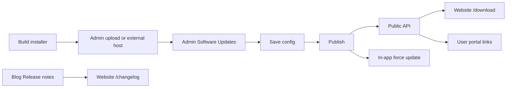

# Desktop distribution (build → publish → download)

**Audience:** release engineering, platform admins, website maintainers.

This document describes how CAMXORA desktop installers move from a build machine to end users through the admin portal, public API, website, user portal, and in-app update flow.

**Scope:** desktop installer distribution only. It does **not** cover music portal (`music_web/`) changelogs or releases. For changelog policy across all surfaces, see [`CHANGELOG_GUIDE.md`](./CHANGELOG_GUIDE.md).

Related docs:

- [DESKTOP_RELEASE.md](./DESKTOP_RELEASE.md) — build scripts, versioning, sandbox vs production installers
- [DEPLOYMENT_OPERATIONS.md](./DEPLOYMENT_OPERATIONS.md) — server deploy and environment URLs

## End-to-end flow



1. **Build** the Windows installer on a build machine (`camxora_python/scripts/build-desktop.ps1`). See [DESKTOP_RELEASE.md](./DESKTOP_RELEASE.md).
2. **Host** the package either by:
   - **Upload in Admin → Software Updates** (stores on VPS disk and auto-fills the download URL), or
   - **External host** — paste a stable HTTPS URL (CDN, B2, manual nginx upload).
3. **Configure** the release in **Admin Portal → Software Updates** (backed by `system_settings` keys, same storage as desktop push notifications).
4. **Save** version, download URL, mandatory flag, and release notes.
5. **Publish** — sets `published_at`, broadcasts `software_update.available` to active desktop users, and makes the release visible on public surfaces.
6. **Download surfaces** read the public API and link users to the hosted installer.
7. **Changelog** on the website lists blog posts with category **Release notes** (separate from the short release-notes field on the software-update config).

## Storage (system_settings)

All software-update metadata is stored in `system_settings` via `platform_api/services/desktop_notification_admin_service.py`:

| Key | Purpose |
|-----|---------|
| `desktop.software_update.version` | Semver string shown to users |
| `desktop.software_update.download_url` | HTTPS link to hosted installer |
| `desktop.software_update.mandatory` | `true` / `false` — in-app gate treats mandatory updates as blocking |
| `desktop.software_update.release_notes` | Short plain-text notes on `/download` and in push payload |
| `desktop.software_update.published_at` | ISO timestamp set on publish; required for public visibility |

**Public visibility rule:** a release is exposed only when **version is non-empty** and **published_at is set** (i.e. an admin clicked Publish at least once).

## Admin steps

1. Open **Admin Portal → Software Updates**.
2. Enter **Version** first if uploading (used for `Camxora-{version}.zip` filename).
3. Either:
   - **Upload installer** — choose `.zip`, `.exe`, or `.msi` and click **Upload installer** (auto-fills download URL), or
   - Paste an external **Download URL** manually.
4. Set **Mandatory** and **Release notes** as needed.
5. Click **Save** to persist draft config (does not notify users yet).
6. Click **Publish** to stamp `published_at`, push notifications, and expose the public download API.

Admin API (authenticated):

| Method | Path | Purpose |
|--------|------|---------|
| `GET` | `/api/v1/admin/desktop/software-update` | Read current config |
| `PUT` | `/api/v1/admin/desktop/software-update` | Save draft config |
| `POST` | `/api/v1/admin/desktop/software-update/upload` | Upload installer; returns `download_url` |
| `POST` | `/api/v1/admin/desktop/software-update/publish` | Publish + notify |

### Installer upload storage (env)

| Variable | Default | Purpose |
|----------|---------|---------|
| `PLATFORM_DESKTOP_RELEASE_STORAGE_PATH` | `./desktop_release_storage` | VPS disk path for uploaded packages |
| `PLATFORM_DESKTOP_RELEASE_PUBLIC_BASE_URL` | *(empty)* | Public CDN/nginx base, e.g. `https://downloads.camxora.com/desktop` |
| `PLATFORM_DESKTOP_RELEASE_MAX_UPLOAD_MB` | `500` | Max upload size |

When `PLATFORM_DESKTOP_RELEASE_PUBLIC_BASE_URL` is set, upload responses use that base. Otherwise files are served from `GET /api/v1/public/desktop-release/files/{filename}` (fine for dev/sandbox).

## Public API

### `GET /api/v1/public/desktop-release`

No authentication.

**200 response** (published release exists):

```json
{
  "version": "2.5.0",
  "download_url": "https://cdn.example.com/CamxoraSetup-2.5.0.exe",
  "release_notes": "Bug fixes and performance improvements.",
  "mandatory": false,
  "published_at": "2026-07-19T03:00:00+00:00"
}
```

**404** when no release has been published (missing version or `published_at`).

Implementation: `platform_api/routers/public_desktop.py` → `get_published_desktop_release()`.

## Website surfaces

| Page | Data source | Behavior |
|------|-------------|----------|
| `/download` | `GET /public/desktop-release` | Version, download button, release notes; graceful empty/error states |
| `/changelog` | `GET /blog-posts/public?category=Release%20notes` | Lists release-note blog posts; links to full articles |

Navigation: **Changelog** appears in the website header/footer (`website/src/components/marketing/site-chrome.tsx`).

Blog category filter: optional `category` query param on `GET /api/v1/blog-posts/public` (case-insensitive match on `blog_posts.category`).

## User portal

Download links in the user portal point to the marketing website `/download` page (not the raw installer URL):

- `user_portal/src/components/dashboard/control-panel-shell.tsx`
- `user_portal/src/components/auth/portal-marketing-shell.tsx`
- `user_portal/src/app/onboarding/done/page.tsx`

This keeps one canonical download experience tied to the public API.

## In-app force update

Mandatory updates are enforced **when the user opens the app**, not mid-session:

1. Admin **Save Draft** (version, download URL, mandatory, notes) then **Publish** (sets `published_at` and public visibility).
2. On next desktop launch — **before login, relogin, or entering the studio** — the client calls `GET /api/v1/public/desktop-release`.
3. If the published version is newer and `mandatory` is true, the blocking update gate appears; login/shell stay unreachable until install.
4. Install flow downloads from `download_url` and runs the Windows installer (`software_update_installer.py`).
5. Live WebSocket `software_update.available` pushes never open the blocking gate.
   While the user is already in the studio, a green update icon appears in the
   header (left of notifications); click installs when convenient. Mandatory still
   force-gates on the next app open.

Fail-open: if the public release endpoint is unreachable or 404, startup continues (unless a prior mandatory update is still persisted on disk).

## Changelog content strategy

Two complementary channels:

| Channel | Best for |
|---------|----------|
| Software update **release_notes** field | Short summary on `/download` and push notification body |
| Blog posts with category **Release notes** | Long-form changelog articles on `/changelog` |

Create release-note articles in **Admin Portal → Blog** with category exactly `Release notes`.

## Manual verification checklist

1. **API — unpublished:** `GET /api/v1/public/desktop-release` → `404`.
2. **Admin save:** set version + URL, Save → admin GET shows draft without changing public API.
3. **Admin publish:** Publish → public GET returns `200` with `published_at`.
4. **Website:** open `/download` → version, download button, release notes.
5. **Changelog:** publish a blog post with category `Release notes` → appears on `/changelog`.
6. **User portal:** footer/marketing **Download** links → `/download` on the website.
7. **Desktop:** publish a version newer than the running build → update prompt appears; mandatory blocks UI.

## Tests

- `platform_api/tests/test_public_desktop_router.py` — public endpoint success/404
- `platform_api/tests/test_desktop_notification_admin_service.py` — publish visibility helper

Run:

```powershell
cd platform_api
pytest tests/test_public_desktop_router.py tests/test_desktop_notification_admin_service.py -q
```
