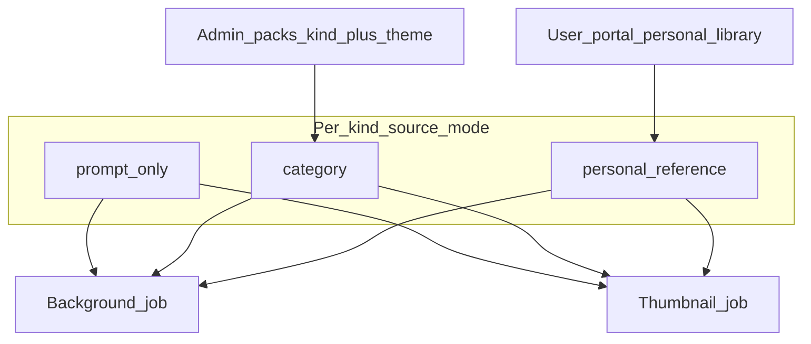
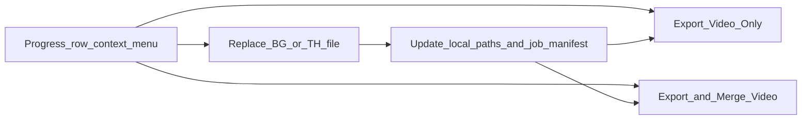
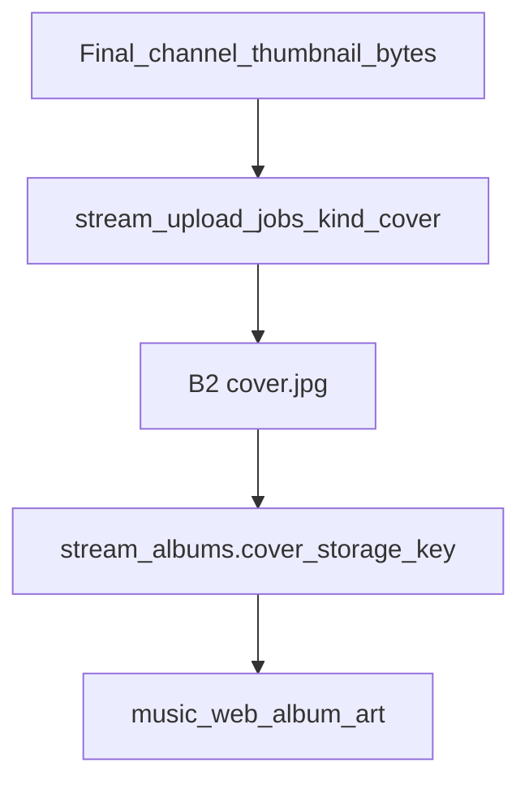

# Image Prompt Mode, Categories & Replace Flow — Requirements

**Date:** 2026-08-05  
**Status:** requirements doc (no feature implementation yet) — updated 2026-08-05 with Progress-menu replace/export, portal quotas (200×10MB), personal rotation toggle, cross-source mixing, and no theme categories on personal uploads  
**Product scope:** In scope — `camxora_python`, `platform_api`, `admin_portal`, `user_portal`. Out of scope — legacy `camxora/` (Electron) and `python_app/`. See [`PRODUCT_SCOPE.md`](./PRODUCT_SCOPE.md).

**Related docs:**

- [`SAMPLE_PACK_VPS_MIGRATION.md`](./SAMPLE_PACK_VPS_MIGRATION.md) — admin ZIP → VPS asset paths for server-side sample rotation
- [`PRODUCT_SCOPE.md`](./PRODUCT_SCOPE.md) — which surfaces receive new work
- Older local-sample design (legacy tree only; do not implement there): `python_app/docs/image-generation-samples/`

---

## 0. Why this document exists

Boss wants image generation to be controllable in three ways that today’s product does not cleanly support:

1. **Rely on the prompt 100%** for background and/or thumbnail (no sample / style reference).
2. **Choose a theme category** (cars, speakers, beautiful girl, etc.) instead of one flat “background stock” and one flat “thumbnail stock”.
3. **Replace disliked AI images** with the user’s own files, then **re-export video only** or **export and merge** without regenerating music.

This document is the canonical requirements + design sketch. **Do not implement until Boss asks to start a phase.**

---

## 1. Problem & goals

### Problem today

| Area | Current behavior | Pain |
|------|------------------|------|
| Sample catalog | Admin packs are typed only as `background` \| `thumbnail` ([`admin_portal/src/types/image-sample-packs.ts`](../admin_portal/src/types/image-sample-packs.ts)). Rotation loads **all** VPS assets for that kind ([`ImageSampleRotationService`](../platform_api/services/image_sample_rotation.py) → `list_vps_asset_paths(category=...)`). | User cannot ask for “cars” vs “speakers”; every BG job draws from the same pool. |
| Prompt-only | Desktop Settings exposes `backgroundSourceMode` with **Samples** only ([`settings_view.py`](../camxora_python/features/settings/views/settings_view.py)). Setting key exists (`backgroundSourceMode`); API **does not** skip reference images when prompt mode is desired. Background jobs still resolve a sample when available ([`_resolve_base_image_bytes`](../platform_api/services/image_job_service.py)). Thumbnail composite **hard-fails** if no style sample ([`_generate_thumbnail_composite`](../platform_api/services/image_job_service.py) — `"Thumbnail style sample is missing."`). | User cannot truly rely on prompt for BG or TH. |
| Personal references | Only admin-managed packs (VPS) + optional local sample folders. No per-user upload library in [`user_portal`](../user_portal/). | Users cannot bring their own reference look into generation. |
| Replace → re-export | Progress menu today: Start Export, Force Regenerate MP4, Rebuild MP4, Start Merging ([`operational_rows_card.py`](../camxora_python/features/progress/widgets/operational_rows_card.py)). Manual image sync exists (`sync_manual_image_jobs`) but there is no first-class **Replace Background / Replace Thumbnail** → **Export Video Only** / **Export and Merge** on the Progress row menu. | After a bad AI image, the recovery path is unclear and incomplete. |

### Goals

1. Independent **source mode** per image kind (background and thumbnail).
2. Admin **theme categories** under each kind; user picks a category (or none / prompt-only).
3. **Cross-source mixing allowed** — e.g. BG = admin category `cars`, TH = personal portal references (or reverse); any independent combination of prompt-only / category / personal per kind.
4. **User portal** sidebar page for personal reference uploads, stored on VPS (quota below).
5. Desktop **Progress** right-click: **replace** BG/TH, then **Export Video Only** or **Export and Merge Video**.

### Non-goals (this initiative)

- No image editor inside the app.
- No change to music / Suno draft billing.
- No Electron / `python_app` parity work.
- No production deploy as part of requirements authoring.
- Dual-reference thumbnail provider mode (`thumbnailReferenceMode=dual_reference`) stays deferred unless a later phase explicitly activates it.

---

## 2. Definitions

| Term | Meaning |
|------|---------|
| **Kind** | Output type: `background` or `thumbnail`. |
| **Theme category** | Admin-defined theme under a kind, e.g. `cars`, `speakers`, `beautiful_girl`. Distinct from today’s pack field `category` which currently **is** the kind. |
| **Source mode** | How a kind is generated: `prompt_only` \| `category` \| `personal_reference`. |
| **Prompt-only** | Provider call uses the user/system prompt with **no** reference / style sample image. |
| **Category sample** | A style/base reference chosen by least-used rotation from admin packs matching **kind + theme category**. |
| **Personal reference** | A user-uploaded image from the account’s personal library (user portal), used as the reference for that kind. **Not** organized by admin theme categories. |
| **Personal rotation** | When enabled for a kind, least-used (then random among ties) pick across that user’s eligible personal assets so the same style is not repeated every run. When disabled, a specific pinned personal image is used. |
| **Replace** | User overwrites the channel/batch background or thumbnail file on disk (and syncs job/manifest state) without re-running AI image generation. |
| **Export Video Only** | Rebuild the channel MP4(s) using current images/audio; do not merge OK+ALT. |
| **Export and Merge Video** | Export (if needed) then merge Primary + Secondary outputs when a pair exists. |

---

## 3. Confirmed product decisions

| # | Decision |
|---|----------|
| 1 | Background **and** thumbnail may run **prompt-only** (no reference/style sample). |
| 2 | Theme categories exist for **both** admin background and thumbnail packs. |
| 3 | Category selection is **independent** per kind — category for only BG, only TH, both, or neither. |
| 4 | Prompt-only is **independent** — BG prompt-only + TH category (or reverse) is valid. |
| 5 | Users upload personal references in **`user_portal`** (sidebar nav); files stored on **VPS**. Quota: **max 200 images per user**, **≤ 10 MB per image**. |
| 6 | Personal library does **not** use admin-style theme categories (see §5). Tag only **usable as background** and/or **usable as thumbnail**. |
| 7 | Personal picks use **least-used / rotate**, with a per-kind **enable/disable rotation** toggle (off = pin one image). |
| 8 | **Cross-source OK:** one kind may use admin category samples while the other uses personal portal images (or prompt-only) — any mix. |
| 9 | **Replace + re-export** lives on the **Progress** row right-click menu (primary surface). |
| 10 | Any empty/missing asset (theme, personal library, pin, prompt, file on disk) must show a **clear user-facing error** with kind + reason + next step (§7.5). |
| 11 | **Streaming:** personal reference library is **never** a music_web catalog surface. Image re-runs / Replace update **cover only**; **do not re-upload MP3s** for the same Suno clip (§12). |
| 12 | **Streaming cover when no Camxora thumbnail yet:** always publish tracks with **temporary art** — Suno clip cover if available, else channel logo, else **Camxora default/platform placeholder art**. Replace later when a final thumbnail is supplied (§12.2d). |

---

## 4. User stories

1. As a channel operator, I set **Background = Prompt only** and type my art-direction prompt so every BG for that run is driven only by text.
2. As a channel operator, I set **Thumbnail = Prompt only** so typography/layout follows the thumbnail prompt without a style sample.
3. As a channel operator, I pick **Background category = Cars** and leave thumbnail on samples/prompt independently.
4. As a channel operator, I pick a category for **thumbnail only** (e.g. Bold Typography) while background stays prompt-only.
5. As a customer on the **user portal**, I open **Image References** in the sidebar, upload up to 200 images (each ≤ 10 MB), and tag each for background and/or thumbnail use.
6. As a channel operator, I set BG to an **admin category** (e.g. Cars) and TH to **My references** (or the reverse) so sources can be mixed.
7. As a channel operator, I enable **Rotate my references** so personal images least-used rotate; or I disable it and pin one reference.
8. As a channel operator, I dislike the AI background: on **Progress**, I **Replace Background**, pick a PNG/JPG, then **Export Video Only**.
9. As a channel operator with OK+ALT, after replacing images on Progress I choose **Export and Merge Video**.

---

## 5. Product model



### Per-kind controls

Each of **background** and **thumbnail** has its own:

| Field | Values / rules |
|-------|----------------|
| `source_mode` | `prompt_only` \| `category` \| `personal_reference` |
| `theme_category` | Required when `source_mode=category`. Slug from **admin** catalog only (e.g. `cars`). |
| `personal_reference_id` | When `source_mode=personal_reference` and rotation is **off**: required pinned asset id. When rotation is **on**: ignored / empty — least-used among eligible personal assets for the kind. |
| `personal_rotation_enabled` | Per-kind bool. Default **true** when using personal references. |
| Prompt text | Existing background / thumbnail / shared prompts still apply; prompt-only does **not** remove the need for a non-empty prompt (validation error if blank). |

**Cross-source:** BG and TH each choose their own `source_mode` independently. Valid examples: BG `category` + TH `personal_reference`; BG `personal_reference` + TH `category`; BG `category` + TH `prompt_only`; etc.

### Admin catalog model (target)

Keep pack **kind** (`background` \| `thumbnail`) and add **theme category**:

- Today’s DB column `image_sample_packs.category` stores the kind. Prefer **add `theme_category`**, keep `category` = kind for backward compatibility.
- Many packs may share the same theme (e.g. multiple “Cars” ZIPs).
- Rotation: `list_vps_asset_paths(kind=..., theme_category=...)` instead of kind-only.

### User personal library

**Recommendation (locked):** do **not** mirror admin theme categories on personal uploads. Categories are for curated stock (ops-managed). Personal libraries are messy and user-specific — forcing “cars / speakers / girl” on uploads adds friction and duplicate taxonomy. Enough structure:

- Tag: usable as background and/or thumbnail
- Desktop chooses source mode per kind (admin category vs my references vs prompt)

**Storage & quotas (locked):**

| Rule | Value |
|------|--------|
| Storage | VPS per-user root (parallel to `sample_pack_storage`, not shared with admin packs) |
| Max images per user | **200** (active / non-deleted) |
| Max size per image | **10 MB** |
| Allowed types | `image/png`, `image/jpeg`, `image/webp` |

**Rotation (locked):**

- Reuse the existing least-used history pattern (same family as admin sample rotation).
- Per-kind toggle in desktop Settings: **Rotate my background references** / **Rotate my thumbnail references**.
- On: pick least-used eligible personal asset (exclude already-used siblings in the same batch when possible).
- Off: require a pinned `personal_reference_id`; always use that file.

### Replace + re-export (Progress primary)



---

## 6. UX requirements

### 6.1 Desktop — Settings / Image preferences (`camxora_python`)

**Rendering / Image source panel** (extend current Preferences):

- Keep **Image source mode**:
  - **AI Generated** — AI jobs; use BG/TH source dropdowns below
  - **User Provided** — no AI; user places finals in the run folder; pipeline continues (hide/disable BG/TH source)
- Under AI Generated, **two** controls (labels: Category | User reference | Prompt only):
  - Background source mode: Prompt only | Category | User reference (`personal_reference`)
  - Thumbnail source mode: Prompt only | Category | User reference (`personal_reference`)
- **Hide Thumbnail overlay** UI; keep AI/composite behavior behind the scenes (`thumbnail_overlay_mode=ai`).
- When mode = Category: show theme dropdown filtered by kind (list from API) — P1.
- When mode = User reference (P2):
  - Toggle: **Rotate** (least-used) on/off for that kind
  - If rotate off: picker to pin one personal image
  - If rotate on: optional “eligible pool” note (all BG- or TH-tagged uploads); no single pin required
  - Empty library → CTA linking to user portal Image References
  - Until P2 ships: clear error that User reference is not available yet
- Style strength: still applies when a reference/sample is used; **hidden or disabled** in prompt-only (no reference to weight).
- Persist via settings sync keys (see §8).

**Image workspace:** surface the same modes read-only or editable for the active prefs; queue rows may show which mode/category was used (optional footer detail). Right-click **Regenerate Background + Thumbnail** force-resets both jobs including success. Progress remains the Replace/Export recovery surface (P3).

### 6.2 Admin portal — Image Packs

- Create/edit pack: **Kind** (Background / Thumbnail) + **Theme category** (select existing or create slug + display name).
- List/filter by kind and theme.
- Upload ZIP / URL import unchanged in spirit ([`SAMPLE_PACK_VPS_MIGRATION.md`](./SAMPLE_PACK_VPS_MIGRATION.md)); assets remain VPS-indexed.
- Seed examples Boss mentioned: Cars, Speakers, Beautiful Girl (background); thumbnail themes TBD by content ops (e.g. Bold Type, Minimal, Neon).

### 6.3 User portal — Image References (sidebar)

Add a primary sidebar item in [`control-panel-shell.tsx`](../user_portal/src/components/dashboard/control-panel-shell.tsx) `NAV_ITEMS`, e.g.:

- Label: **Image References**
- Route: `/dashboard/image-references`

Page behavior:

- Upload one or more images (enforce **≤ 10 MB** each; reject oversize with clear error).
- Hard stop at **200** active images (show count `N / 200`).
- Grid: preview, file name, usable-as Background / Thumbnail toggles, delete.
- **No theme/category folders** on this page (admin categories stay admin-only).
- Copy: “Used as **references** when you choose My references in the desktop app. Not published to the streaming site.”
- No generation trigger from the portal in v1 (library management only).

### 6.4 Desktop — Progress context menu (primary)

**Progress operational rows** ([`operational_rows_card.py`](../camxora_python/features/progress/widgets/operational_rows_card.py)) — **this is the required surface**:

- Keep existing Start Export / Force Regenerate / Rebuild / Start Merging / Continue / Stop, etc.
- Add:
  - **Replace Background…**
  - **Replace Thumbnail…**
  - **Export Video Only** (rebuild MP4 with current images; no merge)
  - **Export and Merge Video** (export as needed, then merge OK+ALT when applicable)

**Image queue** ([`controls_queue_card.py`](../camxora_python/features/image/widgets/controls_queue_card.py)): keep Retry / Open File only. Do **not** require Replace/Export parity on Image queue in v1 (Progress owns recovery).

Replace behavior:

1. File picker (png/jpg/jpeg/webp).
2. Copy/overwrite into the channel run folder using existing naming / asset manifest paths.
3. Mark related image job READY with new path (or update manual sync) so Progress does not think images are missing.
4. Do **not** auto-start export; user chooses Export Video Only or Export and Merge from the same Progress menu.

---

## 7. Generation behavior

### 7.1 Mode matrix (per job)

| Kind | Mode | Reference input | Failure if missing |
|------|------|-----------------|--------------------|
| Background | `prompt_only` | None | Fail only if prompt empty or provider error |
| Background | `category` | Least-used asset from kind+theme packs | Fail if theme has zero active assets |
| Background | `personal_reference` | Pinned asset if rotation off; else least-used BG-eligible personal asset | Fail if library empty for BG; fail if rotation off and no pin |
| Thumbnail | `prompt_only` | None (no style sample; no composite corner-box from sample) | Fail only if prompt empty or provider error; **must not** raise “style sample is missing” |
| Thumbnail | `category` | Style sample from kind+theme (existing composite path OK) | Fail if theme empty |
| Thumbnail | `personal_reference` | Pinned or least-used TH-eligible personal asset as style sample | Fail if library empty for TH; fail if rotation off and no pin |

**Every empty / missing asset failure must show a clear user-facing error** (see §7.5). Do not surface raw internal strings like `"Thumbnail style sample is missing."` or `"Image reference file does not exist."` without explaining **what** is missing and **what to do next**.

Thumbnail still depends on a **ready background output** for composite-onto-background flows when the product keeps “thumbnail = text overlay on generated background.” Prompt-only thumbnail means: **no style-sample reference**, not “skip background dependency.” If product later chooses a fully freeform thumbnail (ignore BG pixels), that is deferred — see §14 #1.

### 7.2 Mixed / cross-source modes

All combinations of BG mode × TH mode are allowed, including **admin category ↔ personal library**:

- BG `category=cars` + TH `prompt_only`
- BG `prompt_only` + TH `category=bold_type`
- BG `category=cars` + TH `personal_reference` (rotate or pinned)
- BG `personal_reference` + TH `category=…`
- BG `personal_reference` + TH `personal_reference`
- Both `prompt_only`

### 7.3 Billing

- Image job billing / quota consumption stays as today (per image job).
- Prompt-only does not change pricing.
- Replacing a local file and re-exporting video does **not** charge image generation again; export/merge remain local desktop work (no new image credits).

### 7.4 Defaults (migration)

- Existing users: map current sample-based behavior to `source_mode=category` with theme = **`default`** (or “General”) that includes all packs whose `theme_category` is null/default after migration — so behavior does not break before ops assigns themes.
- `backgroundSourceMode=prompt` (if any client ever stored it) → background `prompt_only`; thumbnail remains category/default until user changes it.

### 7.5 Clear user-facing error messages (required)

**Principles**

1. Say **which kind** failed (Background vs Thumbnail).
2. Say **why** (empty theme, empty personal library, no pin, empty prompt, missing BG for TH, file gone, etc.).
3. Say **what to do next** (pick another category, upload in portal, enable rotation / pin an image, fill prompt, wait for background, Replace on Progress, etc.).
4. Prefer **preflight validation** in desktop Settings / before enqueue when possible (disable Generate + inline helper text), and still persist the same message on the **image job `error`** field if a job was already created.
5. Show the message in Progress / Image queue status (and Settings toast on save/validate). Do not charge image credits for validation failures that never called the provider.

**Canonical messages** (copy may be lightly edited for tone; meaning must stay):

| Condition | User-facing message |
|-----------|---------------------|
| BG `prompt_only`, prompt blank | **Background:** Add a background prompt, or switch Background source to Category / My references. |
| TH `prompt_only`, prompt blank | **Thumbnail:** Add a thumbnail prompt, or switch Thumbnail source to Category / My references. |
| BG `category`, theme has zero active VPS assets | **Background:** No sample images in category “{theme_display_name}”. Pick another category, ask an admin to upload a pack, or switch to Prompt only / My references. |
| TH `category`, theme empty | **Thumbnail:** No style samples in category “{theme_display_name}”. Pick another category, ask an admin to upload a pack, or switch to Prompt only / My references. |
| BG `category`, theme slug missing / unknown | **Background:** Category “{slug}” is not available. Choose a category from the list. |
| TH `category`, theme slug missing / unknown | **Thumbnail:** Category “{slug}” is not available. Choose a category from the list. |
| BG `personal_reference`, rotation **on**, zero BG-eligible uploads | **Background:** Your Image References library has no background images. Upload images in the user portal (Image References) and tag them for Background, or switch to Prompt only / Category. |
| TH `personal_reference`, rotation **on**, zero TH-eligible uploads | **Thumbnail:** Your Image References library has no thumbnail images. Upload images in the user portal (Image References) and tag them for Thumbnail, or switch to Prompt only / Category. |
| BG `personal_reference`, rotation **off**, no pin selected | **Background:** Rotation is off — select one personal reference image to pin, or turn Rotate on. |
| TH `personal_reference`, rotation **off**, no pin selected | **Thumbnail:** Rotation is off — select one personal reference image to pin, or turn Rotate on. |
| BG/TH personal pin id missing / deleted / not owned | **{Kind}:** The selected personal reference was deleted or is unavailable. Pick another image in Settings, or upload a new one in the user portal. |
| Personal pin exists but not tagged for that kind | **{Kind}:** “{file_name}” is not tagged for {kind}. Edit usable-as tags in the user portal, or pick another image. |
| Personal / admin reference file missing on VPS disk | **{Kind}:** Reference file is missing on the server. Re-upload the image or pick another category / reference. |
| TH waiting / BG not ready (dependency) | **Thumbnail:** Waiting for the background image to finish. If background failed, fix or Replace Background on Progress, then retry thumbnail. |
| TH `prompt_only` must never show | ~~Thumbnail style sample is missing.~~ → use prompt-blank or dependency messages above instead. |
| Portal upload > 10 MB | **Upload failed:** Each image must be 10 MB or smaller. Compress or choose a smaller file. |
| Portal library at 200 | **Upload failed:** You already have 200 images. Delete one in Image References before uploading more. |
| Replace Background/Thumbnail, invalid/unreadable file | **Replace failed:** Could not read that image. Use PNG, JPG, or WebP. |
| Export Video Only, images/audio not ready | **Export Video Only:** Background, thumbnail, or audio is not ready for this channel. Replace missing images or wait until music/images finish. |
| Export and Merge, pair not ready | **Export and Merge:** Both Primary and Secondary need ready video (or exportable assets). Finish or export the other channel first. |
| Provider / network failure (after refs resolved) | **{Kind}:** Image provider error — {short_provider_reason}. Retry from Progress, or change prompt / reference and try again. |

**Settings preflight (desktop):** when the user selects a mode/category that is currently empty, show the matching message **inline under the control** immediately (red/muted helper), not only after a job fails.

**Job error field:** store the same user-facing string (or a stable `error_code` + message) so Progress/Image queue and API history stay consistent.

---

## 8. Data model sketch

### 8.1 Admin packs

`image_sample_packs` (existing):

| Column | Change |
|--------|--------|
| `category` | Keep as **kind** (`background` \| `thumbnail`) for compatibility |
| `theme_category` | **New** `TEXT NOT NULL DEFAULT 'default'` (slug) |
| indexes | `(category, theme_category, sort_order)`, unique `(category, theme_category, lower(name))` replacing or extending current unique on `(category, lower(name))` |

Optional catalog table (if admin wants renameable labels without editing every pack):

```text
image_sample_themes (
  id UUID PK,
  kind TEXT NOT NULL,          -- background | thumbnail
  slug TEXT NOT NULL,
  display_name TEXT NOT NULL,
  sort_order INT NOT NULL DEFAULT 0,
  is_active BOOL NOT NULL DEFAULT TRUE,
  UNIQUE (kind, slug)
)
```

v1 may use free-form slug on packs + distinct query for dropdown; themes table preferred if ops need display names and ordering without pack edits.

### 8.2 User personal references

```text
user_image_references (
  id UUID PK,
  user_id UUID NOT NULL REFERENCES users(...),
  file_name TEXT NOT NULL,
  storage_path TEXT NOT NULL,       -- absolute or storage-relative on VPS
  content_type TEXT NOT NULL,
  byte_size INT NOT NULL,            -- enforce <= 10485760 at write
  usable_as_background BOOL NOT NULL DEFAULT TRUE,
  usable_as_thumbnail BOOL NOT NULL DEFAULT FALSE,
  created_at TIMESTAMPTZ NOT NULL DEFAULT NOW(),
  deleted_at TIMESTAMPTZ NULL
)
-- App-enforced: COUNT(*) WHERE user_id=? AND deleted_at IS NULL <= 200
```

Index: `(user_id, deleted_at)` plus filters on usable flags.  
Least-used history: reuse `image_random_history` (or equivalent) with kinds `user_bg_ref` / `user_th_ref` keyed by reference id.

### 8.3 Settings keys (workspace / synced)

| Key | Purpose |
|-----|---------|
| `imageBackgroundSourceMode` | `prompt_only` \| `category` \| `personal_reference` |
| `imageThumbnailSourceMode` | same |
| `imageBackgroundThemeCategory` | slug when BG mode = category |
| `imageThumbnailThemeCategory` | slug when TH mode = category |
| `imageBackgroundPersonalReferenceId` | uuid when BG personal + rotation off |
| `imageThumbnailPersonalReferenceId` | uuid when TH personal + rotation off |
| `imageBackgroundPersonalRotation` | bool, default `true` |
| `imageThumbnailPersonalRotation` | bool, default `true` |
| Legacy `backgroundSourceMode` | Read for migration only; stop writing after dual keys ship |

Retain: prompts, `styleStrength` (when reference used), resolution, auto-gen flags.

### 8.4 Image jobs

Persist on job row (or metadata JSON) at enqueue time:

- `source_mode`, `theme_category` (nullable), `personal_reference_id` (nullable), `personal_rotation_enabled` (nullable), resolved sample/reference path if any

So retries honor the same mode even if user later changes Settings.

---

## 9. API sketch

### 9.1 Admin

- Extend pack create/update/list with `theme_category`.
- `GET /admin/image-sample-themes?kind=background` (if themes table exists) or derive distinct themes from packs.
- Rotation helper: `list_vps_asset_paths(kind, theme_category)`.

### 9.2 User (auth required)

- `GET /image-references` — list current user’s assets + `count` / `limit` (`200`)
- `POST /image-references` — multipart upload + usable flags; reject if `byte_size > 10_485_760` or count ≥ 200
- `PATCH /image-references/{id}` — update flags / name
- `DELETE /image-references/{id}` — soft delete + storage cleanup

### 9.3 Themes for desktop dropdown

- `GET /image-sample-themes?kind=background|thumbnail` — active **admin** themes that have ≥1 active pack with assets (hide empty for users).

### 9.4 Generation path

- `ImageSampleRotationService.pick_sample_path` must accept kind + theme + mode; return `None` immediately for `prompt_only`.
- Personal path: pick from `user_image_references` with least-used history kind e.g. `user_bg_ref` / `user_th_ref` when rotation on.
- `ImageJobService`:
  - Background prompt-only: `base_image=None` / no `reference_image_base64`.
  - Thumbnail prompt-only: new path that does not require style sample; must not call the current hard-fail branch.
  - Personal reference: resolve storage path by id + user_id; verify usable flag for kind.

### 9.5 Replace (desktop + Progress)

Prefer local replace + existing manual sync:

- Desktop copies file into run dir from Progress **Replace…** action.
- Call existing or thin-wrapped `POST .../image-jobs/sync-manual` so server job rows match.
- Export Video Only / Export and Merge remain desktop workers triggered from the Progress menu (no new API required for v1).

---

## 10. Acceptance criteria

### Prompt-only

- [ ] With BG mode `prompt_only`, generation requests include **no** reference image; jobs succeed with prompt alone (provider permitting).
- [ ] With TH mode `prompt_only`, jobs do **not** fail with “Thumbnail style sample is missing.”
- [ ] Mixed: BG category + TH prompt-only (and reverse) both succeed when inputs are valid.
- [ ] Empty prompt shows the canonical **Background/Thumbnail: Add a … prompt** message (§7.5).

### Categories

- [ ] Admin can create packs under kind + theme (e.g. background / cars).
- [ ] Desktop category dropdown lists themes for that kind.
- [ ] Rotation only selects assets from the chosen theme (not the entire kind pool).
- [ ] User can set category on only one kind.
- [ ] Empty theme shows the canonical **No sample images in category “…”** message with next steps (§7.5), in Settings preflight and on the job error.

### Personal references

- [ ] User portal sidebar **Image References** lists uploads; VPS-backed; shows `N / 200`.
- [ ] Upload rejects files **> 10 MB** and blocks at **200** images with the canonical upload messages (§7.5).
- [ ] No theme-category taxonomy on personal uploads (BG/TH usable flags only).
- [ ] Desktop “My references” + **rotation on** least-used rotates across eligible assets.
- [ ] Desktop **rotation off** pins one personal image for that kind.
- [ ] Empty personal library / missing pin / wrong usable-tag / deleted pin each show the matching §7.5 message (not a generic failure).
- [ ] Cross-source: BG admin category + TH personal (and reverse) both succeed.
- [ ] Other users cannot access another user’s references.

### Replace + export (Progress)

- [ ] Progress row menu: **Replace Background…** / **Replace Thumbnail…**
- [ ] Progress row menu: **Export Video Only** and **Export and Merge Video**
- [ ] Replace overwrites the channel asset and updates job/manifest readiness.
- [ ] Export Video Only rebuilds MP4 using replaced images without merge.
- [ ] Export and Merge Video exports (as needed) and merges when OK+ALT allow.
- [ ] Neither replace nor re-export charges a new image generation credit.
- [ ] Image queue is not required to expose Replace/Export in v1.
- [ ] Replace/export readiness failures use the §7.5 messages (readable file types, assets not ready, pair not ready).

### Regression

- [ ] Default/migrated settings keep current sample-based behavior until the user changes modes.
- [ ] Admin VPS pack upload/list still works for uncategorized/`default` theme packs.

### Streaming (when §12 work ships)

- [ ] Image replace / image re-gen on an already-streamed batch does **not** enqueue or re-PUT MP3 bytes.
- [ ] Cover can update on streaming after new thumbnail / Replace Thumbnail without touching tracks.
- [ ] Manual image sync / Replace Thumbnail / **Update streaming cover…** schedules cover-only upload (§12.2a–c).
- [ ] External thumbnails (not Camxora-generated) reach streaming only via explicit file picker or run-folder push — never assumed from YouTube/MP4.
- [ ] With no Camxora thumbnail, music_web shows temporary art: Suno cover → logo → **Camxora default art** (never broken/missing) (§12.2d).
- [ ] MP3-only batches publish tracks immediately under temporary/default art; later own thumbnail updates art only.
- [ ] Second callback/reconcile for an archived `(suno_task_id, variant)` skips MP3 re-upload.
- [ ] `user_image_references` are never exposed on music_web public catalog APIs.

---

## 11. Phased delivery

| Phase | Scope | Surfaces |
|-------|--------|----------|
| **P0** | Dual source-mode settings; API honors `prompt_only` for BG and TH; stop thumbnail hard-fail when prompt-only; migrate legacy keys; ship §7.5 messages for prompt-empty / missing-sample paths touched in P0 | `platform_api`, `camxora_python` |
| **P1** | `theme_category` on packs; admin UI; rotation filter; desktop theme dropdowns; empty-theme §7.5 messages + Settings preflight | `platform_api`, `admin_portal`, `camxora_python` |
| **P2** | User image references (200 / 10 MB); portal sidebar page; least-used rotation + enable/disable; desktop My references + cross-source; empty-library / pin / quota §7.5 messages | `platform_api`, `user_portal`, `camxora_python` |
| **P3** | Progress menu: Replace BG/TH, Export Video Only, Export and Merge; cover sync to streaming after Replace/manual thumbnail; post-Replace export toast; §7.5 readiness messages | `camxora_python`, `platform_api` (cover upload hook) |

Ship sandbox per phase after changelog; production only on explicit ask ([sandbox-first deploy rule](../.cursor/rules/sandbox-first-deploy.mdc)).

---

## 12. Music streaming interaction (recommendations locked)

Personal references and image replace/re-gen touch **covers**, not the music_web “library of my uploads.” This section answers: what should happen when a pipeline already succeeded and the user changes images, and how we avoid duplicate MP3 streaming uploads.

Related code today: [`streaming_upload_service.py`](../platform_api/services/streaming_upload_service.py) (MP3 on Suno callback; cover via `maybe_upload_cover_after_image_job`), [`STREAMING_CATALOG_ENHANCEMENT.md`](./STREAMING_CATALOG_ENHANCEMENT.md).

### 12.1 Do we build music_web UI for personal references?

**Recommendation: No.**

| Surface | Role |
|---------|------|
| `user_portal` → Image References | Upload / tag / delete **generation references** (private) |
| Desktop Settings | Choose Prompt / Category / My references |
| `music_web` | Public streaming catalog: albums, tracks, **final album cover** already on `stream_albums` |

Personal refs are inputs to AI (or style samples), not publishable art. Showing them on music_web would leak private assets, confuse “cover vs reference,” and duplicate admin/user portal UX. music_web should keep showing the **published album cover** only.

### 12.2 Case: pipeline already 100% success, then user re-runs with own / new images

Typical flows:

1. **Progress → Replace Background / Thumbnail** (local file), then Export Video Only / Export and Merge  
2. **Regenerate image jobs** on the same batch (new AI output; maybe new category / personal ref / prompt-only)  
3. Settings change then **Retry Images** on an already-streamed batch  

**Recommended behavior:**

| Asset | On image replace / image re-gen (same batch, same Suno clips) | Why |
|-------|---------------------------------------------------------------|-----|
| **MP3 / `stream_tracks`** | **No-op.** Do not create a new `mp3_*` upload job; do not re-download from Suno; do not overwrite B2 audio if `stream_tracks` already has a successful row for that `(suno_task_id, variant)`. | Audio did not change; avoids duplicate uploads, bandwidth, and racey overwrites. |
| **Album cover on streaming** | **Cover-only update** when the **final channel thumbnail** (or explicit cover file) changes — see §12.2a. | Listeners see new art; tracks stay the same. |
| **Desktop video** | Export Video Only / Export and Merge as in §6.4 | Local deliverable only; unrelated to streaming MP3. |
| **Credits** | No new image credit for Replace; re-gen AI images bill as today; **zero MP3 streaming “re-upload” cost** | |

**UX copy (Progress / status):**  
“Images updated. Streaming cover will refresh; tracks already on music.camxora.com are unchanged.”  
If cover sync fails: clear §7.5-style message — “Album cover could not update on streaming. Tracks are fine; retry cover sync from Progress or Admin.”

**Default for Replace:** **Update streaming album cover** = on when album already exists in catalog (or when tracks finished uploading); never “re-publish tracks.”

### 12.2a Two different “own image” concepts (do not confuse)

| Concept | What it is | Goes to music_web? |
|---------|------------|--------------------|
| **A. Personal reference** (user portal Image References) | Private **input** for AI style / base image when mode = `personal_reference` | **No.** Never published as-is. |
| **B. Final channel image** (AI output, Progress Replace, or Manual image source files in the run folder) | The **output** BG/TH used for video + YouTube | **Cover only:** upload the **thumbnail** (preferred) as `stream_albums.cover_storage_key` on B2. Background alone is optional and usually not the catalog cover. |

So: “user uses their own image” for streaming means **B** — the final thumbnail file on the channel — not the private reference library **A**.

**How final own images get onto music streaming (required path):**



Triggers that must call the same cover-upload helper (reuse `upload_album_cover_from_image_job` / equivalent):

1. AI image job SUCCESS (today: `maybe_upload_cover_after_image_job` — keep; prefer **thumbnail** over background).
2. **Progress → Replace Thumbnail** (and optionally Replace Background only if no thumbnail exists yet).
3. **Manual image mode** / Continue Pipeline after user drops files into the run folder + `sync_manual_image_jobs` succeeds — **today this does not upload streaming cover**; requirement: after manual sync marks TH READY, schedule cover upload from those bytes.
4. Explicit Progress action: **Update streaming cover** (retry if auto sync failed).

Never upload personal-reference library files directly to B2 catalog covers.

### 12.2b Case: user only generates MP3 (no AI images), uses own images, exports video manually

This is a common operator path: `autoGenImage=false` and/or `imageSourceMode=manual`.

| Step | What happens today (approx.) | What we require |
|------|------------------------------|-----------------|
| Suno succeeds | MP3 uploads to streaming automatically (callback) | Keep. Idempotent skip if already archived (§12.3). |
| No Camxora image jobs | Album cover uses **temporary art** (§12.2d): Suno → logo → default | Locked. |
| User places own BG/TH in run folder / Progress Replace | Desktop video can export; **streaming cover often stays Suno/placeholder** | After final thumbnail is present (Replace or manual sync), **upload cover-only** to streaming (§12.2a). |
| User never provides a thumbnail | Streaming keeps temporary art (Suno → logo → **default art**); video export may still need local images | OK. Message: “Tracks are live with temporary album art; add/replace a thumbnail to update music.camxora.com.” |
| User exports video only | Local MP4 only | Must **not** trigger MP3 re-upload. May still trigger cover sync if Replace just happened. |

**Summary recommendation:** Music streaming always gets **audio from Suno success**. Catalog **art** comes from (priority, locked):

1. Final Camxora **thumbnail** (AI output, Progress Replace / Update streaming cover, or manual run-folder file pushed to API) → B2 `cover.jpg`  
2. Else **temporary art** while waiting for a real thumbnail:  
   - **2a.** Suno clip image (`image_url` / existing `_maybe_upload_suno_cover`)  
   - **2b.** Channel profile logo (if present)  
   - **2c.** **Camxora default / platform placeholder art** (always available — never leave music_web with a broken/missing image)  
3. When a final thumbnail arrives later → **overwrite** temporary art with cover-only upload; **never** re-upload MP3s  

MP3-only / no-thumbnail batches are first-class: **tracks go live immediately** under temporary or default art; operators are not blocked waiting for Camxora image jobs.

### 12.2d Temporary / default art when there is no thumbnail (locked)

**Boss decision:** if there is no Camxora thumbnail yet, use temporary art or our default art first.

| State | Album cover on music_web |
|-------|---------------------------|
| No Camxora thumbnail (AI off, still generating, failed, or external-only not pushed) | Temporary: Suno cover → channel logo → **Camxora default art** |
| Final thumbnail available (AI / Replace / Update streaming cover / run-folder push) | Replace temporary cover with that thumbnail on B2 |

Rules:

- Publishing tracks **must not wait** for Camxora images.
- music_web must always resolve a displayable cover URL (CDN key or known default asset) — no empty/broken art.
- Default art is a **platform-owned** static asset (or existing placeholder already used by music_web), not a user’s personal reference.
- Status / Progress may note: “Using temporary album art until you add a thumbnail (Progress → Update streaming cover).”
- Clear §7.5-style guidance when they later want custom art (§12.2c).

### 12.2c Thumbnail made outside Camxora (we cannot “get” it automatically)

Operators often create thumbnails in Photoshop, Canva, CapCut, another AI site, etc., then only use that file for local video/YouTube. The **platform never receives those bytes**, so music_web cannot invent the cover.

**Do not try to:**

- Scrape YouTube after upload  
- Extract a frame from the exported MP4 as the official cover (lossy / wrong aspect / fragile)  
- Reach into arbitrary folders on the user’s PC  
- Publish personal-reference library images as album covers  

**Do this instead (recommended):**

| Situation | What we do |
|-----------|------------|
| File is already in the channel **run folder** as the resolved thumbnail (`thumbnail_*` / asset manifest path) | Desktop can **read local bytes** and call cover-upload API (same as Replace). Prefer auto-offer after Export Video Only / Replace if streaming cover is missing or older than the local file. |
| File lives only outside the run folder | User must use Progress → **Replace Thumbnail…** (or **Update streaming cover…**) and pick the file once. That copies into the run folder **and** uploads cover-only to streaming. |
| User refuses / never picks a file | Streaming keeps **temporary art** (Suno → logo → **Camxora default art**). Tracks stay published. Status copy: “Tracks are live with temporary album art — use Progress → Update streaming cover to publish your thumbnail.” |
| AI images off + manual video only | Same: no server-side image job means **no automatic cover from Camxora**; external art enters only via Replace / Update streaming cover / local run-folder push. |

**Progress menu (extend P3):**

- **Update streaming cover…** — always available when batch has (or will have) a streaming album; file picker → B2 cover only; no MP3.  
- After **Export Video Only**, if local thumbnail exists and streaming cover is missing/stale → non-blocking prompt: **Also update streaming album cover?** Yes / Not now.

**Clear error if upload attempted without a readable file (§7.5 family):**  
**Streaming cover:** No thumbnail file found for this channel. Use Progress → Update streaming cover… and choose your image (PNG/JPG/WebP), or Replace Thumbnail first.

**Principle:** Camxora does not need to know *where* the art was generated — only that the operator **explicitly gives us the final file** (via run folder or picker). That is enough to put it on music streaming without re-touching MP3s.

### 12.3 Avoid uploading the same MP3 again (required)

Today risk: Suno callback / reconcile can call `schedule_suno_streaming_upload` again; `create_upload_job` **always inserts** a new job and `_upload_mp3_variant` downloads + `upload_bytes` to the same key even when the track already exists.

**Hardening (implementation phase — streaming idempotency):**

1. Before MP3 upload: if `stream_tracks` already has `(suno_task_id, variant)` with non-empty `storage_key` and publishable status → **skip MP3 upload** (log `skipped_already_archived`). Still allow metadata-only patches (title/lyrics/genre) via existing sync tools, not a full re-PUT of audio bytes.
2. Dedupe upload jobs: do not enqueue a new `mp3_{variant}` job when a **success** job already exists for the same `suno_task_id` + kind (unless admin **Force re-upload MP3**).
3. Image / cover path must **never** call `schedule_suno_streaming_upload` or `_upload_mp3_variant`.
4. Admin retry remains available for **failed** MP3 jobs only (already true); add explicit **Force re-upload** only for ops recovery (expired Suno URL → prefer B2 if present).

Acceptance:

- [ ] Second Suno callback / reconcile for an already-archived clip does **not** re-download or re-upload MP3 bytes.
- [ ] Image retry / Replace / new personal-ref generation does **not** create `mp3_*` jobs.
- [ ] Cover can still update after image success without touching audio.

### 12.4 Other streaming trouble cases (and what to do)

| Case | Trouble | Recommendation |
|------|---------|----------------|
| A. Image re-gen after Suno cover already set | Cover may stay on Suno art if Camxora upload skips | Prefer Camxora **thumbnail** as album cover when image job succeeds; allow overwrite of existing cover on intentional image re-gen / Replace Thumbnail (not on background-only). |
| B. Replace local image but forget streaming | music_web shows old cover; desktop video shows new | Progress Replace → optional “Update streaming cover”; show status if album not in catalog yet (“Cover will apply when tracks finish uploading”). |
| C. Personal reference mistaken for public art | Privacy leak if ever listed on music_web | Never expose `user_image_references` to public/streaming APIs; only final generated/replaced cover bytes go to B2 cover key. |
| D. Full **new batch** (new songs / new Suno) | New albums/tracks — legitimate new MP3 uploads | Allowed. Idempotency is per `(suno_task_id, variant)`, not “user must never upload again.” |
| E. **Retry Suno** / new `suno_task` for same song | New audio → new or updated track row; old B2 object may orphan | Prefer upsert by song+variant when product intends replace-in-place; otherwise document as new variant. Do not silently upload duplicate published rows for the same listen URL without ops policy. (Follow-up if song-level replace isn’t defined yet.) |
| F. Album rename after upload | Slug/storage_key path may diverge; orphans on B2 | Don’t rewrite MP3 keys on rename; metadata sync title/album display only. |
| G. OK + ALT | Two tracks by design | Keep; not a duplicate bug. |
| H. Image fails, MP3 succeeded | Catalog has audio + placeholder/Suno cover | OK; later image success updates cover only. |
| I. MP3 failed, images succeeded | Cover may upload with no tracks | Keep; admin MP3 retry; cover wait is fine. |
| J. Concurrent reconcile + callback | Double MP3 job race | Idempotent skip (§12.3) + unique success guard. |
| K. User deletes personal ref after jobs queued | Job fails with §7.5 deleted-pin message | No streaming side effect if cover never uploaded. |
| M. Thumbnail created outside Camxora (Photoshop/other AI) | Server never sees bytes; music_web stuck on Suno/placeholder | Progress **Update streaming cover…** / Replace Thumbnail file picker, or push from run-folder thumbnail after export (§12.2c). Never scrape YouTube/MP4. |
| L. Export Video Only after Replace | Local only | Must not trigger streaming MP3; may offer cover update (§12.2c). |

### 12.5 Phase mapping

| Work | Phase |
|------|--------|
| Documented rules; cover-only after AI image job (tighten skip/overwrite) | With image phases / small streaming follow-up |
| Cover upload after **Replace Thumbnail**, **Update streaming cover…**, run-folder push, and **manual image sync** (§12.2a–c) | **P3** (+ thin API if needed) |
| Post-export prompt “Also update streaming album cover?” when local TH exists | **P3** |
| MP3 skip-if-already-archived + job dedupe | **Streaming idempotency** (parallel OK; recommended early) |
| Progress “Update streaming cover” retry + post-Replace export toast | **P3** |
| music_web personal-library UI | **Out of scope — do not build** |

---

## 13. Out of scope / non-goals

- Implementing any phase in the same change set as this doc.
- **music_web UI for personal image references** (private library stays on `user_portal` only; music_web shows published covers/tracks only).
- Publishing personal-reference library files as catalog covers without going through final channel thumbnail.
- Training/fine-tuning models on user uploads.
- In-app generative fill / masking editor.
- Forcing Electron or `python_app` updates.
- Changing Suno or draft pipelines (except streaming **idempotency** guards in §12.3 when that task is scheduled).
- Re-uploading unchanged MP3s to streaming as part of image replace/re-gen.

---

## 14. Open follow-ups — recommendations (locked unless Boss overrides)

| # | Topic | Recommendation | Status |
|---|--------|----------------|--------|
| 1 | Prompt-only thumbnail visual strategy | **Composite:** prompt-driven text/typography overlay onto the **generated background**, **without** a style-sample corner box. Keeps BG+TH pixel-consistent for video/YouTube. Full freeform thumbnail (ignore BG) deferred. | **Locked for P0** |
| 2 | Profile-level overrides vs workspace image modes | **Workspace modes win for v1** (Settings source mode / category / personal refs apply to all channels). Per-profile overrides later only if operators need different categories per channel; do not block P0–P3. | **Deferred** |
| 3 | Toast after Replace: “Export Video Only?” | **Yes, lightweight:** after successful Replace BG/TH, show a non-blocking toast/banner with **Export Video Only** / **Export and Merge** / Dismiss. Do not auto-start export. | **Include in P3** |
| 4 | User folders/tags on personal library | **No for v1.** Only usable-as BG/TH tags. Folders later if library hits 200 and ops complain. | **Out of v1** |
| 5 | Suno retry → stream track replace-in-place | Prefer upsert/replace audio for same song+variant when intent is “fix this take”; avoid duplicate published rows. Detail in streaming idempotency task. | **Follow streaming task** |
| 6 | Admin Force re-upload MP3 | Default = skip if archived; Admin-only **Force re-upload MP3** for recovery. | **Follow streaming task** |

---

## 15. Implementation gate

**This file is documentation only.** Start coding only when Boss explicitly requests a phase (e.g. “implement P0”). Suggested branch names when that happens:

- `feature/image-prompt-only-modes` (P0)
- `feature/image-theme-categories` (P1)
- `feature/user-image-references` (P2)
- `feature/image-replace-export-menus` (P3 — includes cover sync + post-replace toast)
- `fix/streaming-mp3-upload-idempotency` (§12.3 — can ship independently)
