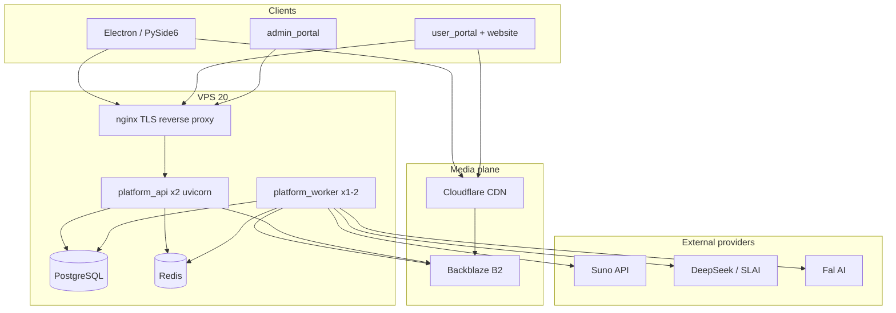
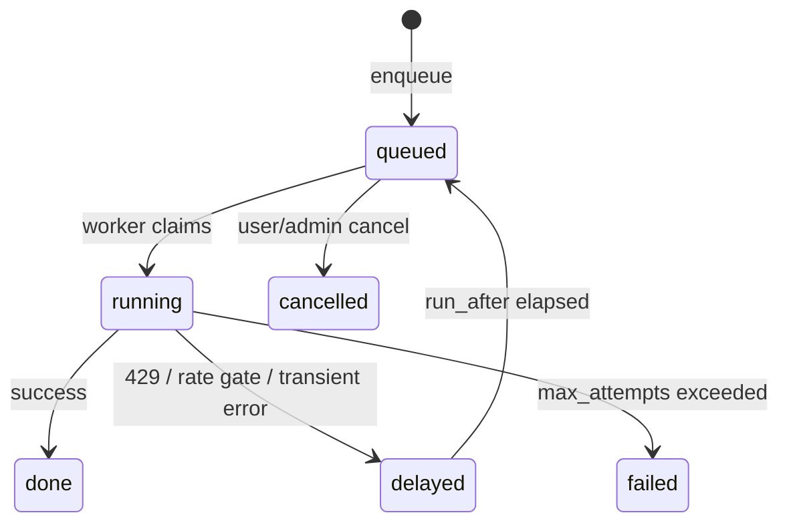

# Camxora Production Infrastructure & Implementation Plan

> **Document ID:** CAMXORA-INFRA-001  
> **Version:** 1.0.0  
> **Status:** Approved for implementation  
> **Last updated:** 2026-07-10  
> **Scope:** VPS hosting, object storage, music streaming (day one), job queue, workers, outbound rate limits  
> **Audience:** Engineering, DevOps, product planning

---

## 1. Executive summary

Camxora is moving from a **thin-server / thick-desktop** prototype to a **production multi-tenant platform** that:

1. Hosts the full web stack (`platform_api`, `website`, `user_portal`, `admin_portal`) on a VPS
2. Stores user MP3s, thumbnails, and album covers in **object storage** (not on the VPS disk)
3. Delivers **music streaming from day one** via CDN + signed URLs
4. Handles **20–50 concurrent subscribers** clicking **Generate** without overloading Suno or LLM providers
5. Uses a **durable job queue + worker process + outbound rate gates** instead of in-process `BackgroundTasks`

**Recommended production stack (launch):**

| Layer | Choice |
|-------|--------|
| Compute | **Cloud VPS 20** — 6 vCPU, 12 GB RAM, 200 GB SSD |
| Database | PostgreSQL 15+ (on VPS) |
| Cache / rate gates | Redis 7 (on VPS) |
| Object storage | **Backblaze B2** (S3-compatible) |
| CDN / streaming delivery | **Cloudflare CDN** (Bandwidth Alliance with B2) |
| Job queue | PostgreSQL `job_queue` table |
| Workers | `platform_worker` process (separate from uvicorn) |

**Storage provider decision:** **Backblaze B2** over Wasabi for music streaming (see §5).

---

## 2. System context

### 2.1 Applications in the ecosystem

| Application | Role | Hosted on VPS? |
|-------------|------|----------------|
| `platform_api` | FastAPI — auth, credits, batches, generation proxy, callbacks, WebSocket | **Yes** |
| `admin_portal` | React/Vite admin CMS | **Yes** (static behind nginx) |
| `user_portal` | Next.js creator portal (billing, account, streaming UI) | **Yes** |
| `website` | Next.js marketing site | **Yes** (or offload to Vercel later) |
| `camxora` | Electron desktop app | **No** — runs on user machines |
| `camxora_python` | PySide6 desktop rewrite | **No** — runs on user machines |

### 2.2 Current architecture (as implemented)

```
┌─────────────────────────────────────────────────────────────────┐
│  VPS (planned) or dev machine                                    │
│  platform_api │ PostgreSQL │ Redis │ portals                     │
└────────────────────────────┬────────────────────────────────────┘
                             │ HTTPS + WebSocket
┌────────────────────────────▼────────────────────────────────────┐
│  Desktop clients                                                 │
│  MP3 download to local disk, GPU video export, FFmpeg merge      │
└─────────────────────────────────────────────────────────────────┘
```

**Key facts from the current codebase:**

- `POST /batches` creates a batch and runs `execute_batch()` via **FastAPI `BackgroundTasks`** in the same uvicorn process
- Batch draft generation is **sequential** per song (`batch_service.orchestrate_drafts`)
- Suno submission is **sequential** per song after drafts complete
- MP3 binaries are **not** stored on the server — metadata + Suno URLs in `suno_tasks`; desktop downloads to `sunoOutputDir`
- Profile logos/covers use local `uploads/` on the API server
- Image batch jobs use `perfImageWorkers` (default 4, max 8) with `asyncio.Semaphore`
- YouTube uploads use `perfYouTubeWorkers` (default 1, max 5)
- **No Celery/RQ**, no S3/MinIO integration, no Docker compose in repo
- Redis is used for: rate limiting, lockout, token blocklist, key pool round-robin, usage cache
- DB connection pool: `min_size=2`, `max_size=10` (`platform_api/main.py`)
- Config already defines `suno_rate_limit=20`, `suno_rate_window_seconds=10` — used for **ingress** rate limiting, not proactive outbound throttling during batch execution

**Reference files:**

| Topic | Path |
|-------|------|
| Batch creation | `platform_api/routers/batch.py` |
| Batch execution | `platform_api/services/batch_service.py` |
| Generation proxy | `platform_api/services/generation_service.py` |
| Key pool + 429 failover | `platform_api/services/key_pool_service.py` |
| Ingress rate limits | `platform_api/middleware/rate_limit.py` |
| Desktop MP3 policy | `camxora/docs/technical.md` §3.X.3 |
| Suno callback | `platform_api/routers/callbacks.py` |
| Config | `platform_api/config.py` |

---

## 3. Target architecture

### 3.1 High-level diagram



### 3.2 Design principles

1. **API accepts work fast** — HTTP returns `batch_id` + `status: queued` immediately
2. **Workers execute work safely** — respect provider rate limits before outbound calls
3. **Media bytes never live on VPS disk** — only metadata in Postgres; files in B2
4. **Streaming bypasses VPS** — users stream from CDN → B2 origin, not through uvicorn
5. **Fair scheduling** — per-user concurrency caps so one user cannot monopolize the queue
6. **Idempotent jobs** — safe retries on 429/5xx with backoff

---

## 4. VPS hosting

### 4.1 Provider options considered

| Tier | Specs | Verdict |
|------|-------|---------|
| **Cloud VPS 10** | 4 vCPU, 8 GB RAM, 75 GB NVMe / 150 GB SSD, 200 Mbit/s | OK for API-only lean start; tight if all portals on same box |
| **Cloud VPS 20** | 6 vCPU, 12 GB RAM, 100 GB NVMe / 200 GB SSD, 300 Mbit/s | **Recommended** for full stack + 20–50 users |

### 4.2 Recommended VPS 20 configuration

| Setting | Choice |
|---------|--------|
| Plan | Cloud VPS 20 |
| Disk | **200 GB SSD** (more room for Postgres growth + backups than 100 GB NVMe) |
| Region | Europe (or closest to primary user base) |
| Billing | 12-month term (~€6/mo) if committed |

### 4.3 Services on VPS

| Service | Processes | RAM estimate |
|---------|-----------|--------------|
| PostgreSQL 15+ | 1 | ~2 GB |
| Redis 7 | 1 | ~256 MB |
| platform_api (uvicorn) | **2 workers** | ~1.5–2.5 GB |
| platform_worker | **1–2 processes** | ~0.5–1 GB |
| user_portal + website (Next.js / PM2) | 1–2 | ~1–2 GB |
| admin_portal (static) | nginx only | minimal |
| nginx | 1 | ~128 MB |
| OS + buffer | — | ~2 GB |
| **Total** | | **~9–10 GB** of 12 GB |

### 4.4 What the VPS disk is for

| On VPS disk | NOT on VPS disk |
|-------------|-----------------|
| OS, applications | User MP3 libraries |
| PostgreSQL data directory | Thumbnails / backgrounds at scale |
| Redis persistence (optional) | Streaming egress bytes |
| Small `uploads/` temp (avatars) | Video exports |
| Logs, backups | |

### 4.5 Network requirements

- **Public HTTPS** required for `PLATFORM_SUNO_CALLBACK_BASE_URL` (Suno webhooks cannot reach localhost)
- WebSocket at `/api/v1/ws` (max 3 connections per user — existing)
- CORS configured for portal origins (`PLATFORM_CORS_ORIGINS`)
- **300 Mbit/s** port is sufficient for API traffic; **not** for bulk media streaming (handled by CDN)

### 4.6 Process layout (systemd)

```ini
# Example service names
camxora-api.service      # uvicorn --workers 2
camxora-worker.service   # python -m platform_api.worker
camxora-user-portal.service
camxora-website.service
nginx.service
postgresql.service
redis.service
```

### 4.7 Nginx reverse proxy (required)

Production nginx config lives in **`scripts/deploy/nginx-camxora-production.conf`**. Apply with:

```bash
python scripts/deploy/apply_nginx.py --env production
python scripts/deploy/verify_nginx_api_timeouts.py --env production
```

**Mandatory:** every location proxying to `platform_api` must set `proxy_read_timeout 300s` (plus `proxy_connect_timeout` / `proxy_send_timeout`). Image generation during onboarding and batch thumbnail jobs routinely exceed nginx’s **60s default**, which produces **504 in the browser while the API audit log shows success**.

Operational details: [`docs/DEPLOYMENT_OPERATIONS.md`](./DEPLOYMENT_OPERATIONS.md).

---

## 5. Object storage: Backblaze B2 vs Wasabi

### 5.1 Decision: **Backblaze B2** for music streaming

| Criteria | Backblaze B2 | Wasabi |
|----------|--------------|--------|
| Storage price | ~$6.95/TB/month | ~$7.99/TB/month |
| Minimum billing | None (10 GB free tier) | **1 TB/month floor** |
| Minimum retention | None | **90 days per object** |
| Egress model | Free up to **3×** stored/month; then $0.01/GB | "Free" only within **~1:1** stored:downloaded fair use |
| Streaming fit | **Good** with CDN | **Poor** for hot streaming workloads |
| CDN integration | **Free origin pull** via Bandwidth Alliance (Cloudflare, Bunny, Fastly) | No strong CDN alliance |
| API | S3-compatible (common actions) | S3-compatible |
| Reliability | Public company (NASDAQ), mature | Solid for backup/archive |

### 5.2 Why not Wasabi for day-one streaming

Music streaming produces **egress >> storage**:

- Store 100 GB of MP3s
- Users stream 500 GB–2 TB/month across the library
- Wasabi fair-use policy expects downloads roughly proportional to stored volume → risk of throttling or account review
- 90-day minimum retention penalizes users who delete/replace songs
- 1 TB monthly minimum is expensive when starting small

**Wasabi is better for:** cold backup, archive, WORM-style retention.  
**B2 is better for:** streaming origin behind a CDN.

### 5.3 Alternative: Cloudflare R2

Cloudflare R2 has **zero egress fees** and integrates natively with Cloudflare CDN. Worth evaluating if already all-in on Cloudflare. B2 + Cloudflare Bandwidth Alliance remains an excellent and proven choice.

### 5.4 Streaming delivery architecture (day one)

```
User clicks Play
    → user_portal / desktop player
    → GET /api/v1/library/songs/{id}/stream-url  (auth required)
    → platform_api returns short-lived signed CDN URL (or signed B2 URL)
    → browser / app streams from Cloudflare CDN
    → CDN cache miss → origin pull from B2 (free via Bandwidth Alliance)
```

**Day-one streaming scope:**

- MP3 direct play via HTML5 `<audio>` + signed URL
- HTTP Range requests for seeking (B2 + CDN support this)
- **No HLS/transcoding required** for v1
- Album art from B2 `covers/` prefix

---

## 6. Storage sizing

### 6.1 Per-user plan assumptions

Sizing below uses a **planning example** only (~420 songs/user/month). Actual allowances come from Admin-managed `plans` rows — do not treat these figures as seeded defaults.

| Metric | Value |
|--------|-------|
| Example monthly song allowance | ~420 songs/user/month (Admin-configured) |
| Average MP3 size | 3–5 MB (plan with **4 MB**) |
| New audio storage per user per month | ~**1.7 GB** |
| Thumbnails / backgrounds overhead | +20–40% |

### 6.2 Projected storage growth (audio only)

| Users | New audio/month | 12-month retention (approx.) |
|-------|-----------------|------------------------------|
| 20 | ~34 GB | ~400 GB |
| 50 | ~84 GB | ~1 TB |

All of this lives in **B2**, not on the VPS 200 GB SSD.

### 6.3 B2 bucket layout

```
camxora-media/                          # bucket name (example)
  users/{user_id}/
    audio/{song_id}/
      ok.mp3
      alt.mp3
    images/{batch_id}/
      thumbnail-16x9.png
      thumbnail-9x16.png
      background-16x9.png
      background-9x16.png
    covers/{album_id}.jpg
```

### 6.4 Postgres metadata (not blobs)

Postgres stores pointers and metadata only:

| Table / columns | Purpose |
|-----------------|---------|
| `songs` | `user_id`, `title`, `album`, `lyrics`, `status` |
| `songs` (new) | `storage_key_ok`, `storage_key_alt`, `size_bytes`, `duration_seconds`, `mime_type` |
| `albums` (new or extended) | `cover_storage_key` |
| `suno_tasks` (existing) | Provider URLs until uploaded to B2 |
| `job_queue` (new) | Async work items |

---

## 7. Job queue architecture

### 7.1 Problem statement

When multiple users click **Generate** on the music page simultaneously:

- Today: all batch work runs in uvicorn via `BackgroundTasks`, sequentially per song
- No fair ordering between users
- Suno limit (20 req/10s) is hit reactively (429 → key failover), not proactively
- One large batch can block others

### 7.2 Solution: durable Postgres queue + worker process

```
User clicks Generate
    → POST /batches
    → validate credits + plan limits
    → INSERT batch + songs
    → INSERT job_queue rows
    → return 201 { batch_id, status: "queued" }
    → (no BackgroundTasks)

platform_worker loop:
    → claim job (FOR UPDATE SKIP LOCKED)
    → acquire outbound rate token (Redis)
    → execute handler
    → update song/batch status
    → on 429: requeue with run_after delay
```

### 7.3 Job table schema (proposed)

```sql
CREATE TABLE job_queue (
    id              UUID PRIMARY KEY DEFAULT gen_random_uuid(),
    user_id         UUID NOT NULL REFERENCES users(id),
    batch_id        UUID REFERENCES batches(id),
    song_id         UUID REFERENCES songs(id),
    job_type        TEXT NOT NULL,  -- 'draft' | 'suno_submit' | 'image' | 'storage_upload'
    provider        TEXT,           -- 'deepseek' | 'suno' | 'fal' | 'b2' | ...
    status          TEXT NOT NULL DEFAULT 'queued',
                    -- queued | running | done | failed | delayed | cancelled
    priority        INT NOT NULL DEFAULT 0,
    run_after       TIMESTAMPTZ NOT NULL DEFAULT now(),
    attempts        INT NOT NULL DEFAULT 0,
    max_attempts    INT NOT NULL DEFAULT 5,
    payload         JSONB NOT NULL DEFAULT '{}',
    last_error      TEXT,
    locked_by       TEXT,
    locked_at       TIMESTAMPTZ,
    created_at      TIMESTAMPTZ NOT NULL DEFAULT now(),
    updated_at      TIMESTAMPTZ NOT NULL DEFAULT now()
);

CREATE INDEX idx_job_queue_claimable
    ON job_queue (status, run_after, priority DESC, created_at)
    WHERE status IN ('queued', 'delayed');

CREATE INDEX idx_job_queue_user
    ON job_queue (user_id, status);
```

### 7.4 Job granularity: per song, per step

For a batch of 10 songs with auto Suno enabled:

| Step | Jobs created |
|------|--------------|
| LLM drafts | 10 × `job_type=draft` |
| Suno submit | 10 × `job_type=suno_submit` (after each draft succeeds) |
| B2 upload | up to 20 × `job_type=storage_upload` (ok + alt per song, after callback) |
| Image gen | N × `job_type=image` (if `auto_gen_image`) |

**Why per-song jobs:** User A with 50 songs does not block User B with 4 songs.

### 7.5 Fair scheduling

| Mechanism | Description |
|-----------|-------------|
| Per-user active cap | Max **2** concurrent `running` jobs per `user_id` (Redis counter or SQL) |
| Global claim order | `ORDER BY priority DESC, created_at ASC` with `SKIP LOCKED` |
| Optional round-robin | `DISTINCT ON (user_id)` pick oldest per user, then oldest overall |

### 7.6 Job status flow



### 7.7 Replace BackgroundTasks

| Current | Target |
|---------|--------|
| `batch.py` → `background_tasks.add_task(execute_batch)` | Enqueue `draft` jobs only; return immediately |
| `image_jobs.py` → `BackgroundTasks` | Enqueue `image` jobs |
| `callbacks.py` → inline processing | Keep callback fast; enqueue `storage_upload` on completion |
| In-process `image_job_service` semaphore | Worker lane concurrency |

---

## 8. Workers & concurrency

### 8.1 Two worker layers

| Layer | Where | Purpose |
|-------|-------|---------|
| **Server workers** | `platform_worker` on VPS | Process `job_queue`, call external APIs, upload to B2 |
| **Desktop workers** | Electron / PySide6 settings | Local MP3 download, GPU export, merge (unchanged) |

### 8.2 Server worker concurrency (VPS 20 starting values)

| Lane | `job_type` | Concurrent jobs | Notes |
|------|------------|-----------------|-------|
| LLM | `draft` | 4–6 | I/O-bound, waits on DeepSeek/SLAI |
| Suno | `suno_submit` | 3–4 | Gated by outbound rate limiter |
| Image | `image` | 4–6 | Gated by Fal/SLAI limits |
| Storage | `storage_upload` | 3–4 | Upload MP3/images to B2 after generation |
| **Total in-flight** | | **8–12** | Across all lanes in one worker process |

### 8.3 Uvicorn workers (HTTP only)

| Setting | Value | Notes |
|---------|-------|-------|
| uvicorn `--workers` | **2** | Do not use all 6 vCPU for HTTP |
| Postgres pool `min_size` | 4 | Scale with workers |
| Postgres pool `max_size` | 20 | `(workers × 2) + worker_process + spare` |

### 8.4 Desktop worker settings (per user machine)

These are **user settings** synced via API (`perfMusicWorkers`, etc.) — not VPS settings.

| Setting | Default | Range | Notes |
|---------|---------|-------|-------|
| `perfMusicWorkers` | 1 | 1–5 | Local download / music pipeline |
| `perfImageWorkers` | 4 | 1–8 | Desktop image work |
| `videoExportWorkers` | 1 | 1–10 | GPU/NVENC limited |
| `perfMergeWorkers` | 1 | 1–2 | FFmpeg merge |
| `perfYouTubeWorkers` | 1 | 1–5 | YouTube upload threads |

Server-side `perfImageWorkers` / `perfYouTubeWorkers` in merged settings currently affect API background tasks — migrate these to worker lane concurrency config.

---

## 9. Outbound rate gates

### 9.1 Ingress vs outbound rate limits

| Type | Purpose | Implementation today |
|------|---------|---------------------|
| **Ingress** | Protect API from user abuse | `middleware/rate_limit.py` — per user, per endpoint type |
| **Outbound** | Protect Suno/LLM from platform over-calling | **Not implemented** — build `OutboundRateGate` |

### 9.2 Outbound rate gate design (Redis)

Before every external HTTP call in workers:

```python
async def acquire_outbound_slot(provider: str, key_id: UUID) -> None:
    """Block or requeue until a token is available."""
    while not await gate.try_acquire(f"outbound:{provider}:{key_id}", limit, window):
        await asyncio.sleep(0.5)
```

### 9.3 Provider limits (starting configuration)

| Provider | Limit | Window | Scope |
|----------|-------|--------|-------|
| Suno | **20** | **10 seconds** | Per API key (`api_key_entries.id`) |
| DeepSeek (LLM) | 30 | 60 seconds | Per key (tune after testing) |
| SLAI (LLM) | 20 | 60 seconds | Per key |
| Fal (image) | 10 | 60 seconds | Per key |
| B2 upload | 50 | 60 seconds | Global (tune) |

With **multiple Suno keys** in the key pool, each key gets its own 20/10s bucket. Optionally add a global Suno cap across all keys for safety.

### 9.4 On HTTP 429 from provider

1. Mark key `rate_limited` in key pool (existing behavior)
2. Set Redis cooldown TTL (existing)
3. Requeue job with `run_after = now() + backoff`
4. Do **not** fail the entire batch

### 9.5 Admin-configurable limits

Extend existing `rate_limit_config` table with outbound types:

| `endpoint_type` | Default | Scope |
|-----------------|---------|-------|
| `outbound_suno` | 20 / 10s | per API key |
| `outbound_llm_deepseek` | 30 / 60s | per API key |
| `outbound_llm_slai` | 20 / 60s | per API key |
| `outbound_fal` | 10 / 60s | per API key |
| `ingress_batch` | 5 / 60s | per user (prevent Generate spam) |

Admin portal already has rate limit UI (`GET/PUT /admin/rate-limits`) — extend for outbound types.

---

## 10. End-to-end: Music page Generate flow

### 10.1 Target sequence

```
1. User clicks Generate (10 songs, auto Suno on)
2. POST /api/v1/batches
   - Credit pre-check (existing)
   - INSERT batch + 10 songs
   - INSERT 10 job_queue rows (type=draft)
   - Return { batch_id, status: "queued" }

3. Worker claims draft jobs (up to 4–6 parallel)
   - acquire outbound LLM token
   - generation_service.submit_draft() via key pool
   - UPDATE song (title, album, lyrics)
   - INSERT suno_submit job for that song

4. Worker claims suno_submit jobs (up to 3–4, gated)
   - acquire outbound Suno token for selected key
   - generation_service.submit_suno()
   - Wait for Suno callback (existing)

5. POST /api/v1/callbacks/suno (existing)
   - UPDATE suno_tasks
   - WebSocket notify user
   - INSERT storage_upload jobs (ok.mp3, alt.mp3)

6. Worker uploads to B2
   - Download from Suno URL or receive from desktop sync
   - PUT to B2 key
   - UPDATE songs.storage_key_*

7. User streams
   - GET /api/v1/library/songs/{id}/stream-url
   - Play via CDN signed URL
```

### 10.2 Progress visibility (existing surfaces)

Users continue to see progress via:

- `GET /api/v1/batches/{id}` — batch status counters
- `GET /api/v1/progress` — aggregate pipeline view
- WebSocket notifications — `suno_task_completed` events
- Workflow / Progress desktop pages (polling)

---

## 11. API endpoints to implement

### 11.1 Storage & streaming (new)

| Method | Path | Auth | Purpose |
|--------|------|------|---------|
| `GET` | `/api/v1/library/songs` | User | List user's songs with stream metadata |
| `GET` | `/api/v1/library/songs/{id}` | User | Song detail + album art URL |
| `GET` | `/api/v1/library/songs/{id}/stream-url` | User | Short-lived signed CDN/B2 URL for playback |
| `GET` | `/api/v1/library/albums` | User | Album list with cover URLs |
| `POST` | `/api/v1/library/songs/{id}/upload` | User | Direct upload to B2 (or presigned PUT URL) |
| `POST` | `/api/v1/music/downloads/sync` | User | Extend existing — trigger B2 upload after desktop download |

### 11.2 Queue observability (new)

| Method | Path | Auth | Purpose |
|--------|------|------|---------|
| `GET` | `/api/v1/jobs` | User | User's queued/running jobs |
| `GET` | `/api/v1/admin/jobs` | Admin | Queue depth, failed jobs, metrics |

### 11.3 Modified endpoints

| Method | Path | Change |
|--------|------|--------|
| `POST` | `/api/v1/batches` | Enqueue jobs; remove `BackgroundTasks` |
| `POST` | `/api/v1/image-jobs/run` | Enqueue image jobs instead of `BackgroundTasks` |

---

## 12. Environment variables (new)

Add to `platform_api/config.py` (prefix `PLATFORM_`):

| Variable | Example | Purpose |
|----------|---------|---------|
| `PLATFORM_S3_ENDPOINT` | `https://s3.us-west-004.backblazeb2.com` | B2 S3 endpoint |
| `PLATFORM_S3_BUCKET` | `camxora-media` | Bucket name |
| `PLATFORM_S3_ACCESS_KEY_ID` | — | B2 application key ID |
| `PLATFORM_S3_SECRET_ACCESS_KEY` | — | B2 application key |
| `PLATFORM_S3_REGION` | `us-west-004` | B2 region |
| `PLATFORM_CDN_BASE_URL` | `https://media.camxora.com` | Cloudflare CDN domain |
| `PLATFORM_STREAM_URL_TTL_SECONDS` | `3600` | Signed URL lifetime |
| `PLATFORM_WORKER_CONCURRENCY` | `8` | Max in-flight jobs per worker |
| `PLATFORM_WORKER_ID` | `worker-1` | Claim lock identity |
| `PLATFORM_JOB_USER_CONCURRENCY` | `2` | Max running jobs per user |

Existing variables still required:

- `PLATFORM_DATABASE_URL`
- `PLATFORM_REDIS_URL`
- `PLATFORM_JWT_SECRET`
- `PLATFORM_SUNO_CALLBACK_BASE_URL`
- `PLATFORM_SUNO_CALLBACK_HMAC_SECRET`
- `PLATFORM_ENCRYPTION_MASTER_KEY`

---

## 13. Implementation phases

### Phase 0 — Infrastructure provisioning (Week 1)

- [ ] Provision Cloud VPS 20 (200 GB SSD, EU)
- [ ] Install PostgreSQL 15+, Redis 7, nginx, certbot
- [ ] Apply `nginx-camxora-production.conf` and verify 300s API proxy timeouts
- [ ] Create Backblaze B2 bucket + application key
- [ ] Configure Cloudflare CDN domain → B2 origin (Bandwidth Alliance)
- [ ] Deploy `platform_api` with 2 uvicorn workers
- [ ] Deploy `admin_portal`, `user_portal`, `website`
- [ ] Set public API URL for Suno callbacks
- [ ] Configure automated Postgres backups (daily → B2)

**Exit criteria:** Health check passes; portals load over HTTPS; Suno callback URL reachable.

---

### Phase 1 — Object storage + day-one streaming (Week 1–2)

- [ ] Alembic migration: `storage_key_ok`, `storage_key_alt`, `size_bytes`, `duration_seconds`, `mime_type` on `songs`
- [ ] Alembic migration: `cover_storage_key` on albums or songs
- [ ] Implement `StorageService` (S3-compatible boto3/aioboto3 → B2)
- [ ] Upload MP3 after Suno callback completes
- [ ] `GET /library/songs/{id}/stream-url` — signed CDN URL
- [ ] Basic audio player in `user_portal` (HTML5 `<audio>`)
- [ ] Album cover URLs from B2

**Exit criteria:** User can generate a song, see it in library, and stream it via CDN without VPS serving bytes.

---

### Phase 2 — Job queue (Week 2–3)

- [ ] Alembic migration: `job_queue` table
- [ ] `JobQueueRepository` — enqueue, claim, complete, fail, requeue
- [ ] Modify `POST /batches` — enqueue `draft` jobs; remove `BackgroundTasks`
- [ ] Implement `platform_api/worker.py` — main worker loop
- [ ] Handlers: `draft`, `suno_submit`
- [ ] `systemd` unit for `camxora-worker.service`
- [ ] Per-user concurrency cap (2 active jobs)
- [ ] `GET /jobs` for user queue visibility

**Exit criteria:** 10 users clicking Generate simultaneously → all get `queued` response; jobs drain without blocking API.

---

### Phase 3 — Outbound rate gates (Week 3)

- [ ] Implement `OutboundRateGate` (Redis sliding window / token bucket)
- [ ] Wire into Suno, LLM, Fal clients in worker handlers
- [ ] Suno: enforce 20 req / 10s per API key **before** HTTP call
- [ ] On 429: requeue with exponential backoff
- [ ] Extend admin rate limit config for outbound types
- [ ] Metrics: `outbound_rate_limited_total`, `job_queue_depth`

**Exit criteria:** Load test 50 Suno submits in 5 seconds → no provider 429 storm; jobs delay gracefully.

---

### Phase 4 — Storage upload pipeline (Week 3–4)

- [ ] Handler: `storage_upload` — download from Suno URL → PUT B2
- [ ] Trigger from Suno callback + desktop `music/downloads/sync`
- [ ] Upload thumbnails/backgrounds to B2 `images/` prefix
- [ ] Remove dependence on client-local paths for streaming

**Exit criteria:** All new songs stream from B2; desktop download becomes optional cache.

---

### Phase 5 — Image jobs + worker tuning (Week 4)

- [ ] Migrate `image_jobs` to `job_queue`
- [ ] Worker lane concurrency from settings (`perfImageWorkers` → server config)
- [ ] Migrate YouTube upload runner to queue (optional)
- [ ] Admin dashboard: queue depth, failed jobs, p95 job duration

**Exit criteria:** Image generation survives 20 concurrent users without API process blocking.

---

### Phase 6 — Streaming polish (Ongoing)

- [ ] CDN cache headers (`Cache-Control: public, max-age=3600` on MP3)
- [ ] HTTP Range request verification for seek/scrub
- [ ] Playlist / album browse APIs
- [ ] Play count / last played analytics (optional)
- [ ] HLS adaptive streaming (future — not required for MP3 v1)

---

## 14. Cost estimate (launch)

| Item | Est. monthly |
|------|----------------|
| VPS 20 (12-month) | ~€6 |
| B2 storage (first 100 GB) | ~$0.70 |
| B2 egress to Cloudflare CDN | **$0** (Bandwidth Alliance) |
| Cloudflare CDN (free plan) | $0 |
| Domain + TLS (Let's Encrypt) | ~€1 |
| **Total** | **~€7–10/month** to start |

Costs scale with B2 storage volume. Egress to end users is primarily Cloudflare's problem (free tier sufficient at launch).

---

## 15. Capacity: 20–50 users

| Concern | Verdict with target architecture |
|---------|----------------------------------|
| 20–50 users clicking Generate at once | **Yes** — jobs queue instantly |
| Suno 20 req/10s | **Yes** — outbound rate gate per key |
| Streaming day one | **Yes** — B2 + Cloudflare CDN |
| All portals on VPS 20 | **Yes** — 12 GB RAM sufficient |
| 50 users storing 420 songs/month | **Yes** — B2 scales; not VPS disk |
| GPU video export | **No change** — stays on desktop |

**Scale trigger for next step:** sustained queue depth > 100 jobs or p95 job wait > 5 minutes → add second `platform_worker` process or upgrade VPS.

---

## 16. Risks & mitigations

| Risk | Mitigation |
|------|------------|
| Suno 429 storms | Outbound rate gate + key pool failover + job requeue |
| VPS OOM | 2 uvicorn workers max; separate worker process; monitor RAM |
| B2 egress costs if CDN bypassed | Always issue CDN URLs; never proxy media through VPS |
| Wasabi-style fair-use violation | Use B2, not Wasabi, for streaming |
| Job queue table bloat | Archive completed jobs > 30 days; index maintenance |
| Single worker SPOF | systemd restart; second worker process at scale |
| Desktop + server path confusion | Phase 4 makes B2 canonical; desktop becomes cache |

---

## 17. Out of scope (this document)

- Docker / Kubernetes deployment manifests (future)
- Payment integration (CutLuy / Bakong — see website architecture doc)
- HLS transcoding pipeline
- Multi-region active-active
- Mobile apps

---

## 18. Related documents

| Document | Path |
|----------|------|
| Deployment operations (nginx, routing, incidents) | `docs/DEPLOYMENT_OPERATIONS.md` |
| Sandbox deployment guide | `docs/SANDBOX_DEPLOYMENT_GUIDE.md` |
| Platform API README | `platform_api/README.md` |
| Website architecture | `.trae/documents/Website Technical Architecture.md` |
| Desktop / API split (MP3 policy) | `camxora/docs/technical.md` |
| Music page requirements | `camxora_python/.docs/pages/07_MUSIC_REQUIREMENTS.md` |
| Worker concurrency (legacy desktop) | `python_app/docs/worker-concurrency/technical.md` |
| Implementation status (desktop) | `camxora_python/.docs/02_IMPLEMENTATION_STATUS.md` |

---

## 19. Glossary

| Term | Definition |
|------|------------|
| **Ingress rate limit** | Limits how often a *user* can call *our* API |
| **Outbound rate gate** | Limits how often *our platform* calls *Suno/LLM* |
| **Job queue** | Postgres table holding async work items |
| **Worker** | Separate process that claims and executes jobs |
| **B2** | Backblaze B2 Cloud Storage (S3-compatible) |
| **Bandwidth Alliance** | Free origin egress from B2 to Cloudflare CDN |
| **Signed URL** | Time-limited URL for authenticated media access |
| **Thick desktop** | Heavy media work (GPU export) runs on user's machine |

---

## 20. Approval & next action

This document captures all infrastructure and architecture decisions discussed for production launch.

**Recommended first implementation PR:** Phase 1 (B2 `StorageService` + DB migration + stream URL endpoint) in parallel with Phase 0 (VPS provisioning).

**Document maintainer:** Update this file when phases complete or provider pricing/decisions change.
