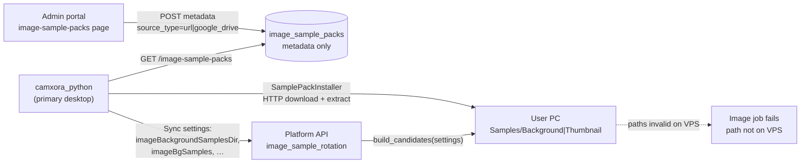
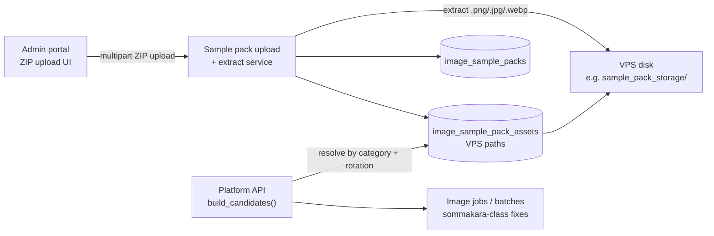

# Sample Pack VPS Migration — Feature Spec & PR Plan

**Status:** PR1–PR3 deployed to sandbox (2026-07-17). PR4 upload-only admin shipped. Admin must keep sample ZIPs populated on VPS; desktop UI hides local install paths.

**Branch context:** `cursor/channel-pricing-and-plan-tiers` (spec authored here; implementation may land on separate branches per PR below).

**Related docs:**

- [`PRODUCT_SCOPE.md`](./PRODUCT_SCOPE.md) — **camxora_python** is the only in-scope desktop app; `camxora/` (Electron) and `python_app/` are excluded.
- [`DESKTOP_RELEASE.md`](./DESKTOP_RELEASE.md) — desktop build/release; sample-pack UI removal in PR3 affects `camxora_python` Preferences.
- [`SANDBOX_DEPLOYMENT_GUIDE.md`](./SANDBOX_DEPLOYMENT_GUIDE.md) — VPS layout where extracted assets will live.
- [`DEPLOYMENT_OPERATIONS.md`](./DEPLOYMENT_OPERATIONS.md) — post-deploy checks after API changes.

**Product scope:** In scope — `platform_api`, `admin_portal`, `camxora_python`. Out of scope — legacy `camxora/` (Electron) and `python_app/`.

---

## Problem statement

Server-side image generation on the Platform API (VPS) resolves background/thumbnail **style reference images** from user workspace settings. Those settings currently store **desktop-local filesystem paths** (e.g. `%LOCALAPPDATA%\Camxora\Media\Samples\Background\…`).

When a batch runs on sandbox/production VPS — including users like **sommakara** — the API calls `ImageSampleRotationService.build_candidates()` and later `ImageJobService._read_image_file()`. The VPS cannot see the user's PC paths, so jobs fail with:

> **"Image reference file does not exist."**

(`platform_api/services/image_job_service.py`, `ValidationError` in `_read_image_file`.)

Meanwhile, the **admin catalog** (`image_sample_packs` table, migration `014_create_image_sample_packs.py`) only records metadata with `source_type` (`google_drive`, `url`) and an external `source_value`. Admins paste links; **desktop clients** download and extract ZIPs locally via `SamplePackInstaller` (`camxora_python/shared/services/sample_pack_installer.py`). There is no VPS-side ZIP ingest or asset index today.

**Goal:** Admin uploads sample-pack ZIPs directly to VPS storage; the API resolves candidates from VPS asset paths so server-side image jobs succeed without requiring desktop sample installation.

---

## Current vs target architecture

### Current (broken for server-side batches)



**Key settings keys** (synced from desktop, consumed by API):

| Key | Purpose |
|-----|---------|
| `imageBackgroundSamplesDir` | Folder scanned for background samples |
| `imageThumbnailSamplesDir` | Folder scanned for thumbnail style samples |
| `imageBgSamples` | Explicit background sample file list |
| `imageThumbSamples` | Explicit thumbnail style sample file list |

Defined in `camxora_python/shared/lib/workspace_defaults.py`; read by `platform_api/services/image_sample_rotation.py`.

### Target



**Reference pattern:** Marketplace template ZIP upload already validates, extracts, and stores on VPS filesystem via `MarketplaceService.upload_template()` and `PLATFORM_MARKETPLACE_STORAGE_PATH` (`platform_api/services/marketplace_service.py`, `platform_api/config.py`). Sample-pack ingest should follow a similar shape (size limits, zip validation, deterministic extract directory, cleanup on delete).

---

## Recommended PR split

Implement **PR1 → PR2 first** so sandbox image generation works before removing desktop sample-pack UI. **PR3** is `camxora_python` cleanup once VPS assets are live.

| PR | Title (short) | Depends on |
|----|---------------|------------|
| **PR1** | VPS storage + admin ZIP upload + asset table + extract service | — |
| **PR2** | API `build_candidates()` from VPS assets + fix sommakara-class failures | PR1 |
| **PR3** | Remove sample install UI/settings in **`camxora_python`** | PR2 |
| **PR4** | Drop legacy `source_type=url` admin fields (`platform_api` + `admin_portal`) | PR1 (can ship with PR1/PR2) |

**Out of scope (per [`PRODUCT_SCOPE.md`](./PRODUCT_SCOPE.md)):** Electron (`camxora/`) and legacy `python_app/` sample-pack UI — no cleanup PRs planned for those trees.

---

## PR1 — VPS storage + admin ZIP upload + asset table + extract service

### Scope

1. **VPS storage root** — new config (e.g. `PLATFORM_SAMPLE_PACK_STORAGE_PATH`, default under API data dir on VPS). Document in deploy env alongside `PLATFORM_MARKETPLACE_STORAGE_PATH`.
2. **Database** — new migration extending catalog:
   - Option A: new `image_sample_pack_assets` table (`pack_id`, relative path, filename, sort_order, sha256 optional).
   - Option B: extend `image_sample_packs` with `storage_path` + JSON asset list (prefer normalized assets table for rotation queries).
   - Deprecate reliance on `source_type` / `source_value` for *new* uploads (keep columns for backward compat until PR4).
3. **Extract service** — `platform_api/services/image_sample_pack_service.py` (or similar):
   - Accept ZIP bytes; validate size (mirror marketplace 10 MB cap or define sample-pack limit).
   - Extract supported images (`.png`, `.jpg`, `.jpeg`, `.webp`) — same set as `SamplePackInstaller` and `ImageSampleRotationService._list_directory_images`.
   - Write under `{storage_root}/{category}/{pack_id}/`.
   - Replace-on-reupload: delete prior extract dir + asset rows.
4. **Admin API** — extend `platform_api/routers/admin_image_sample_packs.py`:
   - `POST …/upload` (multipart) or `POST …` with file + metadata.
   - Wire repo + service in `platform_api/wire_dependencies.py`.
5. **Admin portal UI** — extend `admin_portal/src/pages/image-sample-packs/index.tsx`:
   - ZIP file picker + upload progress (reuse patterns from `admin_portal/src/components/marketplace/upload-dialog.tsx` and `use-marketplace.ts`).
   - Show asset count / preview list after upload.
   - Types/hooks: `admin_portal/src/types/image-sample-packs.ts`, `admin_portal/src/hooks/use-image-sample-packs.ts`.

### Key files

| Area | Files |
|------|-------|
| Migration | `platform_api/migrations/versions/` (new, after `014_create_image_sample_packs.py`) |
| Config | `platform_api/config.py` |
| Service | New `platform_api/services/image_sample_pack_service.py` |
| Repo | `platform_api/repositories/image_sample_pack_repo.py` (+ asset repo if split) |
| Router | `platform_api/routers/admin_image_sample_packs.py` |
| Wiring | `platform_api/wire_dependencies.py`, `platform_api/main.py` |
| Admin UI | `admin_portal/src/pages/image-sample-packs/index.tsx`, hooks/types above |
| Tests | `platform_api/tests/test_image_sample_packs_router.py`, new upload/extract tests |
| Deploy | `docs/SANDBOX_DEPLOYMENT_GUIDE.md` (env var + disk path) |

### Acceptance criteria

- [ ] Admin can upload a `.zip` of sample images for `background` or `thumbnail` category on sandbox admin portal.
- [ ] ZIP is extracted on VPS; asset rows point to paths that exist on the API host.
- [ ] Re-uploading a pack replaces previous assets atomically (no orphan dirs).
- [ ] Invalid ZIP / empty image archive returns structured 4xx (mirror marketplace error codes).
- [ ] Migration applied on sandbox DB; 503 migration hint unchanged for missing table.
- [ ] Unit tests cover extract, validation, and repo CRUD for assets.

---

## PR2 — API `build_candidates()` from VPS assets + fix sommakara-class failures

### Scope

1. **Change candidate resolution** — `platform_api/services/image_sample_rotation.py`:
   - `build_candidates()` loads active pack assets from DB for the requested `ImageKind` (background vs thumbnail) instead of (or as fallback over) user settings paths.
   - Preserve least-used rotation via existing `platform_api/repositories/image_sample_repo.py`.
2. **Call sites** — ensure consistent behavior in:
   - `platform_api/services/image_job_service.py` (`_resolve_runtime_sample_path`, `_read_image_file`)
   - `platform_api/services/batch_service.py` (`_resolve_sample_reference_path`)
3. **Settings fallback (transitional)** — during rollout, optionally keep reading `imageBgSamples` / dirs **only if** they exist on the API host (dev laptops); production/sandbox should prefer VPS assets. Document flag or environment gate if needed.
4. **Sommakara-class validation** — verify end-to-end on sandbox:
   - Batch with server-side image jobs completes without `"Image reference file does not exist."`
   - Background + thumbnail jobs pick rotating VPS samples.
5. **Tests** — extend `platform_api/tests/test_image_sample_rotation.py`, `platform_api/tests/test_image_job_service.py`, relevant `test_batch_service.py` cases.

### Key files

| Area | Files |
|------|-------|
| Rotation | `platform_api/services/image_sample_rotation.py` |
| Image jobs | `platform_api/services/image_job_service.py` |
| Batches | `platform_api/services/batch_service.py` |
| Repos | `platform_api/repositories/image_sample_pack_repo.py`, `image_sample_repo.py` |
| DI | `platform_api/dependencies.py` |
| Tests | `platform_api/tests/test_image_sample_rotation.py`, `test_image_job_service.py`, `test_batch_service.py` |
| Sandbox scripts | Existing deploy probes under `scripts/deploy/` (optional new probe for sample-pack readiness) |

### Acceptance criteria

- [ ] With PR1 assets uploaded, `build_candidates(settings, ImageKind.BACKGROUND|THUMBNAIL)` returns VPS-local paths only.
- [ ] Image job creation for a sandbox user (sommakara-style batch) succeeds for background and thumbnail reference reads.
- [ ] Least-used rotation still works across VPS asset paths.
- [ ] No regression for jobs that supply explicit `input_image_path` / generated outputs on VPS run dirs.
- [ ] Automated tests cover VPS asset resolution without desktop settings paths.

---

## PR3 — Remove desktop sample install UI/settings (`camxora_python`)

### Scope

Remove the **download/install sample pack** workflow from the PyQt desktop app once PR2 proves server-side generation works.

1. **Settings UI** — `camxora_python/features/settings/views/settings_view.py`:
   - Remove sample packs panel, pack combo boxes, install buttons, reload packs.
   - Remove `SamplePackInstallWorker` / `ImageSamplePacksWorker` usage.
2. **Workers** — `camxora_python/shared/workers/data_workers.py` (`ImageSamplePacksWorker`, `SamplePackInstallWorker`).
3. **Installer** — `camxora_python/shared/services/sample_pack_installer.py` (delete once PR3 ships).
4. **Cache / API client** — `camxora_python/shared/services/workspace_cache.py`, `camxora_python/shared/services/platform_api.py` (image sample pack list endpoints if only used for install).
5. **Readiness** — `camxora_python/shared/lib/music_readiness.py` / `test_music_readiness.py`: drop checks requiring local sample dirs if server now owns samples.
6. **Defaults** — `camxora_python/shared/lib/workspace_defaults.py`: stop seeding sample dirs as required workspace paths.

### Key files

| Area | Files |
|------|-------|
| UI | `camxora_python/features/settings/views/settings_view.py` |
| Workers | `camxora_python/shared/workers/data_workers.py` |
| Installer | `camxora_python/shared/services/sample_pack_installer.py` |
| Cache | `camxora_python/shared/services/workspace_cache.py` |
| Models | `camxora_python/shared/models/platform.py` (`ImageSamplePackItem`) |
| Tests | `camxora_python/tests/test_settings_view.py`, `test_music_readiness.py`, `test_workspace_defaults.py` |

### Acceptance criteria

- [ ] Preferences no longer shows sample pack download/install controls.
- [ ] No background workers fetch `/image-sample-packs` for install purposes.
- [ ] Desktop app still launches; image generation uses platform API (server-side samples).
- [ ] Readiness checklist no longer blocks Generate on missing local sample folders.
- [ ] Tests updated; no dead imports.

### Dependencies

- **PR2 merged and verified on sandbox** — do not ship PR3 before server-side candidate resolution works.

---

## PR4 — Drop legacy admin URL fields (`platform_api` + `admin_portal`)

### Scope

Admin and API cleanup after VPS ZIP upload is the primary catalog path. **Does not touch** legacy `camxora/` or `python_app/` (see [`PRODUCT_SCOPE.md`](./PRODUCT_SCOPE.md)).

1. **Admin portal** — remove legacy URL/Google Drive fields:
   - Drop `source_type` / `source_value` from create/edit forms in `admin_portal/src/pages/image-sample-packs/index.tsx`
   - Update `admin_portal/src/types/image-sample-packs.ts` to reflect upload-only catalog
   - API: stop accepting `source_type=url|google_drive` on create; migrate existing rows or one-time backfill script
2. **Public API** — `platform_api/routers/image_sample_packs.py`: trim desktop download URLs if `camxora_python` no longer installs packs locally (PR3).
3. **DB cleanup (optional)** — migration to drop or nullable `source_type` / `source_value` after data migration.

### Key files

| Area | Files |
|------|-------|
| Admin | `admin_portal/src/pages/image-sample-packs/index.tsx`, types, hooks |
| API | `platform_api/routers/admin_image_sample_packs.py`, `image_sample_packs.py`, repo |

### Acceptance criteria

- [ ] Admin catalog is upload-only (ZIP → VPS); no manual URL/Google Drive entry.
- [ ] Existing sandbox packs migrated to VPS assets (manual re-upload or one-off script documented).
- [ ] API docs / OpenAPI reflect new admin upload contract.

### Dependencies

- **PR1** (upload path exists); can ship alongside PR2. **PR3** may simplify public list endpoint usage.

---

## Dependencies and order

```
PR1 (storage + upload + assets)
  └─► PR2 (API candidates + sommakara fix)  ← ship & validate on sandbox
        └─► PR3 (camxora_python UI removal)
PR1 ──► PR4 (admin legacy URL fields; optional parallel with PR2)
```

**User guidance:** Start with **PR1 + PR2** so image generation works on sandbox before stripping `camxora_python` sample install UI.

---

## Risks and mitigations

| Risk | Impact | Mitigation |
|------|--------|------------|
| Disk usage on VPS | Large or many ZIPs fill SSD | Size limits per pack; periodic cleanup; monitor path in deploy ops |
| Partial extract / corrupt ZIP | Broken rotation, job failures | Strict validation before committing asset rows; transactional replace |
| Transition period (desktop paths in user settings) | Mixed behavior | PR2 feature flag or host-path existence check; clear sandbox re-test |
| Existing admin rows with external URLs only | No assets until re-upload | PR1 admin UI shows “needs upload”; optional backfill script |
| Marketplace vs sample-pack storage collision | Ops confusion | Separate config keys and directory roots |
| Removing UI before PR2 verified | Users cannot install locally AND server still broken | Enforce PR2 sandbox sign-off gate for PR3 |

---

## Key codebase map (today)

| Concern | Location |
|---------|----------|
| Sample pack DB schema | `platform_api/migrations/versions/014_create_image_sample_packs.py` |
| Admin CRUD (metadata only) | `platform_api/routers/admin_image_sample_packs.py` |
| Desktop list endpoint | `platform_api/routers/image_sample_packs.py` |
| Candidate resolution (desktop paths) | `platform_api/services/image_sample_rotation.py` |
| Image read failure | `platform_api/services/image_job_service.py` → `_read_image_file` |
| Batch sample pick | `platform_api/services/batch_service.py` → `_resolve_sample_reference_path` |
| Marketplace ZIP pattern | `platform_api/services/marketplace_service.py`, `routers/marketplace.py` |
| Admin UI (URL fields) | `admin_portal/src/pages/image-sample-packs/index.tsx` |
| Desktop install (PyQt) | `camxora_python/features/settings/views/settings_view.py`, `sample_pack_installer.py` |

**Out of scope (reference only):** `python_app/features/sample_pack/`, `camxora/src/renderer/.../SettingsWorkspacePage.tsx` — not maintained; see [`PRODUCT_SCOPE.md`](./PRODUCT_SCOPE.md).

---

## Implementation status

| Item | Status |
|------|--------|
| Spec document | **Done** (this file) |
| PR1 — VPS upload + assets | **Implemented locally** |
| PR2 — API candidates + sommakara fix | **Implemented locally** |
| PR3 — camxora_python UI removal | **Implemented locally** |
| PR4 — admin legacy URL fields | **Done** (upload-only admin UI + optional create defaults) |

---

## Deploy checklist

1. Run migrations `060` + `061` on sandbox/production.
2. Set `PLATFORM_SAMPLE_PACK_STORAGE_PATH` on VPS (optional; defaults to `./sample_pack_storage`).
3. Admin portal → Image Sample Packs → **Upload ZIP** for background + thumbnail packs.
4. Re-run a batch with auto-gen image to confirm jobs no longer fail with missing reference files.
5. Rebuild `camxora_python` desktop so Preferences shows server-managed sample pack notice.
