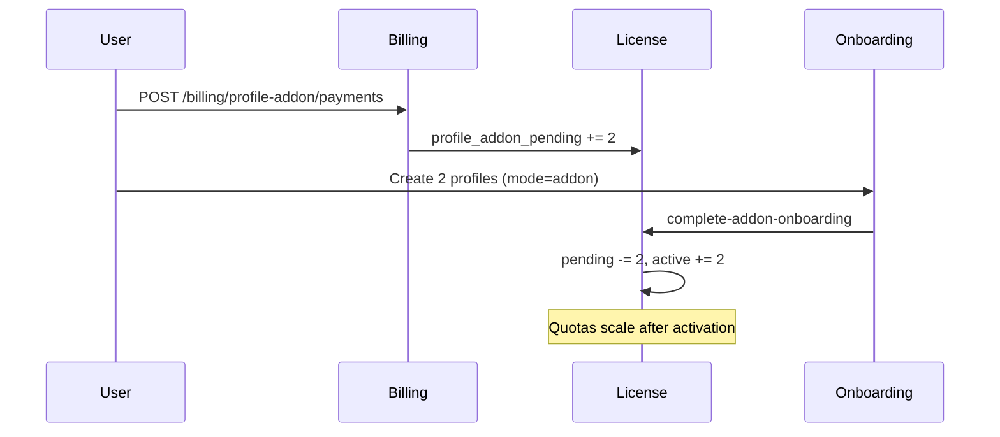
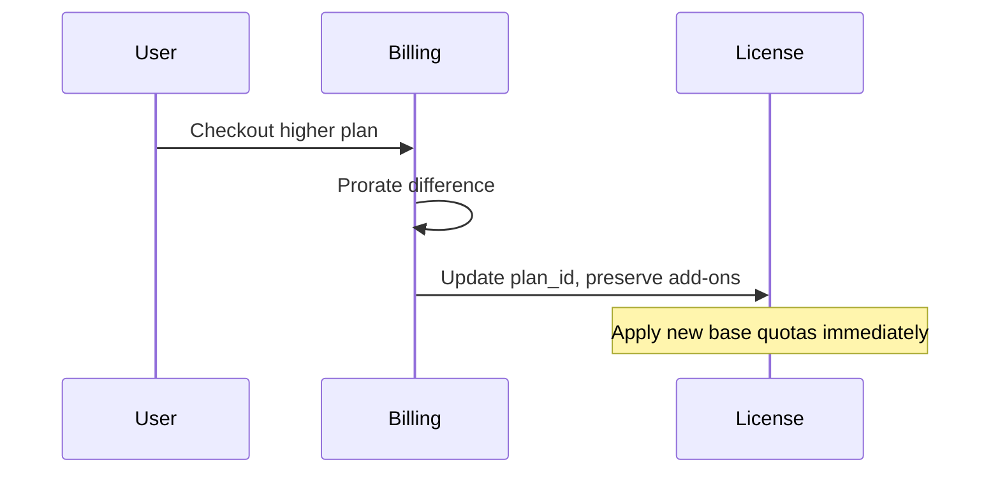

# Billing: proration, plan changes, and quota management

This document defines how CamXora should handle subscription plan upgrades/downgrades, profile add-ons, term discounts, and quota allowance when changes happen mid billing cycle.

## Pricing model (canonical)

**Plans table is the single source of truth.** Checkout, quotes, and billing always read `price_cents` from plan rows.

| Plan kind | Purpose |
|-----------|---------|
| `subscription` | Base channel plans (Monthly / 6 Months / Annual × 2/6/10 channels) |
| `profile_addon` | Add-on bundle checkout rows (`Add-on · +2 channels`, etc.) |

| Rule | Source |
|------|--------|
| 2-channel monthly anchor | Active `subscription` plan with 2 channels + 30-day cycle |
| Add-on +N price | Active `profile_addon` plan where `profile_allowance = N` |
| Term discounts | Encoded in each subscription plan row's `price_cents` (admin calculator helper only) |

### Example: 2ch plan + 2ch add-on on 6-month term

```
Combined monthly = $79 + $79 = $158
6-month checkout = round_whole_dollars($158 × 6 × 0.85) = $806
Annual checkout  = round_whole_dollars($158 × 12 × 0.75) = $1,422
```

Term discounts apply only to **6-month** and **annual** plans. Monthly billing has no term discount.

---

## Two types of channel expansion

### 1. Plan upgrade (2 → 6 → 10 channels)

User switches to a higher **plan row** (different `profile_allowance` on checkout).

- Replaces base plan channel allowance and base quotas.
- Billing is tied to the selected plan row price and billing cycle.

### 2. Profile add-on (+2 / +4 / +6 / +8 channels)

User keeps their current plan and buys additional channel **profiles**.

- Adds `profile_addon_pending` → user completes onboarding → moves to `profile_addon_slots` (active).
- **Quotas do not scale until onboarding completes** for the new profiles.
- Add-on price is fixed per bundle size; no tier discount on add-ons alone.

---

## Entitlement fields (license)

| Field | Meaning |
|-------|---------|
| `plan.profile_allowance` | Base channels included in the plan |
| `profile_addon_pending` | Paid/granted slots awaiting onboarding (creation allowed, **no quota boost**) |
| `profile_addon_slots` | Active add-on slots after onboarding (**quotas scale**) |

**Effective profile creation allowance** = plan + pending + active (capped at 10).

**Effective quota channels** = plan + **active** add-ons only (pending does not count).

---

## Recommended proration policy

### Upgrades (same or higher channel count)

**When:** User upgrades plan mid-cycle (e.g. 2ch monthly → 6ch monthly, or monthly → annual).

**Recommended behavior:**

1. **Calculate unused value** on the current subscription for the remainder of the billing period.
2. **Calculate cost** of the new plan for the remainder of the same period (or start a new full period — see below).
3. **Charge the difference** (credit if downgrade within same period — see downgrades).
4. **Apply new entitlements immediately** after successful payment:
   - Update `plan_id` on the license.
   - Scale base monthly/daily quotas to the new plan's `profile_allowance`.
   - **Preserve** `profile_addon_pending` and `profile_addon_slots` (do not wipe add-ons on upgrade).
5. **Reset usage meters** only for limits that increased (optional: pro-rate increased allowance for days remaining — see quota section).

**Formula (simple time proration):**

```
days_remaining = (period_end - now).days
period_days    = billing_cycle_days of current plan
unused_credit  = current_price_cents × (days_remaining / period_days)
new_charge     = new_price_cents × (days_remaining / period_days)
amount_due     = max(0, round_whole_dollars(new_charge - unused_credit))
```

For **term changes** (monthly → 6-month), prefer starting a **new full term** at checkout rather than partial term math, unless product requires seamless mid-term conversion.

### Downgrades

**Recommendation: allow at renewal only, not mid-cycle.**

| Approach | Pros | Cons |
|----------|------|------|
| **At renewal only (recommended)** | Simple, no refund disputes, clear quotas | User waits until period end |
| Mid-cycle with credit | Flexible | Complex refunds, quota clawback, support burden |

If downgrades are allowed mid-cycle:

1. Schedule downgrade for `period_end` (no immediate quota reduction).
2. Do **not** reduce `profile_addon_slots` automatically if total would exceed new plan + add-ons cap.
3. Block downgrade if `plan_channels + active_addons > new_plan_channels` unless user removes profiles/add-ons first.

**Do not allow** downgrading below the number of **created profiles** or **active add-on slots**.

---

## Quota allowance on mid-cycle changes

### Plan upgrade mid-month (example: 2ch → 6ch on day 10 of 30)

**Option A — Immediate full new quotas (recommended for simplicity):**

- On upgrade success, apply the **full** new plan quotas immediately.
- User benefit: simple, generous, easy to explain.
- Risk: slight overage vs strict pro-rata (usually acceptable).

**Option B — Pro-rated quota increase:**

```
quota_boost_ratio = days_remaining / period_days
new_limit = old_limit + (full_new_limit - old_limit) × quota_boost_ratio
```

Use Option A unless finance requires strict fairness.

### Add-on purchase mid-month

1. Payment → `profile_addon_pending += N`.
2. User creates N channel profiles via onboarding.
3. On `POST /licenses/complete-addon-onboarding` → `pending -= N`, `active += N`.
4. **Only then** scale monthly account-wide limits by `(plan_channels + active_addons) / plan_channels`.
5. Daily per-channel limits are unchanged; account-wide daily caps scale with active channels.

Pending add-ons never increase quota until onboarding succeeds.

### Plan upgrade while add-ons exist

```
effective_quota_channels = new_plan.profile_allowance + profile_addon_slots
scale_factor = effective_quota_channels / old_plan.profile_allowance
```

Recompute limits from the **new base plan template**, then apply add-on multiplier on active slots only.

---

## Add-on billing vs plan billing cycle

**Current implementation:** Add-on checkout charges **one month** at the fixed add-on monthly price.

**Target behavior (recommended):**

| User plan term | Add-on charge |
|----------------|---------------|
| Monthly | 1 × add-on monthly price |
| 6-month | `round_whole_dollars(addon_monthly × 6 × 0.85)` aligned to plan renewal |
| Annual | `round_whole_dollars(addon_monthly × 12 × 0.75)` aligned to plan renewal |

Add-on renewal date should match the **parent subscription** `period_end` so combined invoices stay aligned.

---

## Flow diagrams

### Add-on purchase



### Plan upgrade (target)



---

## Implementation status and gaps

| Area | Status |
|------|--------|
| Plan rows as SSOT for subscription + add-on pricing | Implemented (`plan_kind`) |
| Fixed add-on quotes from `profile_addon` plan rows | Implemented |
| Term discount helper in Create Plan form (local only) | Implemented |
| Deferred quota until add-on onboarding | Implemented |
| Add-on checkout uses add-on plan `price_cents` | Implemented |
| Plan checkout **preserving** add-ons on upgrade | **Gap** — plan fulfillment still revokes and recreates license |
| Proration on plan upgrade | **Gap** — charges full plan price today |
| Add-on charge aligned to 6mo/annual term | **Gap** — add-ons charge monthly only |
| Scheduled downgrades at renewal | **Not implemented** |

### Priority fixes

1. **Plan upgrade path** must update `plan_id` in place and preserve `profile_addon_slots` / `profile_addon_pending`.
2. **Proration service** for upgrade checkout using `days_remaining / period_days`.
3. **Add-on checkout** should read user's `billing_cycle_days` and apply term discount when on 6mo/annual.
4. **Downgrades:** implement "schedule at period_end" before allowing self-service downgrade.

---

## Admin operations

- **Grant add-ons:** Admin adds to `profile_addon_pending`; user still must onboard before quotas apply.
- **Channel pricing:** Admin → Plans → Channel & add-on pricing section; changes affect new quotes immediately.
- **Manual plan assignment:** Use smart price calculator to derive whole-dollar checkout prices from block price + discount %.

---

## Support FAQ (short)

**Why is +2 always $79 even if I'm on 6 channels?**  
Add-ons are fixed-price bundles, not tier-interpolated. Plan tiers use linear block pricing ($79 per 2 channels on the plan itself).

**Why didn't my quota go up after paying for add-ons?**  
Quotas increase only after you finish onboarding for the new channel profiles.

**Can I go above 10 channels?**  
No. At 10 channels, add-on purchase is blocked.

**Can I downgrade from 10ch to 2ch mid-month?**  
Not recommended mid-cycle. Schedule at renewal or remove profiles/add-ons first.

---

*Last updated: 2026-07-15*
