# Camxora Creator Program — End-to-End User Flows & Feature Relationships

**Version:** 1.0
**Date:** 2026-11-09
**Related:** [README](./README.md) · [BRD](./BRD.md) · [Product Spec](./PRODUCT_SPEC.md) · [Technical Design](./TECHNICAL_DESIGN.md) · [Roadmap](./ROADMAP.md)

---

## 1. How to read this document

This document shows the program as **flows**, not screens. Each flow names:

- the actor,
- the entry point,
- the systems touched,
- the data written,
- the failure path.

It also maps the Creator Program against every existing Camxora feature so we can see what is reused, what is extended, and what is genuinely new.

---

## 2. System map

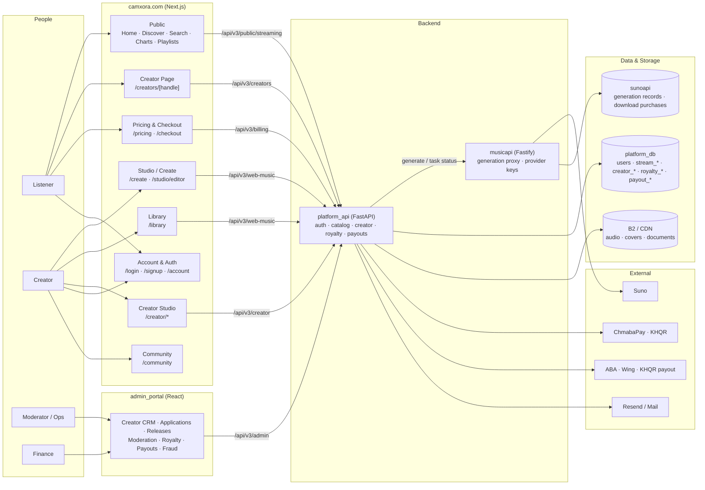

### Reading the map

- **`camxora.com` never talks to a database directly.** It calls `/api/v3/*`, which Next.js rewrites to `platform_api`.
- **Generation is a separate concern.** `platform_api` calls `musicapi`, which talks to Suno. Creator Program reads the resulting `suno_tasks` but never generates.
- **The public catalog is the spine.** Creator pages, discover, search, charts, and playlists all read `stream_albums` / `stream_tracks`.
- **Money is isolated.** Credits (generation) and earnings (creator cash) are different ledgers. They meet only in reporting.

---

## 3. Journey index

| # | Journey | Actor | Entry | Outcome |
|---|---|---|---|---|
| J1 | Discover → follow → play → tip | Listener | Home / Discover / Search | Follow + tip + listen event |
| J2 | Sign up → create → claim profile → apply → verify | Creator | Signup / Creator page claim | Verified creator with public page |
| J3 | Publish a release | Creator + Moderator | Studio / Library | Live release in catalog + creator page |
| J4 | Playback → analytics → royalty | System | Playback | Valid streams + dashboard + royalty accrual |
| J5 | Earnings → KYC → payout | Creator + Finance | Creator Studio / Admin | Money in the creator's bank |
| J6 | Report → moderation → appeal | Listener + Moderator | Creator page / track menu | Takedown, strike, or dismissal |
| J7 | Admin daily operations | Ops / Finance | Admin portal | Queues cleared, payouts reconciled |

---

## 4. J1 — Listener discovers, follows, plays, and tips

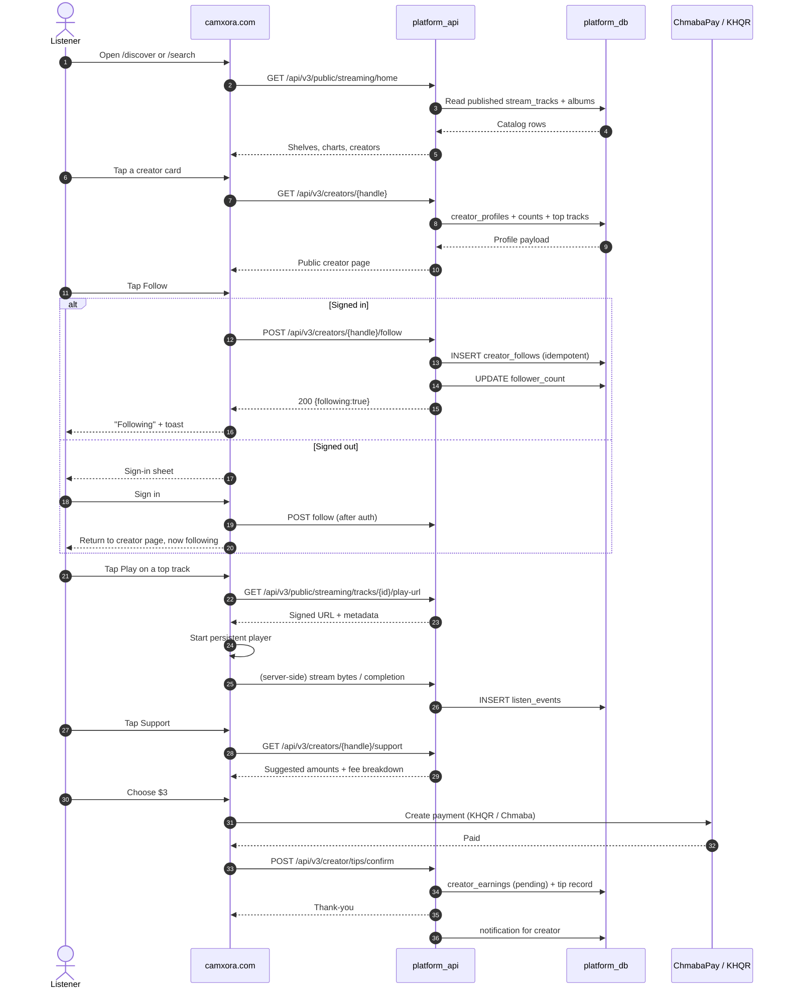

**Rules**

- Follow is idempotent; self-follow and blocked users are rejected.
- Logged-out users are returned to the exact creator page after sign-in (`?next=`).
- Playback is server-authenticated; owner plays are recorded but never paid.
- Tips are shown with the split **before** payment: “Creator receives $2.70 of $3.00.”
- A tip creates an earning in `pending`; it becomes `available` after the holdback.

**Failure paths**

| Failure | Behavior |
|---|---|
| Creator suspended | 404 / unavailable page; follow hidden |
| Creator deleted | 410 “no longer available” |
| Follow rate limit | 429 with retry time |
| Payment fails | No earning created; friendly retry |
| Tip duplicate (double tap) | Idempotency key returns the same result |

---

## 5. J2 — Creator onboarding: signup → create → claim → apply → verify

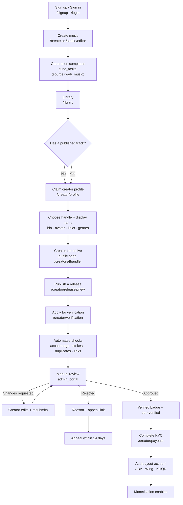

**Important distinctions**

- A user can become a **Creator** without verification: complete profile + publish one track.
- **Verification is not required to publish.** It is required to earn from the Creator Fund and downloads.
- **KYC is not a badge.** It is a separate financial requirement.
- Verification can happen before or after the first release; the checklist shows what is missing.

**Data written**

| Step | Table |
|---|---|
| Claim profile | `creator_profiles`, `creator_handle_history` |
| Apply | `creator_applications` |
| Upload evidence | `creator_verifications` + private object storage |
| Approve | `creator_badges`, `creator_profiles.tier` |
| KYC | `creator_kyc` |
| Payout account | `creator_payout_accounts` |

**Failure paths**

| Failure | Behavior |
|---|---|
| Handle taken | Suggest 3 alternatives; reserved names blocked |
| Account too new | Can be Creator; verification waits for 30 days |
| Duplicate application | Blocked; link to current status |
| Suspended account | Application blocked; appeal path shown |
| Evidence rejected | Reason + one resubmission |
| Verification expires | Re-review prompt 30 days before expiry |

---

## 6. J3 — Publish a release

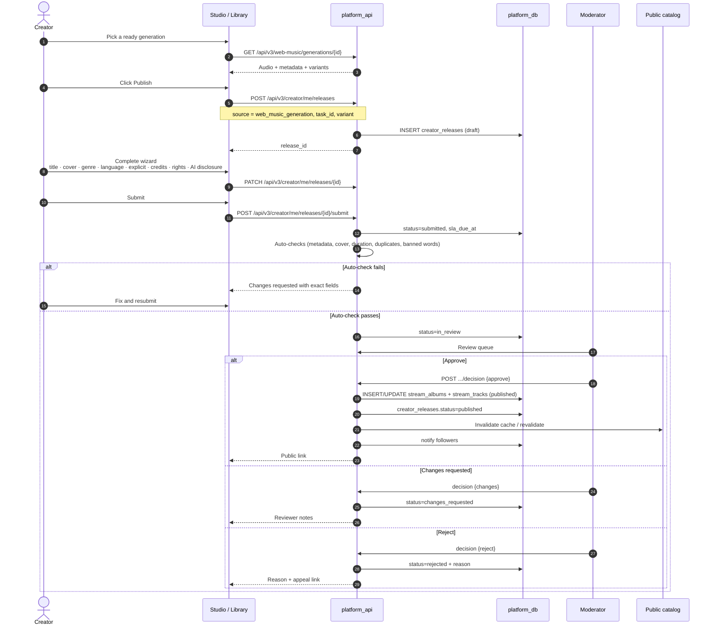

**Publishing rules**

- Generations are **private until submitted**. Web-music callbacks only backfill storage; they do not auto-publish.
- One `creator_releases` row per `(creator, source_task, variant)`; publish is idempotent.
- Approval writes the existing catalog tables, so discover/search/charts/playlists pick it up with no new pipeline.
- Unpublish hides it within 60s (cache revalidation + `publish_status`).
- Scheduled releases publish at 00:00 ICT and notify followers.

**Failure paths**

| Failure | Behavior |
|---|---|
| Generation not ready | Next disabled; status shown |
| Cover too small | Block with required dimensions |
| Duplicate audio | Block (fingerprint phase) or warn |
| Rights not attested | Submit disabled |
| Generation deleted | Block; ask to create a new one |
| Reviewer requests changes | Draft-like edit; resubmit without losing data |
| Takedown after publish | Hidden; creator notified; appeal path |

---

## 7. J4 — Playback → analytics → royalty

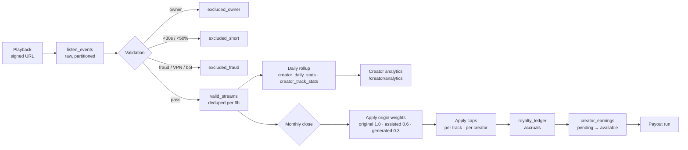

**Definitions in the flow**

| Stage | What it means |
|---|---|
| Play | Playback started, ≥5s |
| Valid stream | ≥30s or ≥50% duration, non-owner, deduped, not fraud |
| Royalty stream | Valid stream that passes eligibility + weights + caps |
| Weighted stream | Valid stream × origin weight |
| Accrual | Ledger entry; not yet payable |
| Available | Passed holdback; can be paid |
| Paid | Included in a completed payout |

**Why the separation matters**

- The dashboard can update hourly; money only moves after the monthly close.
- A stream can be valid but not royalty-eligible (below threshold, capped, creator suspended).
- Fraud corrections are new adjustment rows, never edits to history.

**Failure paths**

| Failure | Behavior |
|---|---|
| `valid_streams` missing/table error | Stats show 0; alert ops (this is the current bug to fix first) |
| Fraud spike | Quarantine; hold earnings; human review |
| Duplicate replay in same 6h | Upsert upgrades the row; no double count |
| Creator suspended mid-period | Accruals held; paid after resolution or forfeited per policy |
| Negative adjustment | Offsets future earnings; statement explains |

---

## 8. J5 — Earnings, KYC, and payout

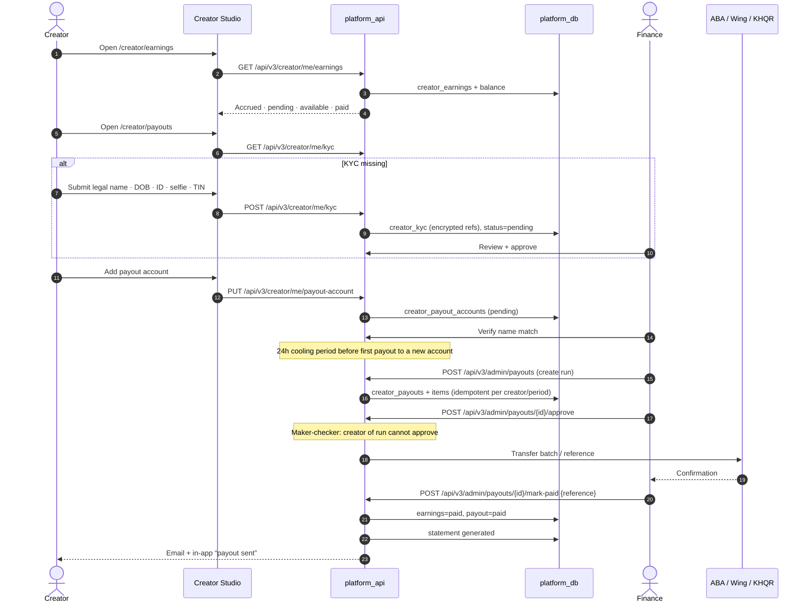

**Payout rules**

- Minimum $20; below that rolls over.
- 30-day holdback (90 for new creators), plus 10% reserve held 90 days.
- USD settlement; KHR shown at the day’s rate.
- Failed transfer: retry once, then hold + notify.
- Chargeback/clawback offsets future earnings; no cash collection.
- Statements are generated from the ledger; the ledger is the source of truth.

**Failure paths**

| Failure | Behavior |
|---|---|
| KYC rejected | Reason + one resubmission |
| Name mismatch | Block payout; ask for a matching account |
| Below threshold | “Request payout” disabled with amount needed |
| Bank outage | Mark failed; retry next cycle |
| Partial batch failure | Per-creator status; reconciliation report |
| Duplicate run | Unique constraint blocks a second payout for the same period |

---

## 9. J6 — Report → moderation → appeal

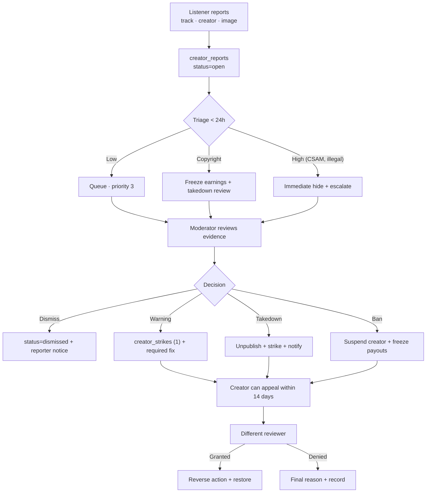

**Rules**

- Every action is audit-logged with actor, reason, and before/after.
- Bans longer than 30 days require two reviewers.
- Illegal content is removed immediately with no advance notice.
- Appeals go to a reviewer who did not make the original decision.

---

## 10. J7 — Admin daily operations

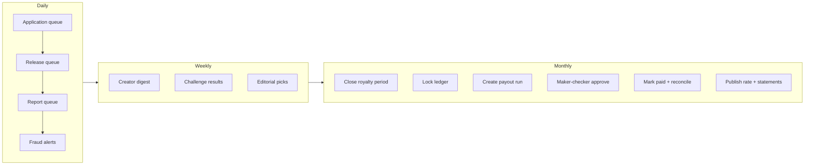

**Operational SLAs**

| Queue | SLA |
|---|---|
| Application first response | 3 business days |
| Application decision | 7 business days |
| Release review | 3 business days |
| Report triage | 24 hours |
| Appeal decision | 14 days |
| Payout cycle | 5th of the month |

---

## 11. State machines

### 11.1 Creator lifecycle

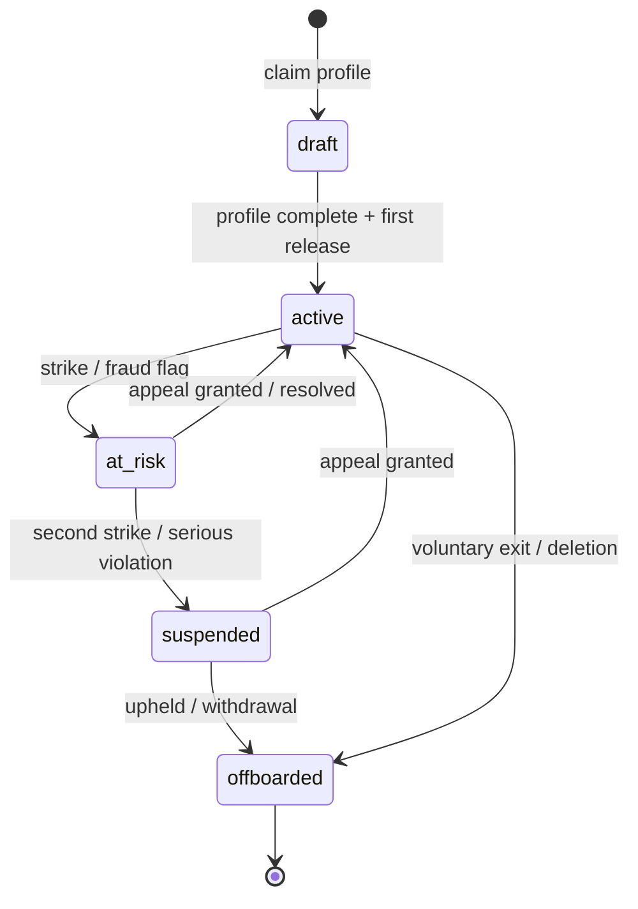

### 11.2 Application lifecycle

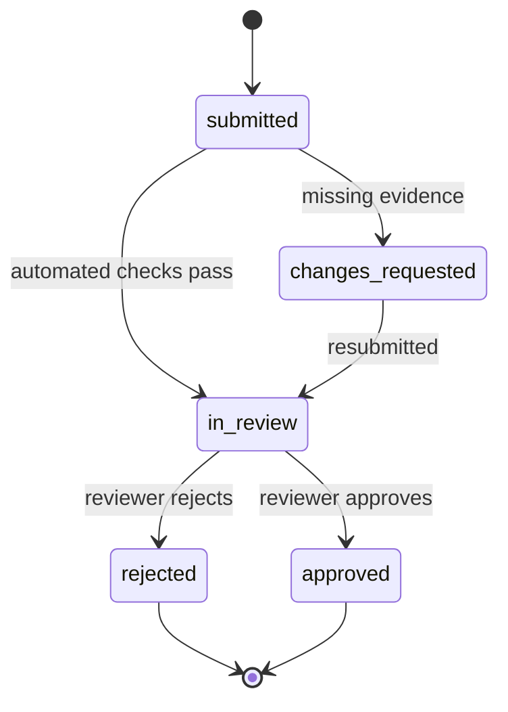

### 11.3 Release lifecycle

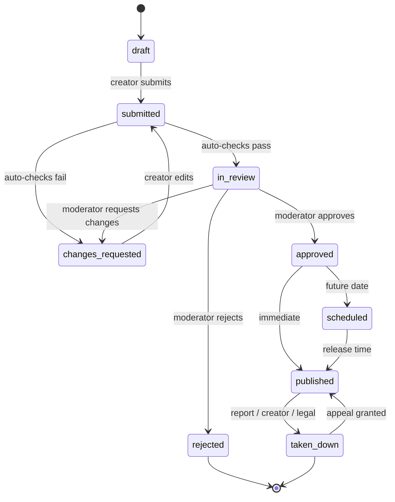

### 11.4 Payout lifecycle

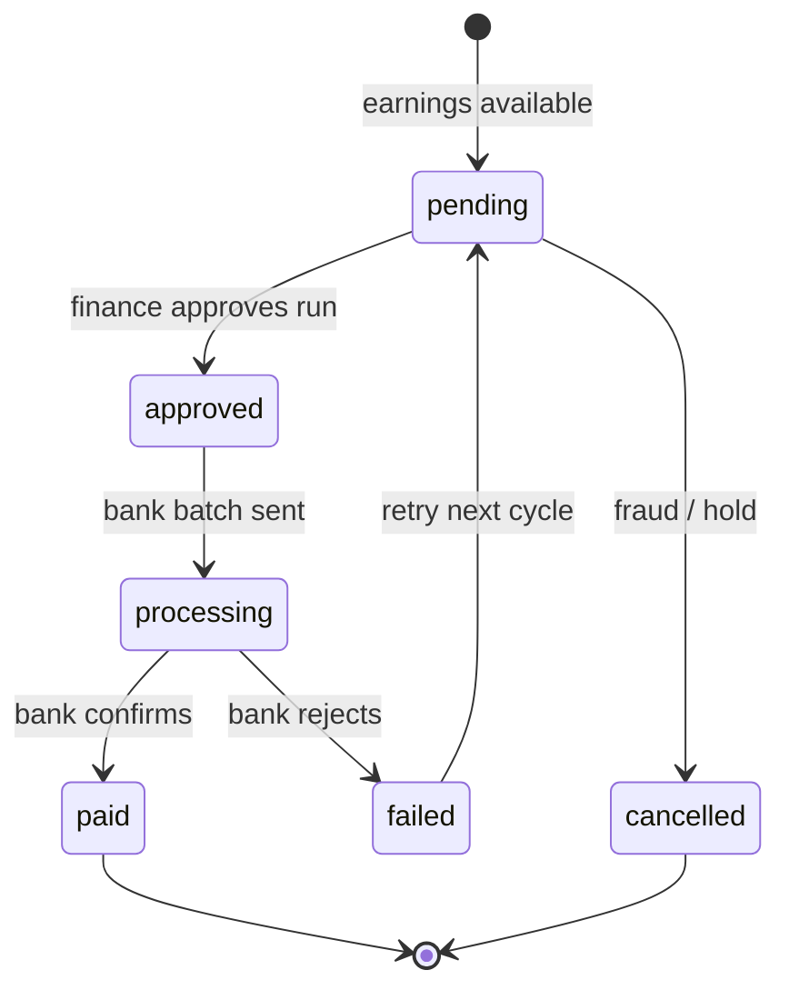

---

## 12. Feature relationship matrix

Legend: **R** = reads, **W** = writes, **X** = extends existing behavior, **N** = new surface.

| Existing feature | Relationship | What the Creator Program uses or changes |
|---|---|---|
| **Auth & Account** (`/login`, `/signup`, `/account`) | R/X | `users.id` is the creator identity; adds handle/profile fields; never creates a second account |
| **Create / Studio** (`/create`, `/studio/editor`) | R | Reads `suno_tasks` generations; adds a “Publish” entry point; never writes Studio tables |
| **Library** (`/library`) | R/X | Source of publishable generations; adds “Publish” actions and release status |
| **Streaming catalog** (`/discover`, `/search`, `/albums`, `/playlists`) | R/W | Public creator pages read catalog; approved releases write `stream_albums` / `stream_tracks` |
| **Charts** (`/charts`) | R/X | Adds creator/genre charts based on valid streams; never pay-to-play |
| **Playlists** | R/X | Public playlists appear on creator pages; playlist adds count as saves |
| **Credits & wallet** | R/X | Challenges/bonuses grant credits; **creator earnings are cash, not credits** |
| **Pricing & Checkout** (`/pricing`, `/checkout`) | R/X | Tips and downloads use the same payment rails; payouts are a separate ledger |
| **Payments** (ChmabaPay, KHQR) | R/X | Tips, downloads, and payout rails; no new card processor required |
| **Community** (`/community`) | X | Real creators/challenges replace mock cards; weekly challenge becomes real |
| **Notifications** (`/notifications`) | X | New events: application, release, follower, tip, payout, strike |
| **Mail** (`mail_*`) | X | Lifecycle emails via existing templates/automations |
| **Invite / Redeem** (`/invite`, `/redeem`) | X | Creator referral codes; credits rewards (not cash) |
| **Admin portal** | X | New consoles: creators, applications, releases, moderation, royalty, payouts, fraud |
| **AI generation** (Suno via `musicapi`) | R | Creator Program consumes output; never proxies generation |
| **Storage / CDN** (B2) | R/X | Reuses audio/cover storage; adds private KYC document storage |
| **Downloads** (`download_purchases`) | X | Phase 4: paid downloads and licenses; cross-DB bridge required |
| **Marketplace** | X | Phase 4: creator packs with 80/20 split |
| **YouTube / PostForMe publishing** | — | Independent; creator program does not depend on it |
| **Desktop app** | R | Desktop batch tracks can be claimed/published; no desktop UI changes required at launch |

### What is genuinely new

| New capability | Why it cannot be reused |
|---|---|
| Creator profile + handle | `users` only has display name/avatar; no public identity |
| Follow graph | No `follows` table exists |
| Applications / verification / badges | No workflow exists |
| Release review pipeline | Catalog has publish/unpublish, not draft/review states |
| Listen event ledger | Play counts are counters; no per-play event or validation |
| Royalty policy + ledger | Referenced in admin code but not implemented |
| Earnings / payouts / KYC | No financial tables |
| Moderation / strikes / appeals | Only `web_music_reports` exists |
| Creator analytics | Play counts exist; no rollups or audience metrics |

---

## 13. Cross-feature contracts (who writes what)

| Data | Owner | Readers | Rule |
|---|---|---|---|
| `users` | Auth | Everything | Creator Program never creates users or changes auth |
| `suno_tasks` | Studio / generation | Library, Creator Program | Creator Program reads only; never edits generation |
| `creator_profiles` | Creator Program | Public pages, admin | One row per user |
| `creator_releases` | Creator Program | Admin, public page | Workflow only; catalog is written on approval |
| `stream_albums` / `stream_tracks` | Catalog | Public, charts, playlists | Creator Program writes only through the approved publish path |
| `stream_track_likes` / `web_music_likes` | Engagement | Analytics | Saves metric |
| `listen_events` | Streaming | Validation | Append-only; partitioned |
| `valid_streams` | Validation | Analytics, royalty | Deduped; never edited, only status changes/upserts |
| `royalty_ledger` | Royalty engine | Earnings, admin | Append-only; corrections are new rows |
| `creator_earnings` | Earnings | Studio, payouts | Append-only; status transitions only |
| `creator_payouts` | Payout | Studio, admin | Idempotent per creator/period |
| `notification_queue` | Platform | Web | New event types only |
| `download_purchases` (sunoapi) | musicapi | Earnings (Phase 4) | Cross-DB bridge; never join directly |

---

## 14. How the program relates to the whole product (by surface)

### Home / Discover

- Adds **creator shelves** and **verified creator** cards.
- Uses real data; removes fictional artists.
- Creator pages become landing destinations from shelves.

### Search

- Adds creator results alongside tracks and albums.
- Creator names and handles are indexed.
- No change to track search.

### Charts

- Adds creator/genre charts based on valid streams.
- Methodology uses the same fraud-filtered counts as royalties.
- No paid placement.

### Playlists

- Creator pages show public playlists featuring the creator.
- Playlist adds count as saves.
- Editorial playlists remain staff-curated.

### Studio / Create

- Adds a **Publish** button after a generation is ready.
- Deep link: `/studio/editor?task_id=...&variant=...`.
- No change to generation, editing, or billing.

### Library

- Adds release status to generations (“In library”, “In review”, “Published”).
- Publish actions route to the release wizard.

### Account

- Adds creator profile entry points.
- Adds language/currency preferences.
- Does not change auth or security settings.

### Pricing / Checkout

- Tips and downloads reuse the same payment methods.
- Creator earnings never mix with credit balances.
- Payouts are not a checkout flow.

### Community

- Replaces mock creators with real ones.
- Weekly challenge becomes a real feature with entries and prizes.
- Guidelines link to the Creator Program content policy.

### Notifications / Mail

- New event types, same infrastructure.
- Transactional emails cannot be fully disabled.
- Preferences per event.

### Invite / Redeem

- Creator referral codes grant credits (not cash) to limit abuse.
- Invite rewards remain separate from royalties.

### Admin

- New consoles sit beside existing streaming/admin pages.
- Reuses admin auth and 2FA.
- Adds granular roles: support, moderator, finance, admin.

### Desktop app

- Desktop-generated tracks can be claimed and published.
- No desktop UI changes required for launch.
- The creator program is web-first.

---

## 15. Release isolation: why this does not block other features

### 15.1 Current setup

| Item | Value |
|---|---|
| Branch | `feat/creator-program` |
| Worktree | `G:\Developments\Projects\Camxora-worktrees\creator-program` |
| Base | `origin/main` at `11d34fd1` |
| Current commit | docs only (`docs/creator-program/*`) |
| `main` checkout | untouched, still on `main` |
| Runtime impact | **zero** — no code, no migrations, no config changes |

### 15.2 Why docs cannot block anything

- The branch adds **only** `docs/creator-program/*.md`.
- No build, deploy, migration, or runtime path reads these files.
- It can be merged at any time, or kept open until the program is ready.
- It does not touch `camxora.com`, `platform_api`, `musicapi`, or `admin_portal`.

### 15.3 How later phases stay non-blocking

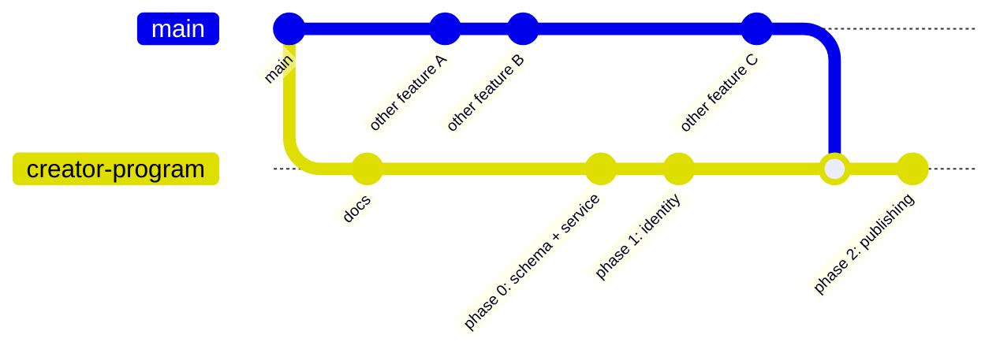

> Diagram branch label is shortened for rendering; the real branch is `feat/creator-program`.

**Rules for code phases**

1. **Additive migrations only.** New tables and columns; no edits to applied migrations. Reserve `186–199`; coordinate with the Studio agent.
2. **New files first.** Put logic in new routers/services/repositories. Avoid editing shared files except for one-line registrations.
3. **Single registration points.** `platform_api/main.py`, `wire_dependencies.py`, `admin_portal/src/App.tsx`, nav — each gets a small, merge-friendly addition.
4. **Feature flags.** `creator_program_enabled`, `creator_publishing_enabled`, `creator_tips_enabled`, `creator_payouts_enabled`. Default **off**. Deploying the branch changes nothing until a flag is on.
5. **No changes to existing write paths.** Publish writes catalog tables only after approval; existing catalog behavior is unchanged when the flag is off.
6. **No Studio file edits.** The Studio agent owns `/create`, `/studio/editor`, and generation. We add a publish entry point through the API contract.
7. **Small PR slices.** Docs → Phase 0 → identity → publishing → analytics → money. Each slice is independently reviewable and mergeable.
8. **Rebase weekly.** Keep the branch close to `main` to avoid a big-bang merge.
9. **Deploy from `main` only.** Per project rules, production ships one commit of `origin/main`; the feature branch is never deployed directly.

### 15.4 What could conflict (and the mitigation)

| Shared file | Risk | Mitigation |
|---|---|---|
| `platform_api/main.py` | Router include conflicts | One-line append; rebase often |
| `platform_api/wire_dependencies.py` | Dependency override conflicts | New block at the end; no reordering |
| Migration numbers | Collision with Studio | Reserve 186–199; Studio uses 200+ or timestamped revisions |
| `camxora.com` layout/nav | Nav item conflicts | Add creator links behind a flag; minimal edits |
| `admin_portal/src/App.tsx` | Route conflicts | Append lazy routes; no reordering |
| `docs/` | Doc conflicts | New folder, no edits to existing docs |

### 15.5 Deployment sequence

1. Merge docs (safe anytime).
2. Merge Phase 0 (schema + service) behind flags; no user-visible change.
3. Merge identity behind `creator_program_enabled`; enable for beta creators.
4. Merge publishing behind `creator_publishing_enabled`; enable for beta.
5. Merge money behind `creator_payouts_enabled`; run sandbox cycles.
6. Enable publicly when launch gates pass.

**Result:** other features can ship from `main` at any time; the Creator Program ships when it is ready, in slices, without a long-lived fork blocking anyone.

---

## 16. End-to-end happy path (one line per step)

1. Listener opens `/discover` → sees real creators and tracks.
2. Opens `/creators/sokha` → follows → plays a track.
3. Server records a listen event → validates it → counts a valid stream.
4. Creator opens `/creator` → sees the new stream and follower.
5. Creator publishes a new generation → release enters review.
6. Moderator approves → release appears on the creator page and catalog.
7. Followers get a notification → play → more valid streams.
8. Month closes → royalty engine computes the pool and accruals.
9. Finance creates a payout run → approves → marks paid.
10. Creator gets a statement and a bank notification.

---

## 17. Failure-path summary (what must never happen)

| Never | Guard |
|---|---|
| Pay for owner plays | `excluded_owner` |
| Pay for bot/VPN streams | fraud rules + quarantine |
| Double-pay a creator | unique payout per period + maker-checker |
| Pay without KYC | KYC gate before first payout |
| Leak KYC or earnings | RBAC + encryption + no public fields |
| Publish without consent | explicit release submission |
| Publish without rights attestation | mandatory checkbox + review |
| Sell a badge | policy + admin audit |
| Let a suspended creator earn | accruals held; payout blocked |
| Silently change a locked ledger | adjustment entries only |
| Break existing catalog | publish path is additive; flag-gated |
| Block other features | docs-only first; additive code; flags; small PRs |
