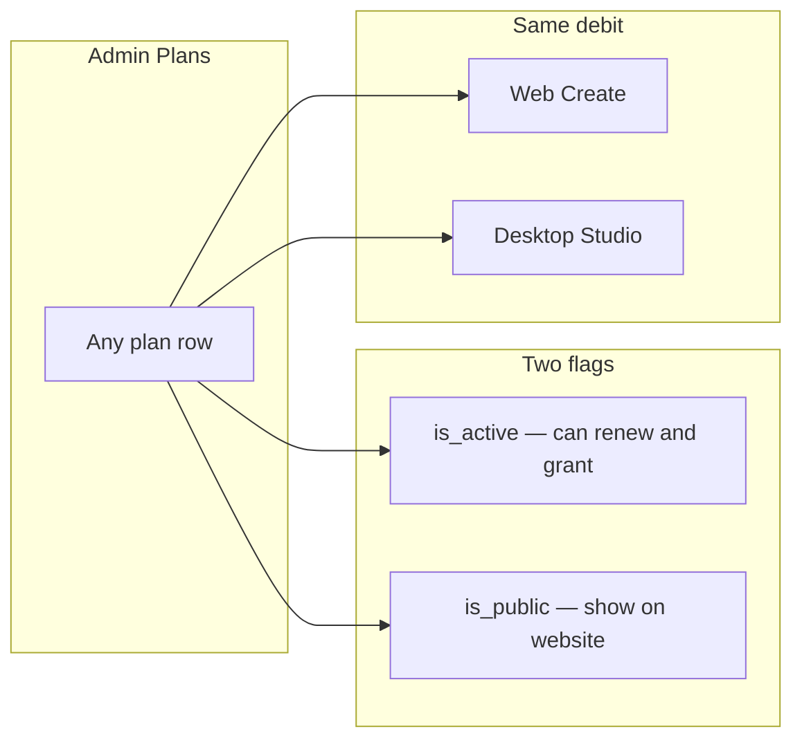

# Credits-only plan unification — full picture

**Spec branch:** `docs/credits-only-plan-unification`  
**Implementation branch:** `feature/credits-only-api-v3`  
**Worktree:** `G:\Developments\Projects\Camxora\MusicGenerator-credits-only-api-v3`  
**Date:** 2026-08-23  
**Status:** Product lock unchanged. Item 17 (one wallet) is implemented on **sandbox**. Production deploy + existing-user leftover mint wait for an explicit ask.  
**Base:** `main` @ `193ecf1b`

This file is the single picture after the decisions in this thread. Older quota docs (`.kiro/specs/credit-pricing-redesign`, `docs/BILLING_COSTS_SECURITY_LAUNCH_GAPS.md`) describe the model we are retiring.

> **Update — 2026-10-15 (`feat/packs-only-billing`):** Subscriptions are retired on
> music.camxora.com and **packs are now the only product**. Pack credits **expire 30 days
> from purchase**, and buying any pack re-stamps the whole wallet to that one date. This
> supersedes every "top-up / pack never expires" statement in the body below (item **B**,
> the "Desktop wallet is one pile" note, and the leftover-mint step) — the body is kept as
> the historical record of the 2026-08-23 cutover. Free daily credits are unchanged. See
> `platform_api/services/v3/wallet_sync.py` (`PACK_CREDIT_VALIDITY`) and
> `V3BillingStore.restamp_live_lots`.

---

## Progress (keep this current)

Last updated: **2026-08-23** after wallet API inventory + admin recast verify + designed E2E. Environment: **sandbox only**. Production not touched.

### Ready? (short answer)

| Question | Answer |
|---|---|
| Does the **catalog + visibility** flow match this doc? | **Yes on sandbox.** |
| Do the **new v3 APIs** work? | **Yes.** Plus cutover apply / grant / flag-on charge proof. |
| Does **live Generate** debit credits yet? | **Yes on sandbox.** Flag On. Desktop `/generation/suno` and Web Create both debit **10** (`music`). Desktop Pro no longer skips web Create. |
| Did leftover conversion mint anyone? | **Yes, one test user.** `credits-cutover-test@sandbox.camxora.test`: 80 / 300 used → **2,200** minted. Expired `somvannda@` / `sommakara84@` still **0**. |
| Period grant? | **Yes.** Test user granted **3,000**. Wallet after grant: **5,200** (2,200 leftover + 3,000 grant). Re-grant is `already_granted`. |
| `credits_only_v3_charge` | **On (sandbox).** |
| Free daily setting deleted? | **Yes on sandbox.** `daily_free_limit()` reads Free plan `daily_credits=50`. |
| Desktop list 7.5 → 10? | **Yes on sandbox.** `credit_pricing` music is 100,000 units = **10** credits. |
| Ready for production? | **Code is a complete set on sandbox.** Do not deploy or run leftover mint on prod until you ask. |

Evidence: worktree `docs/credits-only-sandbox-conversion-dry-run.csv` and `docs/changelog/2026-08-23-credits-only-sandbox-cutover.md`.

### How the tests went

| Layer | Result | What it proved |
|---|---|---|
| Local pytest (`test_v3_credits_only` + generate-flag) | **18 passed** (API v3 worktree) | Quote/charge/refund, leftover formula, confirm-gate, v1 public hides hidden plans. One leftover fail later: v1 serializer now also returns `monthly_credits` (test still expects the old shape). Not a sandbox outage. |
| Addon / period unit tests | **10 passed** | Extra profile slots do **not** scale song/draft/image/video/merge meters. Billing-period math works. |
| Sandbox API smoke | **20/20** `CREDITS_ONLY_SANDBOX_API_SMOKE_OK` | Every new v3 door + v1 public hide + flag stays false. |
| Sandbox matrix (visual + API, 2026-08-23) | **45 PASS, 0 matrix FAIL, 7 BLOCKED, 1 SKIP** | Public pages, Admin catalog, wallets, conversion skip, desktop chrome, music Create labels. |
| Conversion apply | **DONE (test user)** | 80/300 → leftover 220 × 10 = **2,200**. Idempotent second apply = `already_applied`. Expired users not in the apply set. |
| Live Suno generate | **Spent on sandbox** | Two `POST /api/v1/generation/suno` jobs for `credits-cutover-test@sandbox.camxora.test`. |
| Portal onboarding past email | **BLOCKED** | Still on confirm-email. Public cards themselves are filtered. |
| $5 / $10 addon checkout | **BLOCKED** | Not purchased. Existing addon slots already prove meters do not scale. |
| Flag On as the live path | **On (sandbox)** | Set after mint + grant. Test charge 10 then refund; wallet back to 5,200. |

**BLOCKED is not FAIL.** Those leftover cases need a person at the machine (email code, live Suno, CutLuy addon buy).

### Done (sandbox)

| # | Work | Matches this doc? | Notes |
|---|---|---|---|
| 1 | Schema: grants, per-op amounts, `credit_wallet_lots`, `billing_conversion_runs` | Yes §3 / §4.5 | Alembic `116`. Lot tables owned by `camxora`. |
| 2 | `/api/v3` quote, charge, refund, wallets, plan GET+PATCH, grant-period, conversion | Yes §4 / §5 | Same DB as v1. Docs: `https://api.sandbox.camxora.com/api/v3/docs`. |
| 3 | `GET /api/v3/plans/public` = `is_active AND is_public` | Yes §2.4 | 7 rows. No $79 / 7900. Free daily = 50. |
| 4 | `GET /api/v1/plans/public` = `is_active AND is_public` | Yes §2.4 | Same hide. Website and portal can no longer leak unpublished rows. |
| 5 + 5b | Admin `/plans` is the **one** catalog; quota editor retired | Yes §8 | Credits-only list+edit+create. Generate flag is **On** on sandbox. |
| 6 | Hidden **$79** on the **same** Monthly · 2-channel `plan_id` | Yes §2.3 | `7900¢`, `monthly_credits=3000`, leftover `monthly_song_limit=300`, `is_active=true`, `is_public=false`. |
| 7 | Public Starter / Creator / Studio | Yes §2.1 | 1,000 / 3,500 / 8,000. Yearly = cash discount, **same** grant (not extra credits). `profile_allowance=2`. |
| 8 + 8b | Free as a real $0 plan row; setting deleted | Yes §2.2 | `daily_credits=50`. `web_music_free_daily_credits` **deleted** on sandbox. Code reads the Free row first. |
| 8c–8f | Admin `/users/:id`, `/usage`, `/finance`, `/user-spent` recast | Yes §8 | Wallet + grant remaining. Quota table / meter chips / over_allowance retired. Ledger kept. |
| 11 + 12 | Conversion dry-run + **apply** | Yes §5.1 / §5.6 | Test user 80/300 → **2,200**. Expired somvannda/sommakara **0**. Apply idempotent. |
| 10 | Period grant | Yes §4.5 | Test user **3,000**. Wallet **5,200**. |
| 9 + 13 | Flag On | Yes §5.6 | `credits_only_v3_charge=true` on sandbox. Quote/charge/refund 10 (`source=plan`). |
| 14 | Desktop: one credits number; Suno list **10** | Yes §4.3 / §5.4 | Credits-page music **10** (was 7.5). Chrome still shows wallet credits. |
| 15 | Website / portal / Web Music three public cards | Yes §2.1 | `sandbox.camxora.com/pricing`, `music.sandbox.camxora.com/pricing`: Free + three paid. Dual-channel is a **bullet**. ≈ songs = `floor(credits/10)`. |
| 16 | Dual-profile packs do not multiply credits | Yes §2.5 | Addon SKUs unpublished. Existing `addon_slots=8` does not change song/draft/image/video/merge limits. |
| 20 | Sandbox API + matrix smoke | Yes §10.6 | 20/20 API; 45 matrix PASS. |
| 22 | Web Create = same charge model | Yes §4.1 / §4.2 / §5.4 / §6 | Flag On: quote `plan.<op>_credits`. Music **10** for everyone (Pro skip removed). Lyrics assist = **`lyric`**. Style = **`style`**. Free daily via v3 `daily_grant` lot from the Free plan row. Generate spends `credit_wallets` only. |
| 23 | Admin `/plans` + reports on v3 | Yes §8 | Catalog grouped Public / Hidden / Inactive. Flag copy is the live path. Finance grant issued is no longer `-`. Usage groups `v3_music` with music. Settings Music Web no longer edits the deleted free-daily setting. |
| 24 | Web Credits number from v3 | Yes step 2 / 17E | Header / Create / profile read `/api/v3/me/credits` only. v2 leftover is no longer added. Daily grant on `GET /me/credits`. |
| 17 | One wallet web + desktop | Yes on sandbox | A+B fulfill write grant/pack. C leftover applied for two CutLuy users (`1726` + `1400`). Second dry-run is `already_applied`. D generate is v3-only. Checkout URLs stay v2. |
| 25 | Wallet API inventory | Yes | `docs/credits-only-api-platform-map.md`. No v4. |
| 26 | Admin `/users` `/licenses` recast | Yes §8 | Tag gone. Plan from catalog. Licenses = desktop + CutLuy web. |
| 27 | Designed E2E | Yes | `docs/credits-only-e2e-cases-2026-08-23.md`: 28 PASS, 5 BLOCKED, 0 FAIL. User-spent 500 fixed on sandbox. |

### Pending

| # | Work | Notes |
|---|---|---|
| C03 | Optional **live Suno** generate | **Done on sandbox.** Two real `/generation/suno` jobs. |
| E03 | Live month rollover | Unit-proven. Do not fake a billing cycle on sandbox. |
| A05 / I02 | Portal onboarding past email | Visual only. |
| H01 / H02 | Real $5 / $10 addon checkout | Optional. |
| 21 | **Production** | Only when you ask. |

### Out of this project (do not build)

| # | Work | Why |
|---|---|---|
| 18 | Lifetime leftover | Out. Skip in dry-run. Do not mint. |
| 19 | `somvannda@gmail.com` / $79×5 | Out of spec. Expired; skipped as expired; no ×5. CSV leftover = 0. |

### What we should continue (next sitting)

1. **Do not** deploy production until asked.
2. Sandbox flag stays **On**. Empty v3 wallets 402 on Generate (no v2 fallback).
3. **Item 17 is on sandbox.** CutLuy fulfill writes grant/pack. Leftover job: `run_web_ledger_conversion_sandbox.py`. Production later: deploy this set, then `run_web_ledger_conversion_production.py --i-mean-production` (dry-run) and `--apply` once.
4. Checkout URLs stay `/api/v1/v2/subscriptions|topups` until a later cleanup.
5. Production remains a separate ask.

### 17. One wallet (implemented on sandbox)

Goal: one pot. Same user, same number on desktop and web, generate always debits `credit_wallets`.

| Phase | Work | Do not |
|---|---|---|
| A | CutLuy **paid plan** fulfillment: set license / web sub plan_id, then `ensure_period_grant` on `credit_wallets` | Do not remap $79 onto Starter |
| B | CutLuy **top-up** fulfillment: mint a `pack` lot (does not expire) | Do not put top-ups in `web_subscriptions` |
| C | One-time leftover: `max(0, web remaining)` → `quota_conversion` lot | Do not convert expired / $0 |
| D | Generate: remove v2 fallback in `WebMusicChargeBridge` | Do not change the 10 / lyric / style amounts |
| E | Web UI: drop `/api/v1/v2/credits/balance` for the header number | Checkout URLs can stay v2 until A+B are live |
| F | Admin Finance / Usage already read v3; confirm leftover mint shows as grant/pack | Do not invent API v4 |

Order: A+B+D+E are in the same deploy. C is a one-shot leftover job after that code is live. Production later: deploy this set, then dry-run C, then apply C once.

### Desktop Music Generate vs v3 (same debit, different doors)

When a user clicks **Generate** on the desktop Music page:

1. Desktop validates two channel profiles + dates.
2. For each song it writes a **draft** (title / album / lyrics). Each slot calls `check_and_deduct` (`title`, `album`, `lyric`) — three charges if all three run.
3. Then `GenerationProxy.submit_suno` → `POST /api/v1/generation/suno`.
4. API `UsageEnforcementService.check_and_deduct(..., operation_type="music")`.
5. With `credits_only_v3_charge` **On**, that short-circuits to v3 quote/charge (**10 credits = 1 generate = 2 versions**). Quota meters are skipped.
6. `generation_service.submit_suno(..., skip_pricing=True)` talks to Suno. Desktop polls `GET /generation/suno/{id}` and downloads both tracks.

**Same as v3 now when the flag is On: music debit is the v3 `music` op (10 credits).** Web Create uses the same amounts and no longer skips Desktop Pro.

| Difference | Desktop Music Generate | Web Create now (flag On) |
|---|---|---|
| Charge door | v1 `check_and_deduct` → v3 | v3 quote/charge when the user has a v3 wallet (desktop / Free daily). Paid CutLuy still debits v2 `web_subscriptions` for the **same** quoted amount |
| Pro skip | Always charges the wallet | **Removed.** Desktop Pro spends 10 from the shared wallet |
| Drafts | Title / album / lyric are **three** charges | Lyrics assist = `lyric`; style assist = `style` |
| Profile id | Desktop proxy historically omitted `channel_profile_id` | v3 charge does not need a profile |
| Flag Off | Old quota meters + `credit_pricing` | Old v2 path + the previous Pro skip |
| Free users | **Blocked** from desktop login and `/generation/suno` | Free can use Web Create (50 daily credits via v3 daily lot) |
| List price | Credits page music is **10** (was 7.5) | Same 10-credit rule |
| Ledgers | `credit_wallets` | Two ledgers remain (item 17 later) |

---

## 1. What we are building

**One charge system** for Web Music and Desktop Studio.

> **Billing = credits.**  
> **A plan = cash + credit grant + per-op amounts + visibility.**  
> **Not channel-based.** Dual-channel desktop is advertising + a 2-profile cap on every paid plan.  
> **No song / draft / image / video / merge billing meters.**

Admin Portal creates and edits every plan. Website and Web Music only show plans that are **active and public**.



---

## 2. Locked catalog

### 2.1 Public — advertise on website and Web Music

Same three cards everywhere. Dual-channel desktop is a **bullet on every card**, not the plan name.

```
┌─────────────────┐  ┌─────────────────┐  ┌─────────────────┐
│ Starter         │  │ Creator      ★  │  │ Studio          │
│ 1,000 credits   │  │ 3,500 credits   │  │ 8,000 credits   │
│ ≈ 100 songs/mo  │  │ ≈ 350 songs/mo  │  │ ≈ 800 songs/mo  │
│ $10 / month     │  │ $30 / month     │  │ $60 / month     │
│ • Web Create    │  │ • Web Create    │  │ • Web Create    │
│ • Desktop studio│  │ • Desktop studio│  │ • Desktop studio│
│ • Dual channels │  │ • Dual channels │  │ • Dual channels │
│ • Top-up packs  │  │ • Top-up packs  │  │ • Top-up packs  │
└─────────────────┘  └─────────────────┘  └─────────────────┘
```

“≈ N songs” = `floor(monthly_credits / 10)`. **10 credits = 1 generate = 2 versions** (web clips / desktop Primary+Secondary). Never ×2.

| Plan | Public | Active | Price | Monthly credits | Daily credits |
|---|---|---|---:|---:|---:|
| Starter | yes | yes | $10 | 1,000 | 0 |
| Creator | yes | yes | $30 | 3,500 | 0 |
| Studio | yes | yes | $60 | 8,000 | 0 |

Term toggle on the page can stay monthly / yearly (like Web Music today). That is cash discount, not extra credits.

### 2.2 Free — a real plan, not a system setting

Today web free is `system_settings.web_music_free_daily_credits` (default 50). That becomes a **Free** plan row.

| Field | Example (Admin can change) |
|---|---|
| Price | $0 |
| Daily credits | 50, or 0 |
| Monthly credits | 0, or any integer |
| Public / active | Show or hide the Free card |
| Per-op amounts | Same form as paid plans |

Both grants can be **0**. If the actions they need cost credits and they have 0, they cannot generate until a pack or a paid plan.

Delete the separate “music web free daily” setting so it cannot disagree with this row.

### 2.3 Hidden $79 — existing desktop subscribers

Keep today’s Monthly · 2-channel **same `plan_id`** (CutLuy + licenses stay put). Do not rename it Starter. Do not put it on `/pricing`.

| Field | Value |
|---|---|
| Price | **$79** |
| Monthly credits | **3,000** (300 generates × 10; 10 already includes both versions) |
| Daily credits | 0 |
| `is_active` | **true** — next month we still charge $79 and grant 3,000 |
| `is_public` | **false** |

6-channel / 10-channel / old term rows: same pattern if you still want their cash (active, unpublished, `monthly_credits` = packages × 10), or map those users later. Extra profile slots stay on the license. They do **not** change the $79 credit number.

### 2.4 Visibility (must fix in code)

| Flag | Meaning |
|---|---|
| `is_active` | Renew, grant, Admin assign |
| `is_public` | Website, Web Music `/pricing`, user-portal onboarding |

Public list = `is_active AND is_public`. Admin and license-assign still see unpublished rows.

**Now (sandbox):** both `GET /api/v1/plans/public` and `GET /api/v3/plans/public` filter this way. 50 concurrent public GETs leaked **0** hidden $79 rows. Website and music `/pricing` show Free + the three paid cards only. If we ever ship production without this filter, the hidden $79 plan would leak onto the website.

### 2.5 Profiles are not the plan (locked)

**Plan does not own profiles.** Starter / Creator / Studio / Free / hidden $79 only sell **credits + feature flags**.  
**Profiles belong to the user.** Buying a dual-profile pack does **not** add credits or quota.

This already matches the tables. We only stop add-ons from **scaling song/draft meters**.

#### How it works today (database)

```
users
  └── channel_profiles (user_id)     ← the actual channels (name, logo, YouTube, prompts)
  └── credit_wallets (user_id)       ← credits (Starter / Creator / Studio)
  └── licenses (user_id, plan_id)    ← which credit plan + slot counters
        ├── profile_addon_pending    ← paid slots, not onboarded yet
        └── profile_addon_slots      ← onboarded extra slots (today also scales quota — retire that)
  └── batches (ok_profile_id, alt_profile_id)  ← a Generate run pairs two profiles
```

`plans.plan_kind = 'profile_addon'` rows (`Add-on · +2 channels`, $79/mo today) are **checkout SKUs**, not a user’s credit plan. Fulfillment (`product_type=profile_addon`) only increments `profile_addon_pending` on the **license**. Onboarding writes `channel_profiles` and moves pending → slots.

| Who | Today | After |
|---|---|---|
| **Admin → Licenses** | PATCH `±2` pending/active on **that user** (`/licenses/:id/profile-addon-slots`) | Same. Copy must not say “quotas scale.” No credits minted. |
| **User portal** | Buy add-on (`/billing/profile-addon/payments`) then `/onboarding?mode=addon` | Same flow. Price from the **profile product** section, not Starter/Creator/Studio. |
| **Admin → Plans → Channel pricing** | Addon SKUs mixed next to subscription plans; $79 per +2; quotas used to scale | **Separate section:** dual-profile price only ($5 / $10, one-time or monthly). Not mixed into credit plans. |

Hard cap stays **10** profiles per user (`MAX_ACCOUNT_CHANNELS`).

#### What the user buys

| Product | Gives | Does not give |
|---|---|---|
| Starter / Creator / Studio / $79 hidden | Credits + desktop/web flags | Extra profiles (unless the plan’s included 2) |
| Dual-profile pack | **+2** create slots (one Music-page pair) | Credits, quota, a new “plan name” |

**Included 2 / packs / cap 10**

| | Meaning |
|---|---|
| **Included 2** | A paid **credit** plan (Starter / Creator / Studio / hidden $79) includes **2 profile slots** = **one** Music-page pair (Primary + Secondary). Enough to run desktop Music Generate. No extra pay. |
| **More pairs** | Each dual-profile pack is **+2 slots** (one more pair). Buy in user portal or Admin grant. 2 packs → 6 profiles (3 pairs), … up to 10. |
| **Cap 10** | Account hard max (`MAX_ACCOUNT_CHANNELS`). 10 profiles = 5 pairs. Cannot buy an 11th. |

Web Create / music_web does **not** use `channel_profiles`. It only needs credits.

**Fee mode (Admin profile-pricing section, not the credit-plan form)**

| Mode | Behavior |
|---|---|
| **One-time** | Pay $5 or $10 (Admin sets). Those extra slots stay until Admin removes them. No renew. |
| **Monthly** | Recurring on the **pack**, not on Starter/Creator/Studio. Stop paying → **do not delete** `channel_profiles`. Included **2** still work on Music page. Extra pairs (profiles 3–10) cannot be used for Music batch/Generate. Web Create still works on the credit plan. |

Onboarding stays the setup wizard for Music page (profiles). Credits to **run** Generate still come from Starter / Creator / Studio (or hidden $79).

---

### 2.6 Dual-channel at Generate (unchanged)

Profiles are independent. Pairing is a **run**, not a plan field. Desktop requires equal primary/secondary IDs with no overlap. Batch stores `ok_profile_id` + `alt_profile_id`. One Suno = 2 versions = 10 credits from the **credit plan**, not from the profile pack.

Create cap: `included (usually 2) + addon_slots + pending`, max 10. Extra slots live on the **license**, not on Starter/Creator/Studio.

---

## 3. What a plan stores (Admin form)

Every plan — Free, public three, hidden $79 — uses the same form. No deploy to add a SKU.

| Field | Meaning |
|---|---|
| Name, `price_cents`, billing cycle | Cash. `price_cents = 0` = Free |
| `monthly_credits` | Period grant. **0 allowed** |
| `daily_credits` | Midnight refill (`billing_today`, Asia/Phnom_Penh). **0 allowed** |
| `is_active`, `is_public` | See §2.4 |
| Dual-channel / desktop / web Create / top-up | Feature flags |
| `profile_allowance` | **Creation cap**, not billing. Default **2** on new public plans. Existing extra slots stay on the license. See §2.5. |

**Per-op credit amounts** (integer ≥ 0). `0` = included on that plan. Web and desktop both read **this user’s plan**.

| Operation | Credits page default (today’s code) | Suggested paid / $79 | Suggested Free |
|---|---:|---:|---:|
| Lyric | 5 | 5 | 0 or 5 |
| Title | 3 | 3 | 0 or 3 |
| Album | 3 | 3 | 0 or 3 |
| Music / web generate | 10 (2 versions) | 10 | 10 |
| Style assist (web) | 2 | 2 | 2 |
| Background / thumbnail | 5 | 5 | 0 or 5 |
| Video export | 3 | **0** (included) | 0 |
| Video merge | 10 | **0** (included) | 0 |

Credits page = default / COGS. Plans page = **this plan charges N**.

---

## 4. How charging works

### 4.1 One path

```
amount = plan.<op>_credits          # 0, 5, 10, …
if amount == 0 → do work, ledger included
else → debit amount from wallet → do work
on failure → refund that amount
```

No `subscription_covers_*`. No song/draft/image meters. Included is **this plan’s 0**, not leftover quota.

### 4.2 Drafts are not bundled

Lyric, title, and album are **three charges**. Skip the slot → skip that charge.

| What ran | What you bill |
|---|---|
| Lyric only | `lyric_credits` |
| Lyric + title | those two |
| Lyric + title + album | all three |
| No album generated | **no album charge** |

There is no flat `draft_credits` SKU.

**Today (before this change)** the server already bills per slot (`draft_billing.py`). Defaults 5 + 3 + 3. Batch song 1 = all three; later songs reuse album so lyric+title only. Desktop “Draft (N Credits)” often shows **lyric only** (undercounts). Web lyrics assist today is a separate **3**-credit `web_music_lyrics` row — after unify it uses **`lyric`**.

### 4.3 Music is 10 for both versions

Web Create already: **10 credits = 2 clips**. Desktop Suno package = the same unit. Unify desktop list from 7.5 → **10**. Never `remaining × 2 × 10`.

### 4.4 Video / merge

Default **0** on paid desktop and hidden $79. Admin can set 3 / 10 on any plan. Not a meter.

### 4.5 Wallet tags (so grants do not stack)

| Tag | Expires? |
|---|---|
| Period / daily **grant** | Yes, at next reset |
| **Pack / top-up** | No |
| **Cutover conversion** | No (they already paid for leftover songs) |
| Admin adjust / redeem | No unless Admin says so |

Desktop wallet is one pile today. Tag or unused monthly grant stacks forever. Web already: monthly remaining resets, top-up never expires.

---

## 5. Migrating existing desktop users

One server job, once, per user. Dry-run CSV first. Flip charge path only after mint + grants exist.

### 5.1 Who is in which bucket

Detect from `licenses` (active) + `plans` + `channel_profiles` count + `usage_tracking` (music this period).

| Bucket | How we know | Credit plan after | Profiles | Credits this cycle | Next invoice |
|---|---|---|---|---|---|
| **Monthly · 2-channel ($79)** | `profile_allowance=2`, cycle 30, price 7900 | Same row: **active, unpublished**, `monthly_credits` = **you set** (e.g. 3,000) | Keep 2 included. Extra slots stay on the license | Leftover **packages × 10** from the **plan row** (300) + song top-up | Still **$79** + that credit number |
| **Monthly · 6-channel** | allowance 6 | Same row unpublished, `monthly_credits=900` packages × 10 = **9,000** | Keep 6 (or `2 + addon_slots=4` if remapped) | packages × 10 | Keep **$190.39** until they switch, or map to hidden $79 (product call) |
| **Monthly · 10-channel** | allowance 10 | Unpublished, `monthly_credits=15,000` | Keep 10 | packages × 10 | Keep **$281** or map — same call |
| **6-month / Annual** same families | cycle 180 / 365 | Same unpublished row + `monthly_credits` as the monthly sibling | Keep slots | packages × 10 | **No new charge** until `expires_at`. Then 30-day credit grant for the rest of the prepaid term; cash renews on that hidden row or they pick a public plan |
| **+ profile add-ons** | `addon_pending` / `addon_slots` > 0 | Credit plan unchanged | **Keep all slots.** Do not mint or multiply credits for slots | Leftover from the **plan row** only | Add-on cash: leave as-is until the $5/$10 pack exists. Grant stays the plan number |
| **Expired license** | `expires_at` past | No grant | Keep profile **rows**; cannot Music-generate until they buy a credit plan | **Do not** mint leftover packages | — |
| **No license / trial** | no active paid license | Free plan if you want desktop free | Cap from Free plan (often 0 or 2) | No package conversion | — |
| **Wallet already > 0** | `credit_wallets` | Keep it | — | Conversion **adds** on top | — |
| **Song quota top-up this period** | `user_period_quota_topups` kind music | — | — | Include top-up in `song_limit` before leftover | — |
| **Web only** | `web_subscriptions` | No desktop migration | n/a | None | Web grant unchanged |

Prefer **keep the same `plan_id` + `license_id`**. Only flip flags and `monthly_credits`. CutLuy already bills that row.

**Lifetime is out of this project.** We do not sell it and we do not convert it. If a leftover Lifetime license appears in the dry-run, skip that row — do not mint leftover meters and do not invent a monthly grant.

### 5.2 Cutover job (one transaction per user)

Two numbers only.

| Number | What it is | Used for |
|---|---|---|
| **Leftover** | `plan.monthly_song_limit` + song top-up − music used this period | Mint once |
| **Plan grant** | What **you set** on that plan (e.g. 3,000 on $79) | Every month after |

```
remaining_packages = max(0, plan.monthly_song_limit + period_song_topup
                            - usage_tracking.music_this_period)
converted          = remaining_packages × 10     # 10 = 2 versions; do not ×2
wallet            += converted                   # tag quota_conversion (never expires)

plan.monthly_credits = <you set>                 # $79 example: 3000
plan.is_public       = false
plan.is_active       = true
# per-op amounts: lyric/title/album charged; music 10; video/merge 0
# stop subscription_covers_* only after every user is minted
```

Do **not** convert leftover drafts, images, videos, merges, or daily bank. Do **not** multiply the grant by channel count or add-on packs.

**$79 example:** 80 / 300 used → mint **2,200**. Next month **$79 + 3,000** (or whatever you set).

**Dedicated 6- / 10-channel plan:** leftover from that row’s own song limit (900 / 1,500), then that row’s own grant.

### 5.3 Profiles in the same job

| Step | Action |
|---|---|
| Count `channel_profiles` | Never delete |
| Create cap | `max(existing_count, plan.allowance + addon_slots + pending)` so we never show `10 / 2` |
| If we remap onto a `allowance=2` credit plan | Set `addon_slots` so cap still matches current profile count (e.g. 10 profiles → slots 8) |
| Pending add-ons | Keep; they still finish onboarding. No extra credits |
| Pairing | Untouched. They still pick pairs on Music page |

Buying more pairs later = new dual-profile product ($5/$10), not a credit plan.

### 5.4 After cutover — desktop still works

- Music page: same profiles, same pairs, now **debits credits** (lyric / title / album / 10 per Suno). Video/merge **0** unless Admin changes the hidden plan.
- Sidebar shows the minted balance, not “0 credits + Plan quota.”
- Web Create: same wallet/rules (recommend charge 10; today Desktop Pro skips). **Now (sandbox):** Pro skip is gone. Web Create charges 10.

### 5.5 Next month (recurring)

Conversion **never runs again**.

| User | Cash | Grant |
|---|---|---|
| Hidden $79 | $79 | The number you set (e.g. 3,000). Unused grant expires; leftover conversion + top-up packs stay |
| Hidden 6ch / 10ch | Old price (if we keep those rows) | 9,000 / 15,000 |
| Prepaid 6-mo / Annual | $0 until term end | Same monthly grant every 30 days |
| They switch to public Studio | $60 | 8,000 |
| They cancel | — | No grant. Profiles remain. Music extra pairs follow pack rules |

### 5.6 Ops sequence

1. Sandbox dry-run CSV (one row per active desktop license):

   `user_id, email, plan_id, plan_name, price_cents, plan_song_limit, addon_slots, music_used, leftover_packages, credits_to_mint, existing_wallet, profile_count, addon_pending, next_grant, next_price_cents, bucket`

2. You review before apply:
   - Dedicated 6ch / 10ch rows (keep hidden grant vs map).
   - Anyone with leftover > one full month (top-up or clock skew).
   - Expired (mint **0**).

3. Apply in this order (not the reverse):
   - Write plan flags + `monthly_credits` + per-op amounts on hidden rows.
   - Mint `quota_conversion` per user (idempotent: skip if already tagged).
   - Grandfather profile caps (`max(existing_count, allowance + slots + pending)`).
   - **Then** disable quota-first / `subscription_covers_*`.

4. Email / in-app: leftover songs → N credits (those do not expire); next bill still $X; website now Starter / Creator / Studio; extra channel pairs are a separate product, not extra credits.

5. Production only when you ask.

### 5.7 What we will not do in migration

- Map $79 people to Starter (1,000) or force Studio $60 this month.
- Shrink a 10-profile account to 2 slots.
- Mint credits for unused drafts/images/video or for profile add-ons.
- Show hidden plans on the website (`is_public` filter).

---

## 6. What exists today (why desktop is the hard part)

**Sandbox note (2026-08-23):** catalog and UIs already look like “after.” Flag is **On**. Web Create now follows the charge-model row below (10 credits, no Pro skip). Production is still this table. Two ledgers remain (item 17).

| | Web Music now | Desktop now |
|---|---|---|
| Plan | Starter / Creator / Studio credits | 2 / 6 / 10 channel quotas |
| Charge | Credits only | Quota first ($0 wallet), then credits |
| Song | 10 = 2 versions | 300 packages, 1 music charge, list ~7.5 |
| Free | 50/day setting, not a plan | No free plan; unlicensed = wallet only |
| Ledger | `web_subscriptions` + daily usage | `credit_wallets` (× 10,000 micro-units) + `usage_tracking` |

Two ledgers remain until a later “one wallet” project. This spec is **one charge model**. Bridging web integer credits and desktop micro-units is implementation, not a second product.

Desktop Pro on web currently **skips** the 10-credit generate. After unify, debit the same 10 from the shared rules (or keep skip — call that out before build). **Recommend: charge 10.** **Now (sandbox):** charged 10. Skip is gone.

---

## 7. Platforms that change

| Surface | Work |
|---|---|
| **platform_api** | Always debit plan amounts; period/daily grant; `is_public` on `/plans/public`; Free plan; conversion job; retire `subscription_covers_*`. **Now (sandbox):** v3 APIs + catalog + leftover mint + grant + flag **On**. Desktop and Web Create both charge 10. Free daily lot. CutLuy ledger still v2. |
| **admin_portal** | Plans form = grants + per-op amounts + public/active; retire quota editor/top-up; recast Usage / Finance / User Spent. **Now (sandbox):** `/plans` is one table of active rows. Leftover channel SKUs collapsed. Generate flag **On**. Finance grant issued is live. |
| **camxora_python** | One credits number; Generate always shows credits; no “Plan quota”. **Now (sandbox):** wallet chrome is one number. Credits-page music list is **10**. |
| **user_portal** | Drop song/draft/image meters; onboarding = public plans only. **Now:** three credit cards in code. Visual past email-confirm still BLOCKED. |
| **website** | Same three cards as Web Music; drop quota table. **Now (sandbox):** live on `https://sandbox.camxora.com/pricing`. |
| **music_web** | Same cards; Free from plan row; lyrics = `lyric` price. **Now (sandbox):** pricing + Create labels (Create · 10, Lyrics · 5). Paid/Pro users with too few credits see the upgrade gate (no unlimited Pro skip). |

No billing-model change: streaming, blog, prompts, marketplace, invitations, job queue, software updates, key pool.

---

## 8. Admin portal — every routed page

From `admin_portal/src/App.tsx`.

| Path | After |
|---|---|
| **`/plans`** | **Rewrite.** Grants, per-op amounts (0–N), active/public. Free = $0. Hidden $79 = active, not public. One catalog. **Now (sandbox):** table of active rows. Leftover channel SKUs collapsed. Generate flag **On**. |
| **`/credits`** | **Keep.** Defaults + COGS + packs + wallet adjust. Rename `song_credits` → credits. |
| **`/users`** | **Keep.** Wallet column. |
| **`/users/:id`** | **Rewrite.** Retire quota table + quota top-up. Wallet + period grant remaining. **Now (sandbox):** quota UI unmounted; wallet + grant remaining + adjust kept. |
| **`/usage`** | **Rewrite stats.** Keep ledger. Old `plan_allowance` rows stay labeled. New rows = wallet or plan_included (amount 0). **Now (sandbox):** wallet-centric stats; ledger kept. |
| **`/finance`** | **Rewrite** “plan included” cards → grant issued. Keep cash, wallet, COGS, absorb. **Now (sandbox):** grant-issued card reads `v3_period_grant` + `v3_daily_grant`. |
| **`/user-spent`** | **Rewrite.** Drop 5 meter chips / over_allowance. Keep COGS vs plan cash. **Now (sandbox):** meters and over_allowance removed. |
| **`/licenses`** | Assign any **active** plan (including unpublished). Copy: not “quotas scale.” |
| **`/pipeline`** | Copy: charges **credits**. `waive_billing` stays. |
| **Settings → Fail absorb** | Copy: refunds **credits**, not quota. |
| **Settings → Billing** | Keep CutLuy. |
| **`/redeem-codes`** | Keep `credit_grant`. |
| **`/audit-log`** | Keep wallet events. |
| **`/dashboard`** | Keep. Provider Suno balance ≠ user wallet. |
| `/invitations`, `/rate-limits`, `/job-queue`, `/batches/:id`, `/songs/:id`, `/blog-posts`, `/prompts`, `/content-pools`, `/image-sample-packs`, `/marketplace`, `/streaming*`, `/key-pool`, `/client-logs`, `/desktop-notifications`, `/software-updates`, `/login` | **Keep** — no billing-model change. |

Do not rewrite historical `plan_allowance` into fake wallet debits (double-counts conversion mint).

---

## 9. API / client files (implementation map)

**API:** `usage_enforcement_service.py`, `billing_mode_service.py`, `draft_billing.py`, `credit_service.py`, `v2/credit_service.py`, `v2/subscription_service.py`, `web_music_service.py`, `batch_service.py`, `plan_change_service.py`, `quota_*` (retire as billing), `routers/plans.py` (`/public` + `is_public`), `routers/credits.py`, `routers/generation.py`, `routers/licenses.py`, `routers/web_music_plans_admin.py`.

**Desktop:** `remaining_month_card.py`, `daily_channel_quota_card.py`, `music_view.py`, `profile_cards.py`, `music_costs.py`, `video_billing.py`, `application.py` chrome.

**Portal / site / web:** `quota.ts`, dashboard/credits/billing, `onboarding-plan-picker.tsx`, website `pricing-comparison-table.tsx`, music_web pricing cards + `creditsToSongs`.

---

## 10. Build order

1. Schema + `is_public` on `/plans/public`. — **Done on sandbox** (v1 and v3).
2. Admin Plans form (Free + hidden $79); retire quota editor. — **Done on sandbox.** Production catalog write still pending.
3. Charge path behind a flag. **Grant/conversion before disabling quota-first.** — **Done on sandbox test user.** Flag **On**.
4. Dry-run leftover CSV → mint. — **Done on sandbox test user** (80/300 → 2,200). Expired rows still 0.
5. Desktop + portal + website + Web Music UI. — **Done as display.** Sandbox music list price is **10**.
6. Sandbox smoke. Production only on explicit ask. — API + cutover charge proof done. Production not started.

---

## 11. What we will not do

- Sell $79 on the website next to Studio $60.
- Force $79 users onto Studio $60 next month.
- Map $79 → Starter (1,000 credits).
- Convert leftover drafts/images/video/merge into credits.
- Multiply leftover packages × 2 (10 already includes both versions).
- Bundle lyric + title + album into one draft SKU.
- Keep a second free-daily setting beside the Free plan.
- Flip charging without a grant — $0-wallet Monthly users would 402.
- Bring back a Lifetime plan or a Lifetime conversion path.

---

## 12. Open only if you want to change the lock

Already locked above. Revisit only if product changes:

- Desktop Pro free-on-web vs charge 10 (recommend charge). **Now (sandbox):** charge 10.
- 6 / 10 channel rows: keep as hidden plans vs map to $79 / Studio.
- One wallet for web + desktop (later).
